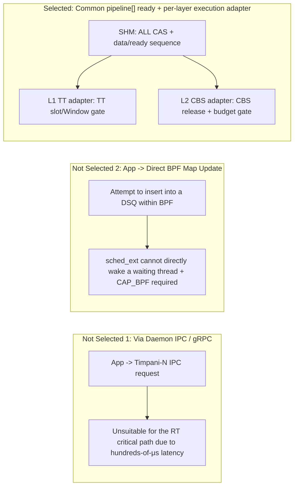

<!--
SPDX-FileCopyrightText: Copyright 2026 LG Electronics Inc.
SPDX-License-Identifier: MIT
-->

# DDR-009: Data-Driven Workload — Phase 0 Design Decision Record

**Date:** 2026-10-27
**Last Updated:** 2026-11-01
**Status:** Draft — Phase 0 design proposal, subject to Project Leader review
**Parent Baseline:** [REQ-009](REQ-009-data-driven-workload.md) §1.5, §7.1, §9, [SRS-009](SRS-009-data-driven-workload.md)
**Related Designs:** [HLD-009](HLD-009-data-driven-workload.md), [LLD-009](LLD-009-data-driven-workload.md), [DDR-011](DDR-011-runtime-table-update.md)

---

## 1. Decision Scope and Assumptions

This document targets the basic Phase 0 Data-Driven chain on a single node with a fixed `Epoch`/`Hyperperiod`. A Task's execution layer is retained as L1 TT or L2 CBS according to its input `TemporalClass`; it is not determined by its Source/Successor role in the DAG.

| Assumption | Relationship to This DDR |
|:---|:---|
| DAG role and execution layer are independent | `Source`/`Successor` are represented only as common DAG metadata. The TT/CBS scheduling representation is retained as is. |
| O exclusively generates; N does not recalculate | O performs both DAG validation and TT/CBS placement, while N only enforces the received representation and the common ready state. |
| RT path discipline | SHM atomic operations and per-layer adapters operate without allocation, blocking, or gRPC. |
| 011 stable SHM publication | The common Pipeline state is updated only in a stable generation, and a control wake is distinguished from Data-Ready. |

---

## 2. D-DD-P0-01 (Decision 9A) — Backward-Extended Region of `/timpani_ttsched` + `futex` and `scx_timpani` Reuse

- **Decision**:
  - The graph state and atomic consumption of `Data-Ready` are handled commonly in SHM.
  - Execution dispatch is delegated to the Task's layer. L1 uses the TT slot/Window, and L2 uses the CBS CPU/budget/Gap.
  - The header (`magic`, `n_tasks`, `generation`) and `tasks[TIMPANI_MAX_TASKS]` array (offset `0..783`) of the existing `struct timpani_ttsched_shm` are kept exactly as is, with no changes to size or offset. A Pipeline-specific `pipeline[TIMPANI_MAX_TASKS]` array is then appended after them.
  - A `pipeline[i].data_counter`, separate from `tasks[i].counter` used to trigger periodic slots, is also used as the `futex` word dedicated to the Successor Task's `Data-Ready`.
- **Rationale**:
  1. Going through daemon IPC/gRPC cannot satisfy the `5 μs`-or-less signal-processing requirement (`REQ-DD-P0-N-002`) because of context-switching and serialization latency.
  2. Linux `sched_ext` can schedule only threads that are already `Runnable`; it cannot directly wake a Successor thread that is `Sleeping` from within `kernel` BPF, and it would require granting the container `CAP_BPF` privileges.
  3. The common graph `pipeline[]` has ready/dispatch state independent of the TT `counter`.
  4. The execution layer comes from the Task input and is therefore independent of the DAG role.
- **Condition**: Approve the SHM fields and API before implementation (`CON-DD-05`).
- **Not Selected**: Daemon IPC, direct manipulation of BPF Maps by the application, and approaches that force the execution class from `Source/Successor`.
- **Traceability**: `REQ-DD-P0-F-006`, `F-007`, `N-001`, `N-002`, `N-004`; `OI-DD-02`.

---

## 3. D-DD-P0-02 (Decision 9B) — Predecessor-Completion Bitmask (`ready_mask`) + Atomic Reset with a Single `CAS` on Wakeup

- **Decision**:
  - Assign a bit to each immediate predecessor for every Successor Task. When a single `CAS` satisfies `ALL`, atomically perform `ready_mask=0` and increment `data_counter`.
  - `data_counter` is the logical ready state. The CBS adapter immediately connects the same ready state to `dispatch_counter` and performs a futex wake, while the TT adapter connects a pending ready state to `dispatch_counter` in an allowed slot. In either case, the adapters do not dispatch the same ready state twice.
- **Rationale**:
  - A simple countdown cannot distinguish repeated signals from the same predecessor.
  - A bitmask CAS finalizes `ALL` ready once, and separating ready from per-layer dispatch allows precise control of both premature L1 TT execution and L2 CBS execution.
  - The Phase 1/2 Window and SKIP state machines are not pre-implemented.
- **Not Selected**: Simple decrement of a remaining counter and intervention to reset state at a `Timer Master` period boundary in Phase 0.
- **Traceability**: `REQ-DD-P0-F-005`, `REQ-DD-P0-N-001`.

---

## 4. D-DD-P0-03 — Execution-Layer-Independent DAG and TT/CBS Execution Adapters

- **Decision**:
  - `predecessors` and `trigger_mode` represent only the Task's DAG role and the `ALL` condition; they do not determine L1/L2.
  - O generates a `TtSlot` or `CbsConfig` according to each Task's existing `TemporalClass`, while the common DAG metadata is linked to the Task hash and transmitted separately.
  - A Source may also be L1 TT or L2 CBS. An L1 Source starts with Timer Master, and an L2 Source starts with the existing Event release. Both may call `signal_ready` upon completion.
  - A Successor may also be L1 TT or L2 CBS. `ALL` creates an execution candidate in either layer.
    - **L1 adapter:** Even when a ready sequence exists, it does not dispatch before an allowed TT slot/Window opens. If ready is present in the slot, it consumes that ready state once.
    - **L2 adapter:** When a ready sequence is created, it performs a CBS release and follows the CPU, budget, and Gap gates.
  - N does not recalculate this path; it applies only the received metadata and the per-layer gates.
- **Rationale**: The core of Data-Driven is dependency ready, while the scheduling layer is already defined for each Task. An L1 successor's premature execution is prevented by the TT adapter, and the L2 successor reuses the CBS rules.
- **Not Selected**: Inferring the Task class from the presence or absence of `predecessors`, or forcing every Successor to either CBS or TT.
- **Phase 0 Test Precondition**: The L1 Successor satisfies `ALL` ready before its corresponding TT slot. Delay/SKIP policy for ready that misses a slot is deferred to Phase 1/2.
- **Traceability**: REQ-DD-001~009, 013; OI-DD-01, OI-DD-03.

---

## 5. D-DD-P0-04 — Compliance with the `DDR-011` Phase 0 Stable Publication (`magic`, Even `generation`) and Separation of the Control Wake

- **Decision**:
  - During SHM publication, populate `tasks[]` and `pipeline[]` and make them valid in the order `n_tasks → even generation → magic`. Publication itself does not increment `counter`, `data_counter`, or `dispatch_counter`.
  - Consumers (`ttsched_signal_ready`, `ttsched_wait_data`) verify `magic` and an even `generation` in acquire order, look up their own Task name (`tasks[idx].name`) and linkage information, and then recheck `generation`. If the generation is odd, the generation changes, or `magic` is invalid, they return `-1` without touching the shared state (unbounded busy-spin is prohibited).
  - `ttsched_wait_data()` returns `0` only after verifying a stable generation, its own identity, and an actual increase in `dispatch_counter`. This sequence increases only when the L1 TT slot/Window or L2 CBS release gate consumes the `data_counter` ready state.
- **Rationale**: Data-Ready publication must be separated from actual scheduler dispatch to prevent both premature L1 TT execution and false L2 CBS activation.
- **Traceability**: `REQ-DD-P0-F-006`, `REQ-DD-P0-N-004`, `OI-DD-02`.

---

## 6. D-DD-P0-05 — Retaining Per-Execution-Layer Placement Policy

- **Phase 0 Decision**: A DAG role does not force a CPU/slot. An L1 Task follows the existing TT slot placement, and an L2 Task follows the existing CBS admission/CPU placement. No separate placement is created for either L1 or L2 merely because it is a `Source/Successor`.
- **CBS Enhancement Possibility**: The existing CBS worst-fit policy may select a lightly loaded CPU, but this is a CBS placement policy, not a Data-Driven rule applied to all Successors.
- **Phase 1**: Include per-layer slot/Window/Gap, TT preemption, and CBS interference in the E2E analysis of a mixed DAG.
- **Phase 2**: Do not automatically migrate at runtime. CPU/slot changes are performed only when O applies a new table.
- **Traceability**: `REQ-DD-008`, `REQ-DD-009`, `AC-DD-P0-05`, `AC-DD-01`; `OI-DD-03`, `OI-DD-05`.

---

## 7. Deferrals and Design Review Gates

- **Phase 1**: `Activation Window`, Harmonic periods, `E2E` analysis for mixed L1/L2 DAGs, successful updates, and SHM version management.
- **Phase 2**: `SKIP`, root-cause `DATA_TIMEOUT`, Sink Fallback, and recovery-state initialization common across layers.
- **Phase 0 Review Gates**:
  1. Approve `OI-DD-01` / `OI-DD-02`.
  2. Represent Source/Successor and L1/L2 independently and connect them to the common SHM graph.
  3. Ensure that an L1 Successor complies with the TT gate and an L2 Successor complies with the CBS gate.
  4. Verify the minimum TT→TT, TT→CBS, CBS→TT, and CBS→CBS combinations.
  5. Verify O→N End-to-End operation and regression coverage for existing TT/CBS.
