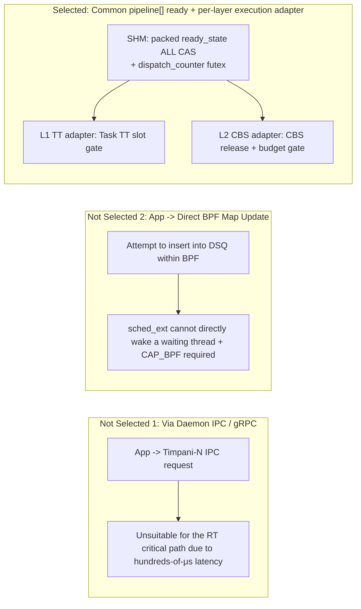

<!--
SPDX-FileCopyrightText: Copyright 2026 LG Electronics Inc.
SPDX-License-Identifier: MIT
-->

# DDR-009: Data-Driven Workload — Phase 0 Design Decision Record

**Date:** 2026-10-27
**Last Updated:** 2026-11-25 (Phase 0 PR review remediations)
**Status:** Draft — Phase 0 design proposal; review and approval pending.
The 008 field allocation `11/12/13` is aligned, but `OI-DD-01`/`02`/`03`
remain subject to Project Leader approval and verification; implementation is
not complete.
**Parent Baseline:** [REQ-009](REQ-009-data-driven-workload.md) §1.5, §7.1, §9, [SRS-009](SRS-009-data-driven-workload.md)
**Related Designs:** [HLD-009](HLD-009-data-driven-workload.md), [LLD-009](LLD-009-data-driven-workload.md), [DDR-011](DDR-011-runtime-table-update.md)

---

## 1. Decision Scope and Assumptions

This DDR targets the basic Phase 0 Data-Driven chain on a single node with a fixed `Epoch`/`Hyperperiod`. A Task's execution layer is retained as L1 TT or L2 CBS according to its input `TemporalClass`; it is not determined by its Source/Successor role in the DAG.

| Assumption | Relationship to This DDR |
|:---|:---|
| DAG role and execution layer are independent | `Source`/`Successor` are represented only as common DAG metadata. The TT/CBS scheduling representation is retained as is. |
| O exclusively generates; N does not recalculate | O performs both DAG validation and TT/CBS placement, while N only enforces the received representation and the common ready state. |
| RT path discipline | SHM atomic operations and per-layer adapters operate without allocation, blocking, or gRPC. |
| 011 stable SHM publication | The common Pipeline state is updated only in a stable generation, and a control wake is distinguished from Data-Ready. |

---

## 2. D-DD-P0-01 (Decision 9A) — Backward-Extended Region of `/timpani_ttsched` + `futex` and `scx_timpani` Reuse

- **Decision**:
  - The graph state and atomic consumption of `Data-Ready` are handled commonly in SHM.
  - Execution dispatch is delegated to the Task's layer. In Phase 0, L1 uses the Task's TT slot and L2 uses the CBS CPU/budget/Gap. Window is a Phase 1 extension.
  - Keep the existing `struct timpani_ttsched_shm` header (`magic`, `n_tasks`, `generation`) and `tasks[TIMPANI_MAX_TASKS]` array (offset `0..783`) at exactly the same size and offsets. Append a **40-byte `pipeline_header`** containing extension `magic`, ABI `version`, total `abi_size`, `publication_guard`, `instance_id`, `origin_epoch_ns`, and `hyperperiod_us`, followed by `pipeline[TIMPANI_MAX_TASKS]` (total `3,128`B).
  - Each Pipeline slot contains `(workload_id_hash, task_id_hash)` (for internal `Timpani-N` association and diagnostics), `ready_state`, `required_mask`, `dispatch_counter`, trigger/model, and outgoing edges. A Source updates the `ready_state` release-valid marker and activation ordinal with a single release-store; a Successor updates the high 32-bit ready sequence and low 16-bit predecessor mask with a single lock-free 64-bit CAS. Only `dispatch_counter` is a futex wait/wake word; the existing `tasks[i].counter` remains in use for TT-period wakes.
  - An L1 Source is stamped immediately before actual activation by `Timer Master`; an L2 CBS Source is stamped by an event adapter/test generator through `ttsched_release_source()`. Both record the Pipeline-period activation ordinal `k` in the high 32 bits and release-valid marker of that Source slot's `ready_state`. `ttsched_current_job_token(&token)` obtains this Source-local release snapshot with a read-only seqlock and does not derive the token from `origin_epoch_ns`/`hyperperiod_us` or the current wall clock. `origin_epoch_ns` and `hyperperiod_us` remain in the 40B header as schedule metadata validated and recorded by the publisher for diagnostics and Phase 1, but are not unnecessarily reloaded on the RT fast path.
- **Rationale**:
  1. A daemon IPC/gRPC route cannot satisfy the signal-processing requirement of `5 μs` or less (`REQ-DD-P0-N-002`) because of context switching and serialization latency.
  2. Linux `sched_ext` can schedule only threads already in the runnable state (`Runnable`); it cannot directly wake a waiting (`Sleeping`) Successor thread from inside `kernel` BPF and would require the container to have `CAP_BPF` privileges.
  3. The common graph `pipeline[]` has ready/dispatch state independent of the TT `counter`.
  4. The execution layer comes from the Task input, so it is independent of the DAG role.
- **Condition**: Before implementation, approve the extension ABI `magic/version/abi_size/instance_id/origin_epoch_ns/hyperperiod_us`; fixed-size object/replacement lifetime; retention of `void ttsched_init()`, `g_shm_init_errno`/full TLS reset, and non-RT `fstat()` verification; pre-/post-publication attach-cursor separation (`g_attached_before_publish`); RT no-VFS pure-atomic revalidation and 16-byte atomic name comparison (`atomic_name_equals`); completion of normal in-flight drain (`pipeline_commit_alive`); read-only seqlock (`wait_data`/`current_job_token`); 64-bit lock-free release-store on the Source (`Timer Master` and L2 `ttsched_release_source()`) and 64-bit lock-free CAS on the Successor; exact job-token verification and immediate `ESTALE` on generation mismatch; `dispatch_counter`-only futex; token-aware new APIs/`errno`; and the DAC/POSIX ACL permission contract (`CON-DD-05`).
- **Permission Boundary**: `O_RDWR` is permission to write the entire `/timpani_ttsched` object. Phase 0 `timpani-pub` is operated with an allowlist of mutually trusted cooperative writers, and untrusted Tasks use only an RO mapping. Isolation against arbitrary slot/header modification within the same writer group and integrity against malicious corruption are outside the guarantees of this ABI and are subjects for a separate capability/mediator design.
- **Not Selected**: Daemon IPC, direct BPF Map manipulation by the application, and forcing the execution class from `Source/Successor`.
- **Traceability**: `REQ-DD-P0-F-006`, `F-007`, `N-001`, `N-002`, `N-004`; `OI-DD-02`.

---

## 3. D-DD-P0-02 (Decision 9B) — Single-CAS Update of the Predecessor Bit and Ready Sequence in `ready_state`

- **Decision**:
  - Assign each direct predecessor of a Successor exactly one distinct bit. The complete incoming-edge OR-union equals that Successor's `required_mask`; the number of incoming edges equals `popcount(required_mask)`; and a zero mask has no incoming edge. O generates this encoding deterministically, and N rejects bit aliasing, a missing required bit, or an extra incoming bit before publication.
  - `signal_ready(job_token)` changes the destination only when `job_token == ready_sequence` and the corresponding predecessor bit is not set. A duplicate of the same predecessor bit while the token is active returns `EALREADY`; a stale/future token, including a token retried after the sequence has advanced, returns `ESTALE`; neither changes state.
  - Before the first destination CAS, a Source validates and preflights the entire outgoing-edge plan. It checks edge count, index, self/duplicate destination, required-bit membership, trigger mode, execution model, and token/duplicate state of each destination. Preflight failure produces no mutation anywhere in the fan-out. This guarantee is pre-first-CAS validation atomicity, not a transaction that rolls back a process crash between multiple destination CAS operations. Because one Source cannot prove the global union that includes other predecessors, runtime preflight relies on the global bijection check performed at publication. If an identical concurrent call completes the bit/sequence first during CAS retry, it is treated as converged completion rather than a late failure.
  - If the Source process terminates after the first destination CAS, only part of the destination bits can remain. Phase 0 does not recover this as success; it records the chain run as failed or as a test-assumption departure. A commit marker, idempotent retry, and quarantine during a crash are determined by the Phase 2 recovery contract.
  - The `ALL` CAS is a single lock-free 64-bit CAS on `ready_state` that clears the predecessor mask and increments the active token/ready sequence by one. Token and bit checks are repeated after every CAS failure. After all outgoing-edge CAS operations, the CBS `dispatch_counter` update/futex wake is performed, and these operations are serialized against publication-generation transitions by the publication guard.
  - `ttsched_init()` distinguishes the initial attach cursor according to SHM state at the call. On a normal startup path where SHM is not yet published (`magic != TIMP`, or an odd/zero `generation`) or the slot is absent, it records `g_attached_before_publish = 1` and starts at cursor `0` upon entry into the first valid generation, preserving token `0` (consistent with the actual `Timpani-N` `/proc` prerequisite discovery startup order). In contrast, when attaching to an already stably published SHM at `cur = N > 0`, it snapshots `g_last_dispatch_counter = N` so that tokens `0..N-1` are not replayed. `ttsched_wait_data()` does not jump to `current - 1U`; it **consumes sequentially in FIFO order after the attach cursor (`token = g_last_dispatch_counter++`)**. After reading the token-addressed payload, the Consumer forwards the same token to the next stage. The CBS adapter increments `dispatch_counter` inside the same guard, and the TT adapter increments it only when `Timer Master` finds pending ready in an allowed slot. The same token is not dispatched twice.
- **Rationale**:
  - A mask alone has no cycle identity. Repeated OR of the predecessor bit can retain cycle `N` while a different predecessor later supplies cycle `N+1`, creating `ALL` from mixed payloads.
  - Exact token matching and duplicate-bit rejection distinguish logical instances without adding an SHM field. Including mask reset and sequence increment in one CAS prevents observation of an intermediate state. `dispatch_counter` is the sole wake word, so a ready-only L1 Task is not awakened before its TT slot.
  - Generation verification followed only by CAS cannot prevent a publication/consumption TOCTOU; the guard serializes the complete commit.
  - If mutation occurs as soon as an edge is validated, an invalid later edge leaves partial notification at an earlier Successor. Complete plan prevalidation and deferred wake prevent partial fan-out **caused by a validation/preflight failure**, while per-edge CAS continues to handle concurrent predecessor updates. This does not imply process-crash atomicity.
  - The Phase 1/2 Window and `SKIP` state machines are not implemented in advance.
- **Not Selected**: A design that validates and mutates one edge at a time, tokenless OR of predecessor bits, bit aliasing among incoming predecessors, a required-mask bit without a corresponding incoming edge, simple decrement of a remaining counter, and intervention to reset state at a `Timer Master` period boundary in Phase 0.
- **Traceability**: `REQ-DD-P0-F-005`, `REQ-DD-P0-N-001`.

---

## 4. D-DD-P0-03 — Execution-Layer-Independent DAG and TT/CBS Execution Adapters

- **Decision**:
  - `SchedInfo.temporal_class` remains the workload default. `TaskInfo.temporal_class` is `optional`: an explicit Task value is used when present, and only an absent value inherits the workload default. Therefore explicit `TEMPORAL_PERIODIC = 0` selects L1. This presence-sensitive rule supersedes the 008 P2 placeholder `0 = inherit`; adopting that semantic change is part of `CON-DD-05` approval. The DAG role does not imply a class. A workload groups lifecycle/default classification, and a Task override is the 009 extension that determines each Task's TT/CBS execution layer.
  - A predecessor is transmitted as `TaskReference(workload_id, task_id)`. An empty `workload_id` means the current workload, and Phase 0 permits only references within the same workload. `predecessors` and `trigger_mode=ALL` do not determine the execution layer.
  - O creates the existing `TtSlot` or `CbsConfig` according to the resolved class. Common DAG metadata is separated from the execution representation and transmitted O→N as the `PipelineTaskKey(workload_id_hash, task_id_hash)` pair. The existing `ExecutionModel.DATA_FLOW = 2` in `node_control.proto` remains in the enum to preserve wire compatibility, but Phase 0 fixes its use to unused (O does not publish it; N rejects it with `EINVAL` on reception).
  - A Source may be either L1 TT or L2 CBS. At `start()`, `Timer Master` for an L1 Source fixes a single `base_cycle_start` shared by all CPU threads and stamps the Pipeline-period activation ordinal `k` (`0, 1, 2, ...`, `+1` at each slot fire) before performing the existing `tasks[i].counter` wake. For an L2 CBS Source, without adding an L2 release daemon/IPC to `Timpani-N`, an event adapter/test generator with `O_RDWR` (`timpani-pub`) permission calls `ttsched_release_source(task_name, k)` (with mandatory validation that `execution_model == TIMPANI_EXEC_CBS`), stamps `k`, and then wakes the Task through the existing event path. Both Sources fix the stamped `k` with `ttsched_current_job_token(&token)` immediately after activation and call the same `ttsched_signal_ready(k)` API on completion.
  - `origin_epoch_ns` and `hyperperiod_us` are schedule/diagnostic metadata validated before publication and are not the source from which `job_token` is derived. The Source token authority is `Timer Master` for L1 and the caller of `ttsched_release_source()` for L2.
  - In a lightweight `tm_pipeline_commit_enter()` commit, the L1 Timer Master release-stores the Source release stamp with `make_source_release_state(k)`, increments `tasks[i].counter`, and performs the futex wake; it releases with `pipeline_commit_exit()`. If the release fails, it performs no wake.
  - The payload is application-owned. The Producer calls `signal_ready(k)` only after completely publishing the token-addressed payload, and the ready/CAS and dispatch release-acquire ordering becomes that payload's visibility edge. The Producer does not reuse a slot until its direct Successor completes processing the same token. 009 does not define the payload location, structure, or acknowledgment API, and does not verify its contents.
  - A Successor's `ALL` creates only a ready sequence. The actual dispatch gate is opened by the layer-specific adapter.
    - **L1 TT adapter:** At the Task's TT slot time, `Timer Master` first updates `next_tt_start` and then uses the internal lightweight guard (`tm_pipeline_commit_enter`) to check `counter_ahead(ready_sequence, dispatch_counter)`. Only when `pending ready` is true does it perform `update_current_slot(cpu, slot_idx)` → increment `dispatch_counter` by 1 (`__ATOMIC_RELEASE`) → `FUTEX_WAKE(&dispatch_counter, 1)` → `pipeline_commit_exit()` (the kernel dispatches the awakened Task in the existing `timpani.bpf.c` `ops.enqueue()` through `SCX_DSQ_LOCAL_ON | acpu` and `scx_bpf_kick_cpu(acpu, SCX_KICK_PREEMPT)`). If `pending ready` is false, it omits all of `update_current_slot()`, the `dispatch_counter` increment, and `FUTEX_WAKE`, and does not actively overwrite `SLOT_NONE` (there is no transition to Runnable or kernel enqueue/kick, and the `deadline_us` lookup in `ops.stopping()` for the previous overrun-slot Task is preserved). Do not wake before the slot or use a normal Source's `tasks[i].counter` for a Successor.
    - **L2 CBS adapter:** After the Source call completes all outgoing-edge CAS operations, increment the `ALL` destination's `dispatch_counter` by 1 and wake the futex. Actual CPU dispatch is decided by the existing `scx_timpani` CBS DSQ, budget, and Gap gate after the awakened Task becomes Runnable.
  - N does not recalculate the DAG or schedulability and applies only the received metadata and per-layer gates. No Data-Ready dependency calculation or separate Data-Driven DSQ is added to BPF.
- **Rationale**: Separating ready from execution permission prevents early L1 wake while reusing the existing CBS admission, budget, and Gap path for L2. `Timer Master` owns the TT slot and BPF owns execution of a Runnable CBS Task, so responsibility does not overlap.
- **Not Selected**: Inferring a Task class from the presence of `predecessors`, forcing every Successor into either CBS or TT, waking an L1 Successor early with `tasks[i].counter`, or creating a separate Data-Driven DSQ for an L2 Successor.
- **Phase 0 Test Precondition**: A normal test has the L1 Successor's `ALL` ready satisfied once before its TT slot. If there is no ready at the slot, there are `0` wakes; ready that arrives after the slot remains pending until the next TT slot. A backlog of two or more pending items is not a normal Phase 0 acceptance condition. Cross-workload references, `Activation Window`, missed-slot expiry, and `SKIP` are deferred to Phase 1/2.
- **Traceability**: `REQ-DD-P0-F-001`..`F-004`, `F-007`, `N-003` (parents `REQ-DD-001`..`009`, `013`); `OI-DD-01`, `OI-DD-03` *(Phase 1 deferral: `OI-DD-05`)*.

---

## 5. D-DD-P0-04 — Compliance with `DDR-011` Phase 0 Stable Publication (`magic`, Even `generation`) and Separation of the Control Wake

- **Decision**:
  - The Pipeline client retains the existing `void ttsched_init(void)` signature but uses `g_shm_init_errno` and full TLS bulk reset to guarantee the error cause (`EINVAL` versus `ENOTSUP`) and prevent double-`munmap`. On the non-RT initialization path it checks SHM object size once with `fstat()`, sets `g_shm_map_size` and `g_shm_pipeline_capable`, and closes the SHM fd immediately after `mmap()` (thread-termination `pthread_key` destructor performs `munmap`). On the RT critical paths (`release_source`, `signal_ready`, `wait_data`, `current_job_token`, and `Timer Master`), it does not call `shm_open`/`fstat`/`close`; it verifies ABI, generation, identity, and replacement/invalidation only with pure userspace atomic loads (`g_shm_pipeline_capable`; `WRITER_PENDING` in `publication_guard`; `shm->magic`; even `generation`; `pipeline_header.{magic, abi_version, abi_size, instance_id}`) and a 16-byte atomic name comparison (`atomic_name_equals`, with publisher `atomic_name_store`). Once first bound to a valid generation (`g_shm_generation == 0U`), all four Pipeline APIs (`release_source`, `current_job_token`, `wait_data`, and `signal_ready`) immediately return `ESTALE` rather than implicitly adopting a new generation if `gen != g_shm_generation` is observed. The publisher holds each live object at the full ABI size (`3,128`B, no-shrink). Replacement/shutdown is performed by retaining `WRITER_PENDING`, draining active commits, invalidating `magic=0`/`pipeline_header.magic=0`, performing `FUTEX_WAKE(..., INT_MAX)` on all `tasks[i].counter` and `pipeline[i].dispatch_counter`, calling `shm_unlink()` without truncation/in-place overwrite, and creating a new `instance_id` object with `O_CREAT|O_EXCL`.
  - The publisher sets the `WRITER_PENDING` bit in `pipeline_header.publication_guard` to prevent new write commits and waits only for the bounded time `effective_pub_drain_timeout_us(H) = min(5 ms, H/4)` (maximum `2` consecutive deferrals) for active commits to reach `0`; for shutdown/replacement, it waits `TIMPANI_PUB_SHUTDOWN_DRAIN_MS = 50 ms`. If `50 ms` is exceeded, it force-invalidates through **Safe Abandonment** (warning log for the remaining count → retain `WRITER_PENDING` and set `magic=0`/`pipeline_header.magic=0` → `FUTEX_WAKE(..., INT_MAX)` on `tasks[]`/`pipeline[]` → prohibit `ftruncate`/overwrite → `shm_unlink`). During normal publication, `pipeline_header` is written by field-wise release-store so that `publication_guard` is not overwritten, in the order `magic=0 → pipeline_header.magic=0 → odd generation → content update (atomic_name_store for names) → field-wise pipeline_header release-stores (abi/instance_id/origin_epoch_ns/hyperperiod_us/magic) → even generation → shm->magic=valid → release WRITER_PENDING`.
  - For an in-flight writer already included in `active_count` after acquiring `publication_guard`, the revalidation before each CAS/wake uses `pipeline_commit_alive()`, which excludes `WRITER_PENDING` and checks only `shm->magic`, `pipeline_header.magic`, `generation`, and `instance_id`. Thus, while normal drain (`WRITER_PENDING=1`) is in progress, a writer that has already entered can complete the in-progress commit and `dispatch_counter++`/wake, then end drain normally with `pipeline_commit_exit()`, leaving neither Lost Wakeup nor partial fan-out.
  - Safe Abandonment is not fencing that forcibly cancels an active writer. A writer that entered the old SHM may resume after timeout; it therefore rechecks `magic=0`, generation, and `instance_id` through `pipeline_commit_alive()` immediately before each CAS/wake. A race immediately after the final check may still leave a late CAS/wake on the old object. `magic=0` + `unlink` + creation of a new-`instance_id` object isolates that late operation from the active generation, and an old-mapping Consumer stops with `ESTALE` when it revalidates stable state after the wake. A Job already executing after receiving a token before invalidation is not cancelled. Writer-count leakage that occurs continuously without publisher shutdown/replacement is not an automatic Safe Abandonment trigger; it belongs to Phase 2 recovery.
  - Write paths (`release_source`, `signal_ready`, and the `Timer Master` lightweight guard `tm_pipeline_commit_enter`) acquire `publication_guard`, revalidate the generation, and then complete the Source release-store or Successor packed `ready_state` CAS and any required `dispatch_counter` update/futex wake. Every failure-rollback path shall also be unified through `pipeline_commit_exit()` to prevent Lost Wakeup. Pure read Consumer APIs (`ttsched_wait_data()` and `ttsched_current_job_token()`), in contrast, use a **read-only seqlock** that does not write to `publication_guard`, allowing operation without `SIGSEGV` or a guard leak on `O_RDONLY` (`PROT_READ`) mappings.
  - `ttsched_wait_data()` uses only `dispatch_counter` as the futex wait/wake word and returns `0` and the corresponding job token for an actual sequential FIFO increment. It then re-enters snapshot/generation verification at the loop head on return from `FUTEX_WAIT` without an immediate failure classification: a control wake accompanying publication, shutdown, or generation change stops with `ESTALE`, while a Linux `futex(2)` spurious wakeup with no generation or validity change safely waits again with `0` executions.
  - **Phase 0:** Apply the guard and read-only seqlock to initial publication, invalidation/shutdown, and serialization of a fixed Pipeline commit, but do not perform normal runtime updates of tables containing a Pipeline. **Phase 1:** Use the same guard for normal-update boundaries and ABI transitions with `min(5 ms, H/4)` drain and a maximum of `2` deferrals. **Phase 2:** Add reclamation rules for state remaining after update failure, rollback, or process restart.
- **Rationale**: Calling `shm_open`/`fstat`/`close` on every RT critical-path invocation would destroy the `signal_ready <= 5 µs` and L1 TT timer-jitter requirements through VFS/inode lock contention. Combining the `live-object fixed size / no-shrink` ownership contract and the `magic=0`/`WRITER_PENDING`/`instance_id` invalidation contract allows replacement and shutdown to be detected safely using only one non-RT `ttsched_init()` `fstat()` and pure atomic loads on the RT path. Separating `wait_data()` into a read-only seqlock also prevents both `SIGSEGV` for an `O_RDONLY` Successor and a permanent guard leak if a Consumer crashes.
- **Traceability**: `REQ-DD-P0-F-005`, `REQ-DD-P0-F-006`, `REQ-DD-P0-N-004`, `OI-DD-02`.

---

## 6. D-DD-P0-05 — Retaining Per-Execution-Layer Placement Policy

- **Phase 0 Decision**: A DAG role does not force a CPU/slot. An L1 Task follows the existing TT slot placement, and an L2 Task follows the existing CBS admission/CPU placement. No separate layer or CPU rule is created for either L1 or L2 merely because the Task is a `Source/Successor`. However, for Phase 0 `L1 → L1` slot placement, apply the sort key `(topo_rank, deadline_us, workload_id, task_id)` and `min_start` based on predecessor completion time so that predecessor completion within the same period (`ASM-DD-03`) is not broken (non-DAG Tasks use `topo_rank == 0`, preserving the existing DM ordering). For a CBS-only Pipeline, guarantee `hyperperiod_us > 0` using the LCM of the CBS periods.
- **CBS Enhancement Possibility**: The existing CBS worst-fit policy may choose a lightly loaded CPU, but this is a CBS placement policy, not a Data-Driven rule applied to all Successors.
- **Phase 1**: Include per-layer slot/Window/Gap, TT preemption, and CBS interference in E2E analysis of a mixed DAG.
- **Phase 2**: Do not automatically migrate during execution. CPU/slot changes are made only when O applies a new table.
- **Traceability**: `REQ-DD-P0-F-002`, `F-007`, `N-003` (parents `REQ-DD-008`, `REQ-DD-009`), `AC-DD-P0-05`; `OI-DD-03` *(Phase 1 deferral: `AC-DD-01`, `OI-DD-05`)*.

---

## 7. Deferrals and Design Review Gates

- **Phase 1**: `Activation Window`, Harmonic periods, `E2E` analysis for mixed L1/L2 DAGs, normal updates, and SHM version management.
- **Phase 2**: `SKIP`, root-cause `DATA_TIMEOUT`, Sink Fallback, and initialization of recovery state common across layers.
- **Phase 0 Review Gates**:
  1. Obtain Project Leader approval for `OI-DD-01` (008 field allocation
     `11/12/13` aligned, including the field-12 semantic change), and pass the
     conditional-verification tests for `OI-DD-02`/`OI-DD-03`.
  2. Represent Source/Successor and L1/L2 independently and connect them to the common SHM graph.
  3. Ensure that an L1 Successor obeys the TT gate and an L2 Successor obeys the CBS gate.
  4. Verify the minimum TT→TT, TT→CBS, CBS→TT, and CBS→CBS combinations.
  5. Verify that duplicate, stale, and future token rejection leaves ready/dispatch state unchanged and produces `0` mixed-cycle executions.
  6. Verify O→N End-to-End operation and existing TT/CBS regressions.
