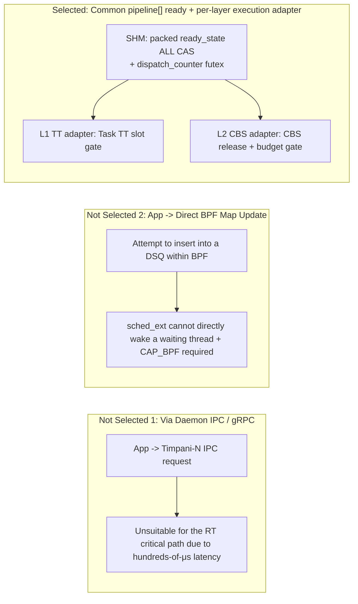

<!--
SPDX-FileCopyrightText: Copyright 2026 LG Electronics Inc.
SPDX-License-Identifier: MIT
-->

# DDR-009: Data-Driven Workload — Phase 0 Design Decision Record

**Date:** 2026-10-27
**Last Updated:** 2026-11-01
**Status:** Draft — Phase 0 design proposal, subject to Project Leader review
**Parent Baseline:** [REQ-009](REQ-009-data-driven-workload.md) §1.5, §7.1, §9, [SRS-009](SRS-009-data-driven-workload.md)
**Related Designs:** [HLD-009](HLD-009-data-driven-workload.md), [LLD-009](LLD-009-data-driven-workload.md), [DDR-011](DDR-011-runtime-table-update.md)

---

## 1. Decision Scope and Assumptions

This document targets the basic Phase 0 Data-Driven chain on a single node with a fixed `Epoch`/`Hyperperiod`. A Task's execution layer is retained as L1 TT or L2 CBS according to its input `TemporalClass`; it is not determined by its Source/Successor role in the DAG.

| Assumption | Relationship to This DDR |
|:---|:---|
| DAG role and execution layer are independent | `Source`/`Successor` are represented only as common DAG metadata. The TT/CBS scheduling representation is retained as is. |
| O exclusively generates; N does not recalculate | O performs both DAG validation and TT/CBS placement, while N only enforces the received representation and the common ready state. |
| RT path discipline | SHM atomic operations and per-layer adapters operate without allocation, blocking, or gRPC. |
| 011 stable SHM publication | The common Pipeline state is updated only in a stable generation, and a control wake is distinguished from Data-Ready. |

---

## 2. D-DD-P0-01 (Decision 9A) — Backward-Extended Region of `/timpani_ttsched` + `futex` and `scx_timpani` Reuse

- **Decision**:
  - The graph state and atomic consumption of `Data-Ready` are handled commonly in SHM.
  - Execution dispatch is delegated to the Task's layer. Phase 0 L1 uses the Task's TT slot, and L2 uses the CBS CPU/budget/Gap. Window is a Phase 1 extension.
  - Keep the existing header (`magic`, `n_tasks`, `generation`) and `tasks[TIMPANI_MAX_TASKS]` array (offset `0..783`) at exactly the same size and offsets. Append a 16-byte `pipeline_header` containing extension `magic`, ABI `version`, total `abi_size`, and `publication_guard`, followed by `pipeline[TIMPANI_MAX_TASKS]`.
  - Each Pipeline slot contains `(workload_id_hash, task_id_hash)`, `ready_state`, `required_mask`, `dispatch_counter`, trigger/model, and outgoing edges. `ready_state` packs the high 32-bit ready sequence and low 16-bit predecessor mask into one lock-free 64-bit CAS. `dispatch_counter` is the sole Data-Driven futex word; the existing `tasks[i].counter` remains the TT periodic wake word.
- **Rationale**:
  1. Going through daemon IPC/gRPC cannot satisfy the `5 μs`-or-less signal-processing requirement (`REQ-DD-P0-N-002`) because of context-switching and serialization latency.
  2. Linux `sched_ext` can schedule only threads that are already `Runnable`; it cannot directly wake a Successor thread that is `Sleeping` from within `kernel` BPF, and it would require granting the container `CAP_BPF` privileges.
  3. The common graph `pipeline[]` has ready/dispatch state independent of the TT `counter`.
  4. The execution layer comes from the Task input and is therefore independent of the DAG role.
- **Condition**: Before implementation, approve extension `magic/version/abi_size`, actual SHM-size validation, lock-free 64-bit `ready_state` CAS, dispatch-only futex, the new API/`errno` contract, and O_RDWR/O_RDONLY permission fallback (`CON-DD-05`).
- **Not Selected**: Daemon IPC, direct manipulation of BPF Maps by the application, and approaches that force the execution class from `Source/Successor`.
- **Traceability**: `REQ-DD-P0-F-006`, `F-007`, `N-001`, `N-002`, `N-004`; `OI-DD-02`.

---

## 3. D-DD-P0-02 (Decision 9B) — Single-CAS Update of the Predecessor Mask and Ready Sequence in `ready_state`

- **Decision**:
  - Assign a bit to each immediate predecessor for every Successor. The `ALL` operation is one lock-free 64-bit CAS on `ready_state` that resets the predecessor mask and increments the ready sequence. The CAS, `dispatch_counter` update, and futex wake are serialized with publication through the commit guard.
  - The ready sequence represents logical readiness. The CBS adapter increments `dispatch_counter` and performs a futex wake inside the guard. The TT adapter increments `dispatch_counter` only in an allowed slot when a pending ready sequence exists. Neither adapter dispatches the same sequence twice.
- **Rationale**:
  - A simple countdown cannot distinguish repeated signals from the same predecessor.
  - Packing mask reset and sequence increment into one CAS removes an observable intermediate state. `dispatch_counter` as the sole wake word prevents a ready-only L1 Task from being awakened before its TT slot.
  - Generation validation plus CAS alone cannot close the publication/consumer TOCTOU; the guard serializes the complete commit.
  - The Phase 1/2 Window and SKIP state machines are not pre-implemented.
- **Not Selected**: Simple decrement of a remaining counter and intervention to reset state at a `Timer Master` period boundary in Phase 0.
- **Traceability**: `REQ-DD-P0-F-005`, `REQ-DD-P0-N-001`.

---

## 4. D-DD-P0-03 — Execution-Layer-Independent DAG and TT/CBS Execution Adapters

- **Decision**:
  - `SchedInfo.temporal_class` remains the workload default. `TaskInfo.temporal_class` is `optional`: an explicit Task value wins, and an absent value inherits the workload default. The DAG role does not determine the class. A workload remains the lifecycle/default-class grouping, while the Task override is the 009 extension that determines that Task's TT/CBS layer.
  - A predecessor is `TaskReference(workload_id, task_id)`. An empty `workload_id` means the current workload, and Phase 0 allows only same-workload references. `predecessors` and `trigger_mode=ALL` do not determine the execution layer.
  - O generates the existing `TtSlot` or `CbsConfig` from the resolved class, and transmits common DAG metadata separately with a `PipelineTaskKey(workload_id_hash, task_id_hash)`.
  - A Source may be L1 TT or L2 CBS. An L1 Source retains the existing `tasks[i].counter` Timer Master wake, while an L2 Source retains the existing Event release. Both may call `signal_ready` on completion.
  - A Successor may be L1 TT or L2 CBS. `ALL` creates only a ready sequence; the execution gate remains layer-specific.
    - **L1 TT adapter:** Timer Master checks `counter_ahead(ready_sequence, dispatch_counter)` only at that Task's TT slot. If ready is pending, it increments `dispatch_counter` by 1 and wakes the futex. It never wakes before the slot or uses the Source `tasks[i].counter` path for a Pipeline Successor.
    - **L2 CBS adapter:** The `ALL` commit increments `dispatch_counter` by 1 and wakes the futex. After the Task becomes Runnable, the existing `scx_timpani` CBS DSQ, budget, and Gap gates decide actual CPU execution.
  - N does not recalculate DAG or schedulability. It applies only the received metadata and per-layer gates, without a separate Data-Driven BPF DSQ.
- **Rationale**: Separating ready from execution prevents early L1 wake while reusing the existing CBS admission, budget, and Gap logic. Timer Master owns the TT slot, and BPF owns Runnable CBS execution, so their responsibilities do not overlap.
- **Not Selected**: Inferring class from DAG role, forcing every Successor to one class, using `tasks[i].counter` to wake L1 Successors early, or adding a separate Data-Driven BPF DSQ for L2.
- **Phase 0 Test Precondition**: Normal testing satisfies `ALL` once before the relevant L1 slot. If no ready exists at that slot, no wake occurs; a late ready remains pending until the next TT slot. More than one pending ready by modulo-sequence comparison is a missed-slot/backlog precondition violation rather than a Phase 0 normal case. `Activation Window`, expiration, and `SKIP` remain Phase 1/2.
- **Traceability**: REQ-DD-001~009, 013; OI-DD-01, OI-DD-03, OI-DD-05.

---

## 5. D-DD-P0-04 — Compliance with the `DDR-011` Phase 0 Stable Publication (`magic`, Even `generation`) and Separation of the Control Wake

- **Decision**:
  - A Pipeline client accesses extension state only after checking its actual object size and `pipeline_header.magic/version/abi_size`. The publisher sets writer-pending in `pipeline_header.publication_guard`, waits for active commits to reach `0`, and then updates `tasks[]`, the extension header, and `pipeline[]`. Validation follows `magic=0 → odd generation → content update → even generation → valid extension/base magic → writer-pending release`; publication itself does not increment ready or dispatch counters.
  - Consumers and the L1 Timer Master verify the stable ABI/generation and acquire the guard before mutation. `signal_ready` completes the packed `ready_state` CAS and any `dispatch_counter` increment/futex wake before releasing the guard. ABI, generation, identity, or writer-pending failures return `-1` with `errno` and do not mutate state.
  - `ttsched_wait_data()` uses only `dispatch_counter` as its futex word and returns `0` only for an actual increase. Publication/shutdown control wake does not increment it and therefore returns `ESTALE`.
  - **Phase 0:** Apply the guard to initial publication, invalidation/shutdown, and fixed-Pipeline commits, but do not perform normal runtime updates of Pipeline-containing tables. **Phase 1:** Use the same guard at normal update and ABI-transition boundaries. **Phase 2:** Add reclamation rules after update failure, rollback, and process restart.
- **Rationale**: Without version/size checks, a backward extension may access beyond a legacy SHM object. Without guard serialization, generation validation cannot close the CAS TOCTOU. The versioned extension and complete-commit guard address both ABI and concurrency failure modes.
- **Traceability**: `REQ-DD-P0-F-005`, `REQ-DD-P0-F-006`, `REQ-DD-P0-N-004`, `OI-DD-02`.

---

## 6. D-DD-P0-05 — Retaining Per-Execution-Layer Placement Policy

- **Phase 0 Decision**: A DAG role does not force a CPU/slot. An L1 Task follows the existing TT slot placement, and an L2 Task follows the existing CBS admission/CPU placement. No separate placement is created for either L1 or L2 merely because it is a `Source/Successor`.
- **CBS Enhancement Possibility**: The existing CBS worst-fit policy may select a lightly loaded CPU, but this is a CBS placement policy, not a Data-Driven rule applied to all Successors.
- **Phase 1**: Include per-layer slot/Window/Gap, TT preemption, and CBS interference in the E2E analysis of a mixed DAG.
- **Phase 2**: Do not automatically migrate at runtime. CPU/slot changes are performed only when O applies a new table.
- **Traceability**: `REQ-DD-008`, `REQ-DD-009`, `AC-DD-P0-05`, `AC-DD-01`; `OI-DD-03`, `OI-DD-05`.

---

## 7. Deferrals and Design Review Gates

- **Phase 1**: `Activation Window`, Harmonic periods, `E2E` analysis for mixed L1/L2 DAGs, successful updates, and SHM version management.
- **Phase 2**: `SKIP`, root-cause `DATA_TIMEOUT`, Sink Fallback, and recovery-state initialization common across layers.
- **Phase 0 Review Gates**:
  1. Approve `OI-DD-01` / `OI-DD-02`.
  2. Represent Source/Successor and L1/L2 independently and connect them to the common SHM graph.
  3. Ensure that an L1 Successor complies with the TT gate and an L2 Successor complies with the CBS gate.
  4. Verify the minimum TT→TT, TT→CBS, CBS→TT, and CBS→CBS combinations.
  5. Verify O→N End-to-End operation and regression coverage for existing TT/CBS.
