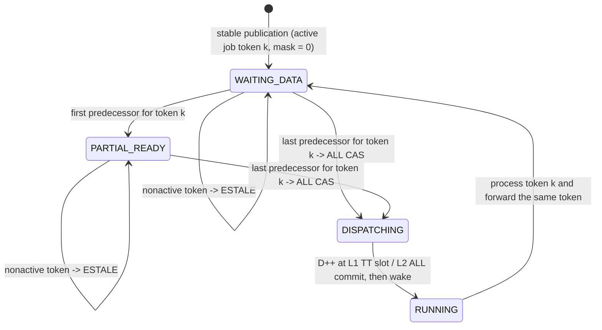
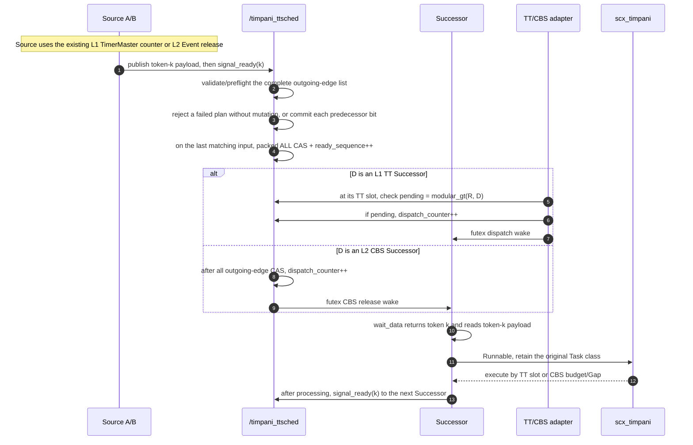

```mermaid
flowchart LR
    subgraph ControlPlane["Control Plane (non-RT)"]
        IN["Pullpiri / Test Input<br/>(Pipeline DAG declaration)"]
        TO["Timpani-O<br/>(DAG validation + existing TT/CBS placement for each Task)"]
    end

    subgraph NodeUserspace["Timpani-N & Workload (userspace)"]
        TN_PREP["Timpani-N non-RT preparation<br/>(common DAG verification · TT/CBS representation registration · SHM publication)"]
        TM["Timer Master<br/>(L1 TT slot adapter)"]
        SHM[("/timpani_ttsched SHM<br/>(tasks[] + versioned pipeline header + pipeline[])")]
        TASKS["Pipeline Tasks<br/>(L1 TT or L2 CBS)"]
    end

    subgraph KernelSpace["Linux Kernel (sched_ext)"]
        BPF["scx_timpani<br/>(TT adapter + CBS adapter)"]
    end

    IN -->|"schedinfo.proto"| TO
    TO -->|"node_control.proto (full_table)"| TN_PREP
    TN_PREP --> TM
    TN_PREP -->|"TT/CBS BPF Maps"| BPF
    TN_PREP -->|"stable generation publication"| SHM
    TM -->|"L1 dispatch gate"| SHM
    SHM -->|"ALL ready / dispatch wake"| TASKS
    TASKS -->|"pipeline[] CAS + signal_ready"| SHM
    TASKS -->|"Runnable: preserve Task class"| BPF
    BPF -->|"dispatch in TT slot or CBS Gap"| TASKS
```

<!--
SPDX-FileCopyrightText: Copyright 2026 LG Electronics Inc.
SPDX-License-Identifier: MIT
-->

# HLD-009: Data-Driven Workload — Phase 0 High-Level Architecture Design

**Date:** 2026-10-27
**Last Updated:** 2026-11-01
**Status:** Draft — Phase 0 design proposal (not a declaration that the current implementation is compliant)
**Parent Baseline:** [REQ-009](REQ-009-data-driven-workload.md) §1.5, §7.1, §8.2, [SRS-009](SRS-009-data-driven-workload.md)
**Decisions / Details:** [DDR-009](DDR-009-data-driven-workload.md), [LLD-009](LLD-009-data-driven-workload.md), [DDR-011](DDR-011-runtime-table-update.md)

---

## 1. Scope and Architecture

This document defines the flow of a **Data-Driven DAG that is independent of a Task's existing L1 TT/L2 CBS layer** on a single node with a fixed `Epoch`/`Hyperperiod`, under basic chain conditions. A Source/Successor role does not determine the execution layer. Precise per-layer Window/Gap control, multiple periods, updates, and `SKIP` are deferred to subsequent phases.

---

## 2. Component Responsibility Separation (RT / Non-RT and O / N Boundaries)

| Component | Phase 0 Responsibility | Does Not Do |
|:---|:---|:---|
| **Input / Test Harness** | Submit a same-period (`100ms`) DAG through the `Timpani-O` input path, collect timestamp and overhead evidence, and abort the test when prerequisites are violated. | Inject a table/graph directly into `Timpani-N` or SHM and treat that as End-to-End success, or guarantee product Fail-Safe behavior instead of the product. |
| **`Timpani-O`** | Independently validate the DAG and the Task's existing `TemporalClass`, and generate the TT/CBS representation and common DAG metadata. | Force an execution layer from the DAG role or delegate placement decisions to N. |
| **`Timpani-N` Non-RT** | Locally verify and publish the layer-specific entries and common `pipeline[]`. | Recalculate DAG/TT/CBS feasibility. |
| **`Timer Master`** | Open the dispatch adapter when Data-Driven ready exists in an allowed slot for an L1 Task. | Handle L2 release or execute an L1 Task when no ready state exists. |
| **`libttsched` / App** | Perform class-independent `ALL` CAS/ready sequence updates and identity verification. | Deliver payloads, execute a control wake, or change the execution layer. |
| **`scx_timpani`** | After the wake makes a Task Runnable, dispatch L1 in its TT slot and L2 through the existing CBS budget/Gap paths. | Create a separate Data-Driven scheduling layer. |
| **`Fault Monitor`** | Retain the existing system-monitoring safety mechanisms. | Collect and report the new Phase 0 `DATA_TIMEOUT` (deferred to Phase 2). |

Common DAG metadata transmission, the appended SHM `pipeline[]`, and new APIs are incorporated after prior approval. The existing TT/CBS entries and timing policies are retained for each Task.

---

## 3. High-Level Design Areas (H-DD-P0-01 ~ H-DD-P0-04)

### 3.1 H-DD-P0-01 — Offline Candidate Validation and Deterministic Topological Placement (`Timpani-O`)

O prefers an explicit `TaskInfo.temporal_class` and otherwise inherits `SchedInfo.temporal_class` to determine each Task's resolved layer. It normalizes `TaskReference(workload_id, task_id)` values within the current workload, validates the DAG, and creates common dependency metadata keyed by `(workload_id_hash, task_id_hash)`. Each Task retains the existing `TtSlot` or `CbsConfig` representation for its resolved class; the execution layer is not inferred from `predecessors`.

Phase 0 permits same-workload references and `ALL`, and retains the existing TT slot/CBS admission policy. Phase 1 extends cross-workload references, mixed-DAG per-layer response-time aggregation, `E2E`, and Window/Gap conditions. On failure, the committed model is retained.

### 3.2 H-DD-P0-02 — Node-Local Suitability Verification and Stable SHM Publication (`Timpani-N`)

N verifies the Task's TT/CBS representation and the common DAG metadata separately. It rejects the candidate if any name, hash, or CPU/slot/budget reference is invalid.

The accepted table is populated with the common `pipeline[]` according to the 011 contract. Adapter metadata is registered so that an L1 Task uses the TT gate and an L2 Task uses the CBS gate. Publication itself does not increment the ready/dispatch sequence.

At initialization and again before every Pipeline API transaction, the client checks the retained mapping extent, the mapped fd's current `fstat()` size, and that the SHM name still resolves to the same file identity; only then may it read `pipeline_header.magic/version/abi_size`. Truncation or replacement returns `ESTALE` before any extension dereference. Timpani-N keeps a live object at full ABI size and replaces it with invalidation + active-commit drain + `unlink`, not in-place shrink.

The publisher sets writer-pending in the header guard, waits for active commits to reach `0`, and then transitions SHM through odd `generation`, content update, even `generation`, and valid base/extension magic. `signal_ready` and the L1 Timer Master hold the guard while performing the packed `ready_state` CAS or `dispatch_counter` update. Phase 0 verifies initial publication, invalidation/shutdown, truncation/replacement rejection, and a fixed chain; Phase 1 extends this to normal Pipeline updates and ABI transitions; Phase 2 adds reclamation after failure or restart.

### 3.3 H-DD-P0-03 — Common Ready/Dispatch State Transitions and Control-Wake Separation

- The packed `ready_state` `ALL` CAS, layer-specific `dispatch_counter` update, and futex wake are performed inside the publication commit guard. Publication first proves a one-to-one mapping from every direct incoming edge to the Successor's `required_mask`: no two edges share a bit, the incoming OR-union equals the mask, and edge count equals `popcount(required_mask)`. Before changing runtime state, `signal_ready(k)` then validates and preflights the Source's complete outgoing-edge list: malformed metadata or any duplicate/stale destination leaves the entire fan-out unchanged. A bit already set for the same `(predecessor, k)` at preflight returns `EALREADY`, and a different token returns `ESTALE`. A concurrent identical commit observed during CAS is convergence, not a late failure. One 64-bit CAS resets a destination mask and increments its ready sequence/job token atomically.
- `ALL` creates only the ready sequence. Timer Master increments `dispatch_counter` for an L1 Successor only at that Task's TT slot when pending exists. After all outgoing-edge CAS operations complete, an L2 Successor increments `dispatch_counter` in the `ALL` commit and wakes. This field is the sole Data-Driven futex word.
- An L1 slot with no ready produces `0` wake. A late ready remains pending until the next TT slot; normal Phase 0 tests contain at most one pending ready.
- After futex wake makes the Task Runnable, existing BPF logic performs actual execution: TT in its slot and CBS under budget/Gap rules.
- A control wake without a dispatch increment, truncated/replaced mapping, writer-pending/ABI mismatch, or a gate with no pending ready does not lead to execution.

### 3.4 H-DD-P0-04 — End-to-End (E2E) Execution Sequence

#### (a) Normal Chain Sequence (Task Class Is Independently Selected as TT/CBS from the Input)

Even when the graph is the same, Task classes can differ. Phase 0 tests include TT→TT, TT→CBS, CBS→TT, and CBS→CBS connections.

#### (b) Wait-State Retention Scenario for Partial Input and a Control Wake (`UC-DD-02`)

---

## 4. Differences Between the Current Code and the Phase 0 Design

| Source to Inspect | Current-Code Observation and Difference Required by the Phase 0 Design |
|:---|:---|
| `timpani-o/src/global_scheduler.{h,cpp}` | A common candidate-validation/placement path is needed that separately generates the DAG and the Task's existing TT/CBS classification. |
| `timpani-n/src/main.cpp` | Layer-specific entry registration and linkage to the common Pipeline DAG metadata are needed. |
| `timpani-n/src/timer_master.{h,cpp}` | Connect L1 Task ready to the dispatch sequence in an allowed TT slot. |
| `sample-apps/src/libttsched.{h,c}` | Add the common ready/dispatch sequences and `wait_data`/`signal_ready` *(subject to approval)*. |
| `timpani-n/src/bpf/timpani.bpf.c` | Use the existing TT/CBS dispatch rules and allow only dispatches created by the L1/L2 adapters. |

The table above is the starting point for the design and does not signify actual code changes or completed approval.

---

## 5. SRS Traceability Matrix

| HLD Area | Active SRS Requirements | Verification Scenarios |
|:---|:---|:---|
| **H-DD-P0-01** | `REQ-DD-P0-F-001`, `REQ-DD-P0-F-002`, `REQ-DD-P0-N-003` | `TC-DD-P0-001`, `TC-DD-P0-003`, `TC-DD-P0-005`, `TC-DD-P0-006` |
| **H-DD-P0-02** | `REQ-DD-P0-F-003`, `REQ-DD-P0-F-004`, `REQ-DD-P0-F-006`, `REQ-DD-P0-N-004` | `TC-DD-P0-003`, `TC-DD-P0-004`, `TC-DD-P0-005` |
| **H-DD-P0-03** | `REQ-DD-P0-F-005`, `REQ-DD-P0-F-006`, `REQ-DD-P0-N-001`, `REQ-DD-P0-N-002` | `TC-DD-P0-001`, `TC-DD-P0-002`, `TC-DD-P0-004`, `TC-DD-P0-006` |
| **H-DD-P0-04** | `REQ-DD-P0-F-004`..`F-008`, `REQ-DD-P0-N-002` | `TC-DD-P0-001`, `TC-DD-P0-002`, `TC-DD-P0-004` |
