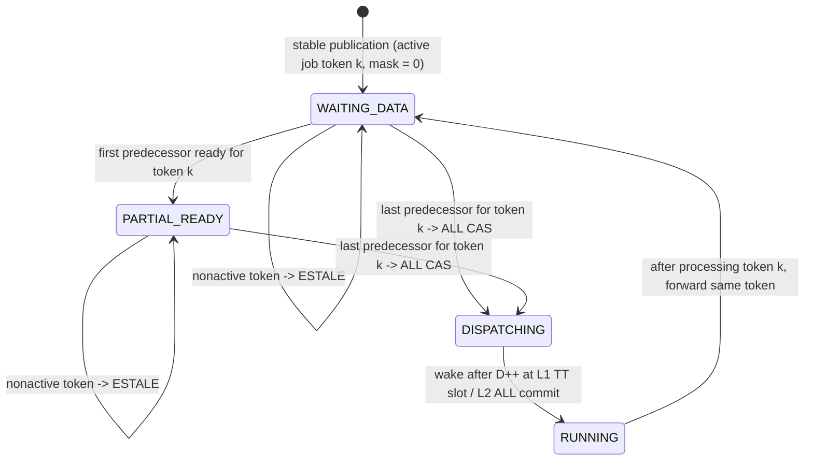
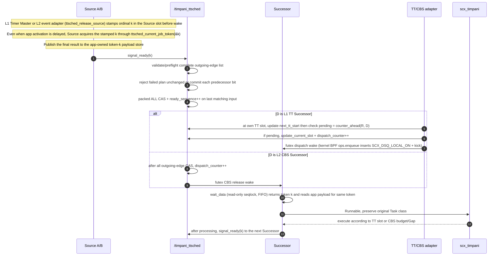
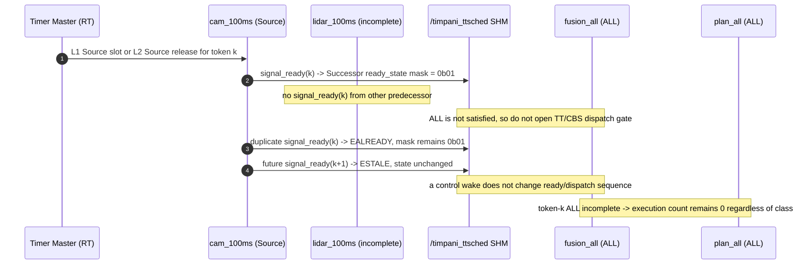

<!--
SPDX-FileCopyrightText: Copyright 2026 LG Electronics Inc.
SPDX-License-Identifier: MIT
-->

# HLD-009: Data-Driven Workload — Phase 0 High-Level Architecture Design

**Date:** 2026-10-27
**Last Updated:** 2026-11-25 (Phase 0 PR review remediations)
**Status:** Draft — Phase 0 design proposal; review and approval pending.
The 008 field allocation `11/12/13` is aligned, but `OI-DD-01`/`02`/`03`
remain subject to Project Leader approval and verification; this is not a
declaration that the current implementation satisfies the design.
**Parent Baseline:** [REQ-009](REQ-009-data-driven-workload.md) §1.5, §7.1, §8.2, [SRS-009](SRS-009-data-driven-workload.md)
**Decisions / Details:** [DDR-009](DDR-009-data-driven-workload.md), [LLD-009](LLD-009-data-driven-workload.md), [DDR-011](DDR-011-runtime-table-update.md)

---

## 1. Scope and Architecture

This document defines a **Data-Driven DAG independent of the Task's existing L1 TT/L2 CBS layer** on a single node under fixed `Epoch`/`Hyperperiod` and basic-chain conditions. A Source/Successor role does not determine the execution layer. Precise per-layer Window/Gap control, multiple periods, updates, and `SKIP` are deferred to subsequent phases.

```mermaid
flowchart LR
    subgraph ControlPlane["Control Plane (non-RT)"]
        IN["Pullpiri / Test Input<br/>(Pipeline DAG declaration)"]
        TO["Timpani-O<br/>(DAG validation + existing TT/CBS placement for each Task)"]
    end

    subgraph NodeUserspace["Timpani-N & Workload (userspace)"]
        TN_PREP["Timpani-N non-RT preparation<br/>(common DAG verification · TT/CBS representation registration · SHM publication)"]
        TM["Timer Master<br/>(L1 TT slot adapter)"]
        SHM[("/timpani_ttsched SHM<br/>(tasks[] + versioned pipeline header + pipeline[])")]
        TASKS["Pipeline Tasks<br/>(L1 TT or L2 CBS)"]
    end

    subgraph KernelSpace["Linux Kernel (sched_ext)"]
        BPF["scx_timpani<br/>(TT adapter + CBS adapter)"]
    end

    IN -->|"schedinfo.proto"| TO
    TO -->|"node_control.proto (full_table)"| TN_PREP
    TN_PREP --> TM
    TN_PREP -->|"TT/CBS BPF Maps"| BPF
    TN_PREP -->|"stable generation publication"| SHM
    TM -->|"L1 dispatch gate"| SHM
    SHM -->|"ALL ready / dispatch wake"| TASKS
    TASKS -->|"pipeline[] CAS + signal_ready"| SHM
    TASKS -->|"Runnable: preserve Task class"| BPF
    BPF -->|"dispatch in TT slot or CBS Gap"| TASKS
```

---

## 2. Component Responsibility Separation (RT / Non-RT and O / N Boundaries)

| Component | Phase 0 Responsibility | Does Not Do |
|:---|:---|:---|
| **Input / Test Harness** | Submit a same-period (`100ms`) DAG through the `Timpani-O` input path, collect timestamp and overhead evidence, and abort the test if assumptions are violated. | Inject a table/graph directly into `Timpani-N` or SHM and treat that as End-to-End success, or guarantee product Fail-Safe behavior in place of the product. |
| **`Timpani-O`** | Independently validate the DAG and the Task's existing `TemporalClass`, and generate the TT/CBS representation and common DAG metadata. | Force an execution layer from the DAG role or delegate placement decisions to N. |
| **`Timpani-N` Non-RT** | Verify and publish the per-layer entries and common `pipeline[]` locally. | Recalculate DAG/TT/CBS feasibility. |
| **`Timer Master`** | At `start()`, fix a single `base_cycle_start`, stamp the Pipeline-period release ordinal for an L1 Source before the slot wake, and, when Data-Driven ready exists in an allowed slot for an L1 Successor, perform `update_current_slot()` and `dispatch_counter++`/futex wake (including SHM publication of CBS/Pipeline Task metadata). | Generate a token from the wall clock, handle L2 release, perform `update_current_slot()`/overwrite `SLOT_NONE`/wake when L1 ready is absent, or directly call `scx_bpf_kick_cpu()` from userspace. |
| **`libttsched` / App** | Update class-independent `ALL` CAS/ready sequence and verify identity (atomic name comparison); an L2 CBS Source event adapter/test generator calls `ttsched_release_source()`. The application publishes the token-addressed payload before `signal_ready()` and retains it until Consumer processing completes. | Provide payload storage, copy, or acknowledgment APIs; execute a control wake; or change the execution layer. |
| **`scx_timpani`** | Dispatch an awakened and now-Runnable L1 Task in its TT slot and an L2 Task through the existing CBS budget/Gap path. | Create a separate Data-Driven scheduling layer. |
| **`Fault Monitor`** | Retain existing system-monitoring safety mechanisms. | Collect/report new Phase 0 `DATA_TIMEOUT` (deferred to Phase 2). |

Common DAG metadata transmission, the backward SHM `pipeline[]`, and new APIs are incorporated after prior approval. Each Task's existing TT/CBS entry and timing policy is preserved.

`O_RDWR` permission on `/timpani_ttsched` grants access to the entire object and is not a per-slot/header security boundary. Phase 0 `timpani-pub` includes only mutually trusted Source/intermediary writers, while read-only Consumers are restricted to a separate group. The identity checks in `libttsched` are for detecting accidental misuse and corruption; they do not guarantee integrity against a malicious writer.

---

## 3. High-Level Design Areas (H-DD-P0-01 ~ H-DD-P0-04)

### 3.1 H-DD-P0-01 — Offline Candidate Validation and Deterministic Topological Placement (`Timpani-O`)

O uses an explicit `TaskInfo.temporal_class` and otherwise inherits `SchedInfo.temporal_class` only when the optional field is absent. Explicit `TEMPORAL_PERIODIC = 0` selects L1; this supersedes the 008 placeholder `0 = inherit` and remains subject to `CON-DD-05` approval. It converts the predecessor list `TaskReference(workload_id, task_id)` into normalized Task identifiers in the same workload, validates the DAG, and creates common dependency metadata by `(workload_id_hash, task_id_hash)` key. Each Task retains the existing `TtSlot` or `CbsConfig` representation according to its resolved class, and its execution layer is not inferred from whether `predecessors` is present.

Phase 0 permits only same-workload references and `ALL` and uses the existing TT slot/CBS admission policy. Phase 1 extends cross-workload references, aggregation of per-layer response times for a mixed DAG, `E2E`, and Window/Gap conditions. On failure, the committed model is retained.

### 3.2 H-DD-P0-02 — Node-Local Suitability Verification and Stable SHM Publication (`Timpani-N`)

N verifies each Task's TT/CBS representation and the common DAG metadata separately. It rejects the candidate if a name, hash, or CPU/slot/budget reference is invalid.

The accepted table is filled with the common `pipeline[]` according to the 011 contract. Adapter metadata is registered so that an L1 Task uses the TT gate and an L2 Task uses the CBS gate. Publication itself does not increment the ready/dispatch sequence. The first Source slot starts with release invalid, and only the actual wake authority may stamp the release ordinal.

During non-RT client initialization (`void ttsched_init()`, `g_shm_init_errno`, and full TLS reset), the client checks SHM size and whether the complete ABI can be mapped once with `fstat()`, then closes the fd immediately after `mmap()` (`pthread_key` destructor performs `munmap` at thread termination). Thereafter, on RT critical paths (`release_source`, `signal_ready`, `wait_data`, `current_job_token`, and `Timer Master`), it verifies ABI, generation, identity, and replacement/invalidation without `shm_open`/`fstat`/`close`, using only pure atomic loads (`magic`, even `generation`, `pipeline_header.{magic, abi_version, abi_size, instance_id}`, and `publication_guard`) and a 16-byte atomic name comparison. `Timpani-N` holds a live object at the full ABI size (`3,128`B); replacement/shutdown is performed by retaining `WRITER_PENDING` + active-commit drain (Safe Abandonment after exceeding `50 ms`) + `magic=0`/`pipeline_header.magic=0` invalidation + `FUTEX_WAKE(..., INT_MAX)` on all `tasks[]`/`pipeline[]` + `shm_unlink()` without `ftruncate` + creation of a new `instance_id` object with `O_CREAT|O_EXCL`.

Safe Abandonment is namespace isolation, not forced cancellation of an active operation on the old object. A writer that has already entered the guard performs only a liveness check immediately before CAS/wake (`pipeline_commit_alive`: `magic`/`pipeline_header.magic`/generation/`instance_id`) that excludes `WRITER_PENDING`; it therefore completes the commit and wake during normal drain and stops with `ESTALE` only when invalidated by Safe Abandonment. It may complete on the old object because of a race after the last check, but cannot access a new `instance_id` object. An old-mapping Consumer stops with `ESTALE` when it revalidates stable state after the wake and does not execute. A Job that has already received a token before invalidation is not reclaimed by Safe Abandonment.

The publisher sets `WRITER_PENDING` in `pipeline_header.publication_guard` to prevent new write commits, waits for the existing active-commit count to reach `0` for a bounded time (`min(5 ms, H/4)` during normal operation / `50 ms` at shutdown), and then changes the SHM generation through a field-wise release-store order that does not overwrite `publication_guard`: `magic=0` → odd `generation` → content and atomic-name store, update `origin_epoch_ns`/`hyperperiod_us`/`instance_id` → even `generation` → valid `magic` → release `WRITER_PENDING`. `signal_ready`, `release_source`, and the L1 Timer Master (internal lightweight guard) are serialized with the publisher through this guard during a write commit. `ttsched_wait_data()` and `ttsched_current_job_token()` protect an `O_RDONLY` mapping with a **read-only seqlock** that does not write to `publication_guard` and with atomic name comparison. A thread already bound to one generation returns `ESTALE` rather than implicitly resynchronizing if it observes another generation. Phase 0 verifies initial publication, shutdown/invalidation (Safe Abandonment), and the guard/seqlock for a fixed chain; Phase 1 extends the contract to normal Pipeline updates and ABI transitions; Phase 2 extends it to cleanup of state left after failure/restart.

### 3.3 H-DD-P0-03 — Common Ready/Dispatch State Transitions and Control-Wake Separation

- The packed `ready_state` `ALL` CAS, the per-layer `dispatch_counter` update, and the futex wake are performed inside the publication commit guard. At publication, first prove that each Successor's direct incoming edges map one-to-one to `required_mask`. Reject two edges that alias one bit, a required bit without a corresponding edge, or an edge bit outside the mask. Before any state change, `signal_ready(k)` validates and preflights the Source's complete outgoing-edge list, so if malformed metadata or one duplicate/stale destination is found before the first CAS, the entire fan-out remains unchanged. If the same `(predecessor, k)` is already set at preflight, return `EALREADY`; if it is another token, return `ESTALE`. If a concurrent identical commit gets ahead during CAS, treat it as convergence. A single 64-bit CAS atomically resets the destination mask and increments the ready sequence/job token.
- The complete fan-out guarantees **preflight failure atomicity** only. If the Source process terminates after the first CAS, only part of a destination's bit may remain. Phase 0 classifies that chain run as failed/a test-assumption departure; crash transactions, rollback, and idempotent retry belong to Phase 2 recovery.
- `ALL` creates only a ready sequence. For an L1 Successor, only when `Timer Master` updates `next_tt_start` at its own TT slot and then checks `pending` through its internal lightweight guard does it perform `update_current_slot()`, increment `dispatch_counter` by 1, and `FUTEX_WAKE` (then kernel BPF `ops.enqueue()` inserts `SCX_DSQ_LOCAL_ON` and performs `scx_bpf_kick_cpu`). An L2 Successor increments by 1 in an `ALL` commit after all outgoing-edge CAS operations are complete. Only `dispatch_counter` is a futex word.
- If there is no `pending ready` at an L1 slot, omit both `update_current_slot()` and `FUTEX_WAKE` and do not actively overwrite `SLOT_NONE` (`wake 0`, zero kernel enqueue/kick operations). Ready that arrives after the slot remains pending until the next TT slot, and a normal Phase 0 test includes at most one pending item.
- `ttsched_init()` preserves token `0` on attach during normal pre-publication startup (`g_attached_before_publish = 1`) by using cursor `0` upon entry into the first valid generation. For a late attach to already published SHM at `cur > 0`, it snapshots the current `dispatch_counter` as the attach cursor and does not replay past tokens. `ttsched_wait_data()` uses a read-only seqlock (`O_RDONLY` supported), observes dispatch after that cursor, and returns `job_token` sequentially in FIFO order (`g_last_dispatch_counter++`) without jumping to `current - 1U`.
- The existing BPF path runs only after a futex wake makes the Task Runnable. L1 receives actual CPU dispatch at its TT slot, and L2 at the CBS budget/Gap gate.
- A control wake accompanying publication, shutdown, or generation transition; invalidated/replaced SHM (`magic=0`/`instance_id` mismatch); or writer-pending/ABI mismatch is rejected with `ESTALE`. A spurious wake with no state change waits again with `0` executions, and a gate with no pending ready creates no wake.

### 3.4 H-DD-P0-04 — End-to-End (E2E) Execution Sequence

#### (a) Normal Chain Sequence (Task Class Is Independently Selected as TT/CBS from Input)

Even when the graph is the same, Task classes may differ. Phase 0 tests include TT→TT, TT→CBS, CBS→TT, and CBS→CBS connections.

#### (b) Wait-State Retention Scenario for Partial Input and a Control Wake (`UC-DD-02`)

---

## 4. Differences Between the Current Code and the Phase 0 Design

| Source to Inspect | Current-Code Observation and Difference Required by the Phase 0 Design |
|:---|:---|
| `timpani-o/src/schedinfo_service.{h,cpp}` | Explicit-over-inherit resolution of `TaskInfo.temporal_class` and safe rollback of the existing workload model when candidate validation fails are required. |
| `timpani-o/src/global_scheduler.{h,cpp}` | DAG validation and common metadata generation are required, as are `hyperperiod_us > 0` for CBS-only operation and `L1→L1` ordering by `(topo_rank, deadline_us, ...)` + `min_start` in `place_tt_slots()`. |
| `timpani-n/src/main.cpp` | Per-TT/CBS-entry registration, rejection of `ExecutionModel.DATA_FLOW`, and `TimerMaster::set_schedule_table()` overloads to transmit CBS/Pipeline metadata are required. |
| `timpani-n/src/timer_master.{h,cpp}` | `set_schedule_table()` overloads (preserving `CON-DD-06`), fixation of the single `base_cycle_start` and per-Task ordinal at `start()`, and, for an L1 Successor in an allowed slot, updating `next_tt_start`, checking `pending` under the lightweight guard, and only then performing `update_current_slot()`, `dispatch_counter++`, and `FUTEX_WAKE` are required (`pending == false` omits them and does not overwrite `SLOT_NONE`). |
| `sample-apps/src/libttsched.{h,c}` | A `40B` extension header, RT no-VFS atomic validation, atomic name comparison, read-only seqlock, retention of `void ttsched_init()`, `g_shm_init_errno`, pre-/post-publication attach separation, `pipeline_commit_alive`, and addition of `release_source`/`current_job_token`/`wait_data`/`signal_ready` are required *(subject to approval)*. |
| `timpani-n/src/bpf/timpani.bpf.c` | Reuse the existing `SCHED_TYPE_TT`/`CBS` dispatch rules unchanged (no Data-Ready awareness or separate Data-Driven DSQ). |

The table above is the design starting point and does not signify actual code changes or completed approval.

---

## 5. SRS Traceability Matrix

| HLD Area | Active SRS Requirements | Verification Scenarios |
|:---|:---|:---|
| **H-DD-P0-01** | `REQ-DD-P0-F-001`, `REQ-DD-P0-F-002`, `REQ-DD-P0-N-003`, `REQ-DD-P0-N-004` | `TC-DD-P0-001`, `TC-DD-P0-003`, `TC-DD-P0-005`, `TC-DD-P0-006` |
| **H-DD-P0-02** | `REQ-DD-P0-F-003`, `REQ-DD-P0-F-004`, `REQ-DD-P0-F-006`, `REQ-DD-P0-N-004` | `TC-DD-P0-003`, `TC-DD-P0-004`, `TC-DD-P0-005` |
| **H-DD-P0-03** | `REQ-DD-P0-F-005`, `REQ-DD-P0-F-006`, `REQ-DD-P0-N-001`, `REQ-DD-P0-N-002` | `TC-DD-P0-001`, `TC-DD-P0-002`, `TC-DD-P0-004`, `TC-DD-P0-005` |
| **H-DD-P0-04** | `REQ-DD-P0-F-004`..`F-008`, `REQ-DD-P0-N-002` | `TC-DD-P0-001`, `TC-DD-P0-002`, `TC-DD-P0-004` |
