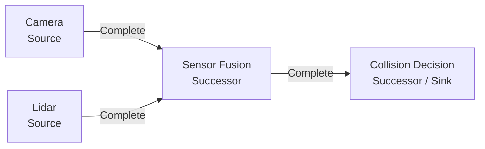
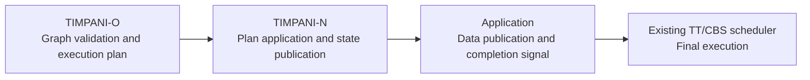

<!--
SPDX-FileCopyrightText: Copyright 2026 LG Electronics Inc.
SPDX-License-Identifier: MIT
-->

# Data-Driven Workload Support: Overview

| Item | Details |
|:--|:--|
| Purpose | Briefly explain what Data-Driven Workloads are for, how they execute, and what is currently supported |
| Audience | Architecture, scheduler, application, and verification personnel |
| Basis | REQ/SRS/DDR/HLD/LLD-009 Phase 0 design proposal and related documents 008 and 011 |
| Status | **Draft / before implementation and approval.** This does not indicate that execution results or interface approval are complete |

> **One-sentence summary:** Once all required predecessor Tasks have completed, a Successor Task becomes an execution candidate. The Task's original TT or CBS rules determine its actual execution time.

| Question | Answer |
|:--|:--|
| **Why is it needed?** | Fixed timing alone makes it difficult to avoid both waiting unnecessarily when an earlier Task finishes early and waking a later Task before its data is ready |
| **What changes?** | `Data-Ready` reports dependency readiness, while TT/CBS makes the final execution-permission decision |
| **What is supported now?** | Phase 0 verifies a basic `ALL` chain in a mixed L1/L2 environment. Activation Windows, timeouts, and recovery are deferred to later phases |

See [REQ-009](REQ-009-data-driven-workload.md) and [DDR-009](DDR-009-data-driven-workload.md) for detailed requirements and decisions. This document is a concise guide connecting their content.

---

## Before You Read: Key Terms

The meanings below are sufficient for reading this document. Other implementation abbreviations and protocol terms are explained in the detailed documents.

| Term | Meaning in This Document |
|:--|:--|
| **DAG** | An acyclic data-flow graph that represents predecessor and successor relationships among Tasks |
| **Source / Successor / Sink** | A starting Task / a later Task that waits for an earlier Task / the final Task in a chain |
| **`Data-Ready` / `ALL`** | The state in which all current-run results required from immediate predecessor Tasks are ready |
| **Execution candidate / execution permission** | A state in which data dependencies are satisfied / a scheduler decision that permits actual execution on a CPU |
| **L1 TT / L2 CBS** | A method that executes at predetermined times / a method that constrains execution with CPU budgets and replenishment rules |
| **O / N / App** | TIMPANI-O, which creates the graph and placement / TIMPANI-N, which applies the plan / the application, which produces the actual data and signals completion |
| **Phase 0 / 1 / 2** | Basic chain / time and period extensions / timeout and recovery extensions |

The most important distinction is that **`Data-Ready` is an execution-candidate condition, not execution permission.** The Task's original TT/CBS layer continues to control the schedule and budget rules.

---

## 1. What Problem Does It Solve?

Work such as `sensor acquisition → sensor fusion → collision decision → control`, where each stage must wait for the previous stage's results, is connected as a data pipeline.

Waking this pipeline only at fixed times causes the following problems.

- If an earlier stage finishes early, the response is delayed because it waits until the scheduled time.
- If an earlier stage finishes late but a Successor Task wakes first, that Task may read data that is not ready.

A Data-Driven Workload **makes a Successor Task an execution candidate only when all required predecessor data is ready.** The Task's original L1 TT or L2 CBS rules make the final decision on whether and when it may execute.

| Core Goal | Meaning |
|:--|:--|
| **Correct ordering** | A Successor Task does not execute before all immediate predecessors have completed |
| **Reduced idle waiting** | Once predecessor data is ready, no unnecessary waiting is introduced when no further validation is needed |
| **Preserve the existing schedulers** | The DAG does not change a Task to L1/L2; TT/CBS continue to apply their own rules |

The application manages the actual data (`payload`) and transmits only the completion signal. TIMPANI does not transport the data itself; it manages only **which predecessor data each Task is waiting for** and **whether it has become an execution candidate**.

---

## 2. What Is "Ready," and What Is "Execution"?

| Activation Method | When It Becomes an Execution Candidate | What Determines Execution |
|:--|:--|:--|
| **Time-Triggered** | At the scheduled periodic time | L1 TT slot |
| **Event-Triggered (008)** | On arrival of an external event | L2 CBS budget, CPU, and Gap |
| **Data-Triggered (009)** | When all immediate predecessors have completed | The Task's original TT/CBS rules |

Two distinctions matter in 009.

- **`Data-Ready`**: The data is ready to read.
- **Dispatch**: The decision to permit actual execution on the CPU.

`Data-Ready` alone must not allow an L1 Task to execute outside its scheduled time or an L2 Task to bypass its budget rules. `Source` and `Successor` are roles in the graph; L1/L2 are a Task's execution layers.

### Representative Example: Camera + Lidar



- If only the camera completes, fusion continues to wait.
- Once the lidar also completes, fusion becomes an execution candidate.
- If fusion is L1, it executes in a TT slot; if it is L2, it executes within the CBS budget and Gap.
- Fusion completion is passed on as predecessor completion for the next Task.

`ALL` is the default condition in Phase 0. `ANY` remains only as an extension possibility and is not in the current scope.

### How to Avoid Confusing Time Concepts

| Term | Meaning |
|:--|:--|
| **Hyperperiod** | The period over which the TT/L1 slot pattern repeats |
| **Activation Window** | A time interval in which a specific Task may execute, from Phase 1 onward |
| **Application boundary** | The point at which a runtime table changes to new values, as defined in [REQ-011](REQ-011-runtime-table-update.md) |
| **E2E deadline** | The total delay allowed from Source completion to Sink completion |

The `Data-Ready` time, Task execution interval, and table application boundary are distinct concepts.

---

## 3. Why Separate the Phases and Responsibilities?



The reason for separating responsibilities is simple.

- O validates ordering and executability.
- N executes the received plan.
- The application reports only whether its data is ready.
- The TT/CBS scheduler retains the existing timing rules.

Rather than implementing every feature at once, the work is divided into three phases.

| Phase | What This Phase Verifies |
|:--|:--|
| **Phase 0** | `ALL` completion ordering and basic chained execution in a mixed L1/L2 environment |
| **Phase 1** | TT windows, CBS response time, `E2E` guarantees, and runtime updates |
| **Phase 2** | Missing-input `SKIP`, `DATA_TIMEOUT`, Fallback, and restart and recovery |

This document is based on **Phase 0**. Features from later phases are not pulled forward into the Phase 0 completion criteria.

---

## 4. Who Does What?

| Component | Responsibility |
|:--|:--|
| **Pullpiri / Input** | Declares what each Task waits for and the chain's completion target |
| **TIMPANI-O** | Rejects invalid graphs and connects them to each Task's existing TT/CBS plan |
| **TIMPANI-N** | Applies the received plan and connects predecessor completion state to execution |
| **Application** | Publishes result data and signals its own completion |
| **TT/CBS scheduler** | Executes a Task whose `Data-Ready` condition is satisfied according to the existing slot and budget rules |
| **Fault Monitor** | Monitors existing faults. `DATA_TIMEOUT` belongs to Phase 2 |

The responsibilities are clearly separated.

- O creates the graph and execution plan.
- N does not recalculate the graph or schedulability.
- The application publishes the payload and signals completion.
- No gRPC or daemon IPC is placed in the `Data-Ready` path.

---

## 5. How Does Execution Continue Once the Data Is Ready?

```mermaid
sequenceDiagram
    participant CAM as Camera
    participant LIDAR as Lidar
    participant SHM as Shared Memory
    participant FUSION as Sensor Fusion
    participant PLAN as Collision Decision
    participant SCHED as TT/CBS Scheduler

    Note over FUSION,PLAN: Wait for predecessor completion from the same chain cycle
    CAM->>CAM: Record Camera result
    CAM->>SHM: Mark Camera complete
    SHM-->>FUSION: Lidar incomplete, continue waiting

    LIDAR->>LIDAR: Record Lidar result
    LIDAR->>SHM: Mark Lidar complete
    SHM-->>FUSION: All required predecessors complete, create one candidate
    FUSION->>SCHED: L1 checks its TT slot; L2 checks CBS budget and Gap
    SCHED-->>FUSION: Layer-specific execution permission
    FUSION->>FUSION: Fuse inputs from the same instance and record the result
    FUSION->>SHM: Mark fusion complete
    SHM-->>PLAN: Create the next execution candidate
```

Data-Driven execution proceeds through four steps.

1. **Data publication:** A predecessor Task first records the result that its Successor will read.
2. **Completion marking:** After recording the result, it signals only its own completion. If it has several Successors, an invalid delivery plan does not leave only some of them notified.
3. **Single candidate:** When every required predecessor completion for the same chain cycle has arrived, the Successor becomes an execution candidate exactly once. Repeated completion and late completion from a different cycle cannot substitute for a missing predecessor.
4. **Execution-permission check:** In Phase 0, L1 executes only at its TT slot and L2 executes only under the existing CBS budget and Gap rules. `Activation Window` belongs to Phase 1.

### Why Is Completion Marked Separately for Each Predecessor?

A camera completion cannot fill the lidar completion condition. Each immediate predecessor has its own independent completion condition, and the number of predecessors must correspond exactly to the conditions expected by the Successor. A repeated camera completion or completion from another cycle therefore cannot replace a missing lidar result.

### How Are False Wakes Prevented?

- **Use data from the same chain cycle:** Results and completion indications correspond, and previous or later cycles are not mixed.
- **Apply only valid connection plans:** Missing or duplicated predecessor connections are rejected before execution.
- **Do not leave partial notifications:** When one completion reaches several Successors, an invalid connection does not leave only some of them updated.
- **Distinguish control signals from data completion:** Publication or shutdown notifications do not execute a Task.
- **Preserve execution rules:** `Data-Ready` does not bypass an L1 schedule time or L2 budget rule.

Synchronization and interface implementation details are covered in [LLD-009](LLD-009-data-driven-workload.md).

---

## 6. How Is a DAG Validated and Executed?

### 6.1 Reject Invalid Graphs First

| Check | Meaning |
|:--|:--|
| **References** | Every predecessor Task exists, and a Task does not name itself as a predecessor |
| **Identifiers** | Task names are unique and name hashes do not collide |
| **Cycles** | Tasks can form a consistent execution order from predecessors to successors. If not all Tasks can be placed, there is a cycle such as `A → B → A` |
| **Capacity** | The numbers of Tasks, predecessor connections, and Successor connections are within the supported limits |
| **Readiness mapping** | Each direct predecessor has one distinct completion condition, and no expected condition is missing or duplicated |

The exact name, hash, completion-condition, and capacity rules are specified in [LLD-009](LLD-009-data-driven-workload.md). O builds an execution order starting with Tasks that have no predecessors and always selects the same order when multiple candidates are available.

If validation fails, only the candidate is discarded; the existing committed model and active table are not changed. N does not reconstruct the graph and checks only the received connections and local applicability.

### 6.2 Separate the Readiness Signal from Actual Execution

1. A predecessor Task records its result and then reports that the data is ready.
2. The Successor becomes `ALL` ready only when every direct predecessor has completed for the same chain cycle.
3. The Task then follows its existing execution method.
   - L1 Task: Even with `ALL` ready, it is woken and executes only at its allowed TT slot.
   - L2 Task: It is released after `ALL`; actual execution follows the existing CBS budget/Gap conditions.
4. The application owns the payload; shared state carries only readiness and execution permission.

Data-Ready therefore means **"the data dependencies are satisfied,"** not **"execute immediately."** The original L1/L2 rules for the Task make the final execution decision.

### 6.3 Guarantees by Phase

| Phase | What It Guarantees |
|:--|:--|
| **Phase 0** | Rejects invalid graphs and inconsistent predecessor mappings, prevents repeated or mismatched completion from satisfying `ALL`, avoids partial notifications and control-signal execution, and preserves the existing TT/CBS rules |
| **Phase 1** | Verifies `E2E` for mixed DAGs, including TT Windows and CBS response time |
| **Phase 2** | Handles missing-input `SKIP`, root-cause `DATA_TIMEOUT`, Fallback, and recovery |
---

## 7. What Is Verified in Phase 0?

| Category | Phase 0 Baseline |
|:--|:--|
| **Guaranteed** | A valid DAG and consistent readiness mapping; execution after all required predecessors complete for the same chain cycle; no partial or control-signal execution; and no basic regression in existing L1/L2 Tasks |
| **Test form** | Continuous operation of a basic chain on a single node with a fixed table and explicit periodic conditions |
| **Execution layer** | Tasks retain their original L1 TT or L2 CBS layer, and `ALL` adds only an execution-permission condition to each layer |
| **Not yet guaranteed** | `Activation Window`, quantitative `E2E`, runtime updates of tables containing a Pipeline, fault recovery, and Fallback |
| **Related baseline** | Follows the publication-stability and control-wake separation in [REQ-011](REQ-011-runtime-table-update.md) to prevent regressions in normal TT updates |

Phase 0 completion means that the basic Data-Driven chain operates; it does not mean that functional-safety or Fail-Safe operation has been approved, or that all real-time guarantees are provided.

---

## 8. What Does the Example Verify?

Phase 0 demonstrates the core behavior with a four-Task sensor-fusion chain.

| Task | Role | What This Example Verifies |
|:--|:--|:--|
| Camera | Source | Reports only its own processing completion |
| Lidar | Source | Has completion state independent of the camera |
| Sensor Fusion | Successor | Executes only after both the camera and lidar have completed |
| Collision Decision | Successor / Sink | Executes in sequence after fusion completes |

The example Tasks are each changed between TT and CBS for verification. This confirms that TT→TT, TT→CBS, CBS→TT, and CBS→CBS connections all use the same data-dependency rules.

Phase 0 acceptance is determined by the following four checks.

| Observation | Pass Condition |
|:--|:--|
| **Normal chain** | Predecessor completion order is not violated, and each Task follows its original TT/CBS rules |
| **Partial input** | If one required predecessor is absent or completion belongs to another chain cycle, the Successor executes `0` times |
| **Invalid input and wakes** | Invalid graphs, inconsistent readiness mappings, unusable shared state, or control notifications do not lead to Task execution |
| **Regression and determinism** | Existing TT/CBS behavior does not regress, and the same execution plan is produced even when input order changes |

See [SRS-009](SRS-009-data-driven-workload.md) for the exact values and each test ID.

---

## 9. What Is Observed, and in What Order Does the Work Proceed?

### Phase 0 Observations

- **Ordering:** Did each Successor start only after all predecessors completed?
- **Execution layer:** Did L1 Tasks follow the TT rules, and L2 Tasks follow the CBS rules?
- **False wake:** Did partial input, table publication, or a shutdown signal cause execution?
- **Regression:** Did existing TT/CBS behavior remain unchanged after adding Data-Driven connections?

Host unit tests and actual Linux `sched_ext` target tests are kept separate. Items not run on the target remain unverified.

### Recommended Sequence

1. Finalize the approval scope for common DAG metadata and the application API.
2. Implement DAG validation in O and connect it to the existing TT/CBS execution plan.
3. Connect `ALL` readiness and layer-specific execution permission in N and the application.
4. Verify basic TT→TT, TT→CBS, CBS→TT, and CBS→CBS chains and partial-input cases.

---

## 10. What Must Be Agreed Upon?

| Decision | Review Question |
|:--|:--|
| **Pipeline declaration format** | How are Task predecessor relationships and L1/L2 execution classes represented independently? |
| **Shared memory/API** | How does Data-Driven state coexist with the existing SHM contracts for 008 and 011? |
| **TT/CBS execution connection** | After `ALL` completes, how does each layer continue to preserve its slot, budget, and Gap rules? |
| **Later timing and recovery contracts** | By what criteria are Phase 1 mixed-DAG `E2E` and Phase 2 `SKIP`, Fallback, and restart added? |

Phase 0 verifies **basic mixed L1/L2 chain operation without changing Task classes.** Protocol, SHM, and public API changes in the preceding rows are applied only after Project Leader approval.

---

## 11. When Should the Detailed Documents Be Read?

| Document | When to Read It |
|:--|:--|
| [REQ-009](REQ-009-data-driven-workload.md) | To check support scope and requirements |
| [SRS-009](SRS-009-data-driven-workload.md) | To check the exact Phase 0 verification conditions and pass criteria |
| [DDR-009](DDR-009-data-driven-workload.md) | To check the design decisions and their rationale |
| [HLD-009](HLD-009-data-driven-workload.md) | To check the responsibilities and overall flow of O, N, and the application |
| [LLD-009](LLD-009-data-driven-workload.md) | To check structures, states, algorithms, and implementation order |
| [OVERVIEW-008](DDR-008-event-driven-workload/OVERVIEW-008-event-driven-workload-support.md) | To compare boundaries with the Event-Driven model |
| [REQ-011](REQ-011-runtime-table-update.md) / [DDR-011](DDR-011-runtime-table-update.md) | To compare runtime table update and lifecycle constraints |

**Recommended reading order:** Overview → REQ → DDR → HLD → SRS → LLD. Consult 008 and 011 together when addressing common SHM, runtime update, and shutdown contracts.
