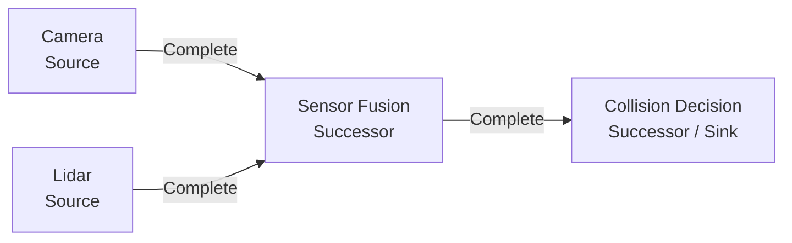
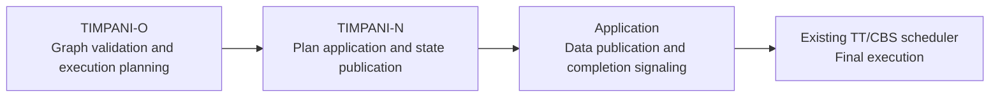

<!--
SPDX-FileCopyrightText: Copyright 2026 LG Electronics Inc.
SPDX-License-Identifier: MIT
-->

# Data-Driven Workload Support: Overview

| Item | Details |
|:--|:--|
| Purpose | Briefly explain what the Data-Driven Workload is for, how it executes, and what it currently supports |
| Audience | Architecture, scheduler, application, and verification personnel |
| Baseline | REQ/SRS/DDR/HLD/LLD-009 Phase 0 design proposal updated for 2026-11-25, and related documents 008 and 011 |
| Status | **Draft — Phase 0 design proposal; approval pending** (008 field allocation `11/12/13` aligned; `OI-DD-01`/`02`/`03` remain subject to Project Leader approval and verification; implementation not complete) |

> **One-Sentence Summary:** Once all required predecessor work is complete, a successor Task becomes an execution candidate. The Task's original TT or CBS rules determine the actual execution time.

| Question | Answer |
|:--|:--|
| **Why is it needed?** | Fixed timing alone makes it difficult to avoid both the idle wait caused when an earlier Task finishes quickly and the problem of waking a later Task before its data exists |
| **What changes?** | `Data-Ready` communicates the predecessor relationship, and TT/CBS determines final execution permission |
| **How much is supported now?** | Phase 0 verifies the basic `ALL` chain in a mixed L1/L2 environment. Time windows, timeout, and recovery are reserved for later phases |

For detailed requirements and decisions, see [REQ-009](REQ-009-data-driven-workload.md) and [DDR-009](DDR-009-data-driven-workload.md). This document provides a brief connecting explanation.

---

## Before Reading: Key Terms

The meanings below are sufficient for reading this document. Other implementation abbreviations and protocol terms are explained in the detailed documents.

| Term | Meaning in This Document |
|:--|:--|
| **DAG** | An acyclic data-flow graph representing predecessor and successor relationships among Tasks |
| **Source / Successor / Sink** | A starting Task / a successor Task that waits for earlier Tasks / the final Task in a chain |
| **`Data-Ready` / `ALL`** | The state in which all current-run results required from immediate predecessor Tasks are ready |
| **execution candidate / execution permission** | A state satisfying data dependencies / a scheduler decision permitting actual CPU execution |
| **L1 TT / L2 CBS** | A method that executes at predetermined times / a method that limits execution through CPU-budget and replenishment rules |
| **O / N / App** | TIMPANI-O, which creates the graph and placement / TIMPANI-N, which applies the plan / the application, which produces actual data and signals completion |
| **Phase 0 / 1 / 2** | Basic chain / time and period extensions / timeout and recovery extensions |

The most important distinction is that **`Data-Ready` is an execution-candidate condition, not execution permission**. The schedule and budget rules of the Task's original TT/CBS layer remain in effect.

---

## 1. What Problem Does It Solve?

Work in which a later stage requires the result of an earlier stage, such as `sensor acquisition → sensor fusion → collision decision → control`, is grouped into a data pipeline.

Waking this pipeline only at fixed times creates the following problems.

- If an earlier stage finishes early, response is delayed because it waits until the reserved time.
- If an earlier stage finishes late and a successor Task wakes first, it may read data that is not ready.

A Data-Driven Workload **makes a successor Task an execution candidate only once all required predecessor data is ready.** The Task's original L1 TT or L2 CBS rules make the final decision on whether and when it may execute.

| Core Objective | Meaning |
|:--|:--|
| **Correct ordering** | A successor Task does not execute before every direct predecessor completes |
| **Reduced idle waiting** | Once predecessor data is ready, it avoids introducing unnecessary waiting until the next fixed time |
| **Preserve the existing scheduler** | A DAG role does not change a Task to L1/L2, and TT/CBS continues applying its own rules |

The application manages the actual data (`payload`) and transmits only the completion signal. TIMPANI does not transport, store, or validate the data itself; it manages only **which predecessor data each Task is waiting for** and **whether an execution candidate exists**. A Producer calls `signal_ready(token)` only after fully writing the token-addressed payload, and does not reuse the slot until the Consumer finishes processing that token.

---

## 2. What Is “Ready,” and What Is “Execution”?

| Activation Method | When It Becomes an Execution Candidate | What Determines Execution |
|:--|:--|:--|
| **Time-Triggered** | At the reserved periodic time | L1 TT slot |
| **Event-Triggered (008)** | On arrival of an external event | L2 CBS budget, CPU, and Gap |
| **Data-Triggered (009)** | Once all direct predecessors complete | The Task's original TT/CBS rules |

Two distinctions matter in 009.

- **`Data-Ready`**: The data is ready to be read.
- **Dispatch**: The decision permitting actual CPU execution.

`Data-Ready` alone must not allow an L1 Task to execute outside its reserved time or an L2 Task to bypass budget rules. `Source` and `Successor` are graph roles, while L1/L2 are Task execution layers.

### Representative Example: Camera + Lidar



- If only the camera completes, fusion waits.
- Once the lidar also completes, fusion becomes an execution candidate.
- If fusion is L1, it executes in a TT slot; if L2, it executes within the CBS budget and Gap.
- Completion of fusion is passed to the next Task as predecessor completion.

`ALL` is the default condition in Phase 0. `ANY` remains only as an extension possibility and is not in the current scope.

### How to Avoid Confusing Time Concepts

| Term | Meaning |
|:--|:--|
| **Hyperperiod** | The period over which the TT/L1 slot pattern repeats |
| **Activation Window** | A time interval permitting a specific Task to execute, from Phase 1 onward |
| **application boundary** | The instant at which the runtime table changes to new values, linked to `REQ-011` in [DDR-011](DDR-011-runtime-table-update.md) |
| **E2E deadline** | The total allowed delay from Source completion to Sink completion |

`Data-Ready` time, the Task execution interval, and the table application boundary are distinct concepts.

---

## 3. Why Separate Phases and Responsibilities?



The reason for separating responsibilities is simple.

- O validates ordering and executability.
- N executes the received plan.
- The application reports data readiness.
- The TT/CBS scheduler preserves existing timing rules.

Rather than implement every feature at once, work is divided into three phases.

| Phase | What Is Verified |
|:--|:--|
| **Phase 0** | `ALL` completion order and basic chained execution in a mixed L1/L2 environment |
| **Phase 1** | TT time window, CBS response time, `E2E` guarantees, and runtime updates |
| **Phase 2** | Missing-input `SKIP`, `DATA_TIMEOUT`, Fallback, and restart/recovery |

The current document is based on **Phase 0**. Later-phase functionality is not pulled forward as a Phase 0 completion condition.

---

## 4. Who Does What?

| Component | Responsibility |
|:--|:--|
| **Pullpiri / Input** | Declares which Task waits for what and the chain's deadline objective |
| **TIMPANI-O** | Rejects invalid graphs and connects them to the Task's existing TT/CBS plan |
| **TIMPANI-N** | Applies the received plan and connects predecessor completion state to execution |
| **Application** | Records result data and signals its own completion |
| **TT/CBS Scheduler** | Executes a Task whose `Data-Ready` condition is satisfied according to the existing slot/budget rules |
| **Fault Monitor** | Monitors existing faults. `DATA_TIMEOUT` is a Phase 2 item |

The responsibilities are clearly separated.

- O creates the graph and execution plan.
- N does not recalculate the graph or schedulability.
- The application transmits the payload and signals completion.
- No gRPC or daemon IPC is introduced into the `Data-Ready` path.

---

## 5. How Does Execution Continue Once Data Is Ready?

```mermaid
sequenceDiagram
    participant CAM as Camera
    participant LIDAR as Lidar
    participant SHM as Shared Memory
    participant FUSION as Sensor Fusion
    participant PLAN as Collision Decision
    participant SCHED as TT/CBS Scheduler

    Note over FUSION,PLAN: Wait for predecessor data completion from the same chain cycle
    CAM->>CAM: Record camera result
    CAM->>SHM: Mark camera complete
    SHM-->>FUSION: Lidar incomplete, continue waiting

    LIDAR->>LIDAR: Record lidar result
    LIDAR->>SHM: Mark lidar complete
    SHM-->>FUSION: All required predecessors complete, create one execution candidate
    FUSION->>SCHED: If L1, check TT slot; if L2, check CBS budget and Gap
    SCHED-->>FUSION: Layer-specific execution permission
    FUSION->>FUSION: Fuse input from the same instance and record the result
    FUSION->>SHM: Mark fusion complete
    SHM-->>PLAN: Create the next-stage execution candidate
```

Data-Driven execution proceeds through four steps.

1. **Record Data:** The predecessor Task first writes the final result to the application-owned payload slot corresponding to the current `job_token`.
2. **Signal Completion:** After writing the result, it reports only its own completion. If an invalid delivery plan or mismatch is found before the first destination is changed, completion is not delivered to any successor Task. Fan-out transaction guarantees for a process crash after the first CAS are outside Phase 0.
3. **Create One Candidate:** When all completions expected from the successor Task's predecessors are confirmed for the same chain cycle, create exactly one execution candidate. Repetition of the same completion or late completion from another cycle cannot replace the missing condition.
4. **Check Execution Permission:** In Phase 0, an L1 Task executes in its own TT slot, while an L2 Task executes within the existing CBS budget/Gap conditions. `Activation Window` is added in Phase 1.

### Why Is Completion Signaled Separately for Each Predecessor?

A camera signal cannot fill the lidar completion condition. Each direct predecessor has its own independent completion condition, and the number of predecessors and completion conditions must correspond exactly before publication. Therefore, a repeated completion from one predecessor or a completion from another execution cycle cannot satisfy another missing predecessor.

### How Are False Wakes Prevented?

- **Obtain the same chain-cycle `job_token` and consume it FIFO:** An L1 Source records the Pipeline-period activation ordinal in the Source slot, with a release-valid marker, immediately before actual activation through `Timer Master`; an L2 CBS Source does so through an event adapter/test generator using `ttsched_release_source()`. An L1/L2 Source obtains that recorded value after activation with `ttsched_current_job_token()` and does not recalculate the token from wall clock or an application-local counter. `signal_ready(job_token)` accepts only a signal matching the active `ready_sequence` of the bound generation (duplicate token `EALREADY`; stale/future token and generation mismatch `ESTALE`). `ttsched_init()` preserves token `0` for normal pre-publication startup attachment, while a post-publication `cur > 0` late attachment uses the current `dispatch_counter` as its cursor and does not replay earlier tokens. `wait_data()` FIFO-sequentially consumes only tokens after the attachment cursor, preventing cross-cycle mixing and downstream deadlock.
- **Apply Only a Valid Connection Plan:** Reject, before execution, a `TaskReference(workload_id, task_id)` violation (Phase 0 is limited to the same workload and a node-unique `1..15`-byte ASCII `task_id`, and rejects duplicate predecessor declarations), an incoming-edge/`required_mask` one-to-one-correspondence (bijection) violation, or missing/duplicate predecessor connections.
- **Prevent Partial Delivery on Validation Failure:** Before changing any state when one completion signal is delivered to several successor Tasks, preflight-validate the complete outgoing-edge set. If an invalid connection or destination failure is found, no partially delivered state remains. This atomicity is limited to validation failure before the first CAS; rollback/retry after a process crash during CAS is not guaranteed in Phase 0.
- **Serialize Publication and Perform No-VFS RT Atomic Validation:** Write paths (`signal_ready`, `release_source`, and `Timer Master`) serialize with table publication through `publication_guard` (normal drain `min(5 ms, H/4)` / Safe Abandonment after `50 ms` at shutdown). A writer that already entered the guard completes commit+wake during normal `WRITER_PENDING` drain and stops only on forced invalidation (`magic=0`) or a generation/object change. Read-only consumers (`wait_data`, `current_job_token`) protect the `O_RDONLY` mapping with a read-only seqlock and atomic name comparison that do not write to `publication_guard`. `fstat()` size validation occurs only in non-RT `ttsched_init()`; RT paths detect replacement or invalidation without VFS system calls, through atomic loads of `magic`/`generation`/`instance_id`.
- **Meaning of Safe Abandonment:** If drain exceeds 50 ms, invalidate the old SHM object and replace it with a new-`instance_id` object. Safe Abandonment does not forcibly cancel a writer that has already stopped or a Job already executing with a token, but CAS/wake prevalidation and old-object isolation prevent a late operation from being consumed as new-generation execution. An old-mapping consumer returns `ESTALE`.
- **Do Not Misinterpret a Control Signal as Data Completion:** A control notification accompanying publication, shutdown, or generation transition returns `ESTALE`; a spurious wake with no state change waits again with `0` executions. An L1 TT Successor also omits `update_current_slot()` and `FUTEX_WAKE` when no `pending ready` exists, avoiding kernel enqueue/kick.
- **SHM Writer Trust Boundary:** `O_RDWR` grants write permission to the entire `/timpani_ttsched` object, not to an individual pipeline slot. In Phase 0, place only mutually trusted cooperative Tasks in the writer group; untrusted Tasks use RO only. Slot/header integrity against a malicious writer is not part of the POSIX ACL contract.
- **Preserve Existing Execution Conditions:** `Data-Ready` alone does not bypass an L1 reserved time or L2 budget rule.

Synchronization and interface implementation details are covered in [LLD-009](LLD-009-data-driven-workload.md).

---

## 6. How Is the DAG Validated and Executed?

### 6.1 Reject Invalid Graphs First

| Check | Meaning |
|:--|:--|
| **Connections** | Predecessors are designated with `TaskReference(workload_id, task_id)`, and Phase 0 permits references only within the same workload. Every predecessor Task exists, and the graph does not refer to itself or duplicate the same predecessor (`[A, A]`) |
| **Identifiers and Execution Layer** | A node-unique `1..15`-byte ASCII `task_id`, uniqueness of `(workload_id, task_id)` and no hash-pair collisions are required. `optional TaskInfo.temporal_class` follows explicit-value-first and, when unspecified, `SchedInfo.temporal_class` inheritance |
| **Cycles** | Tasks must form a consistent front-to-back execution order. If not all can be placed, a cycle such as `A → B → A` exists |
| **Capacity** | The numbers of Tasks, predecessor connections, and successor connections are within supported limits |
| **Readiness-Condition Correspondence** | Each direct predecessor is connected to one independent completion condition, with no missing or duplicated completion condition |

Exact name, hash, completion-condition, and capacity rules are covered in [LLD-009](LLD-009-data-driven-workload.md). O builds an execution order starting with Tasks that have no predecessor and always selects the same order when there are several candidates.

If validation fails, only the candidate is discarded; the existing committed model and active table remain unchanged. N does not reconstruct the graph and checks only received connections and local applicability.

### 6.2 Separate the Ready Signal from Actual Execution

1. The predecessor Task writes its result data and then signals `Data-Ready`.
2. `ALL` becomes ready only when every direct predecessor of the successor Task completes for the same chain cycle.
3. The Task executes according to its existing execution method.
   - L1 Task: Even with `ALL` ready, it wakes and executes only in its own allowed TT slot
   - L2 Task: It is released after `ALL` ready, and actual execution follows the existing CBS budget/Gap conditions
4. The application manages actual payload, while shared state contains only readiness and execution permission.

Thus, Data-Ready means **“the data dependencies are satisfied”**, not **“execute immediately.”** The original L1/L2 rules of the Task make the final execution decision.

### 6.3 Guarantee Scope by Phase

| Phase | What It Guarantees |
|:--|:--|
| **Phase 0** | Rejects invalid DAGs and readiness-condition correspondences; prevents repeated or different-execution-instance completion from misidentifying `ALL`; prevents execution from preflight failure or control signals; and complies with existing TT/CBS execution rules |
| **Phase 1** | Validates `E2E` of mixed DAGs including TT Window and CBS response time |
| **Phase 2** | Handles missing-input `SKIP`, root-cause `DATA_TIMEOUT`, Fallback, and recovery |
---

## 7. What Is Verified in Phase 0?

| Category | Phase 0 Baseline |
|:--|:--|
| **Guaranteed** | A valid DAG and consistent readiness-condition correspondence; execution after all predecessors for the same chain cycle complete; same-token visibility in ready/dispatch when payload obeys the publish-before-signal contract; prevention of partial notification and control-wake execution on preflight failure before the first CAS; and no basic regression in existing L1/L2 Tasks |
| **Not Guaranteed in Phase 0** | Crash-atomic fan-out, rollback, automatic retry, or quarantine after a Source process crash following the first CAS |
| **Test Form** | Continuous operation of a basic chain under a single-node, fixed-table, explicit-period condition |
| **Execution Layer** | Each Task retains its original L1 TT or L2 CBS layer, and `ALL` adds only that layer's execution-permission condition |
| **Not Yet Guaranteed** | `Activation Window`, quantitative `E2E`, runtime updates of a Pipeline-containing table, and fault recovery/Fallback |
| **Related Baseline** | Follow stable publication and control-wake separation in [DDR-011](DDR-011-runtime-table-update.md) (`REQ-011` link) to prevent normal TT-update regression |

Phase 0 completion means that the basic Data-Driven chain operates; it does not imply functional-safety/Fail-Safe operational approval or all real-time guarantees.

---

## 8. What Is Verified in the Example?

Phase 0 demonstrates core behavior with a four-Task sensor-fusion chain.

| Task | Role | What This Example Verifies |
|:--|:--|:--|
| Camera | Source | Reports only its own processing completion |
| Lidar | Source | Has completion state independent of the camera |
| Sensor Fusion | Successor | Executes only after both camera and lidar finish |
| Collision Decision | Successor / Sink | Executes in sequence after fusion completes |

The example Tasks are each changed between TT and CBS for verification. This verifies that TT→TT, TT→CBS, CBS→TT, and CBS→CBS connections all use the same data-dependency rules.

Phase 0 pass/fail is determined by these four checks.

| Observation | Pass Condition |
|:--|:--|
| **Normal Chain** | Predecessor completion order is not violated, and each Task executes according to its original TT/CBS rules |
| **Partial Input** | If a required predecessor is missing or completion belongs to a different chain cycle, successor execution is 0 |
| **Invalid Input and Wakes** | Invalid graph/readiness correspondence/shared state is rejected before application, and a control wake does not lead to work execution |
| **Regression and Determinism** | Existing TT/CBS behavior does not regress, and the same execution plan is produced when input order changes |

See [SRS-009](SRS-009-data-driven-workload.md) for exact values and each test ID.

---

## 9. What Is Observed, and in What Order Does the Work Proceed?

### Phase 0 Observations

- **Ordering:** Did a successor start only after all predecessors completed?
- **Execution Layer:** Did L1 Tasks follow TT rules and L2 Tasks follow CBS rules?
- **False Wake:** Did partial input, table publication, or a shutdown signal fail to cause execution?
- **Regression:** Did existing TT/CBS behavior remain unchanged after adding Data-Driven connections?
- **Boundary Conditions:** Were token/clock, late attach, payload, crash failpoint, ACL trust, generation isolation, and fan-out contention separately observed as failure or assumption departure in SRS-009 `BM-DD-P0-01` through `07`?

Host unit tests and actual Linux `sched_ext` target tests are distinguished. Items not executed on the target remain unverified.

### Recommended Sequence

1. Confirm the approval scope for common DAG metadata and the application API.
2. Implement DAG validation in O and connect it to the existing TT/CBS execution plan.
3. Connect `ALL` readiness signaling and per-layer execution permission in N and the application.
4. Verify basic TT→TT, TT→CBS, CBS→TT, and CBS→CBS chains and partial-input cases.

---

## 10. Approval Status and Follow-On Agreement Items

| Decision | Phase 0 Status / Follow-On Review Question |
|:--|:--|
| **Pipeline Declaration Format (`OI-DD-01`)** | **Approval pending (proposed)** — `TaskInfo.min_inter_arrival_us = 11`, `TaskInfo.temporal_class = 12`, `predecessors = 13`; explicit-first `optional TaskInfo.temporal_class` with inheritance only when absent. Explicit `TEMPORAL_PERIODIC = 0` selects L1 and supersedes the 008 P2 placeholder `0 = inherit`; `CON-DD-05` must approve that semantic change and schema incorporation. Use same-workload `TaskReference` (node-unique `1..15`B ASCII `task_id` ↔ `TaskInfo.name`, reject duplicate predecessors), `(workload_id_hash, task_id_hash)` common metadata, and keep `ExecutionModel.DATA_FLOW` unused/rejected in Phase 0 |
| **Shared Memory/API (`OI-DD-02`)** | **Approval pending (proposed conditional contract)** — add a `40B` extension header (`instance_id`/`origin_epoch_ns`/`hyperperiod_us`) and `pipeline[]` after the 784B prefix; `ttsched_current_job_token()` reads the Source activation token stamped by L1 `Timer Master`/L2 `ttsched_release_source()`; read-only seqlock `wait_data()` (atomic name comparison, FIFO, spurious-wake safe); `signal_ready()` (in-flight `pipeline_commit_alive`, generation-mismatch `ESTALE`); preserve `void ttsched_init()` with `g_shm_init_errno` and pre/post-publication attachment-cursor separation; non-RT `fstat()` plus RT no-VFS atomic validation; `publication_guard` (`min(5 ms, H/4)`/`50 ms` Safe Abandonment); DAC/POSIX ACL and trusted-writer-group validation conditions |
| **TT/CBS Execution Connection (`OI-DD-03`)** | **Approval pending (proposed conditional contract)** — after an L1 TT slot checks `pending`, perform `update_current_slot()`, `dispatch_counter++`, and `FUTEX_WAKE` (omit all when `pending == false`, prohibit `SLOT_NONE` overwrite, kernel BPF `ops.enqueue()` handles kick); after L2 `ALL` fan-out commit, apply the CBS budget/Gap gate; conditional on mixed-combination, partial-input, and prevalidation tests |
| **Subsequent Timing and Recovery Contract (`OI-DD-04` through `08`)** | **Open in Phase 1/2** — mixed-DAG `E2E`, `Activation Window`, Pipeline updates, and criteria for `SKIP`, `DATA_TIMEOUT`, Fallback, and restart recovery |

In Phase 0, verify **basic mixed L1/L2 chain operation without changing Task class**. The approval-pending proposals in the table (`OI-DD-01`, `OI-DD-02`, and `OI-DD-03`) are not merge approvals. Apply their protocol, SHM, and public API changes only after Project Leader approval and the specified validation tests.

---

## 11. When Should the Detailed Documents Be Read?

| Document | When to Read It |
|:--|:--|
| [REQ-009](REQ-009-data-driven-workload.md) | To verify supported scope and requirements |
| [SRS-009](SRS-009-data-driven-workload.md) | To verify exact Phase 0 validation conditions and pass criteria |
| [DDR-009](DDR-009-data-driven-workload.md) | To verify design decisions and their rationale |
| [HLD-009](HLD-009-data-driven-workload.md) | To verify responsibilities and the overall O, N, and application flow |
| [LLD-009](LLD-009-data-driven-workload.md) | To verify structures, states, algorithms, and implementation order |
| [OVERVIEW-008 (Korean)](kor/OVERVIEW-008-event-driven-workload-support.md) | To compare the boundary with the Event-Driven model |
| [REQ-011](REQ-011-runtime-table-update.md) / [DDR-011](DDR-011-runtime-table-update.md) | To compare runtime table update and lifecycle constraints |

**Recommended Reading Order:** Overview → REQ → DDR → HLD → SRS → LLD. Consult 008 and 011 together when addressing common SHM, runtime update, and shutdown contracts.
