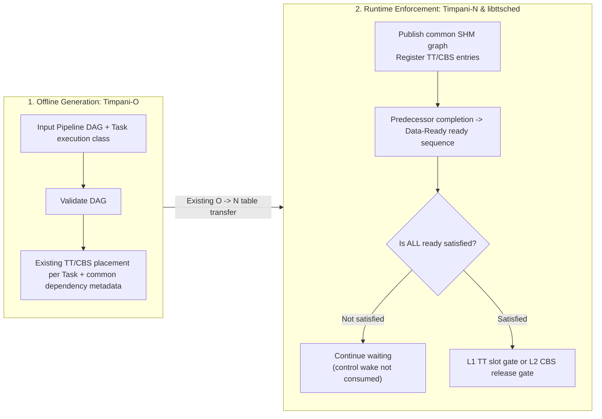
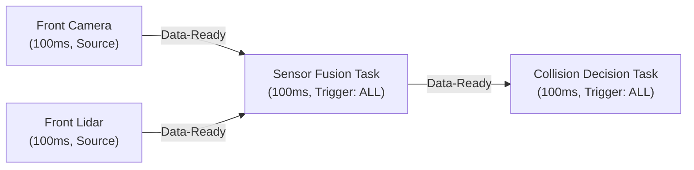

<!--
SPDX-FileCopyrightText: Copyright 2026 LG Electronics Inc.
SPDX-License-Identifier: MIT
-->

# REQ-009: Data-Driven Workload Support — Requirements Specification

**Date:** 2026-10-27
**Last Updated:** 2026-11-25 (Phase 0 PR review remediations)
**Status:** Draft — Phase 0 design proposal; review and approval pending.
The 008 field allocation `11/12/13` is aligned, but `OI-DD-01`/`02`/`03`
remain subject to Project Leader approval and verification; implementation is
not complete.
**Current Design Baseline:** Phase 0 — Verification of Basic Data-Driven Workload Chain Operation
**Author:** Human + AI
**Parent Requirement:** [SRS-000](SRS-000-timpani-system.md) §5.1 `REQ-DD-001`

**Related Documents:** [DDR-001](DDR-001-workload-model.md) (Workload Model), [DDR-002](DDR-002-scheduling-architecture.md) (Scheduling Architecture), [DDR-003](DDR-003-interface-protocol.md) (Interfaces/Protocols), [DDR-004](DDR-004-resource-allocation.md) (Resource Allocation), [DDR-005](DDR-005-sched-ext-bpf-scheduler.md) (BPF Scheduler), [DDR-006](DDR-006-communication-architecture.md) (Communication), [DDR-007](DDR-007-tt-cbs-integrated-scheduling.md) (TT/CBS), [REQ-011](REQ-011-runtime-table-update.md)·[DDR-011](DDR-011-runtime-table-update.md) (Runtime Table Update), [DDR-012](DDR-012-fault-management.md) (Fault Management)

**Follow-On Documents:** [SRS-009](SRS-009-data-driven-workload.md), [HLD-009](HLD-009-data-driven-workload.md), [DDR-009](DDR-009-data-driven-workload.md), [LLD-009](LLD-009-data-driven-workload.md), `PLAN-009` (to be written). All documents subject to the current revision are authored on the **Phase 0 baseline**; functionality from all phases (Phase 1/2) is not automatically inherited into the current implementation scope (§8.2).

> **Role of This Document.** This document is a **requirements specification (What & Why)**. At the system level, it defines *what* TIMPANI must guarantee, and *why*, when a successor task executes after its predecessor task has completed data preparation (`Data-Ready`). Detailed protocol fields, shared-memory (SHM) bit layouts, and topological-sorting algorithms are not fixed here; they are specified in [SRS-009](SRS-009-data-driven-workload.md), and decisions and details are developed in [DDR-009](DDR-009-data-driven-workload.md) and [LLD-009](LLD-009-data-driven-workload.md).
>
> **Keyword Convention:** **SHALL** = mandatory in the applicable phase, **SHOULD** = recommended, **MAY** = optional.

---

## 1. Purpose and Scope

### 1.1 Purpose

This document defines requirements for the phased implementation of **Data-Driven Workload** functionality, extending TIMPANI's existing activation methods (Time-Triggered / Event-Triggered) so that successor tasks execute in a chain when predecessor tasks complete data preparation (`Data-Ready`). The current design and implementation target is **verification of basic Data-Driven chain operation in Phase 0**. Control of execution time based on an `Activation Window`, offline E2E verification, and consistency at the successful runtime-update boundary are separated into **Phase 1**; missing-input timeout `SKIP`, root-cause fault reporting, and safe initialization of abnormal state (Fail-Safe) are separated into **Phase 2**.

The complete requirements (§5) are retained to preserve the final objective and traceability. **The current applicable scope follows §1.5, and the current acceptance criteria follow §7.1.** Failure to satisfy a Phase 1/2 requirement is not a reason for Phase 0 to be considered incomplete, and completion of Phase 0 does not imply compliance at the complete-feature or functional-safety (ISO 26262) level.

### 1.2 Background and Requirements Formalization

#### 1.2.1 Comparison of Activation Models

In an SDV/autonomous-driving environment (sensor → perception → fusion → decision → control), both the execution order and end-to-end (`E2E`) response time of the complete data-flow chain are important, in addition to adherence to individual-task periods. A fixed-offset (TT) method alone requires waiting until the end of the predecessor sensor's worst-case execution time (`WCET`), wasting waiting time when the predecessor completes early and creating a risk that a successor may read data that is not ready if the predecessor has not completed.

| Activation Method | Activation Condition | Execution Layer | Target |
|:---|:---|:---|:---|
| **Time-Triggered** | Fixed timer | L1 TT | Periodic tasks |
| **Event-Triggered** | External sporadic event | L2 CBS | Sporadic tasks |
| **Data-Triggered** *(this document)* | Direct-predecessor `Data-Ready` (`ALL`) completion | **Retains the original Task's L1 or L2 layer** | DAG Successor |

A Data-Driven Workload **separates graph roles from execution layers**. `Source`/`Successor` are DAG roles determined by `predecessors`, whereas L1/L2 are determined by the Task's existing `TemporalClass`. Therefore, either an L1 or L2 Task may be a Source or Successor, and, after predecessor data readiness satisfies `ALL`, each Task executes through the existing firing, budget, and CPU gates of its own layer.

#### 1.2.2 Phase 0 Basic Operational Flow (Current Design Baseline)

The following diagram shows the basic chain flow that operates within the **current Phase 0 scope**. (`Activation Window` open/close control, `E2E deadline` `Feasibility` checking, and transition at the boundary of a successful runtime update are extended in Phase 1; missing-input timeout `SKIP` and `Fault Monitor` `DATA_TIMEOUT` reporting are extended in Phase 2.)

#### 1.2.3 Normalized System Requirement Statements (Full-Objective Baseline)

The following statements represent the objective upon completion of **all of Phase 0–2** and provide the basis for the requirements in §5. Phase 0 does not require every property at once; applicability by phase follows §1.5 and the phase notation in §5.

| ID | Normalized Requirement Statement |
|:---|:---|
| **SR-DD-01** | The system shall accept predecessor data dependencies among tasks as a **Pipeline** in the form of a directed acyclic graph (DAG), and an invalid graph (cycle, self-reference, or nonexistent reference) shall be rejected during schedule generation. |
| **SR-DD-02** | Only **`Timpani-O`** shall perform Pipeline schedule generation and `Feasibility` determination; **`Timpani-N`** shall not recalculate topological ordering or schedulability, but shall enforce the delivered table after checking only its suitability for local application. |
| **SR-DD-03** | A Data-Driven DAG shall not change a Task's L1/L2 execution layer. An L1 Task uses the TT gate, an L2 Task uses the CBS gate, and placement is independent of the Source/Successor role. |
| **SR-DD-04** | A successor task shall not execute before direct-predecessor `Data-Ready` (`ALL`) is satisfied, and shall not consume a control wake as `Data-Ready`. |
| **SR-DD-05** | `Data-Ready` transfer shall be handled commonly through SHM + futex, while actual dispatch is delegated to the Task's existing execution layer (L1 TT or L2 CBS). |
| **SR-DD-06** | `Timpani-O` shall validate Task schedulability for the original layer (TT slot/Window or CBS budget/Gap), and shall transfer the DAG readiness condition as separate common metadata. |
| **SR-DD-07** | Upon completion of all phases, a successor task shall meet its allowed time window and `E2E deadline` (Phase 1) and, when input is missing, shall block cascading delay through `SKIP` and initial-cause `DATA_TIMEOUT` reporting (Phase 2). Runtime updates shall follow the dependency and state-transition principles of [REQ-011](REQ-011-runtime-table-update.md). |

### 1.3 In Scope

The following defines the functional scope across all phases (Phase 0–2). **The scope included in the current design and implementation is restricted in §1.5.**

- Declaration, validation, and chained execution of a Data-Driven Pipeline that connects Tasks classified as L1 TT or L2 CBS in a DAG on a single node
- O preserves each Task's original execution layer while generating the DAG readiness condition as common metadata, and N connects it to the existing TT/CBS-specific firing and dispatch paths
- Multi-predecessor `ALL` synchronization and the `libttsched` Data-Ready API
- Per-layer TT slot/Window or CBS budget/Gap validation, FFI, and `E2E deadline` `Feasibility` checking
- `SKIP` isolation on missing-input timeout, retention of Sink Fallback, and root-cause predecessor `DATA_TIMEOUT` reporting *(Phase 2)*
- Shared-interface compatibility with the [REQ-011](REQ-011-runtime-table-update.md) runtime table update *(Phase 0)*, consistency of successful boundary transitions *(Phase 1)*, and abnormal/recovery state initialization *(Phase 2)*

`Source`/`Successor` are only DAG roles and do not determine L1/L2. A Source may also be activated by an external L2 Event, and a Successor may execute as L1 TT or L2 CBS.

### 1.4 Out of Scope

- General CPU-allocation and slot-placement policies themselves ([DDR-004](DDR-004-resource-allocation.md), [DDR-007](DDR-007-tt-cbs-integrated-scheduling.md)); the runtime table update transaction and state machine themselves ([REQ-011](REQ-011-runtime-table-update.md)); and the fault-recovery policy decision logic itself ([DDR-012](DDR-012-fault-management.md))
- Internal scheduling of L3/L4 (`NonSafety`) workloads not represented in the Schedule Table ([DDR-002](DDR-002-scheduling-architecture.md))
- **Distributed Pipeline (Multi-Node Pipeline):** inter-node DAG scheduling over a network (TSN/gPTP)
- **Heterogeneous Accelerator Integration (GPU/NPU Modeling):** modeling asynchronous execution intervals for AI-inference accelerators (`REQ-AI-001`)
- **Non-harmonic Multi-Period and LET Buffering:** ring-buffer/LET state management across periods that are not integer multiples (for example, `33ms` + `100ms`)
- **Dynamic Early Release:** dynamic slot adjustment during an idle CPU interval before the `Activation Window` starts
- **`ANY` Sequence Enhancement:** a structure that executes upon one or more of multiple predecessors
- **Runtime CPU Migration During Execution:** prohibited by the Partitioned Scheduling principle; CPU changes occur only when a new table generated by O is applied
- **In-Place Pipeline Parameter Modification (`UPD-MODIFY`) and Updates That Change the `Hyperperiod`:** follow-on extension work after [REQ-011](REQ-011-runtime-table-update.md) Phase 1

### 1.5 Phased Implementation Scope and Current Baseline

#### 1.5.1 Phase Definition

The Data-Driven Workload is implemented using the same three-phase structure—**Phase 0 / Phase 1 / Phase 2**—as [REQ-011](REQ-011-runtime-table-update.md).

| Phase | Objective | Implementation Scope | Completion Criterion |
|:---|:---|:---|:---|
| **Phase 0 — Basic Operation** | Verify that a Data-Driven chain operates independently of execution layers | On a fixed table, verify DAG validation, `ALL`, and common SHM state; L1 Tasks execute through the TT gate and L2 Tasks through the CBS gate. Verify L1/L2 mixed connections in a minimal combination | Acceptance criteria in §7.1 are satisfied |
| **Phase 1 — Precise Timing, Placement, and Updates** | Guarantee per-layer deadlines and `E2E` | TT `Activation Window`, CBS TT Gap/budget validation, Harmonic periods, `E2E Feasibility`, and successful runtime updates | Phase 1 SRS |
| **Phase 2 — Fail-Safe** | Isolate faults caused by input or update anomalies | `SKIP` at Window expiry, root-cause `DATA_TIMEOUT`, Sink Fallback, and state initialization on update/restart. Do not arbitrarily change the execution layer during an update | Phase 2 SRS |

The phases are cumulative. A later phase adds functionality while preserving correct operation from the preceding phase. **Deferral means postponement of new implementation or verification; it is not permission to remove existing behavior or safeguards.** Phase 0 also retains `Timpani-O`/`Timpani-N` separation of responsibilities, RT critical-path discipline, backward compatibility of existing L1/L2 behavior, validation of a valid SHM publication under [DDR-011](DDR-011-runtime-table-update.md) Phase 0, and the pre-approval constraint on interface changes.

#### 1.5.2 Phase 0 Test Boundary

- **Target Workload:** On a basic chain with fixed `E/H` and equal periods, verify combinations in which L1/L2 Tasks assume the Source or Successor role. The role does not determine the execution layer; the actual layer follows the input Task's `TemporalClass`.
- **Execution and State Boundary:** `ALL` is the common readiness condition. An L2 Task is released immediately to CBS budget/Gap dispatch, while an L1 Task is dispatched in its next allowed TT slot only when `ALL` is satisfied. Phase 0 tests use only the normal condition in which `ALL` for an L1 Successor is satisfied before that slot.
- **Boundary with Runtime Table Updates ([DDR-011](DDR-011-runtime-table-update.md)):**
  - During Phase 0 tests, **do not perform runtime updates (`UPD-REPLACE / ADD / REMOVE / CLEAR`) on a table that contains a Pipeline**. Consistency of successful boundary transitions for a Pipeline-containing table (`REQ-DD-016`) is deferred to Phase 1, and state initialization on update failure, rollback, recovery `STOP`, or restart (`REQ-DD-014`) is deferred to Phase 2.
  - However, **shared-interface consistency with the Phase 0 baseline of [DDR-011](DDR-011-runtime-table-update.md)** is mandatory in Phase 0:
    1. Do not change the existing 784-byte prefix of `/timpani_ttsched`. Retain the existing `void ttsched_init(void)` signature, but introduce `g_shm_init_errno` and a bulk reset of all TLS. During non-RT `ttsched_init()`, validate the SHM object size with `fstat()` only once (close the fd immediately after `mmap()` and `munmap` when the thread exits). On an RT critical path (`release_source`, `signal_ready`, `wait_data`, `current_job_token`, `Timer Master`), validate using only pure atomic loads (`g_shm_pipeline_capable`, `WRITER_PENDING` in `publication_guard`, `shm->magic`, an even `generation`, and `pipeline_header.{magic, abi_version, abi_size, instance_id}`) and a 16-byte atomic name comparison (`atomic_name_equals`), with no VFS/fd system calls. If the old 784-byte SHM is found during initialization, retain only the existing TT API, and the Pipeline APIs return `ENOTSUP`. `Timpani-N` keeps the live object fixed at the full ABI size (`3,128` B, no shrink); replacement and shutdown use `WRITER_PENDING` + drain (Safe Abandonment if `50 ms` is exceeded) + invalidation of `magic=0`/`pipeline_header.magic=0` + `FUTEX_WAKE(..., INT_MAX)` for all `tasks[i].counter` and `pipeline[i].dispatch_counter` values + `shm_unlink()` without `ftruncate` + `O_CREAT|O_EXCL` creation with a new `instance_id`.
    2. The write commit guard (`release_source`, `signal_ready`, and the `Timer Master` lightweight guard `tm_pipeline_commit_enter`) serializes the Source's release-valid + activation-ordinal single 64-bit release-store, the Successor's packed `ready_state` single 64-bit CAS (mask reset + ready-sequence increment), the required L1/L2 `dispatch_counter` update, and the futex wake with the publication generation transition (including a unified `pipeline_commit_exit()` on failure rollback to prevent Lost Wakeup; normal drain `effective_pub_drain_timeout_us(H) = min(5 ms, H/4)` / shutdown cap `50 ms`). Before each CAS/wake, an in-flight writer that already holds the guard uses `pipeline_commit_alive()`, excluding `WRITER_PENDING`, to complete commit+wake during a normal drain. Once the initial generation binding (`g_shm_generation == 0U`) has occurred, observation of a generation mismatch causes all four Pipeline APIs—`ttsched_release_source()`, `ttsched_current_job_token()`, `ttsched_wait_data()`, and `ttsched_signal_ready()`—to return `ESTALE` immediately. A pure read consumer API (`ttsched_wait_data()`, `ttsched_current_job_token()`) protects an `O_RDONLY` mapping with a read-only seqlock that does not write to `publication_guard`. The 64-bit release-store/CAS must be lock-free on the target environment, and only `dispatch_counter` is used as the futex wait/wake word.
    3. A **control wake** accompanying table publication, shutdown, or a generation change terminates with `ESTALE`, and a spurious wake with no generation or validity change safely waits again with `0` executions. In no case may it be consumed as successor-task execution without an increment to `dispatch_counter`. Pipeline APIs shall fail without mutation and distinguish publication/write-permission/ABI failures through `errno`.
    4. Tables for normal L1 TT that do not contain a Pipeline shall not regress the successful-update Phase 0 acceptance criteria (`AC-P0-01` through `08`) of [REQ-011](REQ-011-runtime-table-update.md).
  - **Phase Boundary:** Phase 0 requires initial publication, invalidation, and fixed-Pipeline commit serialization, but does not perform successful runtime updates of a Pipeline-containing table. Phase 1 applies the same guard to a Pipeline boundary update, while Phase 2 additionally reclaims remaining guards/state after update failure, rollback, or restart.
- **Inputs and Responsibilities:** O validates the DAG and the Task's existing L1/L2 placement separately. N publishes only the common SHM graph, and TT Tasks use the Timer Master/TT gate while CBS Tasks use the CBS gate. `Data-Ready` does not itself reclassify the execution layer or change the CPU.
- **Assurance Level:** Verify non-execution on partial predecessors and a control wake, and the dispatch conditions for the L1/L2 layers. Timeout `SKIP`, `DATA_TIMEOUT`, and quantitative worst-case `E2E` are left to later phases.

#### 1.5.3 Minimum Operation Required in Phase 0

For items in §5 whose phase notation includes `0`, **only the following applies in Phase 0**. Other detailed obligations in items marked with multiple phases (`0/1`, `0/1/2`) are deferred to later phases. This is phase-specific refinement of the same ID and does not mean that the entire requirement is complete in Phase 0.

| Applicable Requirement | Phase 0 Applicability | Subsequent Enhancement |
|:---|:---|:---|
| **REQ-DD-001** | When generating a fixed table, resolve the structured predecessor reference `TaskReference(workload_id, task_id)` (`TaskReference.task_id` is an exact one-to-one match to `TaskInfo.name` (field 1)). An empty `workload_id` means the current workload, and Phase 0 permits only same-workload references and a **node-unique `1..15`-byte ASCII `task_id`**. Pre-reject cycles, self-references, nonexistent references, duplicate declarations in the same Task's `predecessors` (`[A, A]`), duplicate Task identifier pairs/node-local `task_id` values, hash collisions, capacity overruns, duplicate assignment of an incoming predecessor bit, or mismatch between the incoming bit union and `required_mask`, and retain the committed model (preserving rollback of the existing workload model on failure) | Cross-workload references (including resolution of `task_id` collisions across workloads), `E2E deadline` `Feasibility`, and candidate validation for runtime updates: Phase 1 |
| **REQ-DD-002** | Use an explicitly supplied `TaskInfo.temporal_class` as the Task execution layer, and inherit `SchedInfo.temporal_class` only when the field is absent. In particular, explicit `TEMPORAL_PERIODIC = 0` selects L1. The presence-sensitive rule supersedes the 008 P2 placeholder `0 = inherit` and remains subject to `CON-DD-05` approval. O separates DAG roles from layers, separates TT/CBS representation from common DAG metadata, and identifies O→N Tasks by the `(workload_id_hash, task_id_hash)` pair. Existing `ExecutionModel.DATA_FLOW = 2` remains in the enum for wire compatibility but is fixed as unused in Phase 0 (not emitted by O; rejected with `EINVAL` if received by N) | Precise per-layer validation and a cross-workload Pipeline: Phase 1 |
| **REQ-DD-004** | A Source retains its existing TT/CBS path. An L1 Successor performs `update_current_slot()`, increments `dispatch_counter` once, and calls `FUTEX_WAKE` only in its own TT slot when an `ALL`-pending ready exists (when `pending == false`, omit all of these and do not actively overwrite `SLOT_NONE`, so kernel `ops.enqueue()`/`scx_bpf_kick_cpu` does not occur); an L2 Successor opens `dispatch_counter` in the `ALL` commit and releases into the BPF CBS gate. A control wake terminates with `ESTALE`, and a spurious wake waits again with `0` executions | `Activation Window`/slot-miss expiry: Phase 1; `SKIP`: Phase 2 |
| **REQ-DD-005** | An L1 Source (`Timer Master`, using a single common `base_cycle_start` and a Source-specific Pipeline-period activation ordinal `k`) and an L2 CBS Source (`O_RDWR` event adapter/test generator calling `ttsched_release_source(task_name, k)`, forcing `execution_model == TIMPANI_EXEC_CBS`) atomically record `k` in the Source Pipeline slot's `ready_state` with a release marker at actual activation time. Immediately after activation, the application obtains that snapshot once with `ttsched_current_job_token()`. The application/library SHALL NOT recompute the token from `CLOCK_REALTIME` or an application-local counter. Permit one per-layer dispatch per cycle only when every immediate predecessor presents a `job_token` equal to the Successor's active `ready_sequence`. `ttsched_init()` distinguishes attachment before publication (`g_attached_before_publish = 1`, preserving token `0` with cursor `0` on first entry into a valid generation) from late attachment to an already-published `cur = N > 0` (`g_last_dispatch_counter = N`, without replaying `0..N-1`). `ttsched_wait_data()` returns tokens by FIFO sequential consumption (`g_last_dispatch_counter++`) after that cursor, and a Sink (`num_out_edges == 0`) returns no-op `0` from `signal_ready()` after validation. A Producer calls `signal_ready(token)` only after fully publishing the token-addressed payload, and a Consumer reads the same token payload after `wait_data(token)`. Prevalidate the Source's complete outgoing-edge set before changing the first destination; malformed metadata or a duplicate/stale token failure at any destination leaves all mask, sequence, dispatch, and wake state in the complete fan-out unchanged. This mutation-free guarantee is limited to failures before preflight completes; rollback/retry atomicity after a process crash following the first CAS is outside the Phase 0 guarantee. Emit the CBS wake only after all successful `ALL` CAS operations are complete | Generic idempotency, `ANY`, and Harmonic multi-period mapping: Phase 1 |
| **REQ-DD-007** | Deliver `Data-Ready` on the RT critical path using SHM atomic operations + `futex`, without blocking IPC/gRPC, dynamic allocation, VFS/fd system calls, or kernel privilege | Quantitative multicore contention verification: Phase 1 |
| **REQ-DD-008** | For an L1 Successor, enforce ready + its own TT slot gate (perform `update_current_slot()`, `dispatch_counter++`, and `FUTEX_WAKE` when `pending == true`; omit them and do not overwrite `SLOT_NONE` when `pending == false`). For an L2 Successor, satisfy ready + the existing CBS CPU/budget/Gap gate. Phase 0 enforces only the per-layer `dispatch_counter` gate | `Activation Window` and Gap refinement: Phase 1 |
| **REQ-DD-009** | O applies the existing TT slot placement or CBS admission/worst-fit policy for each Task's resolved execution layer. For Phase 0 `L1 → L1` slot placement, apply the ordering key `(topo_rank, deadline_us, workload_id, task_id)` and validation of `min_start` based on predecessor completion time plus `offset(succ) >= offset(pred) + duration(pred)` to ensure predecessor completion within the same period (`ASM-DD-03`) (non-DAG tasks retain existing DM with `topo_rank == 0`). For a CBS-only Pipeline, ensure `hyperperiod_us > 0` using the LCM of CBS periods. Do not permit runtime CPU migration | `E2E` analysis of a mixed DAG, including TT Window and CBS Gap/interference: Phase 1 |
| **REQ-DD-015** | Verify stable 011 publication and preservation of `void ttsched_init()` (`g_shm_init_errno`, reset of all TLS, one non-RT `fstat()`), RT no-VFS atomic validation (extension `magic/version/abi_size/instance_id`, 16-byte atomic name comparison), the write commit guard (`effective_pub_drain_timeout_us(H) = min(5 ms, H/4)` / `50 ms` Safe Abandonment, `FUTEX_WAKE(INT_MAX)` for `tasks[]` and `pipeline[]`), and the read-only seqlock (`O_RDONLY`). Serialize the Source release `ready_state` single 64-bit release-store, the Successor packed `ready_state` single 64-bit CAS, and required `dispatch_counter` update/wake in the same generation order as the publisher. A writer that has already entered the guard completes commit+wake during a normal drain by using `pipeline_commit_alive()`, which excludes `WRITER_PENDING`, immediately before each CAS/wake. After initial generation binding, all four Pipeline APIs reject a mismatch with `ESTALE`: `release_source`, `current_job_token`, `wait_data`, and `signal_ready`. Safe Abandonment is not cancellation of the old active writer; it is a contract that isolates the old operation through `magic=0`, unlink, and a new-`instance_id` object, with failures without mutation for an old ABI, invalid snapshot, or writer-pending new entry | Apply at normal Pipeline update boundaries: Phase 1; guard reclamation on failure/restart: Phase 2 |
| **REQ-DD-013** | On a fixed basic chain, verify TT→TT, TT→CBS, CBS→TT, and CBS→CBS connections, partial input/control wake, invalid DAG, existing TT/CBS regressions, and generation/commit races | Mixed-layer `E2E` and successful updates: Phase 1; Fail-Safe: Phase 2 |

The current follow-on documents ([SRS-009](SRS-009-data-driven-workload.md), [HLD-009](HLD-009-data-driven-workload.md), [DDR-009](DDR-009-data-driven-workload.md), [LLD-009](LLD-009-data-driven-workload.md), and `PLAN-009` (to be written)) elaborate only this section. Later-phase items are retained as traceability lists, but their internal state flags, Window-expiry timers, and `SKIP`/recovery state machines are not to be pulled into Phase 0 implementation work.

---

## 2. Terminology

The following terms are common to the full objective and use the standards in [DDR-001](DDR-001-workload-model.md) through [DDR-012](DDR-012-fault-management.md) and [REQ-011](REQ-011-runtime-table-update.md). `Activation Window` and the Pipeline application-boundary transition are elaborated in Phase 1, while `DATA_TIMEOUT` and abnormal-state initialization are elaborated in Phase 2; **the presence of a term alone does not require Phase 0 implementation.**

| Term | Standard Notation and Definition in This Document Set | Baseline Document |
|:---|:---|:---|
| **Pipeline** | A workload/task execution chain connected through DAG dependencies (with a common `Hyperperiod` and `E2E deadline`) | [DDR-001](DDR-001-workload-model.md) §2 |
| **Task (Source / Successor / Sink)** | A graph role. A Source is a starting Task with no predecessors, a Successor is a Task with `predecessors`, and a Sink is the final Task in the chain. No role forces L1/L2 | This document set |
| **Data-Ready** | A common signal that updates the successor Task's logical ready state after the predecessor Task publishes output data. Actual dispatch is delegated to the Task's execution layer | This document set |
| **Execution Adapter** | Connects a Data-Driven readiness condition to a layer-specific scheduler. Phase 0 uses the Timer Master TT slot gate for L1 and `ALL`-commit release plus the BPF CBS budget/Gap gate for L2. `Activation Window` is Phase 1 | This document set, DDR-007/008 |
| **Trigger Condition (`ALL` / `ANY`)** | The direct-predecessor readiness condition. Phase 0 requires `ALL`; `ANY` is only considered as an extension | This document set |
| **Activation Window** | The time interval in which successor activation and execution are permitted after offline validation (`[EST, window_end_us]`). *(Applies in Phase 1)* | This document set |
| **Harmonic Periods** | A period configuration in which task periods are integer multiples and do not cause `Hyperperiod` explosion | [DDR-004](DDR-004-resource-allocation.md) §8.A |
| **Timer Master / Fault Monitor** | The precision timer-firing thread and fault collection/reporting component in `timpani-n` (`userspace`) | [DDR-002](DDR-002-scheduling-architecture.md), [DDR-012](DDR-012-fault-management.md) |
| **Deadline Miss (`DMISS`) / `DATA_TIMEOUT`** | Exceeding an execution deadline (`DMISS`) and a Fault type for missing predecessor data at the end of an `Activation Window` *(the latter applies in Phase 2)* | [DDR-003](DDR-003-interface-protocol.md), [DDR-012](DDR-012-fault-management.md) |
| **Application Boundary (Activation Instant)** | The `Hyperperiod` boundary (`T = E + kH`) on the common `Epoch` grid at which a candidate Schedule Table prepared by a runtime update becomes the active table. Because this is distinct from the Task-level execution interval, the **`Activation Window`**, this document set uses “application boundary” | [REQ-011](REQ-011-runtime-table-update.md) §2 |
| **Publication / Control Wake** | The process by which `Timer Master` writes and validates a table image in `/timpani_ttsched` SHM (publication), and a `futex` wakeup used to notify publication, shutdown, and similar events (control wake). A control wake is not treated as job execution or `Data-Ready` | [REQ-011](REQ-011-runtime-table-update.md) F-051, [DDR-011](DDR-011-runtime-table-update.md) D-P0-05 |

---

## 3. Stakeholder Requirements and Lessons from Comparable Projects

### 3.1 Stakeholders and Requirements

The following are stakeholder requirements across all phases. Phase 0 applies the test boundary and minimum operation in §1.5.

| Stakeholder | Requirement |
|:---|:---|
| **Pullpiri** | Supplies DAG dependencies, Task execution classes, timing, and `E2E`, and receives reasons for rejection. |
| **Timpani-O** | Is the sole entity that performs DAG validation and existing TT/CBS placement for Tasks. |
| **Timpani-N** | Locally validates and enforces TT/CBS entries and common DAG metadata. |
| **Pipeline Application** | Transmits `Data-Ready` after publishing output data. |
| **Functional-Safety Authority** | Obtains evidence for per-layer TT/CBS isolation, execution order, and timeouts. |

### 3.2 Key Lessons from Comparable Projects

| Reference | Key Characteristic | Application to the Timpani Design | Applicable Phase |
|:---|:---|:---|:---:|
| **ROS 2 (rclc Executor)** | `ALL`/`ANY` trigger conditions and static execution order | Adopt an `ALL` trigger and deterministic execution order for multi-sensor fusion | **Phase 0** |
| **NVIDIA STM (Alpamayo deployment)** | Offline DAG compilation + simple runtime enforcement | Exclude runtime graph traversal and enforce only offline-generated static tables and indices | **Phase 0** |
| **MotionWise (TTTech)** | Dataflow combined atop Time-Triggered execution | Permit data triggering only within an offline-validated `Activation Window` | Phase 1 |
| **Apex.OS (Apex.Grace)** | Task chaining and monitoring of execution deadlines and missing input | Verify chain-level `E2E deadline` (Phase 1) and missing-input `SKIP`/fault monitoring (Phase 2) | Phase 1 / 2 |

---

## 4. Operational Scenarios

Each scenario describes target behavior by phase. **In Phase 0, only `UC-DD-01`, `UC-DD-02`, and basic invalid-DAG rejection in `E-DD-01` are verified under the fixed-table conditions of §1.5.** `UC-DD-03` (Harmonic multi-period operation and `Activation Window`) and `UC-DD-04` (successful runtime update of a Pipeline-containing table) apply to Phase 1; `E-DD-02` (timeout `SKIP` and root-cause reporting) and `E-DD-03` (initialization of abnormal/recovery state) apply to Phase 2.

### UC-DD-01 — Basic Chain Execution for Same-Period Multi-Sensor Fusion *(Current Phase 0 Target)*

- **Precondition:** Each of the four Tasks is placed as L1 TT or L2 CBS according to its input, and the DAG roles are conveyed separately.
- **Main Flow:** A Source starts using the existing TT/CBS method → fully publishes the token-addressed payload → transmits `Data-Ready` for that token → creates `ALL` ready → an L1 Successor executes in the next allowed TT slot, while an L2 Successor executes upon CBS release → completion wakes the next Task.
- **Postcondition:** The Task executes only after direct predecessors complete and complies with each Task's original TT/CBS timing rules.

### UC-DD-02 — Continue Waiting on Partial Predecessor Input or a Control Wake *(Current Phase 0 Target)*

- **Precondition:** The same chain as `UC-DD-01` is operating, and the active chain job token is `k`.
- **Main Flow:** (a) After `camera(k)` sets its bit, the same `(camera, k)` is sent again, or `camera(k+1)`/another predecessor token `k+1` is sent while `lidar(k)` has not arrived; or (b) a control wake, such as an SHM table-publication or shutdown notification without an increase in the `Data-Ready` counter, occurs.
- **Postcondition:** A duplicate token fails with `EALREADY`; a token other than active `k` fails with `ESTALE`; and ready/dispatch state does not change. `Sensor Fusion` and `Collision Decision` continue waiting until all predecessors present token `k`. Token-addressed storage prevents a rejected attempt from overwriting the payload for active token `k`. *(Forced `SKIP` and `DATA_TIMEOUT` reporting at timeout are covered by Phase 2 `E-DD-02`.)*

### UC-DD-03 — AEB Chain Based on Harmonic Multi-Period Operation and an `Activation Window` *(Phase 1 Objective)*

- **Configuration:** Camera (`50ms`) + lidar (`100ms`) → sensor fusion → collision decision → braking control/Fallback. Each Task's TT/CBS class follows its declaration; the example does not force a particular class.
- **Target Behavior:** The fusion task does not execute when only one `50ms` camera cycle completes or when input arrives early before `EST`. It executes only when `ALL` is satisfied within the offline-validated `Activation Window` (`[EST, window_end_us]`), allowing the complete chain to finish within the `E2E deadline`.

### UC-DD-04 — Successful Runtime Update of a Pipeline-Containing Table *(Phase 1 Objective, Linked to REQ-011)*

- **Target Behavior:** During a Pipeline update, an in-progress chain instance completes or is safely terminated before the application boundary. At boundary `T=E+kH`, the TT/CBS execution representation, common DAG metadata, and ready state transition together. Unrelated Pipelines are preserved.

### Exceptional Scenarios

| ID | Scenario | Required Result (Summary) | Applicable Phase |
|:---|:---|:---|:---:|
| **E-DD-01** | Submission of an invalid or constraint-violating Pipeline (cyclic dependency, self-reference, nonexistent reference / FFI violation, Non-harmonic periods, exceeded `E2E deadline`, or reference to a removal target as a predecessor) | `Timpani-O` (or `Timpani-N` for local representation/capacity limits) rejects the Pipeline with a reason before activation; the existing committed model and active table remain unchanged | **Basic DAG and Capacity: Phase 0** FFI, E2E, and Update References: Phase 1 |
| **E-DD-02** | A predecessor input has not arrived by the end of the `Activation Window` | Prevent cascading delay by omitting wakeup (`SKIP`) for the successor task in that cycle; report only the first incomplete predecessor Task as `DATA_TIMEOUT`; keep the Sink control Task on the last valid output (Fallback) | Phase 2 |
| **E-DD-03** | Runtime-update activation failure or rollback, workload recovery `STOP`/`RESTART`, or `Timpani-N` restart occurs | Guarantee `0` erroneous wakeups caused by residual predecessor completion bits or previous-generation state, and prohibit re-firing a Task under recovery `STOP` | Phase 2 |

---

## 5. Requirements

Priority: **M** = mandatory for acceptance in the applicable phase (`SHALL`), **S** = recommended (`SHOULD`)

**Phase Notation:** `0`, `1`, and `2` identify the applicable phases. Where multiple phases appear, such as `0/1` or `0/1/2`, that ID is satisfied incrementally. **Phase 0 applies only the content in §1.5.3.** Items marked `1` or `2` are not prerequisites for current implementation or acceptance. The original wording below preserves the objective through later phases and is not to be used wholesale as detailed input to the current design.

> Requirement IDs are neither renumbered nor reused, so IDs within a section may be nonconsecutive; this is not an error.

### 5.1 Pipeline Model

| ID | Requirement | Priority | Phase | Rationale / Source |
|:---|:---|:-:|:---:|:---|
| **REQ-DD-001** | **DAG Model Declaration and Validation**: The system SHALL be able to declare a DAG Pipeline comprising predecessor edges represented as `TaskReference(workload_id, task_id)` (SHALL; `TaskReference.task_id` is an exact one-to-one match to `TaskInfo.name` (field 1)). In Phase 0, an empty `workload_id` is interpreted as the current workload, references to another workload are rejected, and `task_id` SHALL be a **node-unique `1..15`-byte ASCII** value for SHM name-lookup compatibility (SHALL). Before schedule generation, reject cycles, self-references, nonexistent references, duplicate predecessor declarations within the same Task's `predecessors` array (`[A, A]`), duplicate `(workload_id, task_id)` or node-local `task_id`, FNV-1a hash-pair collisions, supported-capacity overruns, and predecessor-bit encoding violations, while preserving rollback of the existing committed model. Each Successor's direct incoming edges and `required_mask` bits SHALL be one-to-one. Reject the request if two edges share a bit, an assigned bit is outside the mask, or the OR-union of incoming bits differs from the mask. Phase 1 extends this with cross-workload references (including `task_id` collision resolution across workloads) and `E2E deadline` checking. | M | 0/1 | [SRS-000](SRS-000-timpani-system.md) REQ-DD-001, E-DD-01 |
| **REQ-DD-002** | **Layer-Independent Mapping and Separation of Responsibilities**: When `TaskInfo.temporal_class` is explicitly present, that value SHALL be used; only an absent field SHALL inherit `SchedInfo.temporal_class` (SHALL). Thus explicit `TEMPORAL_PERIODIC = 0` selects L1, and this presence-sensitive rule supersedes the 008 P2 placeholder `0 = inherit`; the semantic change is subject to `CON-DD-05` approval. This resolved class is independent of the DAG role, and O generates the existing TT/CBS execution representation. Common DAG metadata is conveyed separately using the `(workload_id_hash, task_id_hash)` pair, and N does not recalculate schedulability. Existing `ExecutionModel.DATA_FLOW = 2` remains in the enum for wire compatibility but is unused in Phase 0 (not emitted by O; rejected with `EINVAL` if received by N). The workload supplies its default class and lifecycle grouping, and a Task override determines the Scheduling layer. | M | 0/1 | DDR-001, DDR-002, DDR-007 |
| **REQ-DD-003** | **Freedom From Interference (FFI)**: `NonSafety` dependencies shall be rejected, and every Task SHALL pass the TT/CBS interference and budget checks for its original layer. | M | 1 | SRS-000 REQ-NFR-002 |

### 5.2 Activation and Runtime Enforcement

| ID | Requirement | Priority | Phase | Rationale / Source |
|:---|:---|:-:|:---:|:---|
| **REQ-DD-004** | **Predecessor-Dependency Guarantee and Per-Layer Gate Connection**: A Source SHALL retain existing TT/CBS activation. A Successor SHALL NOT execute before `ALL` readiness. At its own TT slot, Timer Master may process an L1 Successor only when pending readiness is present, performing `update_current_slot()`, `dispatch_counter++`, and `FUTEX_WAKE` (when `pending == false`, omit all three and do not overwrite `SLOT_NONE`). An L2 Successor opens `dispatch_counter` in the `ALL` commit and SHALL follow the existing CBS CPU/budget/Gap gate (SHALL). A control wake for publication, shutdown, or a generation change terminates with `ESTALE`; a spurious wake waits again with `0` executions and is never treated as dispatch. | M | 0 | UC-DD-01, UC-DD-02 |
| **REQ-DD-005** | **Trigger Condition and Chain-Job Identity**: An L1 Source (`Timer Master`, a single common `base_cycle_start`, and the Source-specific Pipeline-period ordinal) and an L2 CBS Source (`O_RDWR` event adapter/test generator calling `ttsched_release_source()`, enforcing `execution_model == TIMPANI_EXEC_CBS`) SHALL atomically record the common activation ordinal in the Source Pipeline slot's `ready_state` with a release marker at actual activation (SHALL). Immediately after activation, the application shall obtain that snapshot once through read-only `ttsched_current_job_token()` and fix it; it SHALL NOT recompute the token using `CLOCK_REALTIME`, division by `origin_epoch_ns`, or a Task-local counter (SHALL). Permit exactly one per-layer dispatch per cycle only after all direct predecessors signal a `job_token` equal to the Successor's active `ready_sequence`. `ttsched_init()` distinguishes pre-publication attachment (`g_attached_before_publish = 1`, preserving token `0` with cursor `0` on the first valid-generation entry) from late attachment to an already-stably-published `cur = N > 0` (`g_last_dispatch_counter = N`, non-replay of `0..N-1`). A Successor's `ttsched_wait_data()` returns `job_token` values by FIFO sequential consumption after that cursor, and a Sink (`num_out_edges == 0`) returns a validated, no-op `0` from `signal_ready`. A Producer shall call `signal_ready(token)` only after fully publishing the token-addressed payload, and a Consumer shall read the same token payload after `wait_data(token)`. Before changing the first destination, `signal_ready` SHALL validate/preflight `n_tasks`, its own identity and the complete outgoing-edge set: count/index, zero upper 16 bits and bit membership of `required_mask`, trigger/model, self/duplicate destinations, and token/duplicate-bit state at each destination (SHALL). Static or preflight failure shall not change any predecessor mask, sequence, dispatch counter, or wake in the complete fan-out. If the Source process exits after the first destination CAS begins, a partial commit may remain; automatic rollback and retry atomicity are defined in Phase 2 recovery, not Phase 0. After preflight, identical concurrent commits converge, and CBS `dispatch_counter` update/wake occurs only after all required CAS operations complete. A duplicate bit for the active token yields `EALREADY`; a stale/future token yields `ESTALE`. Store the payload per token and retain it until the corresponding dispatch. Defer `ANY`, generic idempotency, and Harmonic multi-period mapping. | M | 0 | UC-DD-01, UC-DD-02 |
| **REQ-DD-006** | **Activation Window Enforcement**: Independently of execution layer, combine an `Activation Window` atop the existing L1/L2 time gates (SHALL). Beginning in Phase 1, execution shall not occur before `ALL` is ready or outside the Window. | M | 1 | UC-DD-03 |
| **REQ-DD-007** | **Low-Latency Data-Ready Synchronization**: On the RT critical path, the data-completion signal and wait SHALL use the `libttsched` API based on `/timpani_ttsched` shared memory (SHM) and `futex`, without blocking IPC/gRPC, dynamic allocation, VFS/fd system calls, or kernel privilege (`CAP_BPF`) (SHALL). | M | 0 | [SRS-000](SRS-000-timpani-system.md) REQ-NFR-003, [DDR-006](DDR-006-communication-architecture.md) |
| **REQ-DD-008** | **Static Enforcement by Layer**: An L1 Successor with pending `ALL` ready SHALL perform `update_current_slot()` activation, `dispatch_counter++`, and `FUTEX_WAKE` only at an allowed TT slot, allowing enforcement through kernel `ops.enqueue()`/`scx_bpf_kick_cpu` (omit all operations and do not overwrite `SLOT_NONE` when `pending == false`). An L2 Successor SHALL execute only under the original CBS CPU, budget, and Gap policies after its gate opens in the `ALL` commit (SHALL). Phase 0 does not apply an `Activation Window`, and DAG metadata shall not bypass scheduler timing/budget rules. | M | 0 | DDR-005, DDR-007, 008 |
| **REQ-DD-015** | **SHM Interface and Publication Validity**: The Pipeline path SHALL preserve the existing 784-byte prefix and `void ttsched_init(void)` signature (including `g_shm_init_errno` and reset of all TLS), validate the SHM size with `fstat()` once in non-RT `ttsched_init()` (close the fd immediately after `mmap()` and `munmap` on thread exit), and in the RT path validate with pure atomic loads and no VFS/fd system calls: `g_shm_pipeline_capable`, `publication_guard` (`WRITER_PENDING`), `shm->magic`, even `generation`, extension `magic`/`abi_version`/`abi_size`/`instance_id`, and a 16-byte atomic name comparison (`atomic_name_equals`) (SHALL). Once initial valid-generation binding (`g_shm_generation == 0U`) has occurred, a generation mismatch SHALL immediately return `ESTALE` from all four Pipeline APIs: `release_source`, `current_job_token`, `wait_data`, and `signal_ready`. Only `Timpani-N` owns `ftruncate()`/`shm_unlink()` object lifecycle; it keeps the live object at fixed size (`3,128` B, no shrink) and performs replacement/shutdown only with `WRITER_PENDING` + drain (`effective_pub_drain_timeout_us(H) = min(5 ms, H/4)`, Safe Abandonment after shutdown exceeds `50 ms`) + invalidation of `magic=0`/`pipeline_header.magic=0` + `FUTEX_WAKE(..., INT_MAX)` for every `tasks[i].counter` and `pipeline[i].dispatch_counter` + `shm_unlink()` without `ftruncate`/overwrite + `O_CREAT|O_EXCL` creation of a new `instance_id`. Before each CAS/wake, an in-flight writer that already entered the guard uses `pipeline_commit_alive()`, excluding `WRITER_PENDING`, to complete commit+wake during normal drain. On Safe Abandonment, `magic=0`, unlink, and a new-`instance_id` object isolate the old operation from the active generation. Workload clients shall not resize or unlink. Update `ready_state` with a lock-free release-store of the release-valid marker and activation ordinal in a Source, and with a lock-free 64-bit CAS that packs the predecessor mask and active ready sequence in a Successor; use only L1/L2 `dispatch_counter` as the futex wait/wake word. Serialize write commit (`release_source`, `signal_ready`, and `Timer Master`) with the commit guard and the publication generation transition, while pure-read APIs (`wait_data`, `current_job_token`) use a read-only seqlock that does not write to `publication_guard` to support `O_RDONLY`. In invalid, replaced, new-entry writer-pending, duplicate-bit, or token-mismatch state, return `-1` with `errno` and no mutation. | M | 0/1/2 | REQ-011 F-037/038/041 |

### 5.3 Offline Scheduling (`Timpani-O`)

| ID | Requirement | Priority | Phase | Rationale / Source |
|:---|:---|:-:|:---:|:---|
| **REQ-DD-009** | **Placement Synthesis by Execution Layer**: O SHALL apply existing TT/CBS placement rules to each Task and validate DAG ordering (SHALL). In Phase 0, apply the ordering key `(topo_rank, deadline_us, workload_id, task_id)`, predecessor-completion-based `min_start`, and validation of `offset(succ) >= offset(pred) + duration(pred)` to `L1 → L1` slot placement, thereby guaranteeing predecessor completion within the same period (non-DAG Tasks retain existing DM). For a CBS-only Pipeline, guarantee `hyperperiod_us > 0` using the LCM of CBS periods. Phase 1 includes TT Window and CBS Gap/interference in `E2E` analysis. Runtime migration shall not be permitted. | M | 0/1 | DDR-004, DDR-007, 008 |
| **REQ-DD-010** | **E2E Deadline Guarantee and Measurement**: O SHALL sum L1 TT wait/slot delay and L2 CBS Gap/budget delay according to the layer along each DAG path, and SHALL reject the schedule if worst-case `E2E` exceeds the declared value. | M | 1 | SRS-000 REQ-DD-001 |

### 5.4 Fault and Monitoring

| ID | Requirement | Priority | Phase | Rationale / Source |
|:---|:---|:-:|:---:|:---|
| **REQ-DD-011** | **Input Timeout and Cascading-Delay Prevention**: If `ALL` is not satisfied by Window expiry, the applicable chain instance SHALL be `SKIP`ped to prevent cascading delay (SHALL). A Sink/Fallback Task SHALL be able to apply a valid-output retention strategy under its own TT or CBS execution rule; 009 shall not fix a Sink to a particular class. | M | 2 | E-DD-02 |
| **REQ-DD-012** | **Root-Cause Task Fault Reporting**: On an input-missing timeout, only the first incomplete predecessor Task SHALL be identified and reported (`FaultInfo`) as a `DATA_TIMEOUT` Fault, without duplicate cascading reports from downstream Tasks (SHALL). The reporting condition shall follow the threshold (`current_limit`) policy in [DDR-012](DDR-012-fault-management.md). | M | 2 | [DDR-012](DDR-012-fault-management.md), E-DD-02 |
| **REQ-DD-014** | **Safe Initialization of Pipeline State (Abnormal Conditions)**: Pipeline runtime state (predecessor-completion information, Window state, and writer-pending/active-commit state in `pipeline_header.publication_guard`) SHALL be initialized on runtime-update activation failure or rollback, workload recovery `STOP`/`RESTART`, or `Timpani-N` restart (SHALL). A successor task shall not be incorrectly woken by residual state from a previous cycle or table. A Pipeline Task under removal by recovery `STOP` shall not be woken again because the previous table is restored ([REQ-011](REQ-011-runtime-table-update.md) F-030). | M | 2 | E-DD-03, [REQ-011](REQ-011-runtime-table-update.md) Phase 2 |

### 5.5 Integration with Runtime Schedule Table Updates

> This requirement applies in a later phase (Phase 1) when the runtime updates (`UPD-REPLACE / ADD / REMOVE / CLEAR`) defined by [REQ-011](REQ-011-runtime-table-update.md) apply to a **table containing a Pipeline**. Phase 0 does not perform runtime updates on a Pipeline-containing table (§1.5.2); the update procedure itself follows [REQ-011](REQ-011-runtime-table-update.md).

| ID | Requirement | Priority | Phase | Rationale / Source |
|:---|:---|:-:|:---:|:---|
| **REQ-DD-016** | **Successful-Update Pipeline Consistency**: ① Transition common DAG metadata and the TT/CBS execution representation at the same application boundary. ② Initialize ready/dispatch state so a previous-generation signal does not wake the new generation. ③ Complete or safely terminate the chain instance so it does not cross the application boundary. ④ Reject a candidate that references a Task being removed. ⑤ Preserve TT slots, CBS budgets, and dependency state for unrelated Pipelines. | M | 1 | UC-DD-04, E-DD-01 |

### 5.6 Verification

| ID | Requirement | Priority | Phase | Rationale / Source |
|:---|:---|:-:|:---:|:---|
| **REQ-DD-013** | **Phased Verification of the Sensor-Fusion PoC**: The acceptance criteria for each implementation phase (§7) SHALL be verified by measurement (SHALL). Phase 0 verifies a same-period (`100ms`) basic chain and the SRS-009 `BM-DD-P0-01` through `07` boundary matrix. Upon completion of all phases, execution-order guarantee, `E2E deadline` satisfaction, and missing-input `SKIP` isolation SHALL be verified in a Harmonic-period camera (`50ms`) + lidar (`100ms`) → sensor fusion (`ALL`) → decision → control chain. | M | 0/1/2 | [SRS-000](SRS-000-timpani-system.md) REQ-DD-001, §7 |

---

## 6. Constraints and Assumptions

### 6.1 Constraints

| ID | Constraint | Source |
|:---|:---|:---|
| **CON-DD-01** | A build environment with Linux 6.12+ supporting `sched_ext` (`SCX_OPS_SWITCH_PARTIAL`), `PREEMPT_RT`, cgroup v2, an Isolated CPU environment, and `protoc >= 3.15` for `proto3 optional` support | [SRS-000](SRS-000-timpani-system.md) REQ-ENV-001..003 |
| **CON-DD-02** | Follow Partitioned Scheduling. A Task follows the existing TT Harmonic/slot or CBS admission rules of its input execution layer, and its DAG role does not change its layer or CPU. CPU changes are permitted only when a new table is applied | DDR-004/007/008 |
| **CON-DD-03** | Pullpiri supplies execution-layer and timing information; only O generates and validates the DAG and per-layer TT/CBS representation; N does not recalculate schedulability | DDR-002, REQ-011 CON-03 |
| **CON-DD-04** | Prohibit dynamic allocation, blocking IPC/gRPC, data-file/network I/O, **`shm_open`/`fstat`/`close` VFS/fd system calls**, and unordered containers (`std::unordered_map`) within the RT critical path (`Timer Master` loop, `libttsched` `release_source`/`signal_ready`/`wait_data`/`current_job_token` paths, and `kernel` BPF callbacks). SHM-size `fstat()` validation is performed only once in non-RT `ttsched_init()`; RT paths use only userspace atomic loads/CAS and `futex` | Repository engineering constraints, [DDR-005](DDR-005-sched-ext-bpf-scheduler.md) |
| **CON-DD-05** | Before implementation begins, obtain explicit Project Leader approval for interface (`.proto`) schema changes, `/timpani_ttsched` SHM layout changes, external dependencies, or addition of a new public API (see the approval items in §9) | Repository engineering constraints, [REQ-011](REQ-011-runtime-table-update.md) CON-05, CON-06 |
| **CON-DD-06** | Do not delete or rename existing public methods of `TimerMaster`, `BpfLoader`, `TaskRegistry`, `FaultMonitor`, or `GlobalScheduler` | Repository engineering constraints, [REQ-011](REQ-011-runtime-table-update.md) CON-07 |
| **CON-DD-07** | An `/timpani_ttsched` `O_RDWR` mapping grants write permission to the entire object and is not a per-slot/header security boundary. Restrict Phase 0 `timpani-pub` membership to mutually trusted cooperative writers, and use RO mapping for untrusted workloads. Phase 0 does not guarantee slot/header integrity or strong fault isolation against a malicious writer | LLD-009 §3.1, deployment trust-boundary constraint |

### 6.2 Assumptions

Phase 0 uses a fixed `Epoch`/`Hyperperiod` test table and the existing isolated-CPU configuration of the node. The prior-approval, public-method-preservation, and RT critical-path constraints in §6.1 apply regardless of phase.

| ID | Assumption |
|:---|:---|
| **ASM-DD-01** | For SHM name-lookup compatibility, every Pipeline Task has a **node-unique `1..15`-byte ASCII `task_id`** (matching `prctl(PR_SET_NAME)`) and an existing `TemporalClass`; only N applies the kernel policy. A DAG role is not a reason to change class. |
| **ASM-DD-02** | Payload storage is application-owned; the Producer writes the complete final content of the token-addressed payload and performs any required visibility barrier before calling `ttsched_signal_ready(token)`. After obtaining the same token through `wait_data(token)`/TT dispatch, the Consumer reads the payload and shall not reuse it until processing is complete. The Producer shall not overwrite the same slot before confirming, by application contract, that the corresponding dispatch and processing at all immediate Successors have completed. To fit the Phase 0 PoC assumption of at most one pending item, use at least two token slots; payload location, size, and ownership/ack mechanism are not owned or validated by the 009 SHM/API. |
| **ASM-DD-03** | In a normal Phase 0 startup (including `/proc` predecessor discovery → SHM publication order), every Successor completes `ttsched_init()` before its first dispatch. A call before SHM publication records `g_attached_before_publish = 1` to acquire cursor `0` on first entry into a valid generation (preserving token `0`); late attachment to an already stably published `cur = N > 0` is used only for a node-local `0..N-1` non-replay boundary test, while multi-hop downstream resynchronization of `ready_sequence` is deferred to Phase 2 (`REQ-DD-014`). In addition, Source application wake delay satisfies `wake_delay < Source_period` (pending `<= 1`), connectivity and clocks are stable, L1 TT tests satisfy `ALL` before the allowed TT slot, and L2 CBS tests satisfy admission conditions. |
| **ASM-DD-04** | CPU placement is determined statically by the Task's existing TT/CBS policy and the O table, with no migration during execution. |

---

## 7. Acceptance Criteria (Requirements Level)

### 7.1 Current Acceptance Criteria — Phase 0

If all of the following are satisfied under the test conditions in §1.5, **Phase 0 alone** is considered complete. [SRS-009](SRS-009-data-driven-workload.md) refines these into test inputs, observation points, and pass criteria. Actual execution in the target environment shall be verified, but this shall not be interpreted as proving `Activation Window` guarantees or Fail-Safe isolation.

| ID | Phase 0 Acceptance Criterion | Verification Target |
|:---|:---|:---|
| **AC-DD-P0-01** | When each Task in the same graph is declared as L1 or L2, a Successor executes only after `ALL` ready is produced when all predecessors present the same active job token, with L1 obeying the TT gate and L2 the CBS gate. There are `0` ordering, token-mixing, or payload-generation mismatch violations on mixed L1/L2 connections. | REQ-DD-001, 002, 004, 005, 007, 008, 013 |
| **AC-DD-P0-02** | When only some predecessors complete, a later outgoing edge is invalid before the first CAS, or a destination signals a duplicate, stale, or future job token, the Successor executes `0` times regardless of Task class, and mask, sequence, dispatch, and wake state for the complete fan-out remains unchanged. A Source process crash after CAS begins is not a Phase 0 atomicity acceptance target; if it occurs, record that chain run as failed and subject to reinitialization. | REQ-DD-004, 005, 013 |
| **AC-DD-P0-03** | No L1/L2 Successor executes because of unstable/invalidation (`magic=0`/`WRITER_PENDING`), replacement (`instance_id` change), or a publication/shutdown/generation-change control wake. A legacy/short mapping returns `ENOTSUP` without extension access; a post-failure call after initialization of an object `< 784B` returns `g_shm_init_errno` (`EINVAL`); invalidation, replacement, generation mismatch, and control wake return `ESTALE` without accessing `pipeline[]`; and a spurious wakeup with state unchanged waits again safely with `0` executions. A writer already inside `publication_guard` completes commit and wake during normal `WRITER_PENDING` drain; an `O_RDONLY` consumer operates without `SIGSEGV`; and RT paths perform `0` VFS/fd system calls. A late CAS/wake from an old writer resumed after more than `50 ms` shall not affect the new-`instance_id` object, and the old consumer shall retain `0` executions and `ESTALE`. | REQ-DD-004, 015, 013 |
| **AC-DD-P0-04** | Reject in advance an invalid DAG, duplicate incoming predecessor-bit assignment, mismatch between `required_mask` and incoming edges, or a TT/CBS representation, CPU, or capacity limit violation, while preserving existing state. | REQ-DD-001, 002 |
| **AC-DD-P0-05** | Mixing L1/L2 Tasks in the same Pipeline does not regress either Task's existing TT/CBS behavior, and there is no regression in normal 011 TT updates. | REQ-DD-002, 008, 009, 015, 013 |
| **AC-DD-P0-06** | The same input produces the same DAG and per-layer placement regardless of input order, and no prohibited operation occurs on the RT path. | REQ-DD-007, 008, 009, CON-DD-04 |

### 7.2 Full-Objective Acceptance Criteria — For Subsequent-Phase Traceability

The `AC-DD-01` through `AC-DD-07` criteria below are objectives for the complete feature, including Phase 1/2, and **are not Phase 0 completion gates**. Activate and verify each criterion when the applicable phase begins.

| ID | Acceptance Criterion | Phase | Verification Target |
|:---|:---|:---:|:---|
| **AC-DD-01** | In a Harmonic multi-period mixed L1/L2 chain, guarantee one execution per `ALL` and satisfy the TT Window/slot and CBS budget/Gap. | Phase 1 | REQ-DD-005, 006, 009, 013 |
| **AC-DD-02** | In a mixed DAG, Source-to-Sink `E2E` is within the declared value when TT slot/Window delays and CBS Gap/budget delays are summed. | Phase 1 | REQ-DD-010, 013 |
| **AC-DD-03** | Candidates with Non-harmonic periods (`33ms` + `100ms`), an exceeded `E2E deadline`, an FFI violation (`SafetyCritical` → `NonSafety`), or an update that references a removal target as a predecessor are all rejected with a reason before activation. | Phase 1 | REQ-DD-003, 009, 010, 016 |
| **AC-DD-04** | During successful runtime updates (`UPD-REPLACE / ADD / REMOVE / CLEAR`) of a Pipeline-containing table, there are `0` chain executions crossing the application boundary or triggers mixing old/new tables, and unrelated Pipelines remain undisturbed. | Phase 1 | REQ-DD-016 |
| **AC-DD-05** | At Window expiry, the chain instance is `SKIP`ped without interfering with other TT/CBS Tasks, and the Sink/Fallback retains valid output under its own execution-layer rules. | Phase 2 | REQ-DD-011, 013 |
| **AC-DD-06** | On missing input, only the first incomplete predecessor Task is identified and reported as `DATA_TIMEOUT`, with no duplicate cascading reports by downstream tasks. | Phase 2 | REQ-DD-012, 013 |
| **AC-DD-07** | Immediately after runtime-update activation failure or rollback, recovery `STOP`/`RESTART`, or `Timpani-N` restart, there are `0` erroneous wakeups caused by residual state and recovery-`STOP` target Tasks are not re-fired. | Phase 2 | REQ-DD-014 |

---

## 8. Traceability

### 8.1 Upstream Traceability

| REQ-009 Group | SRS-000 | Related DDR / REQ |
|:---|:---|:---|
| §5.1 Pipeline Model | `REQ-DD-001`, `REQ-NFR-002` | [DDR-001](DDR-001-workload-model.md), [DDR-002](DDR-002-scheduling-architecture.md), [REQ-011](REQ-011-runtime-table-update.md) |
| §5.2 Activation and Runtime Enforcement | `REQ-DD-001`, `REQ-FUN-007`, `REQ-NFR-001`, `REQ-NFR-003` | [DDR-002](DDR-002-scheduling-architecture.md), [DDR-005](DDR-005-sched-ext-bpf-scheduler.md), [DDR-006](DDR-006-communication-architecture.md), [DDR-011](DDR-011-runtime-table-update.md) |
| §5.3 Offline Scheduling | `REQ-DD-001`, `REQ-FUN-013` | [DDR-004](DDR-004-resource-allocation.md), [DDR-007](DDR-007-tt-cbs-integrated-scheduling.md) |
| §5.4 Fault and Monitoring | `REQ-FUN-014`, `REQ-FUN-015` | [DDR-003](DDR-003-interface-protocol.md), [DDR-012](DDR-012-fault-management.md), [REQ-011](REQ-011-runtime-table-update.md) |
| §5.5 Integration with Runtime Table Updates | `REQ-FUN-012`, `REQ-DD-001` | [REQ-011](REQ-011-runtime-table-update.md), [DDR-011](DDR-011-runtime-table-update.md) |

### 8.2 Downstream Traceability — Phase 0 Baseline for Follow-On Documents

The traceability targets for the current revision are **the Phase 0 applicability in §1.5.3 and `AC-DD-P0-01` through `06` in §7.1**. The complete requirement ID set in §5 (`REQ-DD-001` through `016`) remains as the final objective list, while Phase 1/2-only items (`003`, `006`, `010`, `011`, `012`, `014`, `016`) and the later portions of multi-phase items remain only in the deferral list and are not expanded into current active design or implementation work.

| Document | Phase 0 Authoring Baseline |
|:---|:---|
| **[SRS-009](SRS-009-data-driven-workload.md)** | Activate only the Phase 0 applicability in §1.5.3 and `AC-DD-P0-01` through `06`, and refine the functional, non-functional, and acceptance criteria. Concurrent specification of Phase 1/2 items is not required. |
| **[HLD-009](HLD-009-data-driven-workload.md)** | Define the SHM `ALL` readiness condition independent of execution layer, the L1 TT/L2 CBS adapter boundary, and RT/non-RT responsibilities. |
| **[DDR-009](DDR-009-data-driven-workload.md)** | Record common SHM/futex, single `CAS`, execution-class independence, and per-layer dispatch decisions. |
| **[LLD-009](LLD-009-data-driven-workload.md)** | Detail common DAG metadata, TT/CBS execution adapters, and mixed-layer tests. |
| **`PLAN-009`** *(to be written)* | Decompose only Phase 0 implementation and unit/integration-verification work (`WP-0` through `WP-5`) into an execution plan and link it to active requirements and test cases. Do not link Phase 1/2 work as a prerequisite. |

Traceability is **REQ-009 (Phase 0 applicable portion) → SRS-009 → HLD-009 / DDR-009 / LLD-009 → `PLAN-009` (to be written) and tests**. Each follow-on document SHALL state the applicable phase (`Phase 0`) (SHALL). When Phase 1/2 begins, activate the applicable deferred items and extend the traceability matrix.

---

## 9. Prior Approvals and Subsequent-Phase Decision Items

The following are decision items to be resolved or approved across all phases. **Phase 0 follow-on documents resolve only the `Phase 0` portion of the table**; finalizing Phase 1/2 items in advance is not a prerequisite for starting Phase 0. **(Approval pending)** means explicit Project Leader approval is still required before incorporation into code or schema (CON-DD-05).

| Resolution Phase | Item | Current Disposition |
|:---|:---|:---|
| **Phase 0** | OI-DD-01, OI-DD-02, OI-DD-03 | Task-class explicit-over-inherit rule, same-workload `TaskReference`, hash-pair common DAG metadata, SHM/API, L1/L2 adapters, and mixed-combination tests |
| **Phase 1** | OI-DD-04, OI-DD-05, OI-DD-06 | Per-layer Window/budget and mixed-DAG `E2E`, and Pipeline updates |
| **Phase 2** | OI-DD-07, OI-DD-08 | `DATA_TIMEOUT` and layer-common recovery-state initialization |

| ID | Open / Approval Item | Related Requirements |
|:---|:---|:---|
| **OI-DD-01** | Define the Phase 0 Task interface as follows. `TaskInfo.temporal_class` is `optional` (`protoc >= 3.15`); an explicit value takes precedence, and only an absent value inherits `SchedInfo.temporal_class`. Explicit `TEMPORAL_PERIODIC = 0` therefore selects L1 and supersedes the 008 P2 placeholder `0 = inherit`; this semantic change requires `CON-DD-05` approval. Preserve the 008 allocation `TaskInfo.min_inter_arrival_us = 11`, use field 12 for `TaskInfo.temporal_class`, and field 13 for `predecessors`. Represent `predecessors` as `TaskReference(workload_id, task_id)` (map `task_id` one-to-one to `TaskInfo.name` (field 1)); in Phase 0 permit only references within the current workload, a node-unique `1..15`-byte ASCII `task_id`, and rules rejecting duplicate predecessor declarations. O does not infer class from a DAG role; it separates the execution representation from common DAG metadata and conveys the O→N Task identifier as a `(workload_id_hash, task_id_hash)` pair. Fix existing `ExecutionModel.DATA_FLOW = 2` as unused in Phase 0 (reject with `EINVAL` when received by N). Support only `ALL` for the trigger, and defer `E2E` to Phase 1 OI-DD-05 **(Approval pending — field allocation 11/12/13 aligned; semantic and schema incorporation require CON-DD-05 approval)** | REQ-DD-001, 002, CON-DD-05 |
| **OI-DD-02** | The Phase 0 SHM extension ABI adds a 40-byte header (`magic/version/abi_size/publication_guard/instance_id/origin_epoch_ns/hyperperiod_us`) and `pipeline[]` after the existing 784-byte prefix. Update Successor `ready_state` with a 64-bit lock-free CAS packing mask + ready sequence, and record Source `ready_state` with a 64-bit lock-free release-store packing a release-valid marker + activation ordinal. Fix `dispatch_counter` as the sole futex word, while preserving `void ttsched_init(void)` with `g_shm_init_errno`, full TLS reset, and pre/post-publication attach separation (`g_attached_before_publish`). Provide `ttsched_release_source(task_name, job_token)` (`O_RDWR`, forcing `TIMPANI_EXEC_CBS`) for an L2 CBS Source; `ttsched_current_job_token()` common to L1/L2 Sources (release snapshot not using wall clock); `ttsched_wait_data()` based on a read-only seqlock and FIFO sequential consumption (safe re-wait on spurious wake, `ESTALE` on control wake/generation mismatch); and `ttsched_signal_ready()` with Sink no-op (complete normal-drain in-flight `pipeline_commit_alive()`, immediate `ESTALE` on generation mismatch). Propose conditional approval only after all of the following are specified and verified: one non-RT `ttsched_init()` `fstat()` validation plus RT no-VFS pure-atomic revalidation and 16-byte atomic name comparison (`atomic_name_equals`); fixed object size (no shrink), Safe Abandonment lifecycle (`min(5 ms, H/4)` / `50 ms` drain and `INT_MAX` wake on both futex sides); DAC/POSIX ACL permission model and a mutually trusted `timpani-pub` writer boundary; incoming-edge/`required_mask` bit bijection; prevalidation of mutation-free fan-out on preflight failure (process-crash rollback after the first CAS is Phase 2); exact job-token/ready-sequence equality; `O_RDWR`/`O_RDONLY` tests; old-ABI compatibility; control-wake and contention tests. Withhold implementation merge if tests fail **(Proposed conditional SHM/API approval; Project Leader approval pending)** | REQ-DD-001, 005, 007, 015, CON-DD-05, CON-DD-07 |
| **OI-DD-03** | Propose the Phase 0 execution connection as follows. An L1 Source's `Timer Master` records the Pipeline-period activation ordinal in the Source slot using the single common `base_cycle_start`; an L2 CBS Source's `O_RDWR` event adapter/test generator uses `ttsched_release_source()` to record the activation ordinal and then wake; the application reads the recorded token with `ttsched_current_job_token()`. Timer/application clock delay (`wake_delay < Source_period`) or `CLOCK_REALTIME` adjustment does not affect the token. After updating `next_tt_start`, an L1 Successor's Timer Master checks `pending ready` under its internal lightweight guard (`tm_pipeline_commit_enter`) in its TT slot, and only then activates `update_current_slot()`, increments `dispatch_counter` once, and calls `FUTEX_WAKE` to enforce through kernel `ops.enqueue()`/`scx_bpf_kick_cpu` (omit all when `pending == false` and do not overwrite `SLOT_NONE`). An L2 Successor increments and wakes at the `ALL` fan-out commit after all outgoing-edge CAS operations complete; BPF then enforces the existing CBS budget/Gap. Produce `0` wake when no ready state exists in the slot; a late ready remains pending until the next slot; a bad later edge before the first CAS produces `0` partial notification; normal Phase 0 permits at most one pending item. Defer `Activation Window`/timeout/`SKIP` to Phase 1/2. Finalize only if token boundary-delay/clock-adjustment, gate, mixed-class, no-ready, and fan-out prevalidation tests all pass; otherwise withhold implementation merge **(Proposed conditional Phase 0 execution-connection approval; Project Leader approval pending)** | REQ-DD-004, 008, 009, 013 |
| **OI-DD-04** | Synchronize the common `Activation Window` with the per-layer slot/budget gate **(Interface approval)** | REQ-DD-006, 009, CON-DD-05 |
| **OI-DD-05** | `E2E Feasibility` formula and multi-path selection for summing TT/CBS delays in a mixed L1/L2 DAG | REQ-DD-009, 010 |
| **OI-DD-06** | In a Pipeline-containing table update, conditions for completing or safely terminating L1/L2 chain instances; common-metadata transition conditions; SHM version management; and, for Phase 1 cross-workload references, collision resolution for SHM identification of the same `task_id` in different workloads | REQ-DD-001, 015, 016 |
| **OI-DD-07** | `FaultType.DATA_TIMEOUT` protocol extension; identification of the first root-cause predecessor Task; suppression of cascading reports; and integration with `current_limit` **(Approval if interface changes)** | REQ-DD-011, 012, CON-DD-05 |
| **OI-DD-08** | Boundary for safe initialization of Pipeline state on runtime-update activation failure or rollback, recovery `STOP`/`RESTART`, or daemon restart (linked to [REQ-011](REQ-011-runtime-table-update.md) Phase 2) | REQ-DD-014 |

---

## 10. Reference Documents

- [SRS-000-timpani-system.md](SRS-000-timpani-system.md) — System requirements baseline (`REQ-DD-001`, `REQ-FUN-012`)
- [DDR-001-workload-model.md](DDR-001-workload-model.md) — Workload classification (L1–L4) and the Pipeline concept
- [DDR-002-scheduling-architecture.md](DDR-002-scheduling-architecture.md) — Hierarchical scheduling architecture and `Timer Master`
- [DDR-003-interface-protocol.md](DDR-003-interface-protocol.md) — `Timpani-O` ↔ `Timpani-N` and fault-reporting interfaces
- [DDR-004-resource-allocation.md](DDR-004-resource-allocation.md) — Partitioned CPU allocation and Harmonic-period constraints
- [DDR-005-sched-ext-bpf-scheduler.md](DDR-005-sched-ext-bpf-scheduler.md) — `scx_timpani` BPF scheduler and `/timpani_ttsched` integration
- [DDR-006-communication-architecture.md](DDR-006-communication-architecture.md) — Communication architecture and RT critical-path constraints
- [DDR-007-tt-cbs-integrated-scheduling.md](DDR-007-tt-cbs-integrated-scheduling.md) — Integrated TT/CBS scheduling and `Hyperperiod`
- [REQ-011-runtime-table-update.md](REQ-011-runtime-table-update.md) — Runtime Schedule Table update requirements specification (Phase 0 baseline)
- [DDR-011-runtime-table-update.md](DDR-011-runtime-table-update.md) — Phase 0 design decisions for runtime Schedule Table updates (`D-P0-01` through `D-P0-08`)
- [DDR-012-fault-management.md](DDR-012-fault-management.md) — Fault management and the `FaultAction` recovery policy
