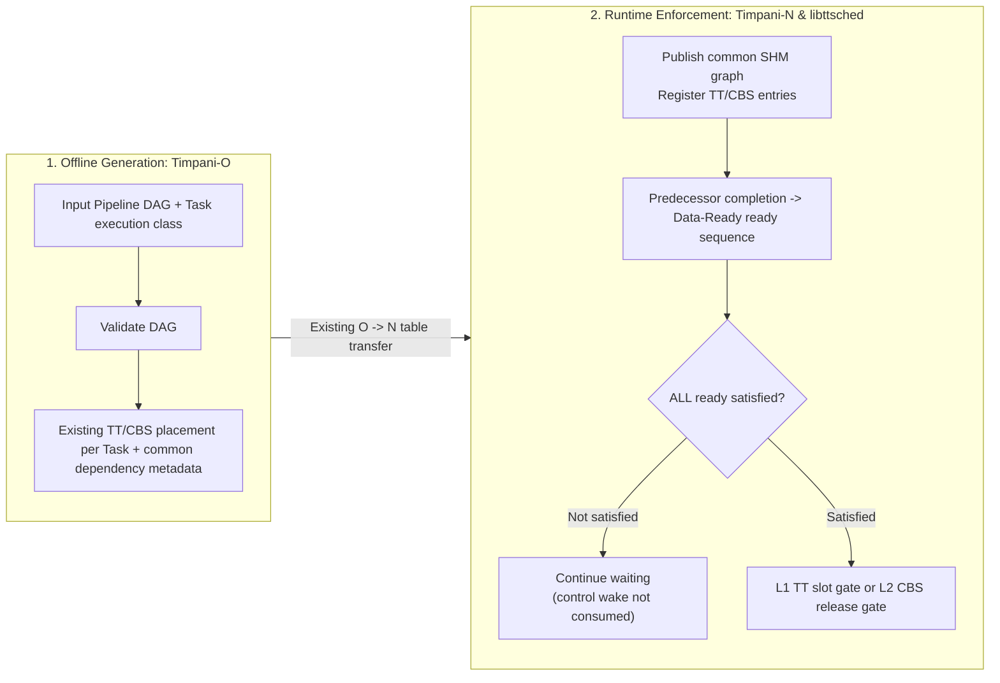
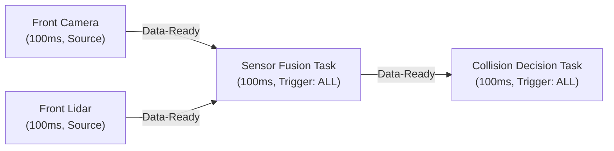

<!--
SPDX-FileCopyrightText: Copyright 2026 LG Electronics Inc.
SPDX-License-Identifier: MIT
-->

# REQ-009: Data-Driven Workload Support — Requirements Specification

**Date:** 2026-10-27
**Last Updated:** 2026-10-31 (Separated Phase 0/1/2 stage baselines, specified the Phase 0 test boundary, minimum operation, acceptance criteria, and follow-on document baseline, and aligned with DDR-011 Phase 0)
**Status:** Draft
**Current Design Baseline:** Phase 0 — Verification of Basic Data-Driven Workload Chain Operation
**Author:** Human + AI
**Parent Requirement:** [SRS-000](SRS-000-timpani-system.md) §5.1 `REQ-DD-001`
**Related Documents:** [DDR-001](DDR-001-workload-model.md)(Workload model), [DDR-002](DDR-002-scheduling-architecture.md)(Scheduling architecture), [DDR-003](DDR-003-interface-protocol.md)(Interface/protocol), [DDR-004](DDR-004-resource-allocation.md)(Resource allocation), [DDR-005](DDR-005-sched-ext-bpf-scheduler.md)(BPF scheduler), [DDR-006](DDR-006-communication-architecture.md)(Communication), [DDR-007](DDR-007-tt-cbs-integrated-scheduling.md)(TT/CBS), [REQ-011](REQ-011-runtime-table-update.md)·[DDR-011](DDR-011-runtime-table-update.md)(Runtime table update), [DDR-012](DDR-012-fault-management.md)(Fault management)
**Follow-On Documents:** [SRS-009](SRS-009-data-driven-workload.md), [HLD-009](HLD-009-data-driven-workload.md), [DDR-009](DDR-009-data-driven-workload.md), [LLD-009](LLD-009-data-driven-workload.md), PLAN-009. All documents subject to the current revision are written on the **Phase 0 baseline**; functionality from the full set of phases (Phase 1/2) is not automatically inherited into the current implementation scope (§8.2).

> **Role of This Document.** This is a **requirements specification (What & Why)**. It defines, at the system level, *what* TIMPANI must guarantee and *why* when a successor task is executed after the output data of a predecessor task becomes ready (`Data-Ready`). This document does not fix detailed protocol fields, shared-memory (SHM) bit layouts, or topological-sorting algorithms; these are specified in [SRS-009](SRS-009-data-driven-workload.md) and decided or elaborated in [DDR-009](DDR-009-data-driven-workload.md) and [LLD-009](LLD-009-data-driven-workload.md).
>
> **Keyword Convention:** **SHALL** = mandatory for the applicable phase, **SHOULD** = recommended, **MAY** = optional.

---

## 1. Purpose and Scope

### 1.1 Purpose

This document defines the requirements for incrementally implementing the **Data-Driven Workload** capability, which extends TIMPANI's existing activation methods (Time-Triggered / Event-Triggered) so that a successor task is executed in a chain when its predecessor task's data becomes ready (`Data-Ready`). The current design and implementation target is **verification of basic Data-Driven chain operation in Phase 0**; execution-time control based on an `Activation Window`, offline E2E verification, and consistency of successful runtime updates are separated into **Phase 1**, while `SKIP` on missing-input timeout, root-cause fault reporting, and safe initialization of abnormal state (Fail-Safe) are separated into **Phase 2**.

The complete set of requirements (§5) is retained to preserve the final objective and traceability. **The current applicability follows §1.5, and the current acceptance criteria follow §7.1.** Failure to satisfy a subsequent-phase (Phase 1/2) requirement is not a reason for Phase 0 to be considered incomplete, and completion of Phase 0 does not signify that the full capability or a functional-safety (ISO 26262) level has been satisfied.

### 1.2 Background and Requirements Formalization

#### 1.2.1 Comparison of Activation Models

In an SDV/autonomous-driving environment (sensor → perception → fusion → decision → control), the execution order and end-to-end (`E2E`) response time of the entire data-flow chain matter in addition to the periodicity of individual tasks. With a fixed-offset (TT) method alone, the system must wait until the predecessor sensor's worst-case execution time (`WCET`), wasting wait time when the task completes early and creating a risk of reading data that is not ready when the predecessor task is incomplete.

| Activation Model | Activation Condition | Execution Layer | Target |
|:---|:---|:---|:---|
| **Time-Triggered** | Fixed timer | L1 TT | Periodic tasks |
| **Event-Triggered** | External Sporadic Event | L2 CBS | Sporadic tasks |
| **Data-Triggered** *(this document)* | Completion of direct predecessor `Data-Ready` (`ALL`) | **Retains the original Task's L1 or L2 layer** | Successors in the DAG |

A Data-Driven Workload **separates the graph role from the execution layer**. `Source`/`Successor` are DAG roles determined by `predecessors`, whereas L1/L2 are determined by the Task's existing `TemporalClass`. Therefore, either an L1 or L2 Task can be a Source or Successor, and once the predecessor data-ready condition satisfies `ALL`, the Task executes through the existing firing, budget, and CPU gates of its layer.

#### 1.2.2 Phase 0 Basic Operational Flow (Current Design Baseline)

The diagram below shows the basic chain flow that operates within the **current Phase 0 scope**. (`Activation Window` open/close control, `E2E deadline` `Feasibility` checks, and transition at the boundary of a successful runtime update are extended in Phase 1; missing-input timeout `SKIP` and `Fault Monitor` `DATA_TIMEOUT` reporting are extended in Phase 2.)

#### 1.2.3 Normalized System Requirements Statements (Full-Objective Baseline)

The statements below are the objective upon completion of all of Phase 0–2 and provide the basis for the requirements in §5. Phase 0 does not require all properties at once; the applicability by phase follows the phase markings in §1.5 and §5.

| ID | Normalized Requirement Statement |
|:---|:---|
| **SR-DD-01** | The system shall accept a **Pipeline** declaration of predecessor data dependencies among tasks in the form of a directed acyclic graph (DAG), and an invalid graph (cycle, self-reference, or reference to a nonexistent task) shall be rejected at schedule generation time. |
| **SR-DD-02** | Only **`Timpani-O`** shall perform Pipeline schedule generation and `Feasibility` determination; **`Timpani-N`** shall not recalculate topological ordering or schedulability, but shall verify local applicability of the received table and enforce it. |
| **SR-DD-03** | A Data-Driven DAG shall not change a Task's L1/L2 execution layer. An L1 Task uses the TT gate, and an L2 Task uses the CBS gate; placement is independent of the Source/Successor role. |
| **SR-DD-04** | A successor task shall not execute before direct-predecessor `Data-Ready` (`ALL`) is satisfied, and it shall not consume a control wake as `Data-Ready`. |
| **SR-DD-05** | `Data-Ready` shall be transferred commonly through SHM + futex, and actual dispatch shall be delegated to the Task's existing execution layer (L1 TT or L2 CBS). |
| **SR-DD-06** | `Timpani-O` shall verify each Task's schedulability in its original layer (TT slot/Window or CBS budget/Gap), and shall transmit the DAG ready condition separately as common metadata. |
| **SR-DD-07** | Upon completion of all phases, a successor task shall meet its allowed time window and `E2E deadline` (Phase 1), and, on missing input, shall block cascading delay through `SKIP` and initial-cause `DATA_TIMEOUT` reporting (Phase 2). Runtime updates shall follow the dependency and state-transition principles of [REQ-011](REQ-011-runtime-table-update.md). |

### 1.3 In Scope

The following is the functional scope across all phases (Phase 0–2). **The scope included in the current design and implementation is restricted by §1.5.**

- Declaration, validation, and chained execution of a Data-Driven Pipeline connecting L1 TT or L2 CBS Tasks in a DAG on a single node
- O generates the DAG ready condition as common metadata while preserving the Task's original execution layer, and N connects it to the existing TT/CBS-specific firing and dispatch paths
- Multi-predecessor-input `ALL` synchronization and the `libttsched` Data-Ready API
- TT slot/Window or CBS budget/Gap validation by layer, FFI, and `E2E deadline` `Feasibility` checks

`Source`/`Successor` are only DAG roles and do not determine L1/L2. A Source can also be activated by an external L2 Event, and a Successor can execute as L1 TT or L2 CBS.
- Isolation by `SKIP` on missing-input timeout, preservation of Sink Fallback, and root-cause predecessor `DATA_TIMEOUT` reporting *(Phase 2)*
- Interface compatibility with runtime table updates in [REQ-011](REQ-011-runtime-table-update.md) *(Phase 0)*, consistency of successful boundary transitions *(Phase 1)*, and state initialization for abnormal conditions/recovery *(Phase 2)*

### 1.4 Out of Scope

- General CPU-allocation and slot-placement policies themselves ([DDR-004](DDR-004-resource-allocation.md), [DDR-007](DDR-007-tt-cbs-integrated-scheduling.md)); runtime table update transactions and the state machine itself ([REQ-011](REQ-011-runtime-table-update.md)); and the fault-recovery policy decision logic itself ([DDR-012](DDR-012-fault-management.md))
- Internal scheduling of L3/L4 (`NonSafety`) workloads that are not represented in the Schedule Table ([DDR-002](DDR-002-scheduling-architecture.md))
- **Distributed Pipeline (Multi-Node Pipeline):** inter-node DAG scheduling over a network (TSN/gPTP)
- **Heterogeneous Accelerator Integration (GPU/NPU Modeling):** modeling asynchronous execution intervals for AI-inference accelerators (`REQ-AI-001`)
- **Non-Harmonic Multi-Period and LET Buffers:** ring-buffer/LET state management across periods that do not have an integer-multiple relationship (for example, `33ms` + `100ms`)
- **Dynamic Early Release:** dynamic slot adjustment in an idle CPU interval before the start time of an `Activation Window`
- **`ANY` Sequence Enhancement:** a structure that executes on one or more inputs among multiple predecessors
- **Runtime CPU Migration During Execution:** prohibited under the Partitioned Scheduling principle; CPU changes are performed only when applying a new table generated by O
- **In-Place Pipeline Parameter Changes (`UPD-MODIFY`) and Updates That Change the `Hyperperiod`:** follow-on extension work after [REQ-011](REQ-011-runtime-table-update.md) Phase 1

### 1.5 Phased Implementation Scope and Current Baseline

#### 1.5.1 Phase Definitions

The Data-Driven Workload shall be implemented using the same **3-phase structure (Phase 0 / Phase 1 / Phase 2)** as [REQ-011](REQ-011-runtime-table-update.md).

| Phase | Objective | Implementation Scope | Completion Determination |
|:---|:---|:---|:---|
| **Phase 0 — Basic Operation** | Verify that a Data-Driven chain operates independently of the execution layer | On a fixed table, verify DAG validation, `ALL`, and common SHM state; L1 Tasks execute through the TT gate, and L2 Tasks execute through the CBS gate. Verify the minimum combinations of mixed L1/L2 connections | Acceptance criteria in §7.1 are satisfied |
| **Phase 1 — Precise Timing, Placement, and Update** | Guarantee per-layer deadlines and `E2E` behavior | TT `Activation Window`, CBS TT Gap/budget verification, Harmonic periods, `E2E Feasibility`, and successful runtime updates | Phase 1 SRS |
| **Phase 2 — Fail-Safe** | Isolate faults on input or update anomalies | `SKIP` at Window expiry, root-cause `DATA_TIMEOUT`, Sink Fallback, and state initialization on update/restart. Do not arbitrarily change the execution layer during an update | Phase 2 SRS |

The phases are cumulative. Subsequent phases add functionality while preserving the correct operation of earlier phases. **Deferral is a postponement of new implementation and verification, not permission to remove existing behavior or safety mechanisms.** Even in Phase 0, the `Timpani-O`/`Timpani-N` responsibility separation, RT critical-path discipline, backward compatibility of existing L1/L2 behavior, validation of SHM publication in [DDR-011](DDR-011-runtime-table-update.md) Phase 0, and the pre-approval constraint for interface changes are retained.

#### 1.5.2 Phase 0 Test Boundary

- **Target Workloads:** Verify combinations in which L1/L2 Tasks take the Source or Successor role in a basic chain with a fixed `E/H` and the same period. The role does not determine the execution layer; the actual layer follows the input Task's `TemporalClass`.
- **Execution and State Boundary:** `ALL` is the common ready condition. An L2 Task is released immediately to CBS budget/Gap dispatch, while an L1 Task is dispatched in the next allowed TT slot only when `ALL` is satisfied. Phase 0 tests use only the normal condition in which `ALL` for an L1 Successor is satisfied before the corresponding slot.
- **Boundary with Runtime Table Updates ([DDR-011](DDR-011-runtime-table-update.md)):**
  - During Phase 0 testing, **do not perform a runtime update (`UPD-REPLACE / ADD / REMOVE / CLEAR`) on a table that contains a Pipeline**. Consistency of successful boundary transitions for Pipeline-containing tables (`REQ-DD-016`) is deferred to Phase 1, and state initialization on update failure, rollback, recovery `STOP`, or restart (`REQ-DD-014`) is deferred to Phase 2.
  - However, **interface compatibility with the Phase 0 baseline of [DDR-011](DDR-011-runtime-table-update.md)** is mandatory in Phase 0:
    1. The `/timpani_ttsched` SHM and `libttsched` Pipeline paths operate only after verifying `magic` and a stable `generation` (an even generation, matching generations before and after, and Task identity); if publication is in progress (odd generation) or the snapshot is invalid, they return `-1` without changing state.
    2. Table-publication notification, shutdown notification, slot reuse, and other **control wakes** that do not increase the actual `Data-Ready` counter are not consumed as execution of a successor task.
    3. General L1 TT tables without a Pipeline must not regress the Phase 0 successful-update acceptance criteria (`AC-P0-01` through `08`) of [REQ-011](REQ-011-runtime-table-update.md).
- **Inputs and Responsibilities:** O validates the DAG and each Task's existing L1/L2 placement separately. N only publishes the common SHM graph; TT Tasks use the TimerMaster/TT gate, and CBS Tasks use the CBS gate. `Data-Ready` itself does not reclassify the execution layer or change the CPU.
- **Assurance Level:** Verify non-execution on partial predecessors or a control wake, and the dispatch conditions by L1/L2 layer. Timeout `SKIP`, `DATA_TIMEOUT`, and quantitative worst-case `E2E` are deferred to subsequent phases.

#### 1.5.3 Minimum Operation Required in Phase 0

For items whose phase markings in §5 include `0`, **only the following content applies in Phase 0**. The remaining detailed obligations of items marked with multiple phases (`0/1`, `0/1/2`) are deferred to subsequent phases. This is a phase-specific elaboration of the same ID and does not mean that the entire requirement has been completed in Phase 0.

| Applicable Requirement | Phase 0 Applicability | Subsequent Enhancement |
|:---|:---|:---|
| **REQ-DD-001** | During fixed-table generation, parse the per-task predecessor-dependency list (`predecessors`) and pre-reject cycles, self-references, references to nonexistent tasks, name/hash collisions, and capacity overruns (committed model unchanged) | Extend `E2E deadline` `Feasibility` verification and validation of candidate runtime-update tables: Phase 1 |
| **REQ-DD-002** | O transmits the DAG role and the Task execution layer independently. Each Task retains either the TT or CBS representation according to its input `TemporalClass` | Precise verification by layer: Phase 1 |
| **REQ-DD-004** | An L1 Task executes only when both the TT dispatch gate and `ALL` ready are satisfied, and an L2 Task releases `ALL` ready to the CBS gate. A control wake is not consumed as execution | Window/generation-signal isolation: Phase 1 |
| **REQ-DD-005** | Permit layer-specific dispatch 1 time per cycle when the bitmask of direct-predecessor completions satisfies `ALL`, and atomically consume the completed state | Harmonic multi-period behavior: Phase 1 |
| **REQ-DD-007** | Deliver `Data-Ready` on the RT critical path through SHM atomic operations + `futex` without blocking IPC/gRPC, dynamic allocation, or kernel privileges | Quantitative verification of multicore concurrent contention: Phase 1 |
| **REQ-DD-008** | An L1 Task satisfies ready + the TT slot gate, and an L2 Task satisfies ready + the CBS gate in the existing scheduler path | Precise Window/Gap refinement by layer: Phase 1 |
| **REQ-DD-015** | Verify stable 011 publication, Task identity, and a change in the ready/dispatch sequence; return `-1` without changes in an invalid state | ABI version management and read-transition-interval contract: Phase 1 |
| **REQ-DD-013** | For a fixed basic chain, verify TT→TT, TT→CBS, CBS→TT, and CBS→CBS connections, partial input/control wake, invalid DAG, and regression of existing TT/CBS behavior | Mixed-layer `E2E` and successful updates: Phase 1; Fail-Safe: Phase 2 |

The current follow-on documents ([SRS-009](SRS-009-data-driven-workload.md), [HLD-009](HLD-009-data-driven-workload.md), [DDR-009](DDR-009-data-driven-workload.md), [LLD-009](LLD-009-data-driven-workload.md), PLAN-009) elaborate only this section. Subsequent-phase items remain in the trace list, but their internal state flags, Window-expiry timers, and `SKIP`/recovery state machines shall not be pulled into the Phase 0 implementation work.

---

## 2. Terminology

The following terms are used throughout the full objective ([DDR-001](DDR-001-workload-model.md) through [DDR-012](DDR-012-fault-management.md) and the [REQ-011](REQ-011-runtime-table-update.md) standard terminology). `Activation Window` and Pipeline application-boundary transitions are elaborated in Phase 1, while `DATA_TIMEOUT` and abnormal-state initialization are elaborated in Phase 2; **the existence of a term alone does not require implementation in Phase 0.**

| Term | Standard Notation and Definition in This Document Set | Baseline Document |
|:---|:---|:---|
| **Pipeline** | A workload/task execution chain connected by DAG dependencies (with a common `Hyperperiod` and `E2E deadline`) | [DDR-001](DDR-001-workload-model.md) §2 |
| **Task (Source / Successor / Sink)** | A graph role. A Source is a starting Task with no predecessor, a Successor is a Task with `predecessors`, and a Sink is the final Task in the chain. No role forces L1/L2 | This document set |
| **Data-Ready** | A common signal that updates a successor Task's logical ready state after a predecessor Task publishes output data. Actual dispatch is delegated to the Task execution layer | This document set |
| **Execution Adapter** | Connects the Data-Driven ready condition to the scheduler for each layer. L1 uses the TT slot/Window gate, and L2 uses the CBS release/budget/Gap gate | This document set, DDR-007/008 |
| **Trigger Condition (`ALL` / `ANY`)** | The ready condition for direct predecessors. Phase 0 requires `ALL`; only extension with `ANY` is considered | This document set |
| **Activation Window** | A successor activation/execution interval (`[EST, window_end_us]`) verified offline *(applies in Phase 1)* | This document set |
| **Harmonic Periods** | A period configuration in which Task periods have integer-multiple relationships and do not cause `Hyperperiod` explosion | [DDR-004](DDR-004-resource-allocation.md) §8.A |
| **Timer Master / Fault Monitor** | The precision timer-firing thread and the fault collection/reporting component within `timpani-n` (`userspace`) | [DDR-002](DDR-002-scheduling-architecture.md), [DDR-012](DDR-012-fault-management.md) |
| **Deadline Miss (`DMISS`) / `DATA_TIMEOUT`** | A deadline miss (`DMISS`) and a Fault type for predecessor data not arriving by the `Activation Window` end *(the latter applies in Phase 2)* | [DDR-003](DDR-003-interface-protocol.md), [DDR-012](DDR-012-fault-management.md) |
| **Application Boundary (Activation Instant)** | A `Hyperperiod` boundary (`T = E + kH`) on the common `Epoch` grid at which a candidate Schedule Table prepared by a runtime update becomes the active table. Because this is a concept distinct from a Task-level execution interval, **`Activation Window`**, this document set refers to it as the "application boundary" | [REQ-011](REQ-011-runtime-table-update.md) §2 |
| **Publication / Control Wake** | The process by which `Timer Master` records and validates a table image in `/timpani_ttsched` SHM (publication), and a `futex` wakeup used to notify publication, shutdown, and so on (control wake). A control wake is not treated as Task execution or `Data-Ready` | [REQ-011](REQ-011-runtime-table-update.md) F-051, [DDR-011](DDR-011-runtime-table-update.md) D-P0-05 |

---

## 3. Stakeholder Requirements and Lessons from Similar Projects

### 3.1 Stakeholders and Requirements

The following are stakeholder requirements across all phases. In Phase 0, apply the test boundary and minimum operation in §1.5.

| Stakeholder | Requirement |
|:---|:---|
| **Pullpiri** | Supplies DAG dependencies, Task execution classes, timing, and `E2E`, and receives reasons for rejection. |
| **Timpani-O** | Is the sole entity that validates the DAG and performs the Task's existing TT/CBS placement. |
| **Timpani-N** | Locally validates and enforces TT/CBS entries and common DAG metadata. |
| **Pipeline Application** | Publishes `Data-Ready` after publishing output data. |
| **Functional-Safety Owner** | Secures evidence of per-layer TT/CBS isolation, execution order, and timeout behavior. |

### 3.2 Key Lessons from Similar Projects

| Reference | Key Characteristic | Application to the Timpani Design | Applicable Phase |
|:---|:---|:---|:---:|
| **ROS 2 (rclc Executor)** | `ALL`/`ANY` trigger conditions and a static execution order | Adopt an `ALL` trigger and deterministic execution order for fusing multiple sensors | **Phase 0** |
| **NVIDIA STM (Alpamayo Deployment)** | Offline DAG compilation + simple runtime enforcement | Exclude runtime graph traversal and enforce only the statically composed table and indices generated offline | **Phase 0** |
| **MotionWise (TTTech)** | Dataflow combined on top of Time-Triggered execution | Allow data triggering only within an `Activation Window` verified offline | Phase 1 |
| **Apex.OS (Apex.Grace)** | Task chaining and monitoring of execution deadlines and missing inputs | Verify chain-level `E2E deadline` (Phase 1) and apply `SKIP` and fault monitoring for missing inputs (Phase 2) | Phase 1 / 2 |

---

## 4. Operational Scenarios

Each scenario describes the target behavior by phase. **In Phase 0, only the fixed-table conditions in §1.5 are verified for `UC-DD-01`, `UC-DD-02`, and basic invalid-DAG rejection in `E-DD-01`.** `UC-DD-03` (Harmonic multi-period behavior and `Activation Window`) and `UC-DD-04` (successful runtime update of a Pipeline-containing table) belong to Phase 1; `E-DD-02` (timeout `SKIP` and root-cause reporting) and `E-DD-03` (initialization of abnormal/recovery state) belong to Phase 2.

### UC-DD-01 — Basic Execution of a Same-Period, Multi-Sensor Fusion Chain *(Current Phase 0 Target)*

- **Preconditions:** Each of the 4 Tasks is placed as L1 TT or L2 CBS according to its input, and the DAG role is transmitted separately.
- **Main Flow:** A Source starts through the existing TT/CBS method → transmits `Data-Ready` on completion → creates `ALL` ready → an L1 Successor executes in the next allowed TT slot, and an L2 Successor executes at the CBS release → completion wakes the next Task.
- **Postconditions:** A Task executes only after its direct predecessors have completed, and it complies with the original TT/CBS timing rules of each Task.

### UC-DD-02 — Continue Waiting on Partial Predecessor Input or a Control Wake *(Current Phase 0 Target)*

- **Preconditions:** The same chain as `UC-DD-01` is operating.
- **Main Flow:** (a) `Camera` repeatedly transmits completion signals over multiple periods while `Lidar` has not signaled, or (b) a control wake, such as an SHM table-publication or shutdown notification that does not increase the `Data-Ready` counter, occurs.
- **Postconditions:** Because `ALL` is not satisfied or this is not actual `Data-Ready`, `Sensor Fusion` and `Collision Decision` do not execute and remain in the wait state. *(Forced `SKIP` at timeout and `DATA_TIMEOUT` reporting are covered by Phase 2 `E-DD-02`.)*

### UC-DD-03 — AEB Chain Based on Harmonic Multi-Period Behavior and an `Activation Window` *(Phase 1 Objective)*

- **Composition:** Camera (`50ms`) + Lidar (`100ms`) → Sensor Fusion → Collision Decision → Brake Control/Fallback. Each Task's TT/CBS class follows its declaration; the example does not force a particular class.
- **Target Behavior:** The fusion task does not execute when only cycle 1 of the `50ms` camera completes or an input arrives early before `EST`; it executes only when `ALL` is satisfied within the offline-verified `Activation Window` (`[EST, window_end_us]`) and the entire chain completes within the `E2E deadline`.

### UC-DD-04 — Successful Runtime Update of a Pipeline-Containing Table *(Phase 1 Objective, Linked to REQ-011)*

- **Target Behavior:** On a Pipeline update, an in-progress chain instance is completed or safely terminated before the application boundary, and at the boundary `T=E+kH`, the TT/CBS execution representation, common DAG metadata, and ready state are transitioned together. Unrelated Pipelines remain intact.

### Exception Scenarios

| ID | Scenario | Required Result (Summary) | Applicable Phase |
|:---|:---|:---|:---:|
| **E-DD-01** | Submission of an invalid Pipeline or one violating a constraint (cyclic dependency, self-reference, nonexistent reference / FFI violation, Non-harmonic periods, exceeded `E2E deadline`, or reference to a Task being removed as a predecessor) | `Timpani-O` (or `Timpani-N` for local-representation/capacity limits) rejects the submission before activation with a reason; the existing committed model and active table remain unchanged | **Basic DAG and Capacity: Phase 0** FFI, E2E, and Update References: Phase 1 |
| **E-DD-02** | A predecessor input has not arrived by the end of the `Activation Window` | Block cascading delay by omitting wakeup (`SKIP`) for that chain instance in the applicable cycle; report `DATA_TIMEOUT` only for the first incomplete predecessor; maintain the previous valid output in the Sink control Task (Fallback) | Phase 2 |
| **E-DD-03** | Runtime update activation failure or rollback, workload recovery `STOP`/`RESTART`, or `Timpani-N` restart | Guarantee `0` erroneous wakeups due to residual predecessor-completion bits or previous-generation state, and prohibit reactivation of Pipeline Tasks targeted by a recovery `STOP` | Phase 2 |

---

## 5. Requirements

Priority: **M** = mandatory for acceptance in the applicable phase (`SHALL`), **S** = recommended (`SHOULD`)

**Phase Notation:** `0`, `1`, and `2` indicate the applicable phases. Where multiple phases such as `0/1` or `0/1/2` are shown, the ID is satisfied incrementally. **Phase 0 applies only the content in §1.5.3.** Items in phase `1` or `2` are not prerequisites for current implementation or acceptance. The original list below preserves the objective through the subsequent phases; it is not used wholesale as detailed input to the current design.

> Requirement IDs are neither renumbered nor reused, so IDs within a section may not be consecutive; this is not an error.

### 5.1 Pipeline Model

| ID | Requirement | Priority | Phase | Rationale / Source |
|:---|:---|:-:|:---:|:---|
| **REQ-DD-001** | **DAG Model Declaration and Validation**: The system SHALL be able to declare a Pipeline as a directed acyclic graph (DAG) containing Tasks (nodes), predecessor dependencies (edges), and the chain-wide `E2E deadline`; cyclic dependencies (Cycle), self-reference, references to nonexistent Tasks, and violations of supported capacity or identifier constraints SHALL be rejected at schedule generation time. The same check SHALL also apply to every candidate table generated by a runtime update ([REQ-011](REQ-011-runtime-table-update.md) F-024, F-050). | M | 0/1 | [SRS-000](SRS-000-timpani-system.md) REQ-DD-001, E-DD-01 |
| **REQ-DD-002** | **Layer-Independent Mapping and Separation of Responsibilities**: O SHALL determine the DAG role through `predecessors` and separately generate the existing TT/CBS execution representation according to each Task's input `TemporalClass`. A Task class SHALL NOT be changed according to DAG participation or the Source/Successor role. N SHALL NOT recompute schedulability. | M | 0/1 | DDR-001, DDR-002, DDR-007 |
| **REQ-DD-003** | **Freedom from Interference (FFI)**: `NonSafety` dependencies SHALL be rejected, and each Task SHALL pass the TT/CBS interference and budget checks of its original layer. | M | 1 | SRS-000 REQ-NFR-002 |

### 5.2 Activation and Runtime Enforcement

| ID | Requirement | Priority | Phase | Rationale / Source |
|:---|:---|:-:|:---:|:---|
| **REQ-DD-004** | **Predecessor Dependency Guarantee and Control-Wake Separation**: A Successor SHALL NOT execute before `ALL` ready. An L1 Successor SHALL additionally satisfy the Timer Master/TT gate, and an L2 Successor SHALL additionally satisfy the CBS gate. Publication, shutdown, and slot-reuse wakes SHALL NOT be treated as ready. | M | 0 | UC-DD-01, UC-DD-02 |
| **REQ-DD-005** | **Trigger Condition Support**: When `ALL` is satisfied, layer-specific dispatch SHALL be permitted exactly 1 time per cycle, and a repeated predecessor signal SHALL NOT overwrite a different input. `ANY` SHOULD retain only an extensible structure. | M | 0 | UC-DD-01, UC-DD-02 |
| **REQ-DD-006** | **Activation Window Enforcement**: Starting in Phase 1, `Activation Window` SHALL be combined on top of the existing time gate of the L1/L2 layer regardless of the execution layer. The Task SHALL NOT execute before `ALL` is ready or outside the Window. | M | 1 | UC-DD-03 |
| **REQ-DD-007** | **Low-Latency Data-Ready Synchronization**: Delivery of the data-completion signal and waiting SHALL be performed with the `libttsched` API based on `/timpani_ttsched` shared memory (SHM) and `futex` on the RT critical path, without blocking IPC/gRPC, dynamic memory allocation, or kernel privileges (`CAP_BPF`). | M | 0 | [SRS-000](SRS-000-timpani-system.md) REQ-NFR-003, [DDR-006](DDR-006-communication-architecture.md) |
| **REQ-DD-008** | **Static Enforcement by Layer**: An L1 Task that has satisfied `ALL` SHALL execute only in its original TT slot/Window, and an L2 Task SHALL execute only under its original CBS CPU, budget, and Gap policies. DAG metadata SHALL NOT bypass the timing rules of the existing scheduler. | M | 0 | DDR-005, DDR-007, 008 |
| **REQ-DD-015** | **SHM Interface and Publication Validity**: The Pipeline path SHALL follow 011's `magic`/stable `generation`/Task identity and SHALL execute only when an actual increase in the L1/L2 `dispatch_counter` is verified. The presence of ready without dispatch SHALL NOT cause execution, and an invalid state SHALL return `-1`. | M | 0/1 | REQ-011 F-037/038/041 |

### 5.3 Offline Scheduling (`Timpani-O`)

| ID | Requirement | Priority | Phase | Rationale / Source |
|:---|:---|:-:|:---:|:---|
| **REQ-DD-009** | **Placement Synthesis by Execution Layer**: O SHALL apply the existing TT/CBS placement rules to each Task and verify DAG ordering. Phase 0 uses the existing TT slot/existing CBS admission policies. Phase 1 includes the TT Window and CBS Gap/interference in the `E2E` analysis. Runtime migration SHALL NOT be permitted. | M | 0/1 | DDR-004, DDR-007, 008 |
| **REQ-DD-010** | **E2E Deadline Guarantee and Measurement**: O SHALL sum the L1 TT wait/slot delay and the L2 CBS Gap/budget delay on DAG paths according to each layer, and SHALL reject the schedule if the worst-case `E2E` exceeds the declared value. | M | 1 | SRS-000 REQ-DD-001 |

### 5.4 Faults and Monitoring

| ID | Requirement | Priority | Phase | Rationale / Source |
|:---|:---|:-:|:---:|:---|
| **REQ-DD-011** | **Input Timeout and Cascading-Delay Prevention**: If `ALL` is not satisfied by Window expiry, the applicable chain instance SHALL be `SKIP`ped to prevent cascading delay. A Sink/Fallback Task SHALL be able to apply a valid-output retention strategy under its own TT or CBS execution rules, and 009 SHALL NOT fix a Sink to a particular class. | M | 2 | E-DD-02 |
| **REQ-DD-012** | **Root-Cause Task Fault Reporting**: On an input-missing timeout, only the first incomplete predecessor Task SHALL be identified and reported as a `DATA_TIMEOUT` Fault (`FaultInfo`), without duplicated cascading reports from downstream Tasks; the reporting condition SHALL follow the threshold (`current_limit`) policy in [DDR-012](DDR-012-fault-management.md). | M | 2 | [DDR-012](DDR-012-fault-management.md), E-DD-02 |
| **REQ-DD-014** | **Safe Initialization of Pipeline State (Abnormal Conditions)**: Pipeline runtime state (predecessor-completion information and Window state) SHALL be initialized on runtime-update activation failure or rollback, workload recovery `STOP`/`RESTART`, or `Timpani-N` restart, and a successor task SHALL NOT be spuriously woken by residual state from a previous cycle or table. Pipeline Tasks being removed by a recovery `STOP` SHALL NOT be woken again on the basis of restoring the previous table ([REQ-011](REQ-011-runtime-table-update.md) F-030). | M | 2 | E-DD-03, [REQ-011](REQ-011-runtime-table-update.md) Phase 2 |

### 5.5 Integration with Runtime Schedule Table Updates

> This is a subsequent-phase (Phase 1) requirement for when the runtime updates (`UPD-REPLACE / ADD / REMOVE / CLEAR`) defined in [REQ-011](REQ-011-runtime-table-update.md) apply to a **table containing a Pipeline**. Phase 0 does not perform runtime updates on a Pipeline-containing table (§1.5.2); the update procedure itself follows [REQ-011](REQ-011-runtime-table-update.md).

| ID | Requirement | Priority | Phase | Rationale / Source |
|:---|:---|:-:|:---:|:---|
| **REQ-DD-016** | **Successful-Update Pipeline Consistency**: ① Transition the common DAG metadata and TT/CBS execution representation at the same application boundary. ② Initialize ready/dispatch state so a previous-generation signal does not wake the new generation. ③ Complete or safely terminate a chain instance so it does not cross the application boundary. ④ Reject a candidate that references a removed Task. ⑤ Preserve the TT slots, CBS budgets, and dependency states of unrelated Pipelines. | M | 1 | UC-DD-04, E-DD-01 |

### 5.6 Verification

| ID | Requirement | Priority | Phase | Rationale / Source |
|:---|:---|:-:|:---:|:---|
| **REQ-DD-013** | **Phased Verification of the Sensor-Fusion PoC**: The acceptance criteria for each implementation phase (§7) SHALL be verified by measurement. In Phase 0, verify a basic same-period (`100ms`) chain; upon completion of all phases, verify guaranteed execution order, satisfaction of the `E2E deadline`, and `SKIP` isolation on missing input in a Harmonic-period camera (`50ms`) + Lidar (`100ms`) → Sensor Fusion (`ALL`) → Decision → Control chain. | M | 0/1/2 | [SRS-000](SRS-000-timpani-system.md) REQ-DD-001, §7 |

---

## 6. Constraints and Assumptions

### 6.1 Constraints

| ID | Constraint | Source |
|:---|:---|:---|
| **CON-DD-01** | Linux 6.12+ supporting `sched_ext` (`SCX_OPS_SWITCH_PARTIAL`), `PREEMPT_RT`, cgroup v2, and an Isolated CPU environment | [SRS-000](SRS-000-timpani-system.md) REQ-ENV-001..003 |
| **CON-DD-02** | Follow Partitioned Scheduling. A Task follows the existing TT Harmonic/slot or CBS admission rules of its input execution layer, and the DAG role does not change its layer or CPU. A CPU change is permitted only when applying a new table | DDR-004/007/008 |
| **CON-DD-03** | Pullpiri supplies execution-layer and timing information; only O generates and verifies the DAG and the TT/CBS representation by layer; and N does not recalculate schedulability | DDR-002, REQ-011 CON-03 |
| **CON-DD-04** | Dynamic memory allocation, blocking IPC/gRPC calls, and use of unordered containers (`std::unordered_map`) are prohibited in the RT critical path (`Timer Master` loop, `libttsched` signal path, and `kernel` BPF callbacks) | Repository engineering constraints, [DDR-005](DDR-005-sched-ext-bpf-scheduler.md) |
| **CON-DD-05** | Explicit Project Leader approval SHALL be obtained before implementation begins for a change to an interface (`.proto`) schema, the `/timpani_ttsched` SHM layout, an external dependency, or addition of a new public API (see the approval items in §9) | Repository engineering constraints, [REQ-011](REQ-011-runtime-table-update.md) CON-05, CON-06 |
| **CON-DD-06** | Do not delete or rename existing public methods of `TimerMaster`, `BpfLoader`, `TaskRegistry`, `FaultMonitor`, or `GlobalScheduler` | Repository engineering constraints, [REQ-011](REQ-011-runtime-table-update.md) CON-07 |

### 6.2 Assumptions

Phase 0 uses a fixed-`Epoch`/`Hyperperiod` test table and the node's existing Isolated CPU configuration. The prior-approval, public-method preservation, and RT critical-path constraints in §6.1 apply regardless of phase.

| ID | Assumption |
|:---|:---|
| **ASM-DD-01** | Every Pipeline Task has a unique name and an existing `TemporalClass`, and only N applies the kernel policy. A DAG role is not a reason to change the class. |
| **ASM-DD-02** | Participating Tasks transmit `Data-Ready` after publishing output data and do not introduce mid-job blocking in the execution interval. |
| **ASM-DD-03** | Phase 0 connectivity and clocks are stable; the L1 TT test uses the condition in which `ALL` is satisfied before an allowed TT slot, and the L2 CBS test satisfies the CBS admission conditions. |
| **ASM-DD-04** | The CPU is determined statically by the Task's existing TT/CBS policy and the O table, and Tasks do not migrate during execution. |

---

## 7. Acceptance Criteria (Requirements Level)

### 7.1 Current Acceptance Criteria — Phase 0

Phase 0 alone is deemed complete when all of the following items are satisfied under the test conditions in §1.5. [SRS-009](SRS-009-data-driven-workload.md) elaborates them as test inputs, observation points, and pass criteria. Actual execution shall be verified in the target environment, but this shall not be interpreted as proof of `Activation Window` guarantees or Fail-Safe isolation.

| ID | Phase 0 Acceptance Criterion | Verification Target |
|:---|:---|:---|
| **AC-DD-P0-01** | When each Task is declared as L1 or L2 in the same graph, a Successor executes only after `ALL` ready and satisfies the TT gate for L1 or the CBS gate for L2. There are `0` ordering violations on mixed L1/L2 connections. | REQ-DD-001, 002, 004, 005, 007, 008, 013 |
| **AC-DD-P0-02** | If only some predecessors complete, the Successor executes `0` times regardless of the Task class. | REQ-DD-004, 005, 013 |
| **AC-DD-P0-03** | No L1/L2 Successor executes as a result of unstable SHM or a control wake. | REQ-DD-004, 015, 013 |
| **AC-DD-P0-04** | An invalid DAG or a TT/CBS representation, CPU, or capacity limit violation is rejected in advance, and existing state is retained. | REQ-DD-001, 002 |
| **AC-DD-P0-05** | Mixing L1/L2 Tasks in the same Pipeline does not regress the existing TT/CBS behavior of either layer, and there is no regression in 011's normal TT update behavior. | REQ-DD-002, 008, 009, 015, 013 |
| **AC-DD-P0-06** | Identical input produces the same DAG and layer-specific placement regardless of input order, and there are no prohibited operations on the RT path. | REQ-DD-007, 008, 009, CON-DD-04 |

### 7.2 Full-Objective Acceptance Criteria — For Subsequent-Phase Traceability

The `AC-DD-01` through `AC-DD-07` items below are objectives for the complete capability including Phase 1/2 and **are not Phase 0 completion gates.** Activate and verify the applicable item when each phase begins.

| ID | Acceptance Criterion | Phase | Verification Target |
|:---|:---|:---:|:---|
| **AC-DD-01** | In a mixed L1/L2 Harmonic multi-period chain, guarantee 1 execution per `ALL`, the TT Window/slot, and the CBS budget/Gap. | Phase 1 | REQ-DD-005, 006, 009, 013 |
| **AC-DD-02** | Source-to-Sink `E2E` in a mixed DAG is within the declared value after summing the TT slot/Window delay and CBS Gap/budget delay. | Phase 1 | REQ-DD-010, 013 |
| **AC-DD-03** | A candidate with Non-harmonic periods (`33ms` + `100ms`), an exceeded `E2E deadline`, an FFI violation (`SafetyCritical` → `NonSafety`), or an update reference to a predecessor being removed is rejected with a reason before activation. | Phase 1 | REQ-DD-003, 009, 010, 016 |
| **AC-DD-04** | During a successful runtime update (`UPD-REPLACE / ADD / REMOVE / CLEAR`) of a Pipeline-containing table, there are `0` chain executions crossing the application boundary or triggers mixing the old and new tables, and unrelated Pipelines remain intact. | Phase 1 | REQ-DD-016 |
| **AC-DD-05** | A chain instance is `SKIP`ped at Window expiry without interfering with other TT/CBS Tasks, and the Sink/Fallback retains valid output under its own execution-layer rules. | Phase 2 | REQ-DD-011, 013 |
| **AC-DD-06** | On missing input, only the first incomplete predecessor Task is identified and reported as `DATA_TIMEOUT`, without duplicate cascading reports from downstream Tasks. | Phase 2 | REQ-DD-012, 013 |
| **AC-DD-07** | Immediately after runtime-update activation failure or rollback, recovery `STOP`/`RESTART`, or a `Timpani-N` restart, there are `0` erroneous wakeups due to residual state, and Tasks targeted by a recovery `STOP` are not reactivated. | Phase 2 | REQ-DD-014 |

---

## 8. Traceability

### 8.1 Upstream Traceability

| REQ-009 Group | SRS-000 | Related DDR / REQ |
|:---|:---|:---|
| §5.1 Pipeline Model | `REQ-DD-001`, `REQ-NFR-002` | [DDR-001](DDR-001-workload-model.md), [DDR-002](DDR-002-scheduling-architecture.md), [REQ-011](REQ-011-runtime-table-update.md) |
| §5.2 Activation and Runtime Enforcement | `REQ-DD-001`, `REQ-FUN-007`, `REQ-NFR-001`, `REQ-NFR-003` | [DDR-002](DDR-002-scheduling-architecture.md), [DDR-005](DDR-005-sched-ext-bpf-scheduler.md), [DDR-006](DDR-006-communication-architecture.md), [DDR-011](DDR-011-runtime-table-update.md) |
| §5.3 Offline Scheduling | `REQ-DD-001`, `REQ-FUN-013` | [DDR-004](DDR-004-resource-allocation.md), [DDR-007](DDR-007-tt-cbs-integrated-scheduling.md) |
| §5.4 Faults and Monitoring | `REQ-FUN-014`, `REQ-FUN-015` | [DDR-003](DDR-003-interface-protocol.md), [DDR-012](DDR-012-fault-management.md), [REQ-011](REQ-011-runtime-table-update.md) |
| §5.5 Integration with Runtime Table Updates | `REQ-FUN-012`, `REQ-DD-001` | [REQ-011](REQ-011-runtime-table-update.md), [DDR-011](DDR-011-runtime-table-update.md) |

### 8.2 Downstream Traceability — Baseline for Writing Phase 0 Follow-On Documents

The traceability target of the current revision is **the Phase 0 applicability in §1.5.3 and `AC-DD-P0-01` through `06` in §7.1.** The full requirement IDs in §5 (`REQ-DD-001` through `016`) are retained as the final objective list, but Phase 1/2-only items (`003`, `006`, `009`, `010`, `011`, `012`, `014`, and `016`) and the subsequent portions of compound-phase items remain only in the deferral list and are not expanded into active design or implementation work.

| Document | Phase 0 Writing Baseline |
|:---|:---|
| **[SRS-009](SRS-009-data-driven-workload.md)** | Activate and elaborate the functional, non-functional, and acceptance criteria only for the Phase 0 applicability in §1.5.3 and `AC-DD-P0-01` through `06`. Concurrent specification of Phase 1/2 items is not required. |
| **[HLD-009](HLD-009-data-driven-workload.md)** | Define the SHM `ALL` ready condition independent of the execution layer, the L1 TT/L2 CBS adapter boundaries, and RT/non-RT responsibilities. |
| **[DDR-009](DDR-009-data-driven-workload.md)** | Record common SHM/futex, a single `CAS`, independence from the execution class, and the dispatch decision by layer. |
| **[LLD-009](LLD-009-data-driven-workload.md)** | Elaborate common DAG metadata, TT/CBS execution adapters, and mixed-layer testing. |
| **PLAN-009** | Decompose only Phase 0 implementation and unit/integration verification work (`WP-0` through `WP-5`) into an execution plan and link it to active requirements and test cases. Phase 1/2 work is not linked as a prerequisite. |

The traceability direction is **REQ-009 (Phase 0 applicable portion) → SRS-009 → HLD-009 / DDR-009 / LLD-009 → PLAN-009 and tests**. Each follow-on document SHALL specify the applicable phase (`Phase 0`). When Phase 1/2 begins, activate the applicable deferred items and expand the traceability matrix.

---

## 9. Prior Approvals and Subsequent-Phase Decision Items

The following are decision items to be resolved or approved across all phases. **The Phase 0 follow-on documents resolve only the table's `Phase 0` portion** and do not treat advance finalization of Phase 1/2 items as a condition for starting Phase 0. **(Approval)** means that explicit Project Leader approval is required before code or schema incorporation (CON-DD-05).

| Resolution Phase | Item | Current Handling Baseline |
|:---|:---|:---|
| **Phase 0** | OI-DD-01, OI-DD-02, OI-DD-03 | Common DAG metadata transmission independent of the execution class, SHM/API, L1/L2 execution-adapter connection, and mixed-combination testing |
| **Phase 1** | OI-DD-04, OI-DD-05, OI-DD-06 | Window/budget by layer, `E2E` for a mixed DAG, and Pipeline update |
| **Phase 2** | OI-DD-07, OI-DD-08 | `DATA_TIMEOUT` and safe initialization of recovery state common across layers |

| ID | Open / Approval Item | Related Requirements |
|:---|:---|:---|
| **OI-DD-01** | Define the explicit/inherit transmission rules for a Task execution class and common DAG metadata independent of the class (`predecessors`, trigger, E2E). Do not infer the class from the DAG role; define the mixed-class submission representation **(Interface Approval)** | REQ-DD-001, 002, CON-DD-05 |
| **OI-DD-02** | The common SHM `pipeline[]` API and separation of ready/dispatch for the L1/CBS execution adapters **(SHM/API Approval)** | REQ-DD-005, 007, 015, CON-DD-05 |
| **OI-DD-03** | Minimum convention for connecting the TT slot/Window gate for an L1 Successor and the CBS release gate for an L2 Successor to the common `ALL` state | REQ-DD-004, 008, 009, 013 |
| **OI-DD-04** | Synchronization of the common `Activation Window` with the slot/budget gate by layer **(Interface Approval)** | REQ-DD-006, 009, CON-DD-05 |
| **OI-DD-05** | The `E2E Feasibility` formula for summing TT/CBS delays in a mixed L1/L2 DAG, and selection among multiple paths | REQ-DD-009, 010 |
| **OI-DD-06** | Conditions for completing or safely terminating L1/L2 chain instances during an update of a Pipeline-containing table, transition conditions for common metadata, and SHM version management | REQ-DD-015, 016 |
| **OI-DD-07** | `FaultType.DATA_TIMEOUT` protocol extension, identification of the first root-cause predecessor Task, suppression of cascading reports, and linkage to `current_limit` **(Approval for an Interface Change)** | REQ-DD-011, 012, CON-DD-05 |
| **OI-DD-08** | Boundary for safe initialization of Pipeline state on runtime-update activation failure or rollback, recovery `STOP`/`RESTART`, or daemon restart (linked to [REQ-011](REQ-011-runtime-table-update.md) Phase 2) | REQ-DD-014 |

---

## 10. Reference Documents

- [SRS-000-timpani-system.md](SRS-000-timpani-system.md) — System requirements baseline (`REQ-DD-001`, `REQ-FUN-012`)
- [DDR-001-workload-model.md](DDR-001-workload-model.md) — Workload classification (L1–L4) and the Pipeline concept
- [DDR-002-scheduling-architecture.md](DDR-002-scheduling-architecture.md) — Hierarchical scheduling architecture and `Timer Master`
- [DDR-003-interface-protocol.md](DDR-003-interface-protocol.md) — `Timpani-O` ↔ `Timpani-N` and fault-reporting interfaces
- [DDR-004-resource-allocation.md](DDR-004-resource-allocation.md) — Partitioned CPU allocation and Harmonic-period constraints
- [DDR-005-sched-ext-bpf-scheduler.md](DDR-005-sched-ext-bpf-scheduler.md) — `scx_timpani` BPF scheduler and integration with `/timpani_ttsched`
- [DDR-006-communication-architecture.md](DDR-006-communication-architecture.md) — Communication architecture and RT critical-path constraints
- [DDR-007-tt-cbs-integrated-scheduling.md](DDR-007-tt-cbs-integrated-scheduling.md) — TT/CBS integrated scheduling and `Hyperperiod`
- [REQ-011-runtime-table-update.md](REQ-011-runtime-table-update.md) — Runtime Schedule Table update requirements specification (Phase 0 baseline)
- [DDR-011-runtime-table-update.md](DDR-011-runtime-table-update.md) — Phase 0 design decisions for runtime Schedule Table updates (`D-P0-01` through `D-P0-08`)
- [DDR-012-fault-management.md](DDR-012-fault-management.md) — Fault management and the `FaultAction` recovery policy
