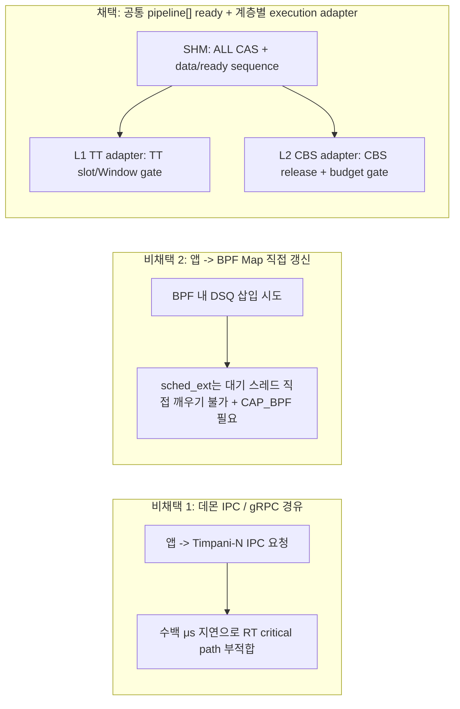

<!--
SPDX-FileCopyrightText: Copyright 2026 LG Electronics Inc.
SPDX-License-Identifier: MIT
-->

# DDR-009: Data-Driven Workload — Phase 0 설계 결정 기록

**작성일:** 2026-10-27  
**최종 수정:** 2026-11-01  
**상태:** Draft — Phase 0 설계 제안, Project Leader 검토 대상  
**상위 기준:** [REQ-009](REQ-009-data-driven-workload.md) §1.5, §7.1, §9, [SRS-009](SRS-009-data-driven-workload.md)  
**연계 설계:** [HLD-009](HLD-009-data-driven-workload.md), [LLD-009](LLD-009-data-driven-workload.md), [DDR-011](DDR-011-runtime-table-update.md)

---

## 1. 결정 범위 및 전제

단일 노드·고정 `Epoch`/`Hyperperiod`의 Phase 0 기본 Data-Driven 체인을 대상으로 한다. Task의 실행 계층은 입력 `TemporalClass`에 따라 L1 TT 또는 L2 CBS로 유지하며, DAG의 Source/Successor 역할로 결정하지 않는다.

| 전제 | 본 DDR과의 관계 |
|:---|:---|
| DAG 역할과 실행 계층은 독립 | `Source`/`Successor`는 공통 DAG 메타로만 표현한다. TT/CBS 스케줄링 표현은 기존 방식대로 유지한다 |
| O 생성 전담 / N 비재계산 | O는 DAG 검증과 TT/CBS 배치 모두 수행하고, N은 수신한 표현과 공통 ready 상태만 집행한다 |
| RT 경로 규율 | SHM 원자 연산과 계층별 adapter는 할당·블로킹·gRPC 없이 동작한다 |
| 011 안정 SHM 게시 | 공통 Pipeline 상태는 안정 세대에서만 갱신하고 제어 wake와 Data-Ready를 구분한다 |

---

## 2. D-DD-P0-01 (결정 9A) — `/timpani_ttsched` 후방 확장 영역 + `futex` 및 `scx_timpani` 재사용

- **결정**:
  - `Data-Ready`의 그래프 상태·원자 소비는 SHM에서 공통 처리한다.
  - 실행 dispatch는 Task의 계층에 맡긴다. L1은 TT slot/Window를, L2는 CBS CPU/예산/Gap을 사용한다.
  - 이때 기존 `struct timpani_ttsched_shm`의 헤더(`magic`, `n_tasks`, `generation`)와 `tasks[TIMPANI_MAX_TASKS]` 배열(오프셋 `0..783`)은 **크기·오프셋 변경 없이 그대로 유지**하고, 그 뒤쪽에 Pipeline 전용 배열 `pipeline[TIMPANI_MAX_TASKS]`를 추가한다.
  - 또한 주기 슬롯 발화용 `tasks[i].counter`와 분리된 `pipeline[i].data_counter`를 후행 태스크 `Data-Ready` 전용 `futex` 워드로 사용한다.
- **이유**:
  1. 데몬 IPC/gRPC 경유는 컨텍스트 스위칭·직렬화 지연으로 `5 μs` 이하 신호 처리 요구사항(`REQ-DD-P0-N-002`)을 만족할 수 없다.
  2. Linux `sched_ext`는 이미 실행 가능(`Runnable`) 상태인 스레드만 스케줄링할 수 있어 대기 중인(`Sleeping`) 후행 스레드를 `kernel` BPF 안에서 직접 깨울 수 없고, 컨테이너에 `CAP_BPF` 특권을 요구하게 된다.
  3. 공통 그래프 `pipeline[]`는 TT `counter`와 독립된 ready/dispatch 상태를 가진다.
  4. 실행 계층은 Task 입력에서 가져오므로 DAG 역할과 무관하다.
- **조건**: SHM 필드·API는 구현 전 승인한다(`CON-DD-05`).
- **비채택**: 데몬 IPC, 앱의 BPF Map 직접 조작, `Source/Successor`로 실행 클래스를 강제하는 방식.
- **추적**: `REQ-DD-P0-F-006`, `F-007`, `N-001`, `N-002`, `N-004`; `OI-DD-02`.

---

## 3. D-DD-P0-02 (결정 9B) — 선행 완료 비트마스크(`ready_mask`) + wakeup 시 단일 `CAS` 원자적 초기화

- **결정**:
  - 후행 Task마다 직속 선행별 비트를 배정하고, 단일 `CAS`가 `ALL`을 충족하면 `ready_mask=0`과 `data_counter` 증가를 원자적으로 수행한다.
  - `data_counter`는 논리적 ready다. CBS adapter는 같은 ready를 `dispatch_counter`에 즉시 연결하고 futex wake하며, TT adapter는 허용 slot에서 pending ready를 `dispatch_counter`에 연결한다. 어느 경우에도 두 adapter가 같은 ready를 두 번 dispatch하지 않는다.
- **이유**:
  - 단순 감소 카운터는 같은 선행 반복 신호를 구분하지 못한다.
  - 비트마스크 CAS는 `ALL` ready를 1회 확정하고, ready와 계층별 dispatch를 분리하면 L1 TT 조기 실행도 L2 CBS 실행도 정확히 제어할 수 있다.
  - Phase 1/2 Window·SKIP 상태 기계는 미리 구현하지 않는다.
- **비채택**: 단순 잔여 카운터 감소, Phase 0에서의 `Timer Master` 주기 경계 상태 리셋 개입.
- **추적**: `REQ-DD-P0-F-005`, `REQ-DD-P0-N-001`.

---

## 4. D-DD-P0-03 — 실행 계층 독립 DAG 및 TT/CBS 실행 어댑터

- **결정**:
  - `predecessors`와 `trigger_mode`는 Task의 DAG 역할과 `ALL` 조건만 나타내고 L1/L2를 결정하지 않는다.
  - O는 각 Task의 기존 `TemporalClass`에 따라 `TtSlot` 또는 `CbsConfig`를 생성하고, 공통 DAG 메타는 Task hash에 연결해 별도로 전송한다.
  - Source도 L1 TT 또는 L2 CBS일 수 있다. L1 Source는 Timer Master, L2 Source는 기존 Event release로 시작한다. 둘 다 완료 시 `signal_ready`를 호출할 수 있다.
  - Successor도 L1 TT 또는 L2 CBS일 수 있다. `ALL`은 두 계층의 실행 후보를 만든다.
    - **L1 adapter:** ready 순번이 생겨도 허용 TT slot/Window가 열리기 전에는 dispatch하지 않는다. slot에 ready가 있으면 그 ready를 1회 소비한다.
    - **L2 adapter:** ready 순번이 생기면 CBS release하고 CPU·예산·Gap gate를 따른다.
  - N은 이 경로를 재계산하지 않고 수신한 메타와 계층별 gate만 적용한다.
- **이유**: Data-Driven의 핵심은 의존성 ready이며 스케줄링 계층은 Task마다 이미 정의되어 있다. L1 successor의 조기 실행 충돌은 TT adapter에서 방지하고, L2 successor는 CBS 규칙을 재사용한다.
- **비채택**: `predecessors` 유무로 Task class를 추론하는 방식, 모든 Successor를 CBS/TT 중 하나로 강제하는 방식.
- **Phase 0 시험 전제**: L1 Successor는 해당 TT slot 전에 `ALL` ready가 충족된다. slot을 놓친 ready의 지연/SKIP 정책은 Phase 1/2로 이관한다.
- **추적**: REQ-DD-001~009, 013; OI-DD-01, OI-DD-03.

---

## 5. D-DD-P0-04 — `DDR-011` Phase 0 안정 게시(`magic`, 짝수 `generation`) 준수 및 제어 wake 분리

- **결정**:
  - SHM 게시 중에는 `tasks[]`와 `pipeline[]`를 채우고 `n_tasks → 짝수 generation → magic` 순으로 유효화한다. 게시 자체로 `counter`, `data_counter`, `dispatch_counter`를 증가시키지 않는다.
  - 소비자(`ttsched_signal_ready`, `ttsched_wait_data`)는 acquire 순서의 `magic`·짝수 `generation` 확인 → 자기 태스크 이름(`tasks[idx].name`) 및 연결 정보 조회 → `generation` 재확인을 수행하며, 홀수 세대·세대 변경·무효 `magic`이면 공유 상태를 건드리지 않고 `-1`을 반환한다(무한 busy-spin 금지).
  - `ttsched_wait_data()`는 안정 세대·자기 신원과 실제 `dispatch_counter` 증가를 확인해야 `0`을 반환한다. 이 순번은 L1 TT slot/Window 또는 L2 CBS release gate가 `data_counter` ready를 소비한 경우에만 증가한다.
- **이유**: Data-Ready 게시와 실제 scheduler dispatch를 분리해야 L1 TT의 조기 실행 및 L2 CBS의 가짜 activation을 모두 방지할 수 있다.
- **추적**: `REQ-DD-P0-F-006`, `REQ-DD-P0-N-004`, `OI-DD-02`.

---

## 6. D-DD-P0-05 — 실행 계층별 배치 정책 유지

- **Phase 0 결정**: DAG 역할은 CPU/slot을 강제하지 않는다. L1 Task는 기존 TT slot 배치, L2 Task는 기존 CBS admission/CPU 배치를 따른다. L1/L2 어느 쪽에도 `Source/Successor`라는 이유로 별도 배치를 만들지 않는다.
- **CBS 보강 가능성**: 기존 CBS worst-fit 정책으로 저부하 CPU를 선택할 수 있으나 이는 CBS 배치 정책이며 모든 Successor에 적용하는 Data-Driven 규칙은 아니다.
- **Phase 1**: 혼합 DAG의 E2E 분석에 계층별 slot/Window/Gap, TT 선점, CBS 간섭을 포함한다.
- **Phase 2**: 실행 중 자동 마이그레이션은 하지 않는다. CPU/slot 변경은 O의 새 테이블 적용에서만 수행한다.
- **추적**: `REQ-DD-008`, `REQ-DD-009`, `AC-DD-P0-05`, `AC-DD-01`; `OI-DD-03`, `OI-DD-05`.

---

## 7. 이관 및 설계 검토 게이트

- **Phase 1**: `Activation Window`, Harmonic 주기, L1/L2 혼합 DAG `E2E` 분석, 정상 갱신, SHM 버전 관리.
- **Phase 2**: `SKIP`, 최초 원인 `DATA_TIMEOUT`, Sink Fallback, 계층 공통 복구 상태 초기화.
- **Phase 0 검토 게이트**:
  1. `OI-DD-01` / `OI-DD-02` 승인
  2. Source/Successor와 L1/L2를 독립적으로 표현해 공통 SHM 그래프에 연결
  3. L1 Successor가 TT gate, L2 Successor가 CBS gate를 준수
  4. TT→TT, TT→CBS, CBS→TT, CBS→CBS 최소 조합 검증
  5. O→N End-to-End 및 기존 TT/CBS 회귀 확인
