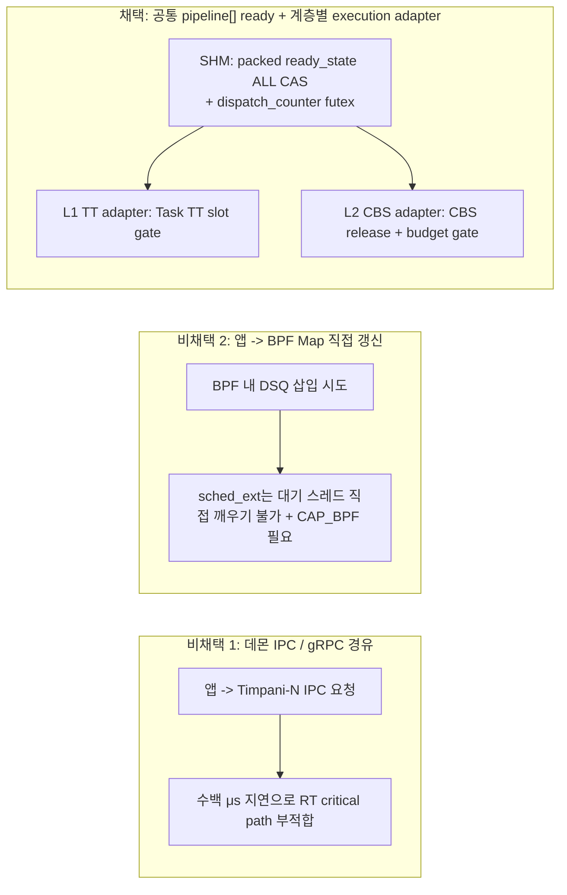

<!--
SPDX-FileCopyrightText: Copyright 2026 LG Electronics Inc.
SPDX-License-Identifier: MIT
-->

# DDR-009: Data-Driven Workload — Phase 0 설계 결정 기록

**작성일:** 2026-10-27  
**최종 수정:** 2026-11-01  
**상태:** Draft — Phase 0 설계 제안, Project Leader 검토 대상  
**상위 기준:** [REQ-009](REQ-009-data-driven-workload.md) §1.5, §7.1, §9, [SRS-009](SRS-009-data-driven-workload.md)  
**연계 설계:** [HLD-009](HLD-009-data-driven-workload.md), [LLD-009](LLD-009-data-driven-workload.md), [DDR-011](DDR-011-runtime-table-update.md)

---

## 1. 결정 범위 및 전제

단일 노드·고정 `Epoch`/`Hyperperiod`의 Phase 0 기본 Data-Driven 체인을 대상으로 한다. Task의 실행 계층은 입력 `TemporalClass`에 따라 L1 TT 또는 L2 CBS로 유지하며, DAG의 Source/Successor 역할로 결정하지 않는다.

| 전제 | 본 DDR과의 관계 |
|:---|:---|
| DAG 역할과 실행 계층은 독립 | `Source`/`Successor`는 공통 DAG 메타로만 표현한다. TT/CBS 스케줄링 표현은 기존 방식대로 유지한다 |
| O 생성 전담 / N 비재계산 | O는 DAG 검증과 TT/CBS 배치 모두 수행하고, N은 수신한 표현과 공통 ready 상태만 집행한다 |
| RT 경로 규율 | SHM 원자 연산과 계층별 adapter는 할당·블로킹·gRPC 없이 동작한다 |
| 011 안정 SHM 게시 | 공통 Pipeline 상태는 안정 세대에서만 갱신하고 제어 wake와 Data-Ready를 구분한다 |

---

## 2. D-DD-P0-01 (결정 9A) — `/timpani_ttsched` 후방 확장 영역 + `futex` 및 `scx_timpani` 재사용

- **결정**:
  - `Data-Ready`의 그래프 상태·원자 소비는 SHM에서 공통 처리한다.
  - 실행 dispatch는 Task의 계층에 맡긴다. Phase 0에서 L1은 Task의 TT slot을, L2는 CBS CPU/예산/Gap을 사용한다. Window는 Phase 1 확장이다.
  - 기존 `struct timpani_ttsched_shm`의 header(`magic`, `n_tasks`, `generation`)와 `tasks[TIMPANI_MAX_TASKS]` 배열(오프셋 `0..783`)은 **크기·오프셋 변경 없이 그대로 유지**한다. 그 뒤쪽에 extension `magic`, ABI `version`, 전체 `abi_size`, `publication_guard`를 담은 16바이트 `pipeline_header`와 `pipeline[TIMPANI_MAX_TASKS]`를 추가한다.
  - 각 Pipeline slot은 `(workload_id_hash, task_id_hash)`, `ready_state`, `required_mask`, `dispatch_counter`, trigger/model, outgoing edge를 가진다. `ready_state`는 high 32bit 활성 chain-job token/ready sequence와 low 16bit predecessor mask를 하나의 64비트 lock-free CAS로 갱신한다. `dispatch_counter`만 futex wait/wake word이고, 기존 `tasks[i].counter`는 TT 주기 wake에 계속 사용한다.
- **이유**:
  1. 데몬 IPC/gRPC 경유는 컨텍스트 스위칭·직렬화 지연으로 `5 μs` 이하 신호 처리 요구사항(`REQ-DD-P0-N-002`)을 만족할 수 없다.
  2. Linux `sched_ext`는 이미 실행 가능(`Runnable`) 상태인 스레드만 스케줄링할 수 있어 대기 중인(`Sleeping`) 후행 스레드를 `kernel` BPF 안에서 직접 깨울 수 없고, 컨테이너에 `CAP_BPF` 특권을 요구하게 된다.
  3. 공통 그래프 `pipeline[]`는 TT `counter`와 독립된 ready/dispatch 상태를 가진다.
  4. 실행 계층은 Task 입력에서 가져오므로 DAG 역할과 무관하다.
- **조건**: extension ABI `magic/version/abi_size`, object 고정 크기/교체 수명, transaction별 object·mapping 크기 재검증, 64비트 lock-free `ready_state` CAS, 정확한 job token 검증, `dispatch_counter` 전용 futex, token-aware 신규 API/`errno`, O_RDWR/O_RDONLY 권한 계약은 구현 전 승인한다(`CON-DD-05`).
- **비채택**: 데몬 IPC, 앱의 BPF Map 직접 조작, `Source/Successor`로 실행 클래스를 강제하는 방식.
- **추적**: `REQ-DD-P0-F-006`, `F-007`, `N-001`, `N-002`, `N-004`; `OI-DD-02`.

---

## 3. D-DD-P0-02 (결정 9B) — `ready_state` 선행 비트 + ready sequence의 단일 CAS 갱신

- **결정**:
  - 후행 Task마다 직속 선행별 비트를 배정한다. `signal_ready(job_token)`는 `job_token == ready_sequence`이고 해당 선행 비트가 미설정일 때만 destination을 변경한다. token이 활성인 동안 같은 선행 비트가 중복되면 `EALREADY`, sequence 증가 후 재시도한 token을 포함한 낡은/미래 token은 `ESTALE`이며 둘 다 상태를 바꾸지 않는다.
  - Source는 첫 destination CAS 전에 전체 outgoing-edge plan을 검증·preflight한다. edge 수, index, self/중복 destination, required-bit 소속, trigger mode, execution model, 각 destination의 token/중복 상태를 확인하며 plan 실패는 전체 fan-out에 mutation이 없다. CAS 재시도 중 동시 동일 호출이 bit/sequence를 먼저 완료하면 늦은 실패가 아니라 수렴 완료로 본다.
  - `ALL` CAS는 `ready_state`의 ready mask를 0으로 만들고 활성 token/ready sequence를 1 증가시키는 단일 lock-free 64비트 CAS다. CAS 실패 때마다 token과 bit 검사를 반복한다. 모든 outgoing-edge CAS가 끝난 뒤 CBS `dispatch_counter` 갱신/futex wake를 수행하며 이 연산들은 publication guard 안에서 게시 세대 전환과 직렬화한다.
  - `wait_data()`는 `dispatch_counter - 1` token을 반환하고 소비자는 그 token-addressed payload를 읽은 뒤 같은 token을 전달할 수 있다. CBS adapter는 같은 guard 안에서 `dispatch_counter`를 증가시키고, TT adapter는 Timer Master가 허용 slot에서 pending ready가 있을 때만 증가시킨다. 같은 token을 두 번 dispatch하지 않는다.
- **이유**:
  - mask 자체에는 주기 신원이 없다. 선행 비트를 반복 OR하면 cycle `N`은 유지하면서 다른 선행의 cycle `N+1` 신호가 나중에 도착해 서로 다른 payload를 섞은 `ALL`이 만들어질 수 있다.
  - 정확 token 일치와 중복 비트 거절은 SHM 필드 추가 없이 논리 instance를 구분한다. mask reset과 sequence 증가를 한 CAS에 넣어 중간 상태의 관측을 차단한다. `dispatch_counter`가 유일한 wake word이므로 ready만 충족된 L1 Task를 TT slot 전에 깨우지 않는다.
  - 세대 확인 후 CAS만으로는 게시-소비 TOCTOU를 막지 못하므로 guard로 전체 commit을 직렬화한다.
  - edge를 검증하자마자 변경하면 뒤쪽 edge 오류 시 앞쪽 Successor에 부분 알림이 남는다. 전체 plan 사전검증과 wake 지연은 이 관측 가능한 부분 fan-out을 막고 edge별 CAS가 동시 선행 갱신은 계속 처리하게 한다.
  - Phase 1/2 Window·SKIP 상태 기계는 미리 구현하지 않는다.
- **비채택**: edge별 검증과 변경을 한 번에 하는 방식, token 없는 선행 비트 OR, 단순 잔여 카운터 감소, Phase 0에서의 `Timer Master` 주기 경계 상태 리셋 개입.
- **추적**: `REQ-DD-P0-F-005`, `REQ-DD-P0-N-001`.

---

## 4. D-DD-P0-03 — 실행 계층 독립 DAG 및 TT/CBS 실행 어댑터

- **결정**:
  - `SchedInfo.temporal_class`는 workload 기본값으로 유지한다. `TaskInfo.temporal_class`는 `optional`이며 Task 값이 있으면 이를 사용하고 없으면 workload 기본값을 상속한다. DAG 역할로 계층을 추론하지 않는다. workload는 생명주기·기본 분류를 묶고 Task override는 각 Task의 TT/CBS 실행 계층을 정하는 009 확장이다.
  - 선행은 `TaskReference(workload_id, task_id)`로 전달한다. 빈 `workload_id`는 현재 workload를 뜻하며 Phase 0에는 같은 workload 내부 참조만 허용한다. `predecessors`와 `trigger_mode=ALL`은 실행 계층을 결정하지 않는다.
  - O는 resolved class에 따라 기존 `TtSlot` 또는 `CbsConfig`를 생성한다. 공통 DAG 메타는 실행 표현과 분리해 `PipelineTaskKey(workload_id_hash, task_id_hash)` 쌍으로 O→N에 전달한다.
  - Source도 L1 TT 또는 L2 CBS일 수 있다. L1 Source는 기존 `tasks[i].counter` 기반 Timer Master wake, L2 Source는 기존 Event release를 사용한다. 완료 시 동일 `signal_ready` API를 호출할 수 있다.
  - Successor의 `ALL`은 ready sequence만 만든다. 실제 dispatch gate는 계층별로 연다.
    - **L1 TT adapter:** Timer Master가 해당 Task의 TT slot 시각에만 `counter_ahead(ready_sequence, dispatch_counter)`를 확인한다. pending ready가 있으면 `dispatch_counter`를 1 증가시키고 futex wake하며, ready가 없으면 counter를 바꾸지 않는다. slot 전에 wake하거나 일반 Source의 `tasks[i].counter`를 Successor에 사용하지 않는다.
    - **L2 CBS adapter:** Source 호출의 모든 outgoing-edge CAS가 완료된 뒤 `ALL` destination의 `dispatch_counter`를 1 증가시키고 futex wake한다. 실제 CPU dispatch는 wake된 Task가 Runnable이 된 뒤 기존 `scx_timpani` CBS DSQ·budget·Gap gate가 결정한다.
  - N은 DAG나 스케줄 가능성을 다시 계산하지 않고 수신한 metadata와 계층별 gate만 적용한다. BPF에 Data-Ready 의존성 계산이나 별도 Data-Driven DSQ를 추가하지 않는다.
- **이유**: ready와 실제 실행 허가를 분리하면 L1의 조기 wake를 막으면서 L2의 기존 CBS admission·budget·Gap 경로를 그대로 재사용할 수 있다. Timer Master가 TT slot을 소유하고 BPF가 runnable Task의 CBS 집행을 소유하므로 책임 중복이 없다.
- **비채택**: `predecessors` 유무로 Task class를 추론하는 방식, 모든 Successor를 CBS/TT 중 하나로 강제하는 방식, L1 Successor를 기존 `tasks[i].counter`로 조기 wake하는 방식, L2 Successor에 별도 Data-Driven DSQ를 만드는 방식.
- **Phase 0 시험 전제**: 정상 시험은 L1 Successor의 `ALL` ready가 해당 TT slot 전에 1회 충족되는 경우다. slot에 ready가 없으면 wake `0`; slot 후 도착한 ready는 다음 TT slot까지 pending으로 유지한다. pending이 2개 이상인 backlog는 Phase 0 정상 수용 조건이 아니다. cross-workload 참조, `Activation Window`, slot miss 만료, `SKIP`은 Phase 1/2로 이관한다.
- **추적**: REQ-DD-001~009, 013; OI-DD-01, OI-DD-03, OI-DD-05.

---

## 5. D-DD-P0-04 — `DDR-011` Phase 0 안정 게시(`magic`, 짝수 `generation`) 준수 및 제어 wake 분리

- **결정**:
  - Pipeline client는 mapped fd와 mapping 길이를 보존한다. 매 extension transaction 전에 fd의 현재 `fstat()`, SHM name resolve 결과의 file identity, 현재/full mapping 범위를 확인한 뒤에만 `pipeline_header.magic/version/abi_size`를 읽는다. mapping 축소나 name identity 변경은 `pipeline_header`/`pipeline[]` dereference 전에 `ESTALE`이다. 게시자는 live object마다 전체 ABI 크기를 유지하고, 교체는 `magic` 무효화 + active commit drain + truncate 없는 `unlink`로 수행한다. 구 object mapping은 unmap까지 구조적으로 유효하며 client는 재초기화로 교체 object에 연결한다.
  - 게시자는 `pipeline_header.publication_guard`의 writer-pending 비트를 설정해 새 commit을 막고, active commit이 `0`이 된 뒤 `tasks[]`·extension header·`pipeline[]`을 갱신한다. 유효화 순서는 `magic=0 → 홀수 generation → 내용 갱신 → 짝수 generation → extension header 유효화/기존 magic 유효화 → writer-pending 해제`다. 게시 자체는 ready 또는 dispatch 순번을 증가시키지 않는다.
  - 소비자와 L1 Timer Master는 첫 extension 접근 전에 현재 object/identity를 재검증하고 stable ABI/generation을 확인한 뒤 guard를 획득하고 세대를 다시 확인한다. `signal_ready(job_token)`은 활성 token과 선행 비트를 검증한 후 guard 안에서 `ready_state` 64비트 CAS와 필요한 `dispatch_counter` 증가·futex wake를 완료한다. 축소/교체, ABI/세대/identity 오류, writer-pending, 중복 비트, token 불일치는 상태를 변경하지 않고 `-1`과 `errno`로 구분한다.
  - `ttsched_wait_data()`는 `dispatch_counter`만 futex wait/wake word로 사용하고 실제 증가에서만 `0`과 해당 job token을 반환한다. 게시·종료 control wake는 counter를 증가시키지 않으므로 `ESTALE`이 된다.
  - **Phase 0:** 최초 게시·무효화/종료와 고정 Pipeline commit 직렬화에 guard를 적용하되 Pipeline 포함 정상 런타임 갱신은 수행하지 않는다. **Phase 1:** 정상 갱신의 적용 경계와 ABI transition에 같은 guard를 사용한다. **Phase 2:** 갱신 실패·rollback·프로세스 재시작 시 남은 guard/상태 회수 규칙을 추가한다.
- **이유**: 초기화 때의 크기 상태는 이후 truncate나 name 교체에서 낡을 수 있다. opened fd·현재 name identity·mapping 범위를 transaction마다 재검증하면 이 변화를 extension 접근 전에 탐지한다. `fstat()` 하나로 지원되지 않는 동시 inplace truncate를 안전하게 만들 수는 없으므로 live object 고정 크기/no-shrink 소유 규칙이 필요하며, guard는 내용 게시·상태 변경만 담당한다. version 확인, transaction별 object 검증, commit guard는 ABI·수명·동시성의 서로 다른 실패 모드를 분리해 막는다.
- **추적**: `REQ-DD-P0-F-005`, `REQ-DD-P0-F-006`, `REQ-DD-P0-N-004`, `OI-DD-02`.

---

## 6. D-DD-P0-05 — 실행 계층별 배치 정책 유지

- **Phase 0 결정**: DAG 역할은 CPU/slot을 강제하지 않는다. L1 Task는 기존 TT slot 배치, L2 Task는 기존 CBS admission/CPU 배치를 따른다. L1/L2 어느 쪽에도 `Source/Successor`라는 이유로 별도 배치를 만들지 않는다.
- **CBS 보강 가능성**: 기존 CBS worst-fit 정책으로 저부하 CPU를 선택할 수 있으나 이는 CBS 배치 정책이며 모든 Successor에 적용하는 Data-Driven 규칙은 아니다.
- **Phase 1**: 혼합 DAG의 E2E 분석에 계층별 slot/Window/Gap, TT 선점, CBS 간섭을 포함한다.
- **Phase 2**: 실행 중 자동 마이그레이션은 하지 않는다. CPU/slot 변경은 O의 새 테이블 적용에서만 수행한다.
- **추적**: `REQ-DD-008`, `REQ-DD-009`, `AC-DD-P0-05`, `AC-DD-01`; `OI-DD-03`, `OI-DD-05`.

---

## 7. 이관 및 설계 검토 게이트

- **Phase 1**: `Activation Window`, Harmonic 주기, L1/L2 혼합 DAG `E2E` 분석, 정상 갱신, SHM 버전 관리.
- **Phase 2**: `SKIP`, 최초 원인 `DATA_TIMEOUT`, Sink Fallback, 계층 공통 복구 상태 초기화.
- **Phase 0 검토 게이트**:
  1. `OI-DD-01` / `OI-DD-02` 승인
  2. Source/Successor와 L1/L2를 독립적으로 표현해 공통 SHM 그래프에 연결
  3. L1 Successor가 TT gate, L2 Successor가 CBS gate를 준수
  4. TT→TT, TT→CBS, CBS→TT, CBS→CBS 최소 조합 검증
  5. 중복·낡은·미래 token 거절 시 ready/dispatch 상태 불변 및 cycle 혼합 실행 `0`건 검증
  6. O→N End-to-End 및 기존 TT/CBS 회귀 확인
