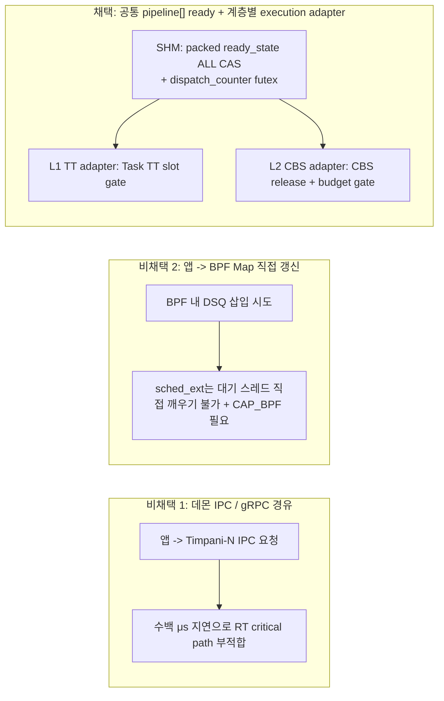

<!--
SPDX-FileCopyrightText: Copyright 2026 LG Electronics Inc.
SPDX-License-Identifier: MIT
-->

# DDR-009: Data-Driven Workload — Phase 0 설계 결정 기록

**작성일:** 2026-10-27  
**최종 수정:** 2026-11-25 (Phase 0 PR 리뷰 반영)
**상태:** Draft — Phase 0 설계안, 검토·승인 대기.
008 필드 `11/12/13`은 정합되었으나 `OI-DD-01`/`02`/`03`은 Project Leader
승인과 검증 전이며 구현 완료가 아니다.
**상위 기준:** [REQ-009](REQ-009-data-driven-workload.md) §1.5, §7.1, §9, [SRS-009](SRS-009-data-driven-workload.md)  
**연계 설계:** [HLD-009](HLD-009-data-driven-workload.md), [LLD-009](LLD-009-data-driven-workload.md), [DDR-011](DDR-011-runtime-table-update.md)

---

## 1. 결정 범위 및 전제

단일 노드·고정 `Epoch`/`Hyperperiod`의 Phase 0 기본 Data-Driven 체인을 대상으로 한다. Task의 실행 계층은 입력 `TemporalClass`에 따라 L1 TT 또는 L2 CBS로 유지하며, DAG의 Source/Successor 역할로 결정하지 않는다.

| 전제 | 본 DDR과의 관계 |
|:---|:---|
| DAG 역할과 실행 계층은 독립 | `Source`/`Successor`는 공통 DAG 메타로만 표현한다. TT/CBS 스케줄링 표현은 기존 방식대로 유지한다 |
| O 생성 전담 / N 비재계산 | O는 DAG 검증과 TT/CBS 배치 모두 수행하고, N은 수신한 표현과 공통 ready 상태만 집행한다 |
| RT 경로 규율 | SHM 원자 연산과 계층별 adapter는 할당·블로킹·gRPC 없이 동작한다 |
| 011 안정 SHM 게시 | 공통 Pipeline 상태는 안정 세대에서만 갱신하고 제어 wake와 Data-Ready를 구분한다 |

---

## 2. D-DD-P0-01 (결정 9A) — `/timpani_ttsched` 후방 확장 영역 + `futex` 및 `scx_timpani` 재사용

- **결정**:
  - `Data-Ready`의 그래프 상태·원자 소비는 SHM에서 공통 처리한다.
  - 실행 dispatch는 Task의 계층에 맡긴다. Phase 0에서 L1은 Task의 TT slot을, L2는 CBS CPU/예산/Gap을 사용한다. Window는 Phase 1 확장이다.
  - 기존 `struct timpani_ttsched_shm`의 header(`magic`, `n_tasks`, `generation`)와 `tasks[TIMPANI_MAX_TASKS]` 배열(오프셋 `0..783`)은 **크기·오프셋 변경 없이 그대로 유지**한다. 그 뒤쪽에 extension `magic`, ABI `version`, 전체 `abi_size`, `publication_guard`, `instance_id`, `origin_epoch_ns`, `hyperperiod_us`를 담은 **40바이트 `pipeline_header`**와 `pipeline[TIMPANI_MAX_TASKS]`를 추가한다(전체 `3,128`B).
  - 각 Pipeline slot은 `(workload_id_hash, task_id_hash)`(`Timpani-N` 내부 결합·진단용), `ready_state`, `required_mask`, `dispatch_counter`, trigger/model, outgoing edge를 가진다. Source의 `ready_state`는 release-valid 표식과 activation ordinal을 단일 release-store로 갱신하고, Successor는 high 32bit ready sequence와 low 16bit predecessor mask를 단일 64비트 lock-free CAS로 갱신한다. `dispatch_counter`만 futex wait/wake word이고, 기존 `tasks[i].counter`는 TT 주기 wake에 계속 사용한다.
  - L1 Source는 `Timer Master`가, L2 CBS Source는 이벤트 어댑터/시험 생성기가 `ttsched_release_source()`를 통해 실제 활성화 직전에 파이프라인 주기 단위 activation ordinal `k`를 해당 Source slot의 `ready_state` high 32bit와 release-valid 표식에 기록한다. `ttsched_current_job_token(&token)`은 이 Source-local release snapshot을 읽기 전용 seqlock으로 취득하며, `origin_epoch_ns`/`hyperperiod_us` 또는 현재 wall-clock으로 token을 계산하지 않는다. `origin_epoch_ns`와 `hyperperiod_us`는 게시자가 검증·기록하는 진단·Phase 1 메타데이터로 40B 헤더에 유지하되 RT fast-path에서는 불필요하게 재로드하지 않는다.
- **이유**:
  1. 데몬 IPC/gRPC 경유는 컨텍스트 스위칭·직렬화 지연으로 `5 μs` 이하 신호 처리 요구사항(`REQ-DD-P0-N-002`)을 만족할 수 없다.
  2. Linux `sched_ext`는 이미 실행 가능(`Runnable`) 상태인 스레드만 스케줄링할 수 있어 대기 중인(`Sleeping`) 후행 스레드를 `kernel` BPF 안에서 직접 깨울 수 없고, 컨테이너에 `CAP_BPF` 특권을 요구하게 된다.
  3. 공통 그래프 `pipeline[]`는 TT `counter`와 독립된 ready/dispatch 상태를 가진다.
  4. 실행 계층은 Task 입력에서 가져오므로 DAG 역할과 무관하다.
- **조건**: extension ABI `magic/version/abi_size/instance_id/origin_epoch_ns/hyperperiod_us`, object 고정 크기/교체 수명, `void ttsched_init()` 유지·`g_shm_init_errno`/TLS 일괄 리셋과 비RT `fstat()` 검증, 게시 전/후 attach cursor 분리(`g_attached_before_publish`), RT 무-VFS 순수 원자 재검증과 16바이트 원자 이름 비교(`atomic_name_equals`), in-flight 정상 drain 완결(`pipeline_commit_alive`), 읽기 전용 seqlock(`wait_data`/`current_job_token`), Source의 64비트 lock-free release-store(`Timer Master` 및 L2 `ttsched_release_source()`)와 Successor의 64비트 lock-free CAS, 정확한 job token 검증 및 세대 불일치 즉시 `ESTALE`, `dispatch_counter` 전용 futex, token-aware 신규 API/`errno`, DAC/POSIX ACL 권한 계약은 구현 전 승인한다(`CON-DD-05`).
- **권한 경계**: `O_RDWR`는 전체 `/timpani_ttsched` object를 쓰는 권한이다. Phase 0 `timpani-pub`은 상호 신뢰된 cooperative writer allowlist로 운영하며, 비신뢰 Task는 RO mapping만 사용한다. 동일 writer group 내부의 slot/header 임의 변경 격리나 악의적 corruption integrity는 이 ABI의 보장 범위가 아니고 별도 capability/mediator 설계 대상이다.
- **비채택**: 데몬 IPC, 앱의 BPF Map 직접 조작, `Source/Successor`로 실행 클래스를 강제하는 방식.
- **추적**: `REQ-DD-P0-F-006`, `F-007`, `N-001`, `N-002`, `N-004`; `OI-DD-02`.

---

## 3. D-DD-P0-02 (결정 9B) — `ready_state` 선행 비트 + ready sequence의 단일 CAS 갱신

- **결정**:
  - Successor의 각 직속 선행에는 서로 다른 bit를 정확히 하나씩 배정한다. 전체 incoming-edge OR-union은 해당 Successor의 `required_mask`와 같고 incoming-edge 수는 `popcount(required_mask)`이며 zero mask에는 incoming edge가 없다. O는 이 인코딩을 결정적으로 생성하고 N은 bit alias, 누락 required bit, 여분 incoming bit가 있으면 게시 전에 거절한다.
  - `signal_ready(job_token)`는 `job_token == ready_sequence`이고 해당 선행 비트가 미설정일 때만 destination을 변경한다. token이 활성인 동안 같은 선행 비트가 중복되면 `EALREADY`, sequence 증가 후 재시도한 token을 포함한 낡은/미래 token은 `ESTALE`이며 둘 다 상태를 바꾸지 않는다.
  - Source는 첫 destination CAS 전에 전체 outgoing-edge plan을 검증·preflight한다. edge 수, index, self/중복 destination, required-bit 소속, trigger mode, execution model, 각 destination의 token/중복 상태를 확인하며 preflight 실패는 전체 fan-out에 mutation이 없다. 이 보장은 첫 CAS 이전의 validation atomicity이며, 여러 destination CAS 사이의 process crash를 rollback하는 transaction은 아니다. 한 Source만으로는 다른 선행까지 포함한 global union을 증명할 수 없으므로 runtime preflight는 게시 시 global bijection 검사를 신뢰한다. CAS 재시도 중 동시 동일 호출이 bit/sequence를 먼저 완료하면 늦은 실패가 아니라 수렴 완료로 본다.
  - 첫 destination CAS 이후 Source process가 종료되면 일부 destination bit만 남을 수 있다. Phase 0은 이 상황을 성공으로 복구하지 않으며 해당 chain run을 실패·시험 전제 이탈로 기록한다. crash 중 commit marker, idempotent retry, quarantine은 Phase 2 recovery 계약에서 결정한다.
  - `ALL` CAS는 `ready_state`의 ready mask를 0으로 만들고 활성 token/ready sequence를 1 증가시키는 단일 lock-free 64비트 CAS다. CAS 실패 때마다 token과 bit 검사를 반복한다. 모든 outgoing-edge CAS가 끝난 뒤 CBS `dispatch_counter` 갱신/futex wake를 수행하며 이 연산들은 publication guard 안에서 게시 세대 전환과 직렬화한다.
  - `ttsched_init()`은 호출 시점의 SHM 상태에 따라 최초 attach cursor를 구분한다. SHM이 아직 미게시(`magic != TIMP` 또는 홀수/0 `generation`)이거나 슬롯이 없는 정상 기동 경로에서는 `g_attached_before_publish = 1`을 기록해 최초 유효 세대 진입 시 cursor `0`에서 시작함으로써 token `0`을 보존한다(실제 `Timpani-N`의 `/proc` 선행 탐색 기동 순서와 정합). 반면 이미 안정 게시된 SHM에서 `cur = N > 0`인 시점에 attach하면 `g_last_dispatch_counter = N`으로 스냅샷해 token `0..N-1`을 replay하지 않는다. `ttsched_wait_data()`는 `current - 1U`로 점프하지 않고 attach cursor 이후를 **FIFO 순차 소비(`token = g_last_dispatch_counter++`)**한다. 소비자는 그 token-addressed payload를 읽은 뒤 같은 token을 다음 단계에 전달한다. CBS adapter는 같은 guard 안에서 `dispatch_counter`를 증가시키고, TT adapter는 Timer Master가 허용 slot에서 pending ready가 있을 때만 증가시킨다. 같은 token을 두 번 dispatch하지 않는다.
- **이유**:
  - mask 자체에는 주기 신원이 없다. 선행 비트를 반복 OR하면 cycle `N`은 유지하면서 다른 선행의 cycle `N+1` 신호가 나중에 도착해 서로 다른 payload를 섞은 `ALL`이 만들어질 수 있다.
  - 정확 token 일치와 중복 비트 거절은 SHM 필드 추가 없이 논리 instance를 구분한다. mask reset과 sequence 증가를 한 CAS에 넣어 중간 상태의 관측을 차단한다. `dispatch_counter`가 유일한 wake word이므로 ready만 충족된 L1 Task를 TT slot 전에 깨우지 않는다.
  - 세대 확인 후 CAS만으로는 게시-소비 TOCTOU를 막지 못하므로 guard로 전체 commit을 직렬화한다.
  - edge를 검증하자마자 변경하면 뒤쪽 edge 오류 시 앞쪽 Successor에 부분 알림이 남는다. 전체 plan 사전검증과 wake 지연은 **validation/preflight 실패로 인한** 부분 fan-out을 막고 edge별 CAS가 동시 선행 갱신은 계속 처리하게 한다. 이는 process crash atomicity를 뜻하지 않는다.
  - Phase 1/2 Window·SKIP 상태 기계는 미리 구현하지 않는다.
- **비채택**: edge별 검증과 변경을 한 번에 하는 방식, token 없는 선행 비트 OR, incoming 선행 간 bit alias, 대응 edge 없는 required-mask bit, 단순 잔여 카운터 감소, Phase 0에서의 `Timer Master` 주기 경계 상태 리셋 개입.
- **추적**: `REQ-DD-P0-F-005`, `REQ-DD-P0-N-001`.

---

## 4. D-DD-P0-03 — 실행 계층 독립 DAG 및 TT/CBS 실행 어댑터

- **결정**:
  - `SchedInfo.temporal_class`는 workload 기본값으로 유지한다. `TaskInfo.temporal_class`는 `optional`이며 Task 값이 있으면 이를 사용하고 필드가 없을 때만 workload 기본값을 상속한다. 따라서 명시적 `TEMPORAL_PERIODIC = 0`은 L1을 선택한다. 이 presence 기반 규칙은 008 P2 placeholder `0 = inherit`를 대체하며 의미 변경 채택은 `CON-DD-05` 승인 대상이다. DAG 역할로 계층을 추론하지 않는다. workload는 생명주기·기본 분류를 묶고 Task override는 각 Task의 TT/CBS 실행 계층을 정하는 009 확장이다.
  - 선행은 `TaskReference(workload_id, task_id)`로 전달한다. 빈 `workload_id`는 현재 workload를 뜻하며 Phase 0에는 같은 workload 내부 참조만 허용한다. `predecessors`와 `trigger_mode=ALL`은 실행 계층을 결정하지 않는다.
  - O는 resolved class에 따라 기존 `TtSlot` 또는 `CbsConfig`를 생성한다. 공통 DAG 메타는 실행 표현과 분리해 `PipelineTaskKey(workload_id_hash, task_id_hash)` 쌍으로 O→N에 전달한다. `node_control.proto`의 기존 `ExecutionModel.DATA_FLOW = 2`는 와이어 호환 보존을 위해 enum에 유지하되 Phase 0에서는 미사용(O 미발행, N 수신 시 `EINVAL` 거절)으로 고정한다.
  - Source도 L1 TT 또는 L2 CBS일 수 있다. L1 Source는 `Timer Master`가 `start()` 시점에 모든 CPU 스레드가 공유하는 단일 `base_cycle_start`를 확정하고 각 Source의 파이프라인 주기 단위 activation ordinal `k`(`0, 1, 2, ...`, 슬롯 발화마다 `+1`)를 stamp한 뒤 기존 `tasks[i].counter` wake를 수행한다. L2 CBS Source는 `Timpani-N`에 별도 L2 release 데몬/IPC를 신설하지 않고, `O_RDWR`(`timpani-pub`) 권한의 이벤트 어댑터/시험 생성기가 `ttsched_release_source(task_name, k)`(`execution_model == TIMPANI_EXEC_CBS` 강제 검증)로 `k`를 stamp한 뒤 기존 이벤트 경로로 Task를 깨운다. 두 Source 모두 활성화 직후 `ttsched_current_job_token(&token)`으로 stamp된 `k`를 고정하고 완료 시 동일 `ttsched_signal_ready(k)` API를 호출한다.
  - `origin_epoch_ns`와 `hyperperiod_us`는 게시 전 검증되는 schedule/diagnostic 메타데이터이며 `job_token` 산출 원천이 아니다. Source token authority는 L1의 `Timer Master`와 L2의 `ttsched_release_source()` 호출 주체다.
  - L1 Timer Master는 Source release stamp를 `tm_pipeline_commit_enter()` 경량 commit 안에서 `make_source_release_state(k)` release-store한 뒤 `tasks[i].counter` 증가와 futex wake를 수행하고 `pipeline_commit_exit()`로 해제한다. release가 실패하면 wake도 수행하지 않는다.
  - Payload는 애플리케이션 소유다. Producer는 token-addressed payload를 완전히 publish한 뒤에만 `signal_ready(k)`를 호출하고, ready/CAS 및 dispatch release-acquire 순서는 해당 payload visibility edge가 된다. Producer는 직속 Successor가 같은 token 처리를 완료하기 전 slot을 재사용하지 않는다. 009는 payload 위치·구조·ack API를 정의하거나 내용을 검증하지 않는다.
  - Successor의 `ALL`은 ready sequence만 만든다. 실제 dispatch gate는 계층별로 연다.
    - **L1 TT adapter:** Timer Master가 해당 Task의 TT slot 시각에 먼저 `next_tt_start`를 갱신하고 내부 경량 guard(`tm_pipeline_commit_enter`)로 `counter_ahead(ready_sequence, dispatch_counter)`를 확인한다. `pending ready`가 참일 때만 `update_current_slot(cpu, slot_idx)` → `dispatch_counter` 1 증가(`__ATOMIC_RELEASE`) → `FUTEX_WAKE(&dispatch_counter, 1)` → `pipeline_commit_exit()`를 수행한다(커널이 깨어난 태스크를 기존 `timpani.bpf.c` `ops.enqueue()`에서 `SCX_DSQ_LOCAL_ON | acpu` 및 `scx_bpf_kick_cpu(acpu, SCX_KICK_PREEMPT)`로 집행). `pending ready`가 거짓이면 `update_current_slot()`, `dispatch_counter` 증가, `FUTEX_WAKE`를 모두 생략하며 `SLOT_NONE`을 능동 덮어쓰기하지 않는다(Runnable 전환·커널 enqueue/kick이 발생하지 않으며 직전 슬롯 overrun 태스크의 `ops.stopping()` `deadline_us` 조회를 보존). slot 전에 wake하거나 일반 Source의 `tasks[i].counter`를 Successor에 사용하지 않는다.
    - **L2 CBS adapter:** Source 호출의 모든 outgoing-edge CAS가 완료된 뒤 `ALL` destination의 `dispatch_counter`를 1 증가시키고 futex wake한다. 실제 CPU dispatch는 wake된 Task가 Runnable이 된 뒤 기존 `scx_timpani` CBS DSQ·budget·Gap gate가 결정한다.
  - N은 DAG나 스케줄 가능성을 다시 계산하지 않고 수신한 metadata와 계층별 gate만 적용한다. BPF에 Data-Ready 의존성 계산이나 별도 Data-Driven DSQ를 추가하지 않는다.
- **이유**: ready와 실제 실행 허가를 분리하면 L1의 조기 wake를 막으면서 L2의 기존 CBS admission·budget·Gap 경로를 그대로 재사용할 수 있다. Timer Master가 TT slot을 소유하고 BPF가 runnable Task의 CBS 집행을 소유하므로 책임 중복이 없다.
- **비채택**: `predecessors` 유무로 Task class를 추론하는 방식, 모든 Successor를 CBS/TT 중 하나로 강제하는 방식, L1 Successor를 기존 `tasks[i].counter`로 조기 wake하는 방식, L2 Successor에 별도 Data-Driven DSQ를 만드는 방식.
- **Phase 0 시험 전제**: 정상 시험은 L1 Successor의 `ALL` ready가 해당 TT slot 전에 1회 충족되는 경우다. slot에 ready가 없으면 wake `0`; slot 후 도착한 ready는 다음 TT slot까지 pending으로 유지한다. pending이 2개 이상인 backlog는 Phase 0 정상 수용 조건이 아니다. cross-workload 참조, `Activation Window`, slot miss 만료, `SKIP`은 Phase 1/2로 이관한다.
- **추적**: `REQ-DD-P0-F-001`..`F-004`, `F-007`, `N-003` (상위 `REQ-DD-001`..`009`, `013`); `OI-DD-01`, `OI-DD-03` *(Phase 1 이관: `OI-DD-05`)*.

---

## 5. D-DD-P0-04 — `DDR-011` Phase 0 안정 게시(`magic`, 짝수 `generation`) 준수 및 제어 wake 분리

- **결정**:
  - Pipeline client는 기존 `void ttsched_init(void)` 시그니처를 유지하되 `g_shm_init_errno`와 전체 TLS 일괄 리셋으로 오류 원인(`EINVAL` vs `ENOTSUP`)과 double-`munmap` 방지를 보장하며, 비RT 초기화 경로에서 1회 `fstat()`로 SHM 객체 크기를 확인해 `g_shm_map_size`·`g_shm_pipeline_capable`을 설정하고 `mmap()` 직후 SHM fd를 즉시 닫는다(스레드 종료 시 `pthread_key` destructor로 `munmap`). RT critical path(`release_source`, `signal_ready`, `wait_data`, `current_job_token`, `Timer Master`)에서는 `shm_open`/`fstat`/`close`를 호출하지 않고 순수 사용자 공간 원자 로드(`g_shm_pipeline_capable`, `publication_guard`의 `WRITER_PENDING`, `shm->magic`, 짝수 `generation`, `pipeline_header.{magic, abi_version, abi_size, instance_id}`)와 16바이트 원자 이름 비교(`atomic_name_equals`, 게시자 `atomic_name_store`)만으로 ABI·세대·신원·교체/무효화를 검증한다. 최초 유효 세대 바인딩(`g_shm_generation == 0U`) 이후 `gen != g_shm_generation`이 관측되면 4개 Pipeline API(`release_source`, `current_job_token`, `wait_data`, `signal_ready`) 모두 새 세대를 암묵 채택하지 않고 즉시 `ESTALE`을 반환한다. 게시자는 live object마다 전체 ABI 크기(`3,128`B)를 고정 유지(no-shrink)하고, 교체·종료는 `WRITER_PENDING` 유지 + active commit drain + `magic=0`/`pipeline_header.magic=0` 무효화 + `tasks[i].counter` 및 `pipeline[i].dispatch_counter` 전체 `FUTEX_WAKE(..., INT_MAX)` + truncate/in-place 덮어쓰기 없는 `shm_unlink()` + `O_CREAT|O_EXCL` 신규 `instance_id` 객체 생성으로 수행한다.
  - 게시자는 `pipeline_header.publication_guard`의 `WRITER_PENDING` 비트를 설정해 새 쓰기 commit을 막고, active commit이 `0`이 될 때까지 제한된 시간(`effective_pub_drain_timeout_us(H) = min(5 ms, H/4)`, 연속 이연 상한 `2`회; 종료/교체 시 `TIMPANI_PUB_SHUTDOWN_DRAIN_MS = 50 ms`)만 대기한다. `50 ms` 초과 시 **Safe Abandonment**(잔여 카운트 경고 로그 → `WRITER_PENDING` 유지·`magic=0`/`pipeline_header.magic=0` → `tasks[]`/`pipeline[]` `FUTEX_WAKE(..., INT_MAX)` → `ftruncate`/덮어쓰기 금지 → `shm_unlink`)으로 강제 무효화한다. 정상 게시 시 `pipeline_header`는 `publication_guard`를 덮어쓰지 않도록 필드별 release-store로 기록하며, 순서는 `magic=0 → pipeline_header.magic=0 → 홀수 generation → 내용 갱신(이름은 atomic_name_store) → pipeline_header 필드별 release-store(abi/instance_id/origin_epoch_ns/hyperperiod_us/magic) → 짝수 generation → shm->magic=유효 → WRITER_PENDING 해제`다.
  - 이미 `publication_guard`를 획득해 `active_count`에 포함된 in-flight writer의 각 CAS/wake 직전 재검증은 `WRITER_PENDING`을 제외하고 `shm->magic`·`pipeline_header.magic`·`generation`·`instance_id`만 확인하는 `pipeline_commit_alive()`를 사용한다. 이로써 정상 drain(`WRITER_PENDING=1`)이 진행되는 동안에도 진입 완료된 writer는 진행 중인 commit과 `dispatch_counter++`/wake를 온전히 마친 뒤 `pipeline_commit_exit()`로 drain을 정상 종료하며 Lost Wakeup이나 부분 fan-out을 남기지 않는다.
  - Safe Abandonment는 active writer를 강제 취소하는 fencing이 아니다. timeout 후 구 SHM에 진입한 writer가 resume될 수 있으므로 각 CAS/wake 직전 `pipeline_commit_alive()`로 `magic=0`/세대/`instance_id` 변경을 재검사하되, 마지막 검사 직후 race에서 구 object late CAS/wake가 남을 수 있음을 허용한다. `magic=0` + `unlink` + 새 `instance_id` object 생성으로 그 late operation을 active generation에서 격리하며, 구 mapping consumer는 wake 후 stable-state 재검증에서 `ESTALE`로 중단한다. 무효화 전에 이미 token을 반환받아 실행 중인 Job은 취소하지 않는다. publisher 종료/교체 없이 상시 발생한 writer-count 누수는 자동 Safe Abandonment trigger가 아니라 Phase 2 recovery 대상이다.
  - 쓰기 경로(`release_source`, `signal_ready`, `Timer Master` 경량 guard `tm_pipeline_commit_enter`)는 `publication_guard`를 획득(실패 롤백 분기도 `pipeline_commit_exit`로 통일해 Lost Wakeup 방지)하고 세대를 재확인한 뒤 Source release-store 또는 Successor packed `ready_state` CAS와 필요한 `dispatch_counter` 갱신·futex wake를 완료한다. 반면 순수 읽기 소비자 API(`ttsched_wait_data()`, `ttsched_current_job_token()`)는 `publication_guard`에 쓰지 않는 **읽기 전용 seqlock**을 사용해 `O_RDONLY`(`PROT_READ`) 매핑에서 `SIGSEGV`와 guard 누수 없이 동작한다.
  - `ttsched_wait_data()`는 `dispatch_counter`만 futex wait/wake word로 사용하고 실제 증가에서만 FIFO 순차 소비로 `0`과 해당 job token을 반환한다. `FUTEX_WAIT` 복귀 시 강제 실패 판정 없이 루프 상단의 스냅샷·세대 검증으로 재진입하므로, 게시·종료·세대 변경을 동반한 제어 wake는 `ESTALE`로 중단하고, 세대·유효성 변화가 전혀 없는 Linux `futex(2)` spurious wakeup은 실행 `0`회로 안전하게 재대기한다.
  - **Phase 0:** 최초 게시·무효화/종료와 고정 Pipeline commit 직렬화에 guard 및 읽기 전용 seqlock을 적용하되 Pipeline 포함 정상 런타임 갱신은 수행하지 않는다. **Phase 1:** 정상 갱신의 적용 경계와 ABI transition에 같은 guard와 `min(5 ms, H/4)` drain/`2`회 이연 상한을 사용한다. **Phase 2:** 갱신 실패·rollback·프로세스 재시작 시 남은 상태 회수 규칙을 추가한다.
- **이유**: RT critical path에서 매 호출 `shm_open`/`fstat`/`close`를 수행하면 VFS/inode 락 경합으로 `signal_ready <= 5 µs`와 L1 TT 타이머 지터 요구를 파괴한다. `live object 고정 크기 / no-shrink` 소유 규약과 `magic=0`/`WRITER_PENDING`/`instance_id` 무효화 계약을 결합하면 비RT `ttsched_init()`의 1회 `fstat()`와 RT 순수 원자 로드만으로 교체·종료를 안전하게 탐지할 수 있다. 또한 `wait_data()`를 읽기 전용 seqlock으로 분리해야 `O_RDONLY` Successor의 `SIGSEGV`와 소비자 크래시에 의한 guard 영구 누수를 함께 차단할 수 있다.
- **추적**: `REQ-DD-P0-F-005`, `REQ-DD-P0-F-006`, `REQ-DD-P0-N-004`, `OI-DD-02`.

---

## 6. D-DD-P0-05 — 실행 계층별 배치 정책 유지

- **Phase 0 결정**: DAG 역할은 CPU/slot 계층을 강제하지 않는다. L1 Task는 기존 TT slot 배치, L2 Task는 기존 CBS admission/CPU 배치를 따른다. L1/L2 어느 쪽에도 `Source/Successor`라는 이유로 별도 계층이나 CPU 규칙을 만들지 않는다. 단, Phase 0의 `L1 → L1` 슬롯 배치에서는 동일 주기 내 선행 완료(`ASM-DD-03`)가 깨지지 않도록 정렬 키 `(topo_rank, deadline_us, workload_id, task_id)`와 선행 완료 시각 기준 `min_start`를 적용한다(비-DAG 태스크는 `topo_rank == 0`으로 기존 DM 정렬과 동일). CBS-only 파이프라인에서는 CBS 주기 LCM으로 `hyperperiod_us > 0`을 보장한다.
- **CBS 보강 가능성**: 기존 CBS worst-fit 정책으로 저부하 CPU를 선택할 수 있으나 이는 CBS 배치 정책이며 모든 Successor에 적용하는 Data-Driven 규칙은 아니다.
- **Phase 1**: 혼합 DAG의 E2E 분석에 계층별 slot/Window/Gap, TT 선점, CBS 간섭을 포함한다.
- **Phase 2**: 실행 중 자동 마이그레이션은 하지 않는다. CPU/slot 변경은 O의 새 테이블 적용에서만 수행한다.
- **추적**: `REQ-DD-P0-F-002`, `F-007`, `N-003` (상위 `REQ-DD-008`, `REQ-DD-009`), `AC-DD-P0-05`; `OI-DD-03` *(Phase 1 이관: `AC-DD-01`, `OI-DD-05`)*.

---

## 7. 이관 및 설계 검토 게이트

- **Phase 1**: `Activation Window`, Harmonic 주기, L1/L2 혼합 DAG `E2E` 분석, 정상 갱신, SHM 버전 관리.
- **Phase 2**: `SKIP`, 최초 원인 `DATA_TIMEOUT`, Sink Fallback, 계층 공통 복구 상태 초기화.
- **Phase 0 검토 게이트**:
  1. `OI-DD-01`(008 필드 배정 `11/12/13` 정합 및 field 12 의미 변경)을
     Project Leader가 승인하고 `OI-DD-02`/`OI-DD-03` 조건부 검증 시험 통과
  2. Source/Successor와 L1/L2를 독립적으로 표현해 공통 SHM 그래프에 연결
  3. L1 Successor가 TT gate, L2 Successor가 CBS gate를 준수
  4. TT→TT, TT→CBS, CBS→TT, CBS→CBS 최소 조합 검증
  5. 중복·낡은·미래 token 거절 시 ready/dispatch 상태 불변 및 cycle 혼합 실행 `0`건 검증
  6. O→N End-to-End 및 기존 TT/CBS 회귀 확인
