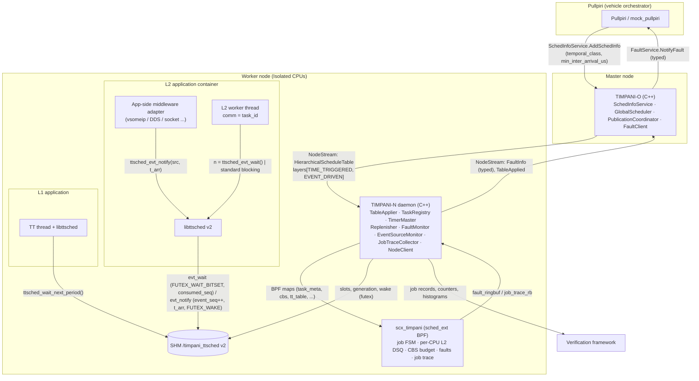
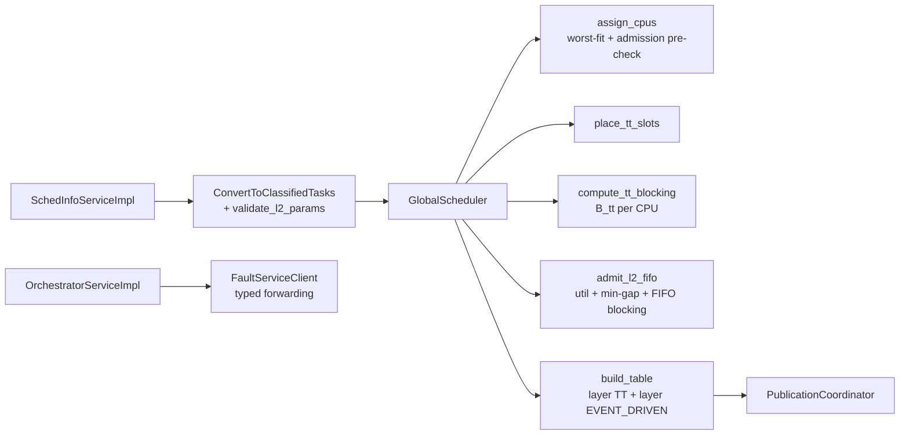
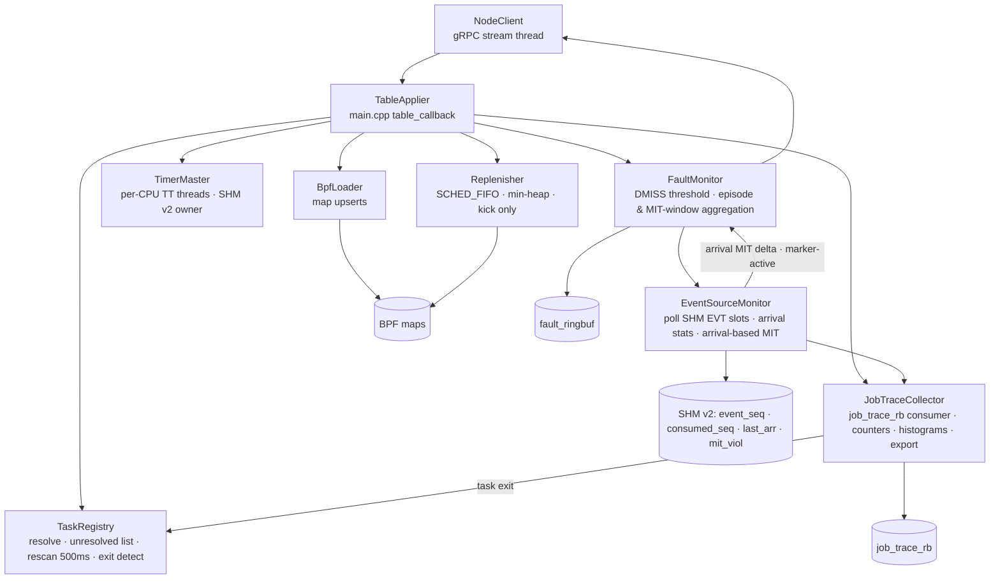
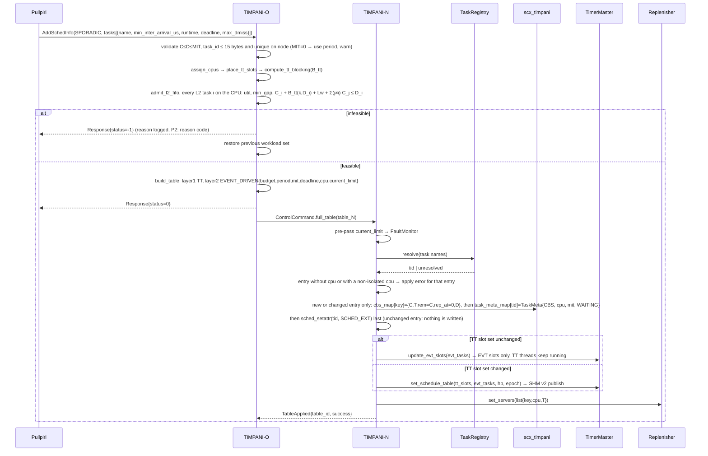
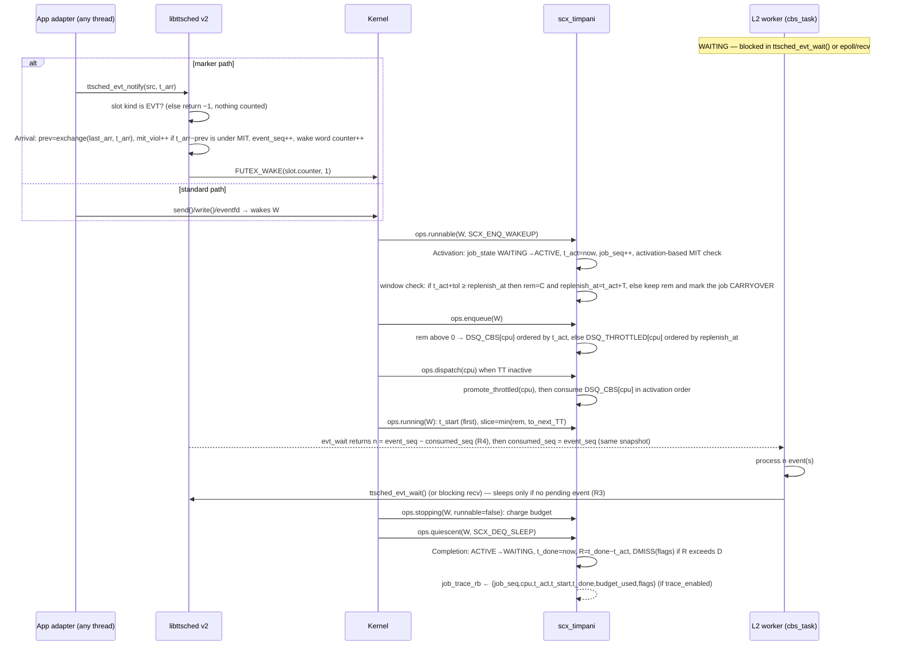
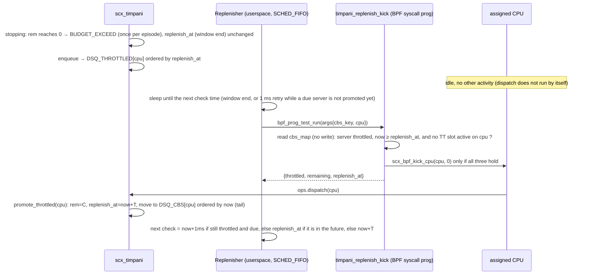
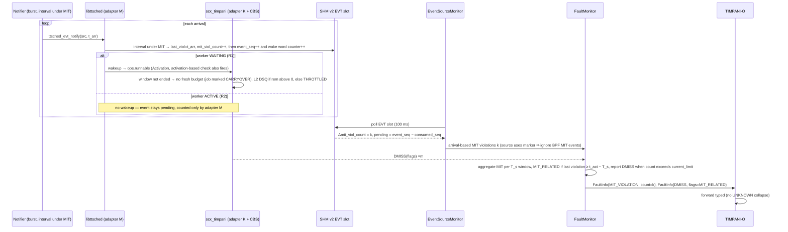
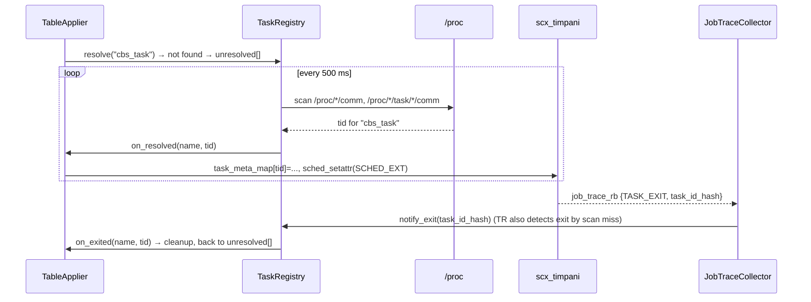

<!--
SPDX-FileCopyrightText: Copyright 2026 LG Electronics Inc.
SPDX-License-Identifier: MIT
-->

# HLD-008: Event-Driven Workload Support — 상위 설계 (High-Level Design)

**날짜:** 2026-11-10
**상태:** Draft (v4 — 공통 Event/Job 모델, 독립 검토·검증 반영, 적용 방법론과 FCW 수정 가이드 추가, Phase 1 범위) — DDR-008(Proposal)의 D-01~D-17 확정을 전제로 함
**작성:** Human + AI
**상위 문서:** [REQ-008](REQ-008-event-driven-workload-support.md), [SRS-008](SRS-008-event-driven-workload-support.md), [DDR-008](DDR-008-event-driven-workload-support.md)
**관련 문서:** [DDR-002](DDR-002-scheduling-architecture.md), [DDR-003](DDR-003-interface-protocol.md), [DDR-005](DDR-005-sched-ext-bpf-scheduler.md), [DDR-006](DDR-006-communication-architecture.md), [DDR-007](DDR-007-tt-cbs-integrated-scheduling.md), [DDR-011](DDR-011-runtime-table-update.md), [DDR-012](DDR-012-fault-management.md)
**하위 문서:** LLD-008

> 본 문서는 DDR-008의 결정(D-01~D-17)을 **컴포넌트 구조·런타임 흐름·배포·데이터** 관점에서 전개한다. 결정의 근거는 재논증하지 않고 D-NN을 참조한다. 코드 수준 구조(구조체, 함수, 의사코드)는 LLD-008에서 다룬다. 범위는 Phase 1이며, Phase 2 영향 지점은 §11에 표시한다.

---

## 요약 (Korean Summary)

- 설계 기준은 REQ-008 §2의 **공통 Event/Job 모델**이며, 구현은 **모델 / 관측 어댑터(K: BPF 커널 관측, M: `libttsched` 마커) / 집행(CBS·폴트·통계)**의 3층으로 나뉜다(§3.0, D-01).
- L2 Event-Driven 지원은 **기존 TT+CBS 파이프라인(DDR-007)을 확장**하는 형태로 구현된다. 새 데몬이나 새 프로세스는 없다.
- TIMPANI-O: MIT 전용 필드 수용, 파라미터 검증, $B_{tt}$ 기반 FIFO 승인식, `EVENT_DRIVEN` 레이어 발행.
- TIMPANI-N: `TaskRegistry` 부활(지연 식별), 신규 `Replenisher` 스레드(백업 보충: 재스케줄 유발만, 상태는 BPF가 갱신), 신규 `JobTraceCollector`(트레이스·통계), 신규 `EventSourceMonitor`(도달 통계·도달 기준 MIT), `FaultMonitor` 집계 확장, `TimerMaster`의 SHM v2.
- BPF: 태스크별 **job 상태 머신**, **CPU별 L2 DSQ**(활성화 순서), **활성화 기준 보충 윈도우**, MIT 검사, 폴트 전이 발행, job 트레이스 ringbuf.
- 애플리케이션: `libttsched` v2의 **전송 계층 중립 마커 API**(`ttsched_evt_open/notify/wait`) — 도달 통지, 배치 소비(`n_events`), 도달 기준 MIT 계수. SOME/IP 등 미들웨어 처리는 앱 어댑터에만 존재.
- **적용 방법론(§8)**: 모든 L2 앱이 지키는 계약(§8.1), 새로운 종류의 Event를 올리는 7단계 절차(§8.2), Event 종류별 적용표(§8.3), 그 절차를 FCW 예제에 적용한 파일별 수정 가이드와 실행별 기대 관측(§8.4). Event 종류가 달라져도 TIMPANI 쪽은 바뀌지 않고 앱의 어댑터만 달라진다.
- 상태: Draft. DDR-008 OI-9(백업 보충 재스케줄 수단) PoC 결과에 따라 §5 배포 뷰의 kick 경로가 확정된다.

---

## 1. 컨텍스트 (Context)

경계 원칙(D-01): `L2 application container` 밖의 어떤 TIMPANI 컴포넌트도 `AD`의 미들웨어 타입을 알지 못한다. `AD`는 샘플 앱 저장소 영역(`examples/`)에만 존재한다.

---

## 2. 아키텍처 드라이버 (Architectural Drivers)

| 드라이버 | 요구사항 | 아키텍처 영향 |
|:--|:--|:--|
| 공통 Event/Job 모델 대응 | REQ-008 §2, MOD-002/007/008 | 모델 / 관측 어댑터 / 집행의 3층(D-01, §3.0). 어댑터 추가가 집행·계약을 바꾸지 않음 |
| 활성화/완료의 결정적 정의 | REQ-008 MOD-002/003, DET-001/002/005 | 어댑터 K: BPF에 태스크별 job FSM(D-02). `select_cpu`의 활성화 기록 제거 |
| 애플리케이션 투명성 + 선택적 정밀화 | DET-003/004, MOD-007 | 어댑터 K만으로 동작 + 어댑터 M(`libttsched` 마커, D-03)이 도달 정보·배치 소비를 추가. 새 데몬 없음 |
| 전송 계층 중립 | MOD-006, IF-005 | 코어에 미들웨어 코드 0, 어댑터는 앱 측(D-01) |
| L1 보호·FFI | CBS-002/005, ORD-003, TIM-007 | CPU별 L2 DSQ(D-06), TT-first 디스패치 유지, 활성화 순서 FIFO(D-08), 윈도우당 예산 상한(D-04) |
| 보충 결정론 | PRT-001/003, TIM-003 | 활성화 기준 보충 윈도우(D-04), Replenisher 스레드 + 커널 kick 경로(D-07) |
| 마감 보장 승인 | CBS-004, ORD-001 | $B_{tt}$ 계산과 FIFO 승인식(D-09), 선행 hyperperiod 버그 수정 |
| 폴트 의미 보존·속도 제한 | PRT-005/006/007, IF-004 | BPF 전이 발행 + N 집계 + O 유형 보존(D-10) |
| 검증 가능성 | OBS-001/002, TIM-* | 전용 job 트레이스 ringbuf + 수집기(D-16) |
| 호환성·거버넌스 | NFR-005, C-03 | proto 필드 추가만(D-11); SHM ABI 단절은 버전 필드로 식별 |
| 단순성(P1) | REQ-008 §0.1 | 전체 테이블 발행 유지(D-17), FIFO, 보수적 승인식, 주기 재스캔(D-12) |

---

## 3. 컴포넌트 뷰 (Component View)

### 3.0 공통 모델과 3층 대응

| 층 (REQ-008 §2.1) | 담당 | 만들어 내는 것 / 사용하는 것 |
|:--|:--|:--|
| **① 모델** | 문서 계약(REQ-008 §2), 애플리케이션 계약(§8.1), 출력 형식(§6.4) | Event source · Event · Job, 생명주기 사건 Arrival/Activation/Start/Completion, 규칙 R1~R4 |
| **② 관측 어댑터 K** (커널) | BPF `ops.runnable/running/quiescent` + job FSM(§3.3) | Activation($t_{act}$, `job_seq`), Start($t_{start}$), Completion($t_{done}$). 한계: REQ-008 §2.4 K-(a)(b)(c). (a)(c)는 마커 태스크에도 적용 |
| **② 관측 어댑터 M** (마커) | `libttsched` v2(§3.4) + SHM v2 슬롯(§6.2) + `EventSourceMonitor`(§3.2) | Arrival(`event_seq`, $t_{arr}$), `n_events`(R4), 미소비 Event 보존(R2/R3), 도달 기준 MIT 위반 수 |
| **③ 집행** | BPF CBS(예산·DSQ·순서), Replenisher, FaultMonitor, TIMPANI-O 승인 | 어댑터 K의 사건만 사용(P1). MIT 위반 **보고**만 M의 도달 계수를 우선 사용 |

같은 L2 태스크가 K만으로 동작하든 K+M으로 동작하든 ③의 동작(격리, CPU 고정, $t_{act}$ 기준 DMISS 판정)은 같다. 달라지는 것은 MIT 위반 보고의 원천과 정밀도, Event 계수의 유무다(D-05). P1에서 Job 경계는 마커 사용 여부와 무관하게 K의 관측을 따르므로 "Job 도중에 블로킹하지 않는다"(REQ-008 A-06)는 모든 L2 태스크의 전제다. P2의 미들웨어 경계·선행 태스크 완료는 ②에 어댑터를 추가하는 것으로 수용한다(§11).

### 3.1 TIMPANI-O

| 컴포넌트 | 변경 | 책임 (P1) | 결정 |
|:--|:--|:--|:--|
| `SchedInfoServiceImpl` | 수정 | `min_inter_arrival_us` 우선, 0이면 `period` 전환 해석(경고); L2 파라미터 검증(`0<C≤D≤MIT`, `task_id` ≤ 15바이트·노드 내 유일); 거부 시 이전 워크로드 복원 | D-09, D-11 |
| `GlobalScheduler` | 수정 | `ClassifiedTask.mit_us` 분리; CPU별/전역 hyperperiod 일관화; CBS 전용 노드 HP 정의 | D-09 |
| `compute_tt_blocking` | 신규 | CPU별 TT 슬롯 병합 → $B_{tt}(k, L)$: 길이 $L$인 임의 윈도우 내 TT 점유의 최댓값 | D-09 |
| `admit_l2_fifo` | 신규(기존 `allocate_cbs_budgets` 확장) | 이용률 + min-gap 거부 + CPU의 **모든** L2 태스크 $i$에 대해 $C_i + B_{tt}(k, D_i) + L_{wake}^{max} + \sum_{j \ne i} C_j \le D_i$; CPU당 L2 태스크 ≤ 16 | D-09 |
| `build_table` | 수정 | `layer_index=1 TIME_TRIGGERED`(TT만) + `layer_index=2 EVENT_DRIVEN`(CBS만, `min_inter_arrival_us`, `cpu` 채움); `table_id` 단조 증가 | D-06, D-11 |
| `OrchestratorServiceImpl::handle_fault_info` | 수정 | 폴트 유형을 같은 의미의 유형으로 매핑(UNKNOWN 축약 제거), 신규 필드 전달 | D-10 |

### 3.2 TIMPANI-N (사용자 공간)

| 컴포넌트 | 변경 | 책임 (P1) | 결정 |
|:--|:--|:--|:--|
| `TableApplier`(main.cpp) | 수정 | 레이어 `model` 분기. EVENT_DRIVEN 엔트리: `cpu` 검사(없거나 Isolated CPU가 아니면 그 엔트리는 적용 오류, 파티션 cpuset으로 대체하지 않음) → TaskRegistry 해석 요청 → `cbs_map` → `TaskMeta(CBS, cpu, mit)` → `SCHED_EXT` 전환 순으로 등록. 이미 등록된 엔트리가 그대로면 **아무것도 쓰지 않는다**(BPF가 소유한 Job·예산 상태 보존). 파라미터가 바뀌었으면 제거 후 재등록. L2 태스크 이름을 TimerMaster에 전달(SHM 슬롯), Replenisher에 서버 목록 전달 | D-06, D-11, D-17 |
| `TaskRegistry` | 부활·확장 | 이름→TID 해석(프로세스→스레드), 미해결 목록, 500 ms 재스캔, 발견 시 콜백(등록), TID 소멸 감지 시 콜백(정리) | D-12 |
| `TimerMaster` | 수정 | SHM v2 레이아웃·버전. 시작할 때 남아 있는 SHM 객체가 있으면 종료 절차를 수행하고 새 객체를 만든다. L2 Event source마다 슬롯을 **고정 배정**하고(kind=EVT) `mit_us`를 게시한다: 한 번 배정한 슬롯은 데몬 수명 동안 그 `task_id`의 것이며 재사용하거나 0으로 지우지 않는다. TT 슬롯 집합이 같으면 TT 스레드를 재시작하지 않고 EVT 슬롯만 갱신(`update_evt_slots`). source 비활성화·종료 시 `kind` 해제 → 깨움 워드 `counter` 증가 → 깨움. 지터 샘플을 JobTraceCollector로 전달 | D-03, D-16, D-17 |
| `Replenisher` | 신규 | L2 서버별 "다음 확인 시각" 힙. 기상 시 `timpani_replenish_kick` 실행(스로틀되고 윈도우가 끝났으며 TT 슬롯이 활성이 아닌 서버의 배정 CPU만 kick; 대체: kicker 스레드). 윈도우가 끝났는데 아직 승격되지 않은 서버는 1 ms 뒤 다시 확인한다. **서버 상태(`cbs_map`)는 쓰지 않는다.** 힙은 테이블 적용 스레드가 만들어 교체 | D-04, D-07 |
| `FaultMonitor` | 수정 | `DMISS`: 임계 규칙 유지 + MIT 연관 표식(해당 source의 마지막 MIT 위반 시각 ≥ `t_act − T_s`, `t_act`는 폴트 이벤트의 `activation_ns`) + BPF가 세운 `THROTTLED`/`EARLY`/`CARRYOVER` 전달. `BUDGET_EXCEED`: 에피소드 키 중복 제거. `MIT_VIOLATION`: source당 $T_s$ 윈도우 집계(원천은 source마다 하나: 마커 활성이면 도달 기준, 아니면 활성화 기준. 둘을 더하지 않는다). `task_id/node_id/timestamp_ns` 채움 | D-05, D-10 |
| `JobTraceCollector` | 신규 | `job_trace_rb` 소비 → 태스크별 카운터·히스토그램; Job 레코드·Event source 통계·TT 지터를 파일/소켓으로 출력; 런타임 활성/비활성 토글(`trace_enabled`); 태스크 종료 레코드를 TaskRegistry에 통지 | D-16, D-12 |
| `EventSourceMonitor` | 신규 | FaultMonitor 폴링 스레드에서 SHM EVT 슬롯의 누적 카운터를 주기 수집(100 ms): 도달·소비·미소비 수 스냅샷 → JobTraceCollector, 도달 기준 MIT 위반 증분 → FaultMonitor(마커 source의 MIT 원천), 마커 사용 여부 판별(`event_seq` 증가), 마지막 MIT 위반 시각 조회. 트레이스 비활성이어도 MIT 보고 경로는 동작 | D-03, D-05, D-16 |
| `BpfLoader` | 수정 | 신규 맵/프로그램 핸들(`job_trace_rb`, `timpani_replenish_kick`, `trace_enabled`), CPU별 DSQ 수 전달 | D-06, D-07, D-16 |

### 3.3 BPF 스케줄러 (`scx_timpani`)

| 요소 | 변경 | 내용 | 결정 |
|:--|:--|:--|:--|
| `TaskMeta` | 확장 | `job_state`, `job_seq`, `activation_ns`(= $t_{act}$), `t_start_ns`, `last_act_ns`, `mit_us`, `job_flags`, `mit_viol_count`, `queue_key_ns`(L2 큐 순위) | D-02, D-05, D-08 |
| `CbsState` | 의미 변경 | `replenish_at_ns` = 현재 보충 윈도우의 끝. `remaining`/`replenish_at`은 BPF만 쓴다 | D-04 |
| DSQ | 변경 | `DSQ_CBS_BASE + cpu`, `DSQ_THROTTLED_BASE + cpu`(isolated CPU마다 `init`에서 생성); 전역 101/102 제거 | D-06 |
| `ops.runnable` | 신규 | WAITING→ACTIVE 전이, `t_act`, 활성화 기준 MIT 검사(어댑터 K, 허용 오차 `CBS_ACT_TOL_US`), `MIT_VIOLATION` 발행. 보충 윈도우 검사: 직전 윈도우가 끝났으면 예산을 채우고 새 윈도우 시작, 끝나지 않았으면 남은 예산으로 실행하고 Job에 `CARRYOVER` 표시 | D-02, D-04, D-05 |
| `ops.select_cpu` | 수정 | 활성화 기록 제거; `assigned_cpu` 반환 | D-02, D-06 |
| `ops.enqueue` | 수정 | L2 → 배정 CPU의 L2 DSQ(순위 = `queue_key_ns`) 또는 THROTTLED DSQ(순위 = `replenish_at`). 여기서는 예산을 채우지 않는다 | D-04, D-06, D-08 |
| `ops.dispatch` | 수정 | 자기 CPU의 THROTTLED 중 윈도우가 끝난 서버를 승격(예산 채움, 새 윈도우, 순위 = 승격 시각) → 자기 CPU의 L2 DSQ를 활성화 순서로 소비 | D-04, D-06, D-08 |
| `ops.running` | 수정 | 첫 실행 시 `t_start` 기록; 슬라이스 캡 유지 | D-02 |
| `ops.stopping` | 수정 | 예산 차감(ns 누산); `BUDGET_EXCEED`는 양수→0 전이에만; 마감이 지났으면 Job당 1회 조기 DMISS(MAY) | D-04, D-10 |
| `ops.quiescent` | 신규 | ACTIVE→WAITING(완료), `t_done`, DMISS 판정, job 레코드 발행(`trace_enabled`일 때) | D-02, D-10, D-16 |
| `ops.exit_task` | 신규 | 태스크 종료 레코드를 `job_trace_rb`로 발행(게이트 없음) → JobTraceCollector → TaskRegistry | D-12, D-16 |
| `job_trace_rb` | 신규 | 완료 시 job 레코드(256 KiB, `trace_enabled` 게이트). 태스크 종료 레코드는 게이트와 무관하게 발행 | D-16 |
| `timpani_replenish_kick` | 신규(SYSCALL prog) | `cbs_map`을 읽어 서버가 스로틀 상태이고 윈도우가 끝났으며 그 CPU에서 TT 슬롯이 활성이 아닐 때만 `scx_bpf_kick_cpu(cpu, 0)`. 상태를 쓰지 않고 `(throttled, remaining, replenish_at)`을 돌려준다 | D-07 |

### 3.4 애플리케이션 라이브러리 (`libttsched` v2)

| API | 대상 | 동작 |
|:--|:--|:--|
| `ttsched_init()` | TT/L2 공통 | SHM v2 매핑(가능하면 쓰기 가능으로; L2 대기는 쓰기 매핑 필요), comm으로 슬롯 탐색(기존). 여러 번 불러도 된다: 이전 매핑을 해제하고 다시 연다 |
| `ttsched_wait_next_period()` | L1 TT | 기존 동작 |
| `ttsched_evt_open(task_id)` | 앱 어댑터 | Event source 핸들 획득(프로세스 내 고정 테이블, 힙 없음). 캐시한 슬롯이 자신의 것이 아니게 되면 notify에서 자동으로 다시 찾는다 |
| `ttsched_evt_notify(src, t_arr_ns)` → 0 / −1 | 앱 어댑터(임의 스레드) | **Arrival**: 자신의 슬롯이 `kind == EVT`인지 **먼저** 확인(아니면 **−1**, 계수하지 않음) → `last_arr_ns` 교환, 도달 기준 MIT 검사(`last_viol_ns`, `mit_viol_count`) → `event_seq` +1 → 깨움 워드 `counter` +1 → `FUTEX_WAKE(1)`. 0을 반환한 Event는 계수된 것이다 |
| `ttsched_evt_wait()` → n / −1 | L2 워커(source당 스레드 하나) | **wait point**: 반복마다 깨움 워드 `counter`를 먼저 읽고 `event_seq`를 **한 번** 읽는다. 미소비 Event가 있으면 `n = event_seq − consumed_seq`를 반환하고 `consumed_seq`를 그 스냅샷으로 갱신(수면 없음). 없으면 `FUTEX_WAIT_BITSET(counter, TTSCHED_EVT_BITSET)`로 대기. 유실·중복 없음. **−1**: 지금 대기할 수 없음(데몬 종료, source 비활성·미등록, 쓰기 매핑 불가) → 큐는 그대로 두고 `ttsched_init()` 후 재시도. **−2**(`TTSCHED_EVT_RESET`): 데몬이 재시작해 계수가 0에서 다시 시작함 → 큐를 비우고 재시도 |

### 3.5 샘플 앱 어댑터 (코어 외부)
`examples/someip/radar_based_fcw`의 vsomeip 콜백은 큐에 넣은 뒤 `ttsched_evt_notify(src, now)`만 호출하고, 워커는 `n = ttsched_evt_wait()` 후 n건을 처리한다. `libtimpani_rt`는 폐기한다(REQ-008 §12). 전송 계층 중립성을 보이기 위해 `sample-apps`에 일반 L2 샘플 `evttask`(이벤트 전달 수단 선택: timerfd / UDP 소켓 / 파이프 / 마커 notify)를 추가한다(§8).

---

## 4. 런타임 뷰 (Runtime View)

### 4.1 L2 워크로드 등록 → 승인 → 발행 → 적용

### 4.2 이벤트 활성화 → 디스패치 → 완료 (마커 경로와 표준 경로)

워커가 처리 중일 때 도달한 Event는 `event_seq`에만 누적되어 미소비 상태로 남고(R2), 다음 `ttsched_evt_wait()`가 수면 없이 복귀하면서 다음 Job의 `n`으로 전달된다(R3/R4). 이 back-to-back 구간은 어댑터 K에서 하나의 구간으로 병합 관측되며 예산을 새로 받지 않는다(D-02, D-04).

TT 슬롯이 활성인 동안 도달한 이벤트는 `ops.dispatch`가 TT 비활성이 될 때까지 소비되지 않으며(`tt_active_on_cpu` 게이트 유지), 실행 중이던 L2는 슬라이스 캡으로 TT 시작 전에 양보한다(DDR-007 §4.4 유지).

### 4.3 예산 소진 → 스로틀 → 백업 보충 → 재개

보충과 승격은 BPF가 배정 CPU에서 수행하고 Replenisher는 dispatch를 유발할 뿐이다(D-04 규칙 6, D-07). 선언을 계속 지켜 온 서버(모든 도달이 MIT를 지키고 Job당 차감 실행 시간이 $C_s$ 미만)는 활성화 때마다 예산을 받으므로 이 경로를 타지 않는다. TT 슬롯이 활성인 CPU(그 CPU에 실행 가능한 TT 태스크가 있는 동안, `tt_active_on_cpu`)에는 kick을 보내지 않는다: TT 태스크가 잠들면 CPU가 다음 태스크를 고르면서 dispatch가 호출되어 승격되고, Replenisher는 승격될 때까지 1 ms마다 다시 확인한다. MIT를 어기거나 예산을 넘긴 서버는 다음 윈도우의 예산을 앞당겨 쓴 것이므로 윈도우가 뒤로 밀리고, 이후 Job이 새 예산 없이(`CARRYOVER`) 실행될 수 있다(D-04 "위반 후 동작").

대체 경로(D-07 2안): `KP` 대신 CPU별 kicker 스레드를 futex로 깨워 `schedule()`을 유발한다.

### 4.4 MIT 위반 버스트 (UC-06)

마커를 쓰지 않는 source는 어댑터 K의 활성화 기준 `MIT_VIOLATION` 이벤트만으로 같은 보고 경로를 탄다(처리 중 도달은 계수되지 않는 근사).

L1 TT는 TT-first 디스패치로 보호된다. 다른 L2 서버에 대한 간섭은 서버당 $C_s$ 이하다: 위반 서버는 새 예산을 받지 못하고, 예산을 다 쓰면 승격 때 큐의 뒤로 간다(D-04 성질 (P-c), D-08).

### 4.5 지연 식별 (늦게 생성된 워커 / 재시작)

### 4.6 STOP(제거)
DDR-011 §3.2/DDR-012 §5.1 경로 유지. 추가: 먼저 `sched_setattr(SCHED_OTHER)`로 되돌린 뒤 `TaskMeta`·`cbs_map`·Replenisher 힙 엔트리·JobTraceCollector 통계·미해결 목록을 제거한다. SHM 슬롯은 지우지 않고 **비활성화**한다(`kind = NONE` → `counter` 증가 → 깨움). 슬롯은 그 `task_id`에 고정 배정된 채 남고, 같은 `task_id`가 다시 등록되면 누적 값을 이어서 쓴다.

---

## 5. 배포 뷰 (Deployment View)

### 5.1 노드 내 스레드 (timpani-n 프로세스)

| 스레드 | 정책/우선순위 | CPU | RT 경로 | 변경 |
|:--|:--|:--|:-:|:--|
| TimerMaster per-CPU | SCHED_FIFO 99 | 각 Isolated CPU(미고정, 현행) | ● | SHM v2 |
| **Replenisher** | SCHED_FIFO 98 (TM−1; 기본값이며 PoC에서 확정, DDR-007 §11) | Non-Isolated | ● | 신규 |
| (대체) kicker per-CPU | SCHED_FIFO 97 | 각 Isolated CPU 고정 | ● | D-07 2안 시 |
| FaultMonitor poll | default | Non-Isolated | — | 집계 확장 + `EventSourceMonitor` 폴링(같은 스레드) |
| **JobTraceCollector** | default | Non-Isolated | — | 신규 |
| **TaskRegistry rescan** | default | Non-Isolated | — | 신규(타이머 루프) |
| NodeClient stream | default | Non-Isolated | — | — |
| main | default | — | — | — |

RT 경로 스레드는 gRPC·힙 할당·블로킹 I/O를 하지 않는다(DDR-006 §4). Replenisher의 힙은 테이블 적용 스레드(비-RT)가 잠금 밖에서 새로 만들어 짧은 임계 구역에서 교체하며, RT 루프는 할당하지 않는다. 잠금은 우선순위 상속 뮤텍스다.

### 5.2 BPF 객체
`scx_timpani` 스켈레톤에 struct_ops(`runnable/quiescent/exit_task` 추가), `job_trace_rb`, `timpani_replenish_kick`(SEC("syscall")), 전역 `trace_enabled`를 포함한다. 로드 순서·권한은 현행(`CAP_BPF`, `CAP_SYS_NICE`) 유지.

### 5.3 애플리케이션
- L2 컨테이너는 Isolated cpuset 안에서 실행되고 `/dev/shm/timpani_ttsched` 접근 권한을 가진다(현행 TT와 동일).
- `ttsched_evt_notify`를 호출하는 어댑터 스레드는 같은 프로세스의 스레드를 기본으로 하며, SHM 쓰기 권한이 있는 같은 호스트의 다른 프로세스도 허용한다(OI-15 종결, DDR-008 D-03). L2 워커는 `consumed_seq`를 기록하므로 SHM을 쓰기 가능으로 매핑해야 한다. `ttsched_evt_wait`를 부르는 스레드는 source당 하나다(`task_id`와 같은 comm을 가진 스레드).

---

## 6. 데이터 뷰 (Data View)

### 6.1 BPF 맵 (변경·신규만; 전체는 LLD-008)

| 맵 | 키 → 값 | 변경 |
|:--|:--|:--|
| `task_meta_map` | TID → `TaskMeta{..., job_state, job_seq, activation_ns(t_act), t_start_ns, last_act_ns, mit_us, job_flags, mit_viol_count, queue_key_ns}` | 확장 |
| `cbs_map` | `wl_hash ^ task_hash` → `CbsState{..., exec_frac_ns, throttle_episodes}` | ns 누산 필드. `replenish_at_ns`는 보충 윈도우의 끝이며 `remaining`과 함께 BPF만 쓴다(D-04). 사용자 공간은 태스크가 SCHED_EXT에 들어가기 전(생성)과 나온 뒤(삭제)에만 쓴다 |
| DSQ | `DSQ_CBS_BASE+cpu`, `DSQ_THROTTLED_BASE+cpu` | CPU별 |
| `fault_ringbuf` | `FaultEvent{..., job_seq, flags, activation_ns}`; 유형 `MIT_VIOLATION=2` | 확장 |
| `job_trace_rb` | `JobRecord{workload_id_hash, task_id_hash, job_seq, cpu, t_act_ns, t_start_ns, t_done_ns, budget_used_us, flags}`(정본: LLD-008 §4.1) | 신규 |
| `.bss trace_enabled` | u32 | 신규 |

### 6.2 SHM v2 (`/timpani_ttsched`)
헤더 `{magic(v2), version, n_tasks, generation, instance_id, reserved}` + `tasks[64]{name[16], counter, kind, consumed_seq, mit_us, last_arr_ns, mit_viol_count, event_seq, last_viol_ns, reserved}`. 슬롯 하나가 대기/통지 지점 하나다. `counter`는 futex 대기에 쓰는 **깨움 워드**다: TT 슬롯에서는 TimerMaster가 틱마다 올리고, EVT 슬롯에서는 notify와 비활성화가 올린다. EVT 슬롯에서 Event 수는 `counter`가 아니라 **`event_seq`**다. EVT 슬롯은 Event source 하나의 상태이며 쓰는 주체가 필드마다 하나다.

| 필드 | 쓰는 주체 | 성격 |
|:--|:--|:--|
| `event_seq`, `last_arr_ns`, `mit_viol_count`, `last_viol_ns` | `ttsched_evt_notify` | 누적(`event_seq`, `mit_viol_count`) / 최근 시각 |
| `consumed_seq` | 소비 태스크의 `ttsched_evt_wait` | 누적 |
| `kind`, `name`, `mit_us` | TIMPANI-N(TimerMaster) | 설정 |
| `counter` | notify, 그리고 비활성화·종료 때 TIMPANI-N | 깨움 워드(값 자체에 의미 없음) |

갱신 규약(D-03):

1. **고정 배정**: L2 `task_id`에 한 번 배정한 슬롯은 데몬(SHM 객체) 수명 동안 그 이름의 것이다. 다른 이름에 재사용하지 않고 0으로 지우지 않는다. 그래서 notify가 슬롯을 확인한 뒤 값을 올리는 사이에 선점되어도 다른 source의 슬롯을 건드릴 수 없다. 슬롯이 모자라면 그 엔트리는 적용 오류다.
2. **유효성**: EVT 슬롯의 유효성은 슬롯 자신의 `kind == EVT`와 이름 일치로 판정한다. 헤더의 `magic`/`generation`과 무관하므로, TT 테이블을 다시 발행하는 동안에도 유지되는 Event source의 통지·대기는 끊기지 않는다.
3. **배정·비활성화 순서**: 새로 배정할 때는 `name`·`mit_us`를 쓰고 `kind = EVT`를 마지막에 쓴다. 테이블에서 빠지거나 데몬이 종료할 때는 `kind = NONE` → `counter` 증가 → 깨움 순서로 알린다(`event_seq`는 건드리지 않으므로 가짜 Event가 생기지 않는다). 같은 `task_id`가 다시 등록되면 누적 값을 이어서 쓴다.
4. **TT 슬롯**: 기존 `magic`-last/`generation` 핸드셰이크를 그대로 따른다(DDR-011 §1.1). 재발행 때 `counter`를 올려 깨우는 대상은 TT 슬롯뿐이다.
5. **시작**: 이전 데몬이 비정상 종료해 SHM 객체가 남아 있으면, 새 데몬은 그 객체에 종료 절차(3항)를 수행하고 unlink한 뒤 새 객체를 만든다. 새 객체에는 새 `instance_id`를 쓰고 `fchmod`로 권한(0666)을 맞춘다. 남은 객체에 붙어 있던 앱은 −1을 받고 `ttsched_init()`으로 새 객체에 붙는다.

보장 범위: notify가 0을 반환한 Event는 데몬이 살아 있는 동안 유실·중복 없이 소비 태스크에 전달된다(비활성화 후 재등록 포함). 데몬이 종료·재시작하면 계수는 0에서 다시 시작한다. 소비 태스크는 `instance_id`가 달라진 객체에 처음 붙는 wait에서 −2를 한 번 받고 큐를 비운다(§8.1 6항).

### 6.3 프로토콜 (요약; 번호는 LLD-008)
- `schedinfo.TaskInfo.min_inter_arrival_us`(신규), `schedinfo.FaultType{+BUDGET_EXCEED, MIT_VIOLATION, WATCHDOG(예약, P2)}`, `schedinfo.FaultInfo{+timestamp_ns, count, flags}`.
- `node_control.CbsConfig{+min_inter_arrival_us, optional cpu}`, `LayerConfig(model=EVENT_DRIVEN, layer_index=2)`, `node_control.FaultType{+MIT_VIOLATION, WAKEUP_LATENCY_EXCEED(예약)}`, `FaultInfo{+count, flags, job_seq}`.

### 6.4 Job 레코드 (검증 프레임워크 입력)
Job 레코드(어댑터 K, 커널이 관측한 Job 구간). 커널이 내는 레코드는 `JobRecord{workload_id_hash, task_id_hash, job_seq, cpu, t_act_ns, t_start_ns, t_done_ns, budget_used_us, flags}`이고(정본: LLD-008 §4.1), `JobTraceCollector`가 출력할 때 `node_id`와 태스크 이름(`task_id`)을 붙인다. 플래그와 설정 주체:

| 플래그 | 설정 주체 | 의미 |
|:--|:--|:--|
| `MIT_VIOLATION` | BPF | 활성화 기준 MIT 위반이 관측된 Job |
| `THROTTLED` | BPF | 응답 구간에서 스로틀된 적이 있음 |
| `EARLY_DMISS` | BPF | 완료 전에 조기 DMISS를 냄 |
| `CARRYOVER` | BPF | 새 예산 없이 시작한 Job(활성화 시점에 서버 윈도우가 끝나지 않음: 이 Job의 MIT 위반, 또는 앞선 위반·예산 초과의 후속 영향) |
| `DMISS` | BPF | 완료 시 마감 초과 |
| `TASK_EXIT` | BPF | 태스크 종료 레코드(Job 아님) |
| `MARKER` | JobTraceCollector | 해당 source가 마커 활성(`EventSourceMonitor` 판별) |

Event source 통계 레코드(어댑터 M, 100 ms 스냅샷): `{node_id, workload_id_hash, task_id, event_seq, consumed_seq, pending, mit_violations, last_t_arr, t_sample}`. 둘 다 CSV/gpdata 호환 라인 형식이며 시각은 `CLOCK_MONOTONIC`이다. Job 레코드에는 `n_events`가 없다. Event가 유실 없이 소비되었는지는 `event_seq`와 `consumed_seq`로 확인하고, Event↔Job 대응과 $t_{rel}$ 기준 응답 시간은 검증 프레임워크가 이 두 레코드와 생성기 로그를 오프라인 대조해 산출한다(D-16). TT 지터 샘플은 `{cpu, slot_idx, target, actual, jitter}`로 동일 채널.

---

## 7. 설계 결정 표

| 결정 | 제목 | 적용 컴포넌트 |
|:--|:--|:--|
| D-01 | 공통 Event/Job 모델과 3층 구조 | 전 컴포넌트, 어댑터 |
| D-02 | 관측 어댑터 K: BPF job 상태 머신 | BPF, JobTraceCollector |
| D-03 | 관측 어댑터 M: `libttsched` v2 마커 API, 슬롯 고정 배정 | libttsched, TimerMaster(SHM), EventSourceMonitor |
| D-04 | 활성화 기준 보충 윈도우 + 백업 필수, 위반 후에는 빌린 예산을 갚을 때까지 새 예산 없음 | BPF, Replenisher |
| D-05 | MIT 위반: 도달 기준 우선 계수·흡수 | libttsched, EventSourceMonitor, BPF, FaultMonitor |
| D-06 | CPU별 L2 DSQ | BPF, TableApplier |
| D-07 | Replenisher(재스케줄 유발만) + kick 경로 | Replenisher, BPF syscall prog |
| D-08 | 활성화 순서 FIFO(P1) / EDF(P2) | BPF, GlobalScheduler |
| D-09 | 승인 충분조건(P1) | GlobalScheduler |
| D-10 | 폴트 분류·속도 제한 | BPF, FaultMonitor, OrchestratorService |
| D-11 | proto 필드 추가 | proto, O, N |
| D-12 | TaskRegistry 재스캔 | TaskRegistry |
| D-13 | TT floor/watchdog 미채택 | — |
| D-14 | DDR-005 정합 | 문서 |
| D-15 | C++ 경로 | 전체 |
| D-16 | job 트레이스 ringbuf + source 통계 | BPF, JobTraceCollector, EventSourceMonitor |
| D-17 | 전체 테이블 발행 유지 | O, TableApplier |

---

## 8. 애플리케이션 적용 방법론과 샘플 앱 가이드 (Phase 1)

이 절은 Phase 1 설계 위에서 **여러 종류의 Event를 같은 방법으로 다루는 절차**를 정한다. §8.1은 모든 L2 애플리케이션이 지키는 계약이다. §8.2는 새로운 종류의 Event를 TIMPANI에 올리는 절차이고 §8.3은 Event 종류별 적용표다. §8.4는 그 절차를 FCW 예제(`examples/someip`)에 적용한 수정 가이드이고, §8.5는 수용 기준의 기준 검증 수단인 범용 샘플이다.

전송 계층이나 미들웨어가 달라져도 TIMPANI 쪽(TIMPANI-O, TIMPANI-N, BPF, `libttsched`)은 바뀌지 않는다. Event 종류마다 달라지는 것은 앱 안의 어댑터, 곧 "Event가 도달한 것을 어디서 알리는가"와 워크로드 선언의 파라미터 값뿐이다.

### 8.1 L2 애플리케이션 계약 (전송 계층 무관)

계약은 공통 모델(REQ-008 §2)의 용어로 기술한다. 앱이 지킬 것은 "Event가 도달하면 알리고(또는 표준 수단으로 깨우고), wait point에서 기다리고, 받은 만큼 처리한다"이다.

1. **태스크 식별**: L2 처리 스레드의 comm 이름을 `task_id`로 설정한다(`pthread_setname_np`). `task_id`는 15바이트 이하이고 노드 안에서 유일해야 한다(TIMPANI-O가 검증). 같은 comm을 가진 스레드를 둘 이상 만들지 않는다.
2. **wait point**: 스레드는 `ttsched_init()` 후 루프의 wait point에서 **`n = ttsched_evt_wait()`**(어댑터 M, 권장) 또는 표준 블로킹(`epoll_wait`, `recv` 등, 어댑터 K만 사용)으로 대기한다. `ttsched_evt_wait()`를 부르는 스레드는 source당 하나다.
3. **Job 도중에 블로킹하지 않는다**(REQ-008 A-06): wait point에서 깨어나 다시 wait point에 들어갈 때까지 잠들 수 있는 호출을 하지 않는다 — 경합이 있는 뮤텍스, 블로킹 I/O(가득 찬 파이프나 터미널로의 출력 포함), `sleep`, 응답을 기다리는 동기 호출. 마커 사용 여부와 무관하다. P1에서는 모든 자발적 수면이 Job 완료로 관측되므로, 도중에 잠들면 Job 하나가 여러 개로 나뉘어 측정된다.
4. **도달 통지(어댑터 M)**: Event를 수신하는 스레드(미들웨어 콜백, 소켓 리더 등)는 데이터를 앱 큐에 **먼저 넣고** **`ttsched_evt_notify(src, t_arr_ns)`**를 호출한다. `src`는 초기화 때 `ttsched_evt_open(task_id)`로 한 번 얻는다. notify가 **−1**을 반환하면(source 미등록·비활성, SHM 객체 없음) Event는 계수되지 않았으므로, 방금 넣은 항목이 처리되지 않게 한다(큐에서 빼거나 무효로 표시하고, 워커는 무효 항목을 세지 않고 버린다). 같은 source에 대한 notify는 한 스레드에서 호출하거나 앱이 직렬화한다. 표준 경로라면 소켓/eventfd 쓰기 자체가 wakeup이 된다.
5. **소비(R4)**: `ttsched_evt_wait()`가 n을 반환하면 큐에서 **정확히 n건**을 처리하고 다시 wait한다. 정상 조건에서 n = 1이다. n > 1은 처리 중에 Event가 더 도달했다는 뜻이며(MIT 위반 또는 선행 Job 지연) TIMPANI가 따로 계수·보고한다. 큐를 "빌 때까지" 비우는 방식은 쓰지 않는다(다음 wait가 즉시 복귀하여 빈 Job이 생긴다). n이 큐 길이보다 크면 큐 길이만큼만 처리한다.
6. **−1과 −2의 처리**: `ttsched_evt_wait()`가 **−1**을 반환하면 지금은 대기할 수 없다는 뜻이다(워크로드가 아직 등록되지 않았거나 제거됨, 데몬 기동 전이거나 정상 종료 후여서 SHM 객체가 없음). 큐는 그대로 두고 `ttsched_init()`을 호출한 뒤 다시 시도한다: 같은 데몬 안에서는 계수가 이어지므로 큐에 남은 항목은 source가 다시 활성화될 때 처리된다. **−2**(`TTSCHED_EVT_RESET`)는 데몬이 재시작해 계수가 0에서 다시 시작했다는 뜻이다. 큐에 남은 항목을 모두 버리고 다시 시도한다: 남겨 두면 이후의 Event와 하나씩 어긋난다. 워커를 먼저 띄운 뒤 수신을 시작한다(워커가 붙기 전에 수락된 항목이 재시작을 넘어 남지 않도록). 데몬 재시작 직후나, 이전 프로세스가 미소비 Event를 남기고 끝난 뒤의 첫 wait에서는 n이 큐의 항목 수보다 클 수 있다(5항대로 큐 길이만큼만 처리한다). 이 어긋남은 그 한 번으로 끝난다. 데몬이 비정상 종료한 뒤 다음 데몬이 뜰 때까지는 SHM 객체가 남아 있어 notify가 수락되고 wait가 계속 동작한다: 그 구간의 실행은 TIMPANI의 관리 밖이고, 그때 계수된 Event는 재시작 때 버려진다.
7. **MIT**: Event **도달** 간격의 제약이다. 어댑터 M은 notify 간격으로, 어댑터 K만 쓰면 wakeup 간격으로 판정된다.
8. **예산 선언**: `runtime`(= $C_s$)은 Job 한 건의 최대 실행 시간보다 **크게** 선언한다. 차감 시간에는 큐에서 꺼내기, 처리, 다시 대기에 들어가는 경로가 모두 들어가고, 차감액이 예산에 도달하면 스로틀된다. 여유는 MIT 위반이나 예산 초과 뒤에 서버가 정상 위상으로 돌아오는 데에도 쓰인다(D-04 "위반 후 동작"). 여유가 0이면 한 번의 초과 뒤에 회복하지 못한다.
9. **종료**: P1에는 wait 중인 워커를 Event 없이 깨우는 수단이 없다. 프로세스를 끝낼 때는 워커를 깨우지 않고 끝낸다(워커 스레드를 detach해 두고 프로세스 종료에 맡긴다). 프로세스를 유지한 채 워커만 끝내야 하면 종료 플래그를 세우고 `ttsched_evt_notify(src, 0)`을 한 번 호출할 수 있으나, 그 통지는 도달 1건(직전 도달과의 간격이 MIT보다 짧으면 MIT 위반 1건)과 Job 1건으로 계수되므로 검증 구간 밖에서만 쓴다(전용 취소 API는 LLD-008 L-8).
10. 앱은 SCHED_EXT·우선순위·affinity를 스스로 설정하지 않는다(DDR-002, REQ-NFR-003).
11. 자체 MIT/E2E 폴트 판정 로직을 두지 않는다. 판정·보고는 TIMPANI-N이 한다. 로컬 로그는 자유이나 Job 밖의 스레드에서 출력한다(3항).

### 8.2 새로운 종류의 Event를 올리는 절차

어떤 Event든 아래 일곱 단계로 올린다. 각 단계의 산출물이 다음 단계의 입력이다.

| 단계 | 할 일 | 산출물 |
|:--|:--|:--|
| 1. 모델 요소 식별 | 공통 모델의 네 요소를 앱에서 찾는다. **Event source**: 무엇이 Event를 만드는가. **도달 지점**: 그 Event가 이 노드의 앱 코드에 처음 보이는 곳(콜백, `read()` 복귀 등). **소비 태스크**: 그 Event를 처리하는 스레드 하나. **Job**: Event 한 건의 처리, 곧 wait point에서 깨어나 다시 wait point에 들어갈 때까지 | `task_id`(소비 스레드의 comm), 도달 지점의 코드 위치 |
| 2. P1 적용 조건 확인 | (a) source 하나에 소비 태스크 하나, 태스크 하나에 source 하나. (b) 도달 간격의 하한(MIT)을 말할 수 있다. (c) Job 도중의 블로킹을 없앨 수 있다(§8.1 3항). (d) 소비 태스크가 Isolated CPU 하나에 고정되어도 된다. 조건에 맞지 않으면 §8.3의 "P1에서 다루는 법"으로 구조를 바꾼다 | 적용 가능 여부, 필요한 구조 변경 |
| 3. 파라미터 결정 | **MIT**: 도달 지점(notify를 부르는 곳, K만 쓰면 깨어나는 곳)에서 본 최소 간격이다. 주기 생산자면 `주기 − (송신 시점의 흔들림 + 도달 지점까지의 전달 흔들림)`, 비주기면 규격상 최소 간격에서 전달 흔들림을 뺀다. notify를 부르는 수신 스레드가 일반 스레드면 그 스케줄링 지연도 전달 흔들림에 들어간다. 규격이 없으면 측정한 최소 간격에서 여유를 뺀다. 도달 기준 검사에는 허용 오차가 없으므로 MIT를 낙관적으로 잡으면 정상 구동에서 `MIT_VIOLATION`이 계수된다. **C**(`runtime`): 측정한 Job당 최대 실행 시간보다 크게(§8.1 8항). **D**(`deadline`): 활성화부터 완료까지의 상대 마감. `0 < C ≤ D ≤ MIT`. **`max_dmiss`**: 보고 임계 | `min_inter_arrival_us`, `runtime`, `deadline`, `max_dmiss` |
| 4. 어댑터 선택 | 아래 판단표로 K만 쓸지 K+M을 쓸지 정한다 | 어댑터, notify 위치 |
| 5. 앱 구조화 | 수신 측: 큐에 넣고 notify(§8.1 4항). 소비 측: 이름 설정 → `ttsched_init()` → wait → n건 처리 → wait(§8.1 5항). Job 안의 블로킹을 제거한다: 큐는 워커가 잠들지 않는 구조로, 로그 출력은 다른 스레드로 | 수정된 앱 |
| 6. 워크로드 선언과 승인 | `TEMPORAL_SPORADIC` 워크로드로 선언한다. 제출 전에 승인식을 직접 확인할 수 있다: 배정 CPU $k$에서 `C + B_tt(k, D) + L_wake_max(50 µs) + (같은 CPU의 다른 L2 태스크들의 C 합) ≤ D`. $B_{tt}(k, D)$는 길이 D인 구간에 들어갈 수 있는 TT 점유의 최댓값이다. 거부되면 D를 늘리거나(`D ≤ MIT`), TT 점유가 적은 CPU로 옮기거나, Job 자체의 실행 시간을 줄여 다시 측정한 값으로 C를 낮춘다(C를 측정한 최댓값보다 작게 선언하지 않는다, §8.1 8항) | `SchedInfo` 항목, 승인 결과 |
| 7. 검증 | **정상 구동**: 폴트 0건(`MIT_VIOLATION`이 나오면 3단계의 MIT가 낙관적인 것이다), source 통계의 최종 `event_seq = consumed_seq`, `event_seq` + 앱이 버린 수(큐 넘침, notify 거부) = 생성한 Event 수, Job 레코드 수 = `event_seq`, 모든 Job에서 `t_done − t_act ≤ D`, `budget_used_us`의 최댓값 < C. **이상 주입**: 실행 시간 초과 → `BUDGET_EXCEED`와 스로틀, 짧은 간격의 도달 → `MIT_VIOLATION`. 두 경우 모두 L1 TT 지터와 다른 L2 태스크가 영향을 받지 않음을 확인한다 | 검증 기록(REQ-008 AC-008-01~07 대응) |

**어댑터 판단표(4단계)**. 위에서부터 묻고 처음 "예"가 나오는 행을 따른다.

| 질문 | "예"이면 |
|:--|:--|
| Event를 받는 스레드와 처리하는 스레드가 다른가(미들웨어 콜백, 수신 스레드 + 큐)? | **K+M**. notify는 수신 스레드에서 큐에 넣은 직후 |
| 처리 중에 도달한 Event의 수를 세어야 하거나, 도달 기준의 정확한 MIT 계수가 필요한가? | **K+M** |
| 소비 스레드가 Event마다 한 번씩 블로킹 시스템 콜에서 깨어나 한 건만 읽는가(1 wakeup = 1 Event)? | **K만**. 코드 변경은 comm 이름 설정뿐이다. 처리 중에 도달한 Event는 따로 계수되지 않고 Job이 이어 붙어 관측된다(REQ-008 §2.4) |
| (위 어느 것도 아님) | **K+M** |

어느 어댑터를 쓰든 집행(예산 격리, CPU 고정, DMISS 판정)은 같다(§3.0).

### 8.3 Event 종류별 적용

| Event 종류 | 도달 지점 | 어댑터 | notify 위치 / wait point | MIT 산정 | P1 주의 |
|:--|:--|:--|:--|:--|:--|
| SOME/IP event·field 통지 | 메시지 핸들러 콜백(미들웨어 스레드) | K+M | 핸들러에서 큐에 넣고 notify. 워커는 `ttsched_evt_wait` | 송신 주기 − (송신 시점 흔들림 + 미들웨어 전달 흔들림) | FCW가 이 경우다(§8.4). service/instance/event ID는 앱 안에만 있다 |
| DDS 샘플 | `on_data_available` 리스너 | K+M | 리스너에서 샘플을 꺼내 큐에 넣고 notify | writer 주기 − 흔들림 | 소비 스레드가 WaitSet으로 직접 기다리면 K만으로도 되지만, 한 번 깨어 여러 샘플을 꺼내면 Event 수가 계수되지 않는다 |
| CAN 프레임(SocketCAN) | ID 필터를 건 `CAN_RAW` 소켓 | K만 | 소비 스레드가 `read()`로 한 프레임씩 읽는다 | 프레임 주기 규격. 이벤트성 프레임은 송신 금지 시간(inhibit time) | 한 스레드가 여러 ID를 받으면 "여러 종류의 Event" 행을 따른다 |
| UDP·Unix 소켓·파이프 메시지 | 소켓 수신 | K만(소비 스레드가 직접 읽음) 또는 K+M(리더 스레드가 분배) | `recv()`/`read()`가 wait point | 송신자 규격 | TCP 같은 스트림은 한 번 깨어 메시지 한 건만 처리하도록 앱이 경계를 정한다 |
| 앱 타이머로 만드는 비주기 작업 | `timerfd` 만료 | K만 | `read(timerfd)` | 타이머의 최소 간격 | 엄격히 주기적인 작업은 L2가 아니라 L1 TT로 선언한다 |
| 하드웨어 입력(GPIO 에지, 센서 인터럽트) | 커널이 넘겨주는 fd(GPIO 문자 장치 이벤트, UIO, input) | K만 | `read()`/`poll()` | 디바운스 간격, 센서의 최대 발생률 | 인터럽트 처리 자체는 대상이 아니다. 대상은 그 뒤의 사용자 공간 스레드다 |
| 선행 태스크의 완료(L1 TT 태스크나 다른 L2 태스크의 출력) | 선행 태스크가 출력을 큐·공유 메모리에 쓴 시점 | K+M | 선행 태스크가 출력을 쓴 뒤 `ttsched_evt_notify`(같은 프로세스, 또는 SHM 쓰기 권한이 있는 다른 프로세스) | 선행이 TT면 `주기 − 완료 시점 흔들림`(흔들림 ≤ 선행의 깨움 흔들림 + 선행 WCET) | notify 비용(약 1–2 µs)을 선행 태스크의 WCET에 넣는다. 선·후행의 자동 연계(어댑터 D)는 P2 |
| 다른 노드에서 오는 Event | 이 노드의 수신 지점 | 위 행들과 같음 | 위 행들과 같음 | 송신 주기 − 네트워크 지터 | P1은 이 노드에 도달한 뒤만 판정한다. 노드 간 E2E 지연은 P2 |
| 하한이 불분명한 Event(진단 요청, 사용자 입력) | 수신 지점 | K+M | 위와 같음 | 설계값으로 정한다: "이 간격까지는 마감을 보장한다" | 선언보다 촘촘한 도달은 `MIT_VIOLATION`으로 계수되고 예산 한도 안에서 늦게 처리된다. TIMPANI가 수락한 Event는 유실되지 않지만, 밀린 Event가 앱 큐 길이를 넘으면 앱이 버리게 된다. 큐 길이 상한과 넘칠 때의 정책은 앱이 정하고 버린 수를 센다 |

**P1에서 다루는 법**(2단계의 조건에 맞지 않을 때):

| 상황 | P1에서 다루는 법 | P2 |
|:--|:--|:--|
| 한 태스크가 여러 종류의 Event를 처리 | (a) Event 종류마다 스레드를 나눈다: 각자 `task_id`·MIT·예산을 갖는다. 또는 (b) 합쳐서 source 하나로 선언한다: MIT는 합쳐진 흐름에서 연속한 두 도달의 최소 간격, C는 종류별 최댓값. (b)는 MIT가 매우 작아질 수 있다 | 태스크당 다중 source |
| Event 하나를 여러 태스크가 처리(fan-out) | 수신 스레드가 태스크마다 큐에 넣고 각 source에 notify한다. 태스크마다 독립된 서버다 | — |
| 처리 도중에 기다림이 꼭 필요(동기 요청의 응답 대기 등) | 처리를 단계로 나누고 응답 도착을 새 Event로 만든다. 단계마다 Job 하나다 | wait point 식별(OI-17) |
| 수신 스레드 없이 여러 스레드가 같은 큐에서 꺼내 처리(워커 풀) | 지원하지 않는다. source당 소비 태스크는 하나다 | 검토 대상 |

### 8.4 FCW 수정 가이드 (`examples/someip`)

FCW 예제는 §8.3의 "SOME/IP event 통지" 행에 해당한다. 아래는 §8.2의 절차를 현재 코드(HEAD `4201573`)에 적용한 결과다. 코드 스케치는 LLD-008 §7.2에 있다.

**(1) 모델 대응**

| 모델 요소 | FCW에서 |
|:--|:--|
| Event source | 레이더 생산자의 ObstacleAlert 통지(service 0x1024, instance 0x0001, event 0x8001). TIMPANI는 이 ID를 알지 못한다 |
| 도달 지점 | `fcw_consumer.cpp`의 `on_obstacle_alert_received()`(vsomeip 수신 스레드) |
| 소비 태스크 | `cbs_worker_loop()` 스레드, comm `cbs_task` |
| Job | 경보 한 건에 대한 충돌 판정 |
| MIT | 18 ms(현재 코드의 값) = 생산자 주기 20 ms − 생산자 실행 시간 흔들림 2 ms. 생산자의 깨움 흔들림(생산자 코드의 목표 한도 1 ms)과 수신 스레드까지의 전달 흔들림은 들어 있지 않으므로, 3단계의 식대로면 17 ms 이하다. 18 ms는 시작값으로만 쓴다: 7단계의 정상 구동에서 도달 간격의 최솟값을 재고 그보다 작게 확정한다. `D ≤ MIT`가 유지되는 한 승인 결과는 바뀌지 않는다 |
| C / D | 2 ms / 5 ms(현재 YAML 값). C는 7단계에서 잰 `budget_used_us`로 다시 확인한다 |
| 생산자 | L1 TT 태스크 `tt_task`(주기 20 ms, 슬롯 2 ms) |
| 어댑터 | K+M(수신 스레드와 처리 스레드가 다르다) |

승인 확인(6단계): `C 2000 + B_tt(k, 5000) 2000 + L_wake_max 50 + 다른 L2 0 = 4050 µs ≤ D 5000 µs`. 승인된다.

**(2) 파일별 수정**

| 파일 | 현재 | 변경 |
|:--|:--|:--|
| `include/timpani_rt.h`, `include/timpani_rt_shm.h`, `src/libtimpani_rt.cpp` | SOME/IP ID를 인자로 받는 API 8개, 자체 SHM `/timpani_rt`, 라이브러리 안의 MIT 판정과 E2E 3 ms 판정 | **삭제**한다. TIMPANI-N은 이 SHM을 읽지 않으므로 그 판정은 어디에도 전달되지 않는다 |
| `CMakeLists.txt`, `radar_based_fcw/CMakeLists.txt` | 공유 라이브러리 `timpani_rt`(`libtimpani_rt.cpp` + `libttsched.c`)를 만들어 링크 | `timpani_rt` 타깃을 없애고 `../../sample-apps/src/libttsched.c`만으로 정적 라이브러리 `ttsched`를 만들어 두 실행 파일에 링크한다. `include/` 경로와 쓰지 않는 `dummy_tasks` 타깃을 뺀다(`../../sample-apps/src` 경로는 `libttsched.h` 때문에 유지한다) |
| `fcw_consumer.cpp`, `mock_radar_producer.cpp` — include | 둘 다 `#include <timpani_rt.h>`. 생산자는 `<libttsched.h>`도 include한다 | 소비자는 `<timpani_rt.h>`를 `<libttsched.h>`로 바꾸고, 생산자는 `<timpani_rt.h>` 줄을 지운다 |
| `fcw_consumer.cpp` — 초기화(`main`) | `timpani_rt_init()`, `timpani_evt_register("fcw_workload", "cbs_task", "0x1024", "0x0001", "0x8001", 18000)` | 둘 다 삭제하고 `g_src = ttsched_evt_open("cbs_task")`를 한 번 호출한다. MIT 18000은 코드가 아니라 워크로드 선언으로 옮긴다. vsomeip 구독 코드는 그대로 둔다 |
| `fcw_consumer.cpp` — 수신(`on_obstacle_alert_received`) | `timpani_evt_mark_arrival(...)` → `cbs_mtx`를 잡고 `cbs_queue.push` → `cbs_cv.notify_one()` | `t_arr`를 잰다 → 큐에 넣는다 → `ttsched_evt_notify(g_src, t_arr)` → −1이면 방금 넣은 항목을 무효로 표시한다. `mark_arrival`과 `cbs_cv.notify_one()`은 삭제한다 |
| `fcw_consumer.cpp` — 큐 | `std::queue` + `std::mutex cbs_mtx` + `std::condition_variable cbs_cv`. 워커와 수신 스레드가 같은 뮤텍스를 잡는다 | 고정 크기 단일 생산자·단일 소비자 링 버퍼로 바꾼다. 워커가 뮤텍스 경합으로 잠들면 Job이 나뉘어 측정된다(§8.1 3항). 핸들러가 여러 스레드에서 불릴 수 있는 vsomeip 설정이면 **핸들러 쪽만** 뮤텍스로 직렬화하고 워커는 그 뮤텍스를 잡지 않는다. 큐가 가득 차면 넣지 않고 notify도 하지 않는다(넘침 수를 앱이 센다) |
| `fcw_consumer.cpp` — 워커(`cbs_worker_loop`) | `cbs_cv.wait(...)`로 대기 → 한 건 처리. 처리 앞뒤로 `timpani_cbs_bind_thread("fcw_workload", "cbs_task")` / `timpani_cbs_unbind_thread()` | `pthread_setname_np(..., "cbs_task")`는 그대로 두고 `ttsched_init()`을 추가한다. 대기는 `n = ttsched_evt_wait()`. n건을 처리하고(큐 길이 한도) 다시 wait한다. −1이면 큐를 그대로 두고 `ttsched_init()` 후 재시도하고, −2면 큐를 비우고 재시도한다(§8.1 6항). `bind`/`unbind` 호출은 삭제한다: Job의 경계는 wait point가 정한다 |
| `fcw_consumer.cpp` — Job 안의 블로킹 | 프레임마다 `std::cout ... std::endl`, `--wakeup-delay-ms`의 `sleep_for` | 프레임 로그는 로그 레코드를 링 버퍼에 넣고 일반 스레드가 출력한다. 워커 안의 `sleep_for`는 없앤다(Job 도중의 수면). `--wakeup-delay-ms`를 유지하려면 수신 측에서 `t_arr`를 잰 뒤 notify 전에 지연시킨다: 도달부터 활성화까지의 지연이 재현되고 생성기 로그와 Job 레코드의 대조로 `t_act − t_arr`를 본다. P1은 이 지연을 폴트로 판정하지 않는다(P2) |
| `fcw_consumer.cpp` — 로컬 판정 | `FCW_CBS_BUDGET_MS`, `FCW_CBS_DEADLINE_MS`로 `OVER_BUDGET`/`DEADLINE_MISS` 문자열 출력 | 보조 로그로만 남길 수 있다. 판정의 기준은 TIMPANI-N의 폴트와 Job 레코드다. 앱의 값은 `t_arr`부터 재므로 TIMPANI의 `t_act` 기준 값보다 깨움 지연만큼 크다 |
| `fcw_consumer.cpp` — 종료 | 시그널 핸들러와 `main`에서 `cbs_cv.notify_all()`, 그 뒤 워커 `join` | `cbs_cv.notify_all()`을 지운다. 워커 스레드는 만들 때 detach하고, `main`은 `app->start()`가 돌아오면 로그 스레드만 멈추고(종료 플래그 → `join`) 끝낸다. wait 중인 워커는 깨우지 않는다(§8.1 9항) |
| `mock_radar_producer.cpp` | `timpani_rt_init()`, `timpani_tt_register("radar_workload", "tt_task")`, 주기 대기는 `ttsched_wait_next_period()` | 앞의 둘을 `pthread_setname_np(pthread_self(), "tt_task")`와 `ttsched_init()`으로 바꾼다. `ttsched_wait_next_period()` 루프와 `--burst-ms`, `--tt-overrun-ms`는 그대로 둔다 |
| `scripts/mock_pullpiri.yaml` | `verify_wl_cbs` / `cbs_task`: `period: 20000`, `runtime: 2000`, `deadline: 5000`. MIT 필드 없음 | `cbs_task`에 `min_inter_arrival_us: 18000`을 추가한다. `period`는 구 TIMPANI-O와의 호환을 위해 남겨도 되며 MIT 필드가 있으면 쓰이지 않는다. 워크로드 ID(`verify_wl_cbs`, `fcw_producer_tt`)를 예제에 맞는 이름으로 정리한다. 앱 코드의 `"fcw_workload"`/`"radar_workload"` 문자열은 위 변경으로 사라지므로 이름 불일치도 없어진다 |
| `scripts/mock_pullpiri.py`, `timpani-o/scripts/grpcurl/cbs.json` | `min_inter_arrival_us`를 읽거나 싣지 않는다 | 태스크 항목에 `min_inter_arrival_us`를 싣는다(proto 필드 추가 후) |
| `README.md` | 없는 절을 가리키는 "section 5.3", `LD_LIBRARY_PATH=.` 안내(3곳), 코드와 다른 로그 예시와 이상 주입 표 | "section 5.3"을 실제 문서 위치로 바꾸고, README §2에 복사해 둔 워크로드 YAML도 `scripts/mock_pullpiri.yaml`과 같게 고치거나(MIT 필드, 워크로드 ID) 복사본 대신 파일을 가리키게 하고, 공유 라이브러리가 없어지므로 `LD_LIBRARY_PATH` 안내를 지운다. 로그 예시를 코드와 맞추고 이상 주입 표의 "확인 위치"를 TIMPANI-N 폴트 로그와 Job 레코드로 바꾼다. 기동 순서는 TIMPANI-O → TIMPANI-N → 워크로드 등록이며 앱은 그 앞뒤 어느 때 떠도 된다(늦게 뜬 스레드는 재스캔으로 등록되고, 등록 전의 notify는 −1을 받는다) |
| 소스 주석 | 저장소에 없는 옛 초안 인용: `fcw_consumer.cpp`의 "(DDR-008)" 주석, `radar_based_fcw/CMakeLists.txt`의 `hello_world/` 언급. (`libtimpani_rt.cpp`의 "DDR-008 §2.3"·"FR-041"·`TIMPANI_RT_VERBOSE`와 `timpani_rt_shm.h`의 "DDR-008 LLD §1.3"은 파일과 함께 없어진다) | 삭제하거나 현재 문서 번호(REQ/SRS/DDR/HLD/LLD-008)로 바꾼다 |

**(3) 실행별 기대 관측**. 판정은 TIMPANI-N의 폴트 로그, Job 레코드, source 통계로 한다.

| 실행 | 기대 | 수용 기준 |
|:--|:--|:--|
| 옵션 없음(정상) | MIT를 측정으로 확정한 뒤의 기대는 폴트 0건이다(시작값 18 ms에서 `MIT_VIOLATION`이 계수되면 MIT가 낙관적인 것이므로 (1)의 MIT 행대로 줄인다). `cbs_task`의 Job 레코드 수 = 경보 수, 매번 n = 1, 모든 Job에서 `t_done − t_act ≤ 5 ms`, 최종 `event_seq = consumed_seq`, 앱의 넘침 수 0. `tt_task`의 지터는 L2 없이 돌렸을 때와 같다 | AC-008-01, 02, 05 |
| `fcw_consumer -be [N]`(N번째 경보마다 3 ms 사용, 예산 2 ms) | 그 Job(활성화 시각을 0으로 둔다)에서 `BUDGET_EXCEED` 1회. 윈도우 끝(+18 ms)까지 스로틀된 뒤 새 예산 2 ms로 재개해 나머지 1 ms를 쓰므로 그 Job은 `DMISS`(flags `THROTTLED`)이고 예산 1 ms가 남는다. 승격 때 윈도우가 [+18, +36)으로 다시 잡히므로 +20 ms의 다음 Job은 새 예산 없이(`CARRYOVER`) 남은 1 ms로 실행된다. 정상 Job의 실행 시간 c가 1 ms 미만이면 그대로 끝나고 +40 ms의 Job부터 새 예산을 받는다. 1 ms ≤ c < 1.5 ms면 +36 ms까지 한 번 더 스로틀되어 `BUDGET_EXCEED`와 `DMISS`(flags `THROTTLED`, `CARRYOVER`)가 한 건씩 더 나오고 +60 ms의 Job부터 정상이다. c ≥ 1.5 ms면 더 이어진다(여유가 작을수록 회복이 늦다, §8.1 8항). c는 정상 구동의 `budget_used_us`로 확인한다. `tt_task`는 영향 없음 | AC-008-03 |
| `fcw_consumer --overrun-ms 10`(모든 경보에서 10 ms 사용) | 모든 Job이 예산을 넘는다: 스로틀 에피소드마다 `BUDGET_EXCEED`, Job마다 `DMISS`. 서버는 18 ms마다 2 ms만 쓰므로 처리가 도달을 따라가지 못해 미소비 Event가 쌓인다(source 통계의 `pending` 증가). TIMPANI가 수락한 Event는 유실되지 않지만, 앱 큐(64칸)가 차면 그 뒤의 경보는 앱이 버리고 넘침 수로 센다(통지하지 않으므로 `event_seq`에 들어가지 않는다). `tt_task`는 영향 없음. O에는 `max_dmiss`를 넘으면 보고된다 | AC-008-04 |
| `mock_radar_producer --burst-ms 6`(도달 간격 6 ms, MIT 18 ms) | `MIT_VIOLATION`의 count = 간격이 MIT보다 짧은 도달의 수. 서버는 18 ms마다 2 ms만 쓰므로 Job이 늦어지고, 그 `DMISS`에는 `MIT_RELATED`가 붙는다. 버스트가 끝나면 미소비 Event가 모두 처리되어 최종 `consumed_seq = event_seq`(버스트가 길어 앱 큐가 차면 넘친 만큼은 앱이 버린다). 이 모드에서 생산자는 TIMPANI의 TT 깨움이 아니라 로컬 타이머로 동작하므로 L1 보호를 보는 시험이 아니다. MIT 경로만 본다 | AC-008-07 |
| `mock_radar_producer --tt-overrun-ms` | L1 TT 폴트(기존 경로). L2 쪽에는 변화가 없다 | (L1) |

**(4) 적용 시점**. 위 수정은 `libttsched` v2와 proto 필드 추가(LLD-008 §11의 N-2, O-1)가 들어간 뒤에 적용한다(S-1). 그 전에 먼저 할 수 있는 것은 큐 구조 변경, 프레임 로그의 분리, 옛 초안 인용 삭제, YAML의 `min_inter_arrival_us` 추가(구 스크립트는 읽지 않는다)다.

### 8.5 일반 L2 샘플 `sample-apps/src/evttask.c` (신규)
- 옵션: `--source timerfd|udp:<port>|pipe|self`(마커 notify 스레드), `--mit-us`, `--wcet-us`(nsqrt 부하), `--burst N`(MIT/3 간격 N회), `--overrun-us`, `--midjob-block-us`(A-06 위반 재현), `--marker on|off`.
- 목적: 공통 모델·전송 계층 중립성 시연(동일 바이너리·동일 TIMPANI 설정으로 4개 전달 수단, AC-008-12), REQ-008 수용 기준의 **기준 검증 수단**, AC-008-01/02/03/04/05/06/07/10/12의 이벤트 생성기, `cbstask.c`(자체 타이머 기반) 대체. §8.3의 "K만" 행(timerfd, udp, pipe)과 "K+M" 행(self, 그리고 `--marker on`)을 한 바이너리로 재현한다.

---

## 9. 리스크 및 기술 부채

| # | 리스크 | 영향 | 완화 |
|:--|:--|:--|:--|
| R-1 | `scx_bpf_kick_cpu`가 SYSCALL 프로그램에서 호출 불가(커널 버전 의존) | 백업 보충 지연 바운드(TIM-003) | D-07 2안(kicker 스레드) 준비; P1 초기 PoC |
| R-2 | `ops.runnable/quiescent` 콜백 추가로 BPF 경로 오버헤드 증가 | TIM-008 | 등록 TID만 맵 조회 1회; 측정으로 확인 |
| R-3 | 슬라이스 만료가 스케줄러 틱에서 평가되어 예산 overrun이 최대 1틱(1000/HZ ms; 대상 커널 HZ=1000에서 1 ms) | TIM-004 P1 | HZ 가정 문서화(REQ-008 C-01); P2 HRTICK 검토 |
| R-4 | SHM ABI 단절로 외부 TT 앱 재컴파일 | 배포 | `version` 필드·`magic` 변경으로 불일치 즉시 감지(-1 반환) |
| R-5 | FIFO + 보수적 승인식의 낮은 수용률(다중 L2) | 배치 실패 | P2 EDF/정밀식 |
| R-6 | mid-job blocking 앱의 Job 분할 측정(마커 사용 여부 무관) | 응답 시간 과소 측정, 마커 없는 source는 거짓 MIT 위반 | A-06 문서화, `evttask --midjob-block-us`로 효과 시연, P2 wait point 식별(OI-17) |
| R-7 | C++ 경로 CI 부재 | 회귀 미탐 | 로컬 GTest 추가(timpani-n 신규 테스트 타깃 포함), 통합 스크립트 |
| R-8 | 재스캔(500 ms)의 `/proc` 비용 | Non-Isolated CPU 부하 | 미해결 목록과 추적 목록이 모두 비면 스캔 중지 |
| R-9 | 전체 테이블 재발행 시 TT 스레드 재시작(현행) | TT 활성화 누락 가능(P1 허용) | TT 슬롯 집합이 같으면 재시작 생략(D-17(b)); P2 diff 적용(DDR-011 개정) |
| R-10 | `libttsched` v1로 빌드된 TT 앱은 v2 SHM에서 −1만 받는다 | 배포 순서 | TT 앱을 v2로 다시 빌드한 뒤 timpani-n과 함께 배포(NFR-003의 명시적 예외, LLD-008 §9) |
| R-11 | kick과 TT 슬롯의 경계 | TT 지터 | TT 슬롯이 활성인 CPU에는 kick을 보내지 않는다. kick 직후에 슬롯이 시작되는 경계의 영향은 PoC에서 측정(D-07) |
| R-12 | MIT 위반·예산 초과 뒤 서버의 윈도우가 뒤로 밀린다(D-04 "위반 후 동작") | 여유 없이 선언한 서버는 한 번의 초과 뒤 계속 스로틀될 수 있다 | $C_s$를 여유 있게 선언(§8.1 8항), `CARRYOVER` 플래그로 식별, P2에서 재평가(DDR-008 F-9) |
| R-13 | SHM 슬롯의 고정 배정 | 데몬 수명 동안 쓴 `task_id` 종류가 슬롯 수(64)를 넘으면 적용 오류 | 오류를 명시적으로 보고. 데몬 재시작으로 해소 |

---

## 10. 오픈 이슈
REQ-008 §11, SRS-008 §9, DDR-008 §3.3을 참조. HLD 수준 추가 항목:

| # | 이슈 |
|:--|:--|
| H-1 | `ttsched_evt_notify`의 크로스 프로세스 허용 범위 — **종결**: DDR-008 D-03(OI-15)에서 P1 범위 확정(같은 프로세스가 기본, SHM 쓰기 권한이 있는 같은 호스트 프로세스 허용; `0666`은 호출자를 제한하지 않음); 권한 축소 정책은 P2 |
| H-2 | JobTraceCollector 출력 형식(gpdata 확장 vs 별도 CSV) 및 Perfetto 연계 (LLD-008 L-5는 본 항목을 참조) |
| H-3 | Replenisher를 TimerMaster 스레드와 병합할지(DDR-007 §11 오픈 아이템) — **종결**: P1은 별도 스레드(§5.1); 병합 검토는 P2. 우선순위(TM−1)는 PoC에서 확정 |
| H-4 | 마커 wait point의 커널 식별을 P1로 앞당길지(DDR-008 F-8, REQ-008 OI-17) — LLD-008 L-7이 담당 |

---

## 11. Phase 2 영향 지점
- BPF: `sys_enter` 보조 프로그램(wait point 분류), `dsq_insert_vtime`(EDF), `WAKEUP_LATENCY_EXCEED`.
- O: $sbf/dbf$ 정밀 승인, 태스크 단위 클래스, 거부 사유 코드, epoch 유지·영향 노드 발행.
- N: diff 기반 테이블 적용(TT 무교란), NodeStatus 통계, watchdog(EventMonitor), cgroup 기반 식별.
- LIB: 시그니처 변경 없음(마커 API는 P1에서 확정). 태스크당 다중 Event source는 `ttsched_evt_open`의 source 지정 변형 추가로 수용. 마커 wait point의 커널 식별(REQ-008 OI-17).
- 관측 어댑터: 미들웨어 경계(X), 선행 태스크 완료(D)를 ②층에 추가. ①·③은 변경 없음.
