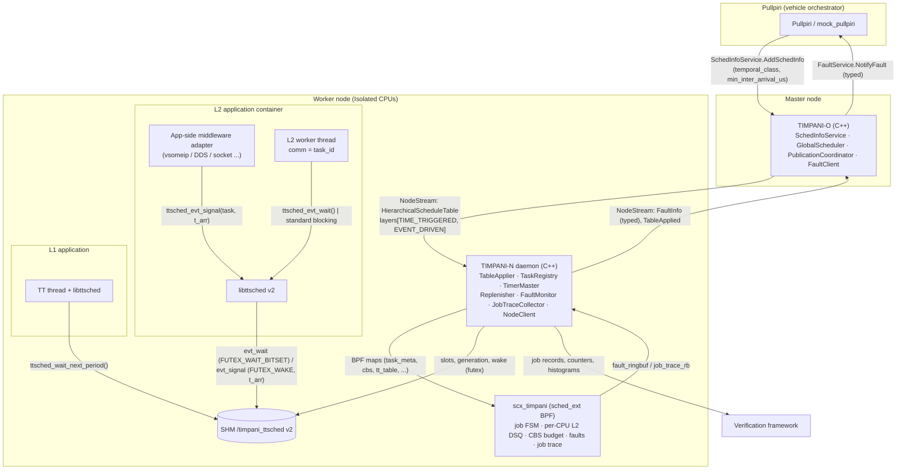
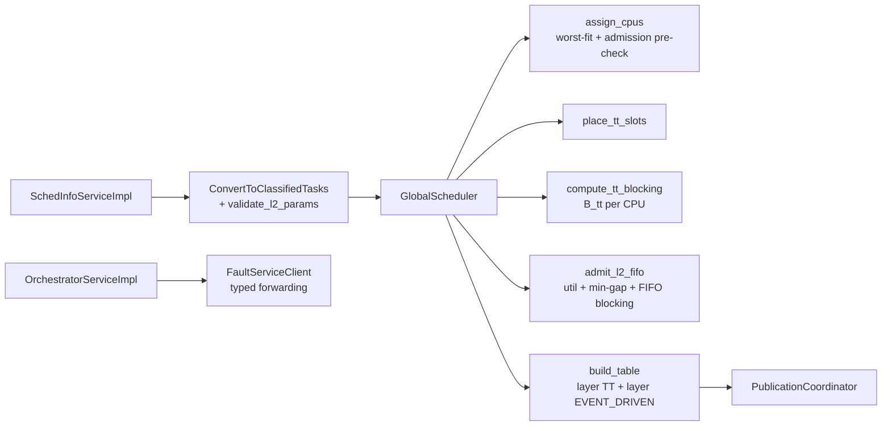
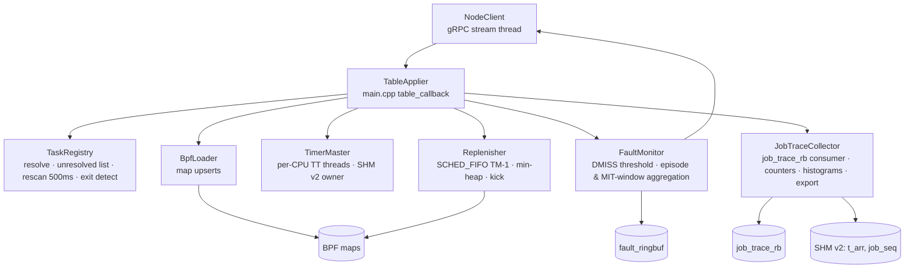
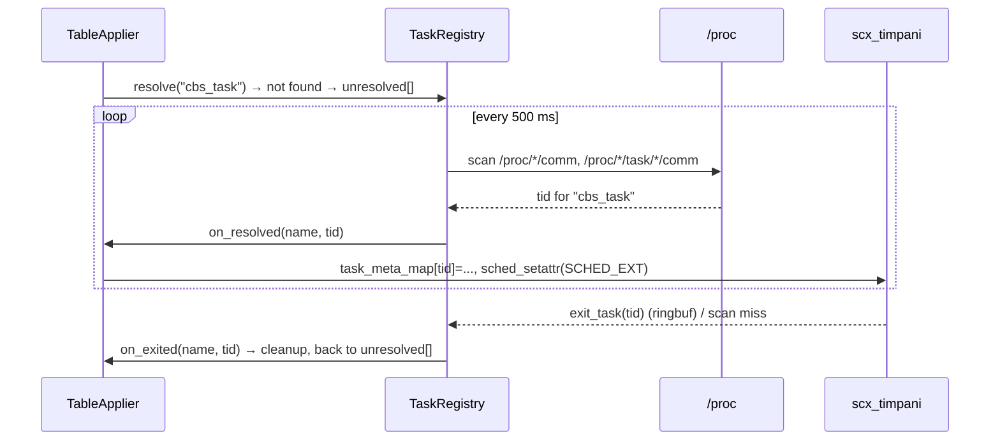

<!--
SPDX-FileCopyrightText: Copyright 2026 LG Electronics Inc.
SPDX-License-Identifier: MIT
-->

# HLD-008: Event-Driven Workload Support — 상위 설계 (High-Level Design)

**날짜:** 2026-11-10
**상태:** Draft (v1, Phase 1 범위) — DDR-008(Proposal)의 D-01~D-17 확정을 전제로 함
**작성:** Human + AI
**상위 문서:** [REQ-008](REQ-008-event-driven-workload-support.md), [SRS-008](SRS-008-event-driven-workload-support.md), [DDR-008](DDR-008-event-driven-workload-support.md)
**관련 문서:** [DDR-002](DDR-002-scheduling-architecture.md), [DDR-003](DDR-003-interface-protocol.md), [DDR-005](DDR-005-sched-ext-bpf-scheduler.md), [DDR-006](DDR-006-communication-architecture.md), [DDR-007](DDR-007-tt-cbs-integrated-scheduling.md), [DDR-011](DDR-011-runtime-table-update.md), [DDR-012](DDR-012-fault-management.md)
**하위 문서:** LLD-008

> 본 문서는 DDR-008의 결정(D-01~D-17)을 **컴포넌트 구조·런타임 흐름·배포·데이터** 관점에서 전개한다. 결정의 근거는 재논증하지 않고 D-NN을 참조한다. 코드 수준 구조(구조체, 함수, 의사코드)는 LLD-008에서 다룬다. 범위는 Phase 1이며, Phase 2 영향 지점은 §11에 표시한다.

---

## 요약 (Korean Summary)

- L2 Event-Driven 지원은 **기존 TT+CBS 파이프라인(DDR-007)을 확장**하는 형태로 구현된다. 새 데몬이나 새 프로세스는 없다.
- TIMPANI-O: MIT 전용 필드 수용, 파라미터 검증, $B_{tt}$ 기반 FIFO 승인식, `EVENT_DRIVEN` 레이어 발행.
- TIMPANI-N: `TaskRegistry` 부활(지연 식별), 신규 `Replenisher` 스레드(백업 보충), 신규 `JobTraceCollector`(트레이스·통계), `FaultMonitor` 집계 확장, `TimerMaster`의 SHM v2.
- BPF: 태스크별 **job 상태 머신**, **CPU별 L2 DSQ**, MIT 검사, 폴트 전이 발행, job 트레이스 ringbuf.
- 애플리케이션: `libttsched` v2의 **전송 계층 중립 마커 API**(`ttsched_evt_wait/signal`). SOME/IP 등 미들웨어 처리는 앱 어댑터에만 존재.
- 상태: Draft. DDR-008 OI-9(백업 보충 재스케줄 수단) PoC 결과에 따라 §5 배포 뷰의 kick 경로가 확정된다.

---

## 1. 컨텍스트 (Context)



경계 원칙(D-01): 점선 왼쪽의 어떤 TIMPANI 컴포넌트도 `AD`의 미들웨어 타입을 알지 못한다. `AD`는 샘플 앱 저장소 영역(`examples/`)에만 존재한다.

---

## 2. 아키텍처 드라이버 (Architectural Drivers)

| 드라이버 | 요구사항 | 아키텍처 영향 |
|:--|:--|:--|
| 활성화/완료의 결정적 정의 | REQ-008 MOD-002/003, DET-001/002/005 | BPF에 태스크별 job FSM(D-02). `select_cpu`의 활성화 기록 제거 |
| 애플리케이션 투명성 + 선택적 정밀화 | DET-003/004 | 커널 wakeup 기본 + `libttsched` 마커(D-03). 새 데몬 없음 |
| 전송 계층 중립 | MOD-006, IF-005 | 코어에 미들웨어 코드 0, 어댑터는 앱 측(D-01) |
| L1 보호·FFI | CBS-002/005, ORD-003, TIM-007 | CPU별 L2 DSQ(D-06), TT-first 디스패치 유지, FIFO(D-08) |
| 보충 결정론 | PRT-003, TIM-003 | Replenisher 스레드 + 커널 kick 경로(D-07) |
| 마감 보장 승인 | CBS-004, ORD-001 | $B_{tt}$ 계산과 FIFO 승인식(D-09), 선행 hyperperiod 버그 수정 |
| 폴트 의미 보존·속도 제한 | PRT-005/006/007, IF-004 | BPF 전이 발행 + N 집계 + O 유형 보존(D-10) |
| 검증 가능성 | OBS-001/002, TIM-* | 전용 job 트레이스 ringbuf + 수집기(D-16) |
| 호환성·거버넌스 | NFR-005, C-03 | proto 필드 추가만(D-11); SHM ABI 단절은 버전 필드로 식별 |
| 단순성(P1) | §0.1 | 전체 테이블 발행 유지(D-17), FIFO, 보수적 승인식, 주기 재스캔(D-12) |

---

## 3. 컴포넌트 뷰 (Component View)

### 3.1 TIMPANI-O



| 컴포넌트 | 변경 | 책임 (P1) | 결정 |
|:--|:--|:--|:--|
| `SchedInfoServiceImpl` | 수정 | `min_inter_arrival_us` 우선, 0이면 `period` 전환 해석(경고); L2 파라미터 검증(`0<C≤D≤MIT`); 거부 시 이전 워크로드 복원 | D-09, D-11 |
| `GlobalScheduler` | 수정 | `ClassifiedTask.mit_us` 분리; CPU별/전역 hyperperiod 일관화; CBS 전용 노드 HP 정의 | D-09 |
| `compute_tt_blocking` | 신규 | CPU별 TT 슬롯 병합 → $B_{tt}(k)$(연속 최대), 윈도우 $D$ 내 점유 총합 | D-09 |
| `admit_l2_fifo` | 신규(기존 `allocate_cbs_budgets` 확장) | 이용률 + min-gap 거부 + FIFO 블로킹 합 조건 | D-09 |
| `build_table` | 수정 | `layer_index=1 TIME_TRIGGERED`(TT만) + `layer_index=2 EVENT_DRIVEN`(CBS만, `min_inter_arrival_us`, `cpu` 채움); `table_id` 단조 증가 | D-06, D-11 |
| `OrchestratorServiceImpl::handle_fault_info` | 수정 | 폴트 유형 동일 번호 매핑, 신규 필드 전달 | D-10 |

### 3.2 TIMPANI-N (사용자 공간)



| 컴포넌트 | 변경 | 책임 (P1) | 결정 |
|:--|:--|:--|:--|
| `TableApplier`(main.cpp) | 수정 | 레이어 `model` 분기; EVENT_DRIVEN 엔트리 → TaskRegistry 해석 요청 → BPF `TaskMeta(CBS, cpu, mit)`/`cbs_map` 등록(동일 엔트리면 `remaining/replenish_at` 보존); L2 태스크 이름을 TimerMaster에 전달(SHM 슬롯 할당); Replenisher에 서버 목록 전달 | D-06, D-11, D-17 |
| `TaskRegistry` | 부활·확장 | 이름→TID 해석(프로세스→스레드), 미해결 목록, 500 ms 재스캔, 발견 시 콜백(등록), TID 소멸 감지 시 콜백(정리) | D-12 |
| `TimerMaster` | 수정 | SHM v2 레이아웃·버전; TT 슬롯 외 L2 태스크에도 슬롯 할당(kind=EVT); 지터 샘플을 JobTraceCollector로 전달 | D-03, D-16 |
| `Replenisher` | 신규 | 모든 L2 서버 `replenish_at` 힙; 기상 시 멱등 보충 + 배정 CPU kick(BPF syscall prog 또는 kicker 스레드); 테이블 갱신 시 힙 재구성 | D-04, D-07 |
| `FaultMonitor` | 수정 | `DMISS`: 임계 규칙 유지 + 표식; `BUDGET_EXCEED`: 에피소드 키 중복 제거; `MIT_VIOLATION`: $T_s$ 윈도우 집계; `task_id/node_id/timestamp_ns` 채움 | D-10 |
| `JobTraceCollector` | 신규 | `job_trace_rb` 소비 → 태스크별 카운터·히스토그램; SHM `t_arr/job_seq` 병합; 파일/소켓 출력; 런타임 활성/비활성 토글(`trace_enabled`) | D-16 |
| `BpfLoader` | 수정 | 신규 맵/프로그램 핸들(`job_trace_rb`, `timpani_replenish_kick`, `trace_enabled`), CPU별 DSQ 수 전달 | D-06, D-07, D-16 |

### 3.3 BPF 스케줄러 (`scx_timpani`)

| 요소 | 변경 | 내용 | 결정 |
|:--|:--|:--|:--|
| `TaskMeta` | 확장 | `job_state`, `job_seq`, `activation_ns`(= $t_{act}$), `t_start_ns`, `last_act_ns`, `mit_us`, `job_flags`, `mit_viol_count` | D-02, D-05 |
| DSQ | 변경 | `DSQ_CBS_BASE + cpu`, `DSQ_THROTTLED_BASE + cpu`(isolated CPU마다 `init`에서 생성); 전역 101/102 제거 | D-06 |
| `ops.runnable` | 신규 | WAITING→ACTIVE 전이, `t_act`, MIT 검사, `MIT_VIOLATION` 발행 | D-02, D-05 |
| `ops.select_cpu` | 수정 | 활성화 기록 제거; `assigned_cpu` 반환 | D-02, D-06 |
| `ops.enqueue` | 수정 | L2 → 배정 CPU의 L2/THROTTLED DSQ | D-06 |
| `ops.dispatch` | 수정 | 자기 CPU의 THROTTLED 승격 → 자기 CPU의 L2 DSQ 소비(FIFO) | D-06, D-08 |
| `ops.running` | 수정 | 첫 실행 시 `t_start` 기록; 슬라이스 캡 유지 | D-02 |
| `ops.stopping` | 수정 | 예산 차감(ns 누산); `BUDGET_EXCEED`는 양수→0 전이에만; 조기 DMISS 1회(MAY) | D-04, D-10 |
| `ops.quiescent` | 신규 | ACTIVE→WAITING(완료), `t_done`, DMISS 판정, job 레코드 발행 | D-02, D-10, D-16 |
| `ops.exit_task` | 신규 | 태스크 종료 시 메타 정리 신호(ringbuf) | D-12 |
| `job_trace_rb` | 신규 | 완료 시 job 레코드(256 KiB) | D-16 |
| `timpani_replenish_kick` | 신규(SYSCALL prog) | 멱등 보충 + `scx_bpf_kick_cpu` | D-07 |

### 3.4 애플리케이션 라이브러리 (`libttsched` v2)

| API | 대상 | 동작 |
|:--|:--|:--|
| `ttsched_init()` | TT/L2 공통 | SHM v2 매핑, comm으로 슬롯 탐색(기존) |
| `ttsched_wait_next_period()` | L1 TT | 기존 동작 |
| `ttsched_evt_wait()` | L2 워커 | 자기 슬롯 카운터에 `FUTEX_WAIT_BITSET(TTSCHED_EVT_BITSET)` — 결정적 wait point |
| `ttsched_evt_signal(task_name, t_arr_ns)` | 앱 어댑터(임의 스레드) | 슬롯 `t_arr_ns/job_seq` 기록 → 카운터 +1 → `FUTEX_WAKE(1)` |

### 3.5 샘플 앱 어댑터 (코어 외부)
`examples/someip/radar_based_fcw`의 vsomeip 콜백은 `ttsched_evt_signal("cbs_task", now)`만 호출하고, 워커는 `ttsched_evt_wait()`로 대기한다. `libtimpani_rt`는 폐기한다(REQ-008 §12). 전송 계층 중립성을 보이기 위해 `sample-apps`에 일반 L2 샘플 `evttask`(이벤트 소스 선택: timerfd / UDP 소켓 / 파이프 / 마커 자기신호)를 추가한다(§8).

---

## 4. 런타임 뷰 (Runtime View)

### 4.1 L2 워크로드 등록 → 승인 → 발행 → 적용

```mermaid
sequenceDiagram
  participant PP as Pullpiri
  participant O as TIMPANI-O
  participant N as TIMPANI-N
  participant TR as TaskRegistry
  participant BPF as scx_timpani
  participant TM as TimerMaster
  participant RP as Replenisher
  PP->>O: AddSchedInfo(SPORADIC, tasks[{name, min_inter_arrival_us, runtime, deadline, max_dmiss}])
  O->>O: validate 0<C<=D<=MIT ; MIT==0 ? period→MIT (warn)
  O->>O: assign_cpus → place_tt_slots → compute_tt_blocking(B_tt)
  O->>O: admit_l2_fifo: util ∧ min_gap ∧ C+B_tt+Lw+ΣC_j ≤ D
  alt infeasible
    O-->>PP: Response{status=-1} (reason logged; P2: reason code)
    O->>O: restore previous workload set
  else feasible
    O->>O: build_table: layer1 TT, layer2 EVENT_DRIVEN{budget,period,mit,deadline,cpu,current_limit}
    O-->>PP: Response{status=0}
    O->>N: ControlCommand.full_table(table_<gen>)
    N->>N: pre-pass current_limit → FaultMonitor
    N->>TR: resolve(task names)
    TR-->>N: tid | unresolved
    N->>BPF: task_meta_map[tid]=TaskMeta{CBS, cpu, mit, WAITING}; cbs_map[key]={C,T,rem,rep_at,D}
    N->>N: sched_setattr(tid, SCHED_EXT)
    N->>TM: set_schedule_table(tt_slots, evt_tasks, hp, epoch) → SHM v2 publish
    N->>RP: set_servers(list{key,cpu,T,rep_at})
    N-->>O: TableApplied{table_id, success}
  end
```

### 4.2 이벤트 활성화 → 디스패치 → 완료 (마커 경로와 표준 경로)

```mermaid
sequenceDiagram
  participant AD as App adapter (any thread)
  participant LIB as libttsched v2
  participant K as Kernel
  participant BPF as scx_timpani
  participant W as L2 worker (cbs_task)
  Note over W: WAITING — blocked in ttsched_evt_wait() or epoll/recv
  alt marker path
    AD->>LIB: ttsched_evt_signal("cbs_task", t_arr)
    LIB->>LIB: slot.t_arr_ns=t_arr; slot.job_seq++; counter++
    LIB->>K: FUTEX_WAKE(slot.counter, 1)
  else standard path
    AD->>K: send()/write()/eventfd → wakes W
  end
  K->>BPF: ops.runnable(W, SCX_ENQ_WAKEUP)
  BPF->>BPF: job_state WAITING→ACTIVE, t_act=now, job_seq++, MIT check (→ MIT_VIOLATION?)
  K->>BPF: ops.enqueue(W)
  BPF->>BPF: lazy_replenish; rem>0 ? insert DSQ_CBS[cpu] : DSQ_THROTTLED[cpu]
  K->>BPF: ops.dispatch(cpu) when TT inactive
  BPF->>BPF: promote_throttled(cpu); consume DSQ_CBS[cpu] (FIFO)
  K->>BPF: ops.running(W): t_start (first), slice=min(rem, to_next_TT)
  W->>W: process event(s)
  W->>LIB: ttsched_evt_wait() (or blocking recv)
  K->>BPF: ops.stopping(W, runnable=false): charge budget
  K->>BPF: ops.quiescent(W, SCX_DEQ_SLEEP)
  BPF->>BPF: ACTIVE→WAITING, t_done=now, R=t_done−t_act; R>D → DMISS(flags)
  BPF-->>BPF: job_trace_rb ← {job_seq,t_act,t_start,t_done,cpu,budget_used,flags}
```

TT 슬롯이 활성인 동안 도달한 이벤트는 `ops.dispatch`가 TT 비활성이 될 때까지 소비되지 않으며(`tt_active_on_cpu` 게이트 유지), 실행 중이던 L2는 슬라이스 캡으로 TT 시작 전에 양보한다(DDR-007 §4.4 유지).

### 4.3 예산 소진 → 스로틀 → 백업 보충 → 재개

```mermaid
sequenceDiagram
  participant BPF as scx_timpani
  participant RP as Replenisher (userspace, SCHED_FIFO)
  participant KP as timpani_replenish_kick (BPF syscall prog)
  participant CPU as assigned CPU
  BPF->>BPF: stopping: rem→0 ⇒ BUDGET_EXCEED (once per episode), replenish_at kept
  BPF->>BPF: enqueue → DSQ_THROTTLED[cpu]
  Note over CPU: idle, no other activity (lazy path cannot fire)
  RP->>RP: clock_nanosleep(ABSTIME, replenish_at)
  RP->>KP: bpf_prog_test_run(args{cbs_key, cpu})
  KP->>KP: cbs_lazy_replenish(cbs, now) (idempotent)
  KP->>CPU: scx_bpf_kick_cpu(cpu, SCX_KICK_IDLE)
  CPU->>BPF: ops.dispatch(cpu)
  BPF->>BPF: promote_throttled(cpu): rem>0 → move to DSQ_CBS[cpu]; consume
  RP->>RP: heap: replenish_at += T_s (re-read from cbs_map)
```

대체 경로(D-07 2안): `KP` 대신 CPU별 kicker 스레드를 futex로 깨워 `schedule()`을 유발한다.

### 4.4 MIT 위반 버스트 (UC-06)

```mermaid
sequenceDiagram
  participant SRC as Event source (burst, Δ<MIT)
  participant BPF as scx_timpani
  participant FM as FaultMonitor
  participant O as TIMPANI-O
  loop each arrival
    SRC->>BPF: wakeup → ops.runnable
    BPF->>BPF: t_act−last_act < mit ⇒ MIT_VIOLATION event, flags.mit=1, no fresh budget
    BPF->>BPF: enqueue: rem>0 ? L2 DSQ : THROTTLED
  end
  BPF-->>FM: MIT_VIOLATION ×k, DMISS(flags.mit|throttled) ×m
  FM->>FM: aggregate MIT per T_s window; DMISS count > current_limit?
  FM->>O: FaultInfo{MIT_VIOLATION, count=k}, FaultInfo{DMISS, flags=MIT_RELATED}
  O->>O: forward typed (no UNKNOWN collapse)
```

L1 TT는 TT-first 디스패치로, 타 L2는 FIFO + 단일 스레드 서버 특성으로 간섭 상한(각 1 job)을 유지한다(D-08).

### 4.5 지연 식별 (늦게 생성된 워커 / 재시작)



### 4.6 STOP(제거)
DDR-011 §3.2/DDR-012 §5.1 경로 유지. 추가: `cbs_map`·`TaskMeta`·Replenisher 힙 엔트리·JobTraceCollector 통계·SHM 슬롯(kind=EVT)·미해결 목록 제거, `sched_setattr(SCHED_OTHER)` 원복.

---

## 5. 배포 뷰 (Deployment View)

### 5.1 노드 내 스레드 (timpani-n 프로세스)

| 스레드 | 정책/우선순위 | CPU | RT 경로 | 변경 |
|:--|:--|:--|:-:|:--|
| TimerMaster per-CPU | SCHED_FIFO 99 | 각 Isolated CPU(미고정, 현행) | ● | SHM v2 |
| **Replenisher** | SCHED_FIFO 98 (TM−1) | Non-Isolated(권장) 또는 TM과 동일 | ● | 신규 |
| (대체) kicker per-CPU | SCHED_FIFO 97 | 각 Isolated CPU 고정 | ● | D-07 2안 시 |
| FaultMonitor poll | default | Non-Isolated | — | 집계 확장 |
| **JobTraceCollector** | default | Non-Isolated | — | 신규 |
| **TaskRegistry rescan** | default | Non-Isolated | — | 신규(타이머 루프) |
| NodeClient stream | default | Non-Isolated | — | — |
| main | default | — | — | — |

RT 경로 스레드는 gRPC·힙 할당·블로킹 I/O를 하지 않는다(DDR-006 §4). Replenisher의 힙 재구성은 테이블 적용 시(비-RT 컨텍스트)에만 할당한다.

### 5.2 BPF 객체
`scx_timpani` 스켈레톤에 struct_ops(`runnable/quiescent/exit_task` 추가), `job_trace_rb`, `timpani_replenish_kick`(SEC("syscall")), 전역 `trace_enabled`를 포함한다. 로드 순서·권한은 현행(`CAP_BPF`, `CAP_SYS_NICE`) 유지.

### 5.3 애플리케이션
- L2 컨테이너는 Isolated cpuset 안에서 실행되고 `/dev/shm/timpani_ttsched` 접근 권한을 가진다(현행 TT와 동일).
- `ttsched_evt_signal`을 호출하는 어댑터 스레드는 동일 프로세스 또는 SHM 접근이 가능한 동일 호스트 프로세스일 수 있다(OI-15: P1은 동일 프로세스 권장).

---

## 6. 데이터 뷰 (Data View)

### 6.1 BPF 맵 (변경·신규만; 전체는 LLD-008)

| 맵 | 키 → 값 | 변경 |
|:--|:--|:--|
| `task_meta_map` | TID → `TaskMeta{..., job_state, job_seq, activation_ns(t_act), t_start_ns, last_act_ns, mit_us, job_flags, mit_viol_count}` | 확장 |
| `cbs_map` | `wl_hash ^ task_hash` → `CbsState{..., exec_frac_ns, throttle_episodes}` | ns 누산 필드 |
| DSQ | `DSQ_CBS_BASE+cpu`, `DSQ_THROTTLED_BASE+cpu` | CPU별 |
| `fault_ringbuf` | `FaultEvent{..., job_seq, flags}`; 유형 `MIT_VIOLATION=2` | 확장 |
| `job_trace_rb` | `JobRecord{wl_hash, task_hash, job_seq, t_act, t_start, t_done, cpu, budget_used_us, flags}` | 신규 |
| `.bss trace_enabled` | u32 | 신규 |

### 6.2 SHM v2 (`/timpani_ttsched`)
헤더 `{magic(v2), version, n_tasks, generation, reserved}` + `tasks[64]{name[16], counter, kind, t_arr_ns, job_seq, pad}`. TT 슬롯은 TimerMaster가 `counter`를, EVT 슬롯은 `ttsched_evt_signal`이 `t_arr_ns/job_seq/counter`를 쓴다. 슬롯 안정성·generation 핸드셰이크는 DDR-011 §1.1 규칙 유지.

### 6.3 프로토콜 (요약; 번호는 LLD-008)
- `schedinfo.TaskInfo.min_inter_arrival_us`(신규), `schedinfo.FaultType{+BUDGET_EXCEED, WATCHDOG, MIT_VIOLATION}`, `schedinfo.FaultInfo{+timestamp_ns, count, flags}`.
- `node_control.CbsConfig{+min_inter_arrival_us, cpu}`, `LayerConfig(model=EVENT_DRIVEN, layer_index=2)`, `node_control.FaultType{+MIT_VIOLATION, WAKEUP_LATENCY_EXCEED(예약)}`, `FaultInfo{+count, flags, job_seq}`.

### 6.4 Job 레코드 (검증 프레임워크 입력)
`{node_id, workload_id, task_id, job_seq, t_arr(SHM, 선택), t_act, t_start, t_done, cpu, budget_used_us, flags{marker_used, mit_violation, throttled, dmiss, early_dmiss}}` — CSV/gpdata 호환 라인 형식으로 출력. TT 지터 샘플은 `{cpu, slot_idx, target, actual, jitter}`로 동일 채널.

---

## 7. 설계 결정 표

| 결정 | 제목 | 적용 컴포넌트 |
|:--|:--|:--|
| D-01 | 전송 계층 중립 Event 모델 | 전 컴포넌트, 어댑터 |
| D-02 | BPF job 상태 머신 | BPF, JobTraceCollector |
| D-03 | `libttsched` v2 마커 API | libttsched, TimerMaster(SHM) |
| D-04 | 격자 정렬 지연 보충 유지 + 백업 필수 | BPF, Replenisher |
| D-05 | MIT 위반: 감지·계수·흡수 | BPF, FaultMonitor |
| D-06 | CPU별 L2 DSQ | BPF, TableApplier |
| D-07 | Replenisher + kick 경로 | Replenisher, BPF syscall prog |
| D-08 | FIFO(P1) / EDF(P2) | BPF, GlobalScheduler |
| D-09 | 승인 충분조건(P1) | GlobalScheduler |
| D-10 | 폴트 분류·속도 제한 | BPF, FaultMonitor, OrchestratorService |
| D-11 | proto 필드 추가 | proto, O, N |
| D-12 | TaskRegistry 재스캔 | TaskRegistry |
| D-13 | TT floor/watchdog 미채택 | — |
| D-14 | DDR-005 정합 | 문서 |
| D-15 | C++ 경로 | 전체 |
| D-16 | job 트레이스 ringbuf | BPF, JobTraceCollector |
| D-17 | 전체 테이블 발행 유지 | O, TableApplier |

---

## 8. 샘플 앱 가이드 (Phase 1)

### 8.1 L2 애플리케이션 계약 (전송 계층 무관)
1. L2 처리 스레드의 comm 이름을 `task_id`로 설정한다(`pthread_setname_np`). 호스트 내 유일해야 한다.
2. 스레드는 `ttsched_init()` 후, 루프의 wait point에서 **`ttsched_evt_wait()`**(권장) 또는 표준 블로킹(`epoll_wait`, `recv` 등)으로 대기한다. 마커를 쓰지 않으면 job 중간에 블로킹하지 않는다(REQ-008 A-06).
3. 이벤트를 수신하는 스레드(미들웨어 콜백, 소켓 리더 등)는 데이터를 앱 큐에 넣고 **`ttsched_evt_signal(task_id, t_arr_ns)`**를 호출한다(마커 경로). 표준 경로라면 소켓/eventfd 쓰기 자체가 wakeup이 된다.
4. 한 번의 wake에서 큐에 쌓인 모든 항목을 처리하는 것은 허용된다(= 1 job). MIT는 **wake 간격** 기준이다.
5. 앱은 SCHED_EXT·우선순위·affinity를 스스로 설정하지 않는다(DDR-002, REQ-NFR-003).
6. 자체 MIT/E2E 폴트 판정 로직을 두지 않는다. 판정·보고는 TIMPANI-N이 한다. 로컬 로그는 자유.

### 8.2 FCW(`examples/someip`) 변경 방향

| 파일 | 변경 |
|:--|:--|
| `include/timpani_rt.h`, `include/timpani_rt_shm.h`, `src/libtimpani_rt.cpp` | 폐기. 필요 시 `timpani_rt.h`를 `libttsched.h` 포함 + 얇은 인라인 래퍼로 축소 |
| `radar_based_fcw/fcw_consumer.cpp` | vsomeip 핸들러: `queue.push(alert, now); ttsched_evt_signal("cbs_task", now);` / 워커: `ttsched_evt_wait()` 후 큐 드레인. `timpani_evt_register/mark_arrival/cbs_bind/unbind` 제거. 이상 주입 옵션(`--overrun-ms`, `-be`, `--wakeup-delay-ms`) 유지 |
| `radar_based_fcw/mock_radar_producer.cpp` | TT 경로 유지(`ttsched_wait_next_period`). `--burst-ms`, `--tt-overrun-ms` 유지 |
| `scripts/mock_pullpiri.yaml` | `verify_wl_cbs` 태스크에 `min_inter_arrival_us: 18000` 추가(`period`는 전환 기간 유지 가능) |
| `README.md` | DDR-008 §2.3/LLD §1.3/FR-041 인용 제거 → REQ/SRS/DDR/HLD/LLD-008 참조로 교체; 이상 매트릭스의 "보고 위치"를 TIMPANI-N 폴트·트레이스로 갱신 |

### 8.3 일반 L2 샘플 `sample-apps/src/evttask.c` (신규)
- 옵션: `--source timerfd|udp:<port>|pipe|self`(마커 자기신호 스레드), `--mit-us`, `--wcet-us`(nsqrt 부하), `--burst N`(MIT/3 간격 N회), `--overrun-us`, `--midjob-block-us`(A-06 위반 재현), `--marker on|off`.
- 목적: 전송 계층 중립성 시연(동일 바이너리로 4개 소스), AC-008-01/03/05/07/10의 이벤트 생성기, `cbstask.c`(자체 타이머 기반) 대체.

---

## 9. 리스크 및 기술 부채

| # | 리스크 | 영향 | 완화 |
|:--|:--|:--|:--|
| R-1 | `scx_bpf_kick_cpu`가 SYSCALL 프로그램에서 호출 불가(커널 버전 의존) | 백업 보충 지연 바운드(TIM-003) | D-07 2안(kicker 스레드) 준비; P1 초기 PoC |
| R-2 | `ops.runnable/quiescent` 콜백 추가로 BPF 경로 오버헤드 증가 | TIM-008 | 등록 TID만 맵 조회 1회; 측정으로 확인 |
| R-3 | 슬라이스 만료 틱 해상도(HZ)로 예산 overrun 최대 1 ms | TIM-004 P1 | 문서화; P2 HRTICK 검토 |
| R-4 | SHM ABI 단절로 외부 TT 앱 재컴파일 | 배포 | `version` 필드·`magic` 변경으로 불일치 즉시 감지(-1 반환) |
| R-5 | FIFO + 보수적 승인식의 낮은 수용률(다중 L2) | 배치 실패 | P2 EDF/정밀식 |
| R-6 | 마커 없는 mid-job blocking 앱의 job 분할 측정 | 지표 왜곡 | A-06 문서화, `evttask --midjob-block-us`로 효과 시연, P2 분류 |
| R-7 | C++ 경로 CI 부재 | 회귀 미탐 | 로컬 GTest 추가(timpani-n 신규 테스트 타깃 포함), 통합 스크립트 |
| R-8 | 재스캔(500 ms)의 `/proc` 비용 | Non-Isolated CPU 부하 | 미해결 목록이 비면 스캔 중지 |
| R-9 | 전체 테이블 재발행 시 TT 스레드 재시작(현행) | TT 활성화 누락 가능(P1 허용) | P2 diff 적용(DDR-011 개정) |

---

## 10. 오픈 이슈
REQ-008 §11, SRS-008 §9, DDR-008 §3.3을 참조. HLD 수준 추가 항목:

| # | 이슈 |
|:--|:--|
| H-1 | `ttsched_evt_signal`의 크로스 프로세스 허용 범위 — **종결**: DDR-008 D-03(OI-15)에서 P1은 동일 프로세스 또는 SHM 쓰기 권한을 가진 동일 호스트 프로세스로 결정; 권한 축소 정책은 P2 |
| H-2 | JobTraceCollector 출력 형식(gpdata 확장 vs 별도 CSV) 및 Perfetto 연계 (LLD-008 L-5와 동일 이슈, 본 항목으로 통합) |
| H-3 | Replenisher를 TimerMaster 스레드와 병합할지(DDR-007 §11 오픈 아이템) — **종결**: P1은 별도 스레드(§5.1); 병합 검토는 P2 |

---

## 11. Phase 2 영향 지점
- BPF: `sys_enter` 보조 프로그램(wait point 분류), `dsq_insert_vtime`(EDF), `WAKEUP_LATENCY_EXCEED`.
- O: $sbf/dbf$ 정밀 승인, 태스크 단위 클래스, 거부 사유 코드, epoch 유지·영향 노드 발행.
- N: diff 기반 테이블 적용(TT 무교란), NodeStatus 통계, watchdog(EventMonitor), cgroup 기반 식별.
- LIB: 변경 없음(마커 API는 P1에서 확정).
