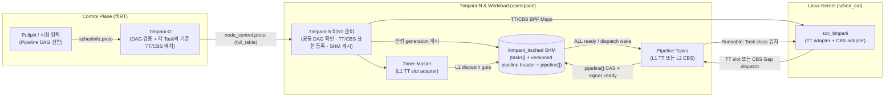
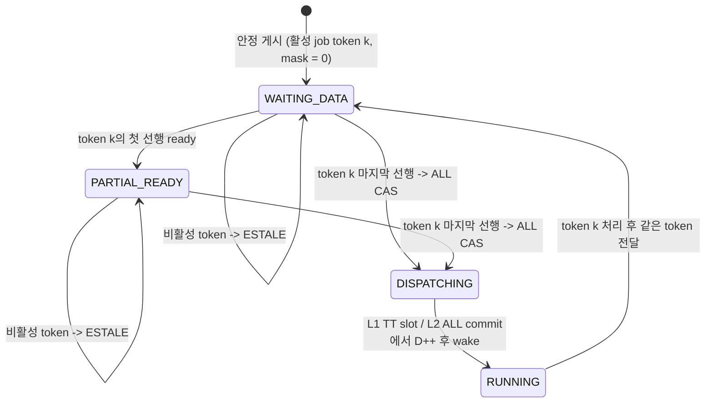
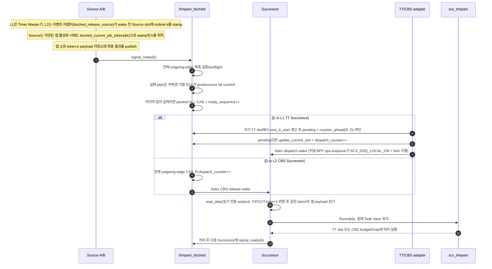
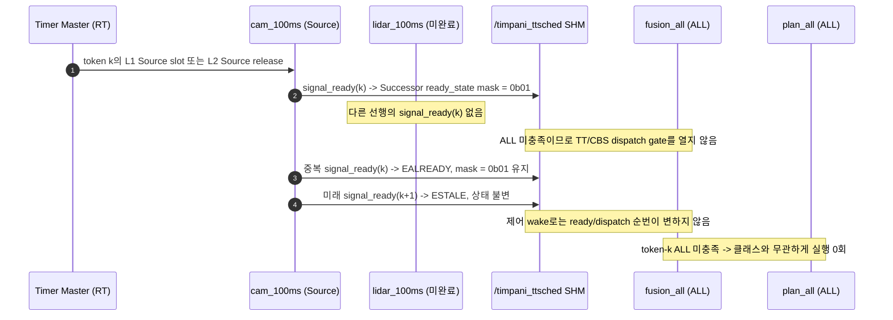

<!--
SPDX-FileCopyrightText: Copyright 2026 LG Electronics Inc.
SPDX-License-Identifier: MIT
-->

# HLD-009: Data-Driven Workload — Phase 0 상위 레벨 아키텍처 설계

**작성일:** 2026-10-27  
**최종 수정:** 2026-11-25 (Phase 0 PR 리뷰 반영)
**상태:** Draft — Phase 0 설계안, 검토·승인 대기.
008 필드 `11/12/13`은 정합되었으나 `OI-DD-01`/`02`/`03`은 Project Leader
승인과 검증 전이며 현재 구현이 설계를 충족한다는 선언이 아니다.
**상위 기준:** [REQ-009](REQ-009-data-driven-workload.md) §1.5, §7.1, §8.2, [SRS-009](SRS-009-data-driven-workload.md)  
**결정/상세:** [DDR-009](DDR-009-data-driven-workload.md), [LLD-009](LLD-009-data-driven-workload.md), [DDR-011](DDR-011-runtime-table-update.md)

---

## 1. 범위와 아키텍처 구조

본 문서는 단일 노드·고정 `Epoch`/`Hyperperiod`·기본 체인 조건에서 **Task의 기존 L1 TT/L2 CBS 계층과 독립적인 Data-Driven DAG** 흐름을 정의한다. Source/Successor 역할은 실행 계층을 결정하지 않는다. 계층별 정밀 Window/Gap, 다중 주기, 갱신, `SKIP`은 후속 단계로 이관한다.

---

## 2. 컴포넌트 책임 분리 (RT / 비RT 및 O / N 경계)

| 구성 요소 | Phase 0 책임 | 하지 않는 일 |
|:---|:---|:---|
| **입력 / 시험기** | `Timpani-O` 입력 경로로 동일 주기(`100ms`) DAG 제출, 타임스탬프·오버헤드 증거 수집, 전제 이탈 시 시험 중단 | `Timpani-N`이나 SHM에 직접 테이블/그래프를 주입해 End-to-End 성공으로 판정, 제품 Fail-Safe를 대신 보장 |
| **`Timpani-O`** | DAG와 Task의 기존 `TemporalClass`를 독립 검증하고 TT/CBS 표현 및 공통 DAG 메타 생성 | DAG 역할로 계층 강제, N에 배치 판단 위임 |
| **`Timpani-N` 비RT** | 계층별 entry와 공통 `pipeline[]` 로컬 확인·게시 | DAG/TT/CBS 가능성 재계산 |
| **`Timer Master`** | `start()` 시 단일 `base_cycle_start`를 확정해 L1 Source의 파이프라인 주기 단위 release ordinal을 slot wake 전에 stamp하고, L1 Successor의 허용 slot에서 Data-Driven ready가 있으면 `update_current_slot()`과 `dispatch_counter++`/futex wake를 수행(CBS/Pipeline 태스크 SHM 게시 포함) | wall-clock 기반 token 생성, L2 release 담당, L1 ready가 없을 때 `update_current_slot()`/`SLOT_NONE` 덮어쓰기·wake 수행, userspace에서 `scx_bpf_kick_cpu()` 직접 호출 |
| **`libttsched` / 앱** | 클래스와 무관한 `ALL` CAS/ready 순번 갱신·신원 확인(원자 이름 비교), L2 CBS Source 이벤트 어댑터/시험 생성기의 `ttsched_release_source()` 호출. 앱은 token-addressed payload를 `signal_ready()` 전에 publish하고 Consumer 처리 완료 전 보존 | payload 저장소·복사·ack API 제공, 제어 wake 실행, 실행 계층 변경 |
| **`scx_timpani`** | wake로 Runnable이 된 L1은 TT slot에서, L2는 기존 CBS 예산/Gap 경로로 dispatch | 별도 Data-Driven 스케줄링 계층 신설 |
| **`Fault Monitor`** | 기존 시스템 감시 안전장치 유지 | Phase 0 신규 `DATA_TIMEOUT` 수집·보고 (Phase 2 이관) |

공통 DAG 메타 전달, SHM 후방 `pipeline[]`, 신규 API는 사전 승인 후 반영한다. Task의 기존 TT/CBS entry와 timing 정책은 보존한다.

`/timpani_ttsched`의 `O_RDWR` 권한은 전체 object를 여는 권한이며 slot/header별 보안 경계가 아니다. Phase 0에서 `timpani-pub`는 상호 신뢰된 Source/중계 writer만 포함하고, read-only consumer는 별도 group으로 제한한다. `libttsched`의 신원 검사는 우발적 오사용과 corruption 탐지용이며 악의적 writer에 대한 integrity를 보장하지 않는다.

---

## 3. 상위 설계 영역 (H-DD-P0-01 ~ H-DD-P0-04)

### 3.1 H-DD-P0-01 — 오프라인 후보 검증과 결정적 위상 배치 (`Timpani-O`)

O는 `TaskInfo.temporal_class` 명시값을 우선하고, optional 필드가 없을 때만 `SchedInfo.temporal_class`를 상속해 각 Task의 실행 계층을 결정한다. 명시적 `TEMPORAL_PERIODIC = 0`은 L1을 선택하며, 이는 008 placeholder `0 = inherit`를 대체하므로 `CON-DD-05` 승인이 필요하다. `TaskReference(workload_id, task_id)` 선행 목록을 같은 workload의 정규화 Task 식별자로 변환하고 DAG를 검증한 뒤, `(workload_id_hash, task_id_hash)` key별 공통 의존성 메타를 만든다. 각 Task는 resolved class에 따라 기존 `TtSlot` 또는 `CbsConfig` 표현을 유지하며 `predecessors` 유무로 실행 계층을 추론하지 않는다.

Phase 0는 같은 workload 참조와 `ALL`만 허용하고 기존 TT slot/CBS admission 정책을 사용한다. Phase 1에는 cross-workload 참조, 혼합 DAG의 계층별 응답시간 합산, `E2E`, Window/Gap 조건을 확장한다. 실패 시 확정 모델은 유지한다.

### 3.2 H-DD-P0-02 — 노드 로컬 적합성 확인과 안정 SHM 게시 (`Timpani-N`)

N은 Task의 TT/CBS 표현과 공통 DAG 메타를 각각 확인한다. 이름·해시·CPU/slot/budget 참조가 유효하지 않으면 거절한다.

통과한 테이블은 011 규약으로 공통 `pipeline[]`를 채운다. L1 Task는 TT gate, L2 Task는 CBS gate를 사용하도록 어댑터 메타를 등록한다. 게시 자체는 ready/dispatch 순번을 증가시키지 않는다. 최초 Source slot은 token release-invalid로 시작하며 실제 wake authority만이 release ordinal을 stamp한다.

client는 비RT 초기화(`void ttsched_init()`, `g_shm_init_errno` 및 전체 TLS 리셋) 시 1회 `fstat()`로 SHM 크기와 전체 ABI 매핑 가능 여부를 확인하고 `mmap()` 직후 fd를 닫는다(스레드 종료 시 `pthread_key` destructor로 `munmap`). 이후 RT critical path(`release_source`, `signal_ready`, `wait_data`, `current_job_token`, `Timer Master`)에서는 `shm_open`/`fstat`/`close` 없이 순수 원자 로드(`magic`, 짝수 `generation`, `pipeline_header.{magic, abi_version, abi_size, instance_id}`, `publication_guard`)와 16바이트 원자 이름 비교만으로 ABI·세대·신원·교체/무효화를 검증한다. `Timpani-N`은 live object를 전체 ABI 크기(`3,128`B)로 고정 유지하고, 교체·종료는 `WRITER_PENDING` 유지 + active commit drain(`50 ms` 초과 시 Safe Abandonment) + `magic=0`/`pipeline_header.magic=0` 무효화 + `tasks[]`/`pipeline[]` `FUTEX_WAKE(..., INT_MAX)` + `ftruncate` 없는 `shm_unlink()` + `O_CREAT|O_EXCL` 신규 `instance_id` 객체 생성으로 수행한다.

Safe Abandonment는 구 object의 active operation을 강제 취소하는 것이 아니라 namespace 격리다. 이미 guard에 진입한 writer는 CAS/wake 직전 `WRITER_PENDING`을 제외한 생사 확인(`pipeline_commit_alive`: `magic`/`pipeline_header.magic`/generation/`instance_id`)만 수행하므로, 정상 drain 중에는 commit과 wake를 끝까지 완결하고 Safe Abandonment 무효화 시에만 중단(`ESTALE`)한다. 마지막 검사 뒤 race로 구 object에서 완료될 수 있으나 새 `instance_id` object에는 접근할 수 없다. 구 mapping consumer는 wake 후 stable-state 재검증으로 `ESTALE`하며 실행하지 않는다. 무효화 전에 이미 token을 반환받은 Job은 Safe Abandonment가 회수하지 않는다.

게시자는 `pipeline_header.publication_guard`의 `WRITER_PENDING`을 설정해 새 쓰기 commit 진입을 막고, 기존 활성 commit이 `0`이 될 때까지 제한된 시간(`min(5 ms, H/4)` 정상 / `50 ms` 종료) 대기한 뒤 `publication_guard`를 덮어쓰지 않는 필드별 release-store 순서로 SHM 세대(`magic=0` → 홀수 `generation` → 내용·원자 이름 저장·`origin_epoch_ns`/`hyperperiod_us`/`instance_id` 갱신 → 짝수 `generation` → `magic` 유효 → `WRITER_PENDING` 해제)를 전환한다. `signal_ready`, `release_source`, L1 Timer Master(내부 경량 guard)는 쓰기 commit 중 이 guard로 게시자와 직렬화하며, `ttsched_wait_data()`와 `ttsched_current_job_token()`은 `publication_guard`에 쓰지 않는 **읽기 전용 seqlock**과 원자 이름 비교로 `O_RDONLY` 매핑을 보호한다. 이미 세대에 바인딩된 스레드가 다른 세대를 관측하면 암묵 재동기화 없이 `ESTALE`을 반환한다. Phase 0은 최초 게시·종료/무효화(Safe Abandonment)와 고정 체인의 guard/seqlock을 확인하고, Phase 1은 Pipeline 정상 갱신과 ABI 전환에, Phase 2는 실패·재시작 후 미회수 상태 정리에 이 규약을 확장한다.

### 3.3 H-DD-P0-03 — 공통 ready/dispatch 상태 전이와 제어 wake 분리

- packed `ready_state`의 `ALL` CAS부터 계층별 `dispatch_counter` 갱신과 futex wake까지는 게시 commit guard 안에서 수행한다. 게시 시 각 Successor의 직속 incoming edge가 `required_mask`와 일대일임을 먼저 증명한다. 두 edge의 bit alias, 대응 edge 없는 required bit, mask 밖 edge bit를 거절한다. 상태 변경 전에 `signal_ready(k)`는 Source의 전체 outgoing-edge 목록을 검증·preflight하므로 잘못된 metadata 또는 중복/낡은 destination 하나가 첫 CAS 전에 확인되면 전체 fan-out이 불변이다. 같은 `(predecessor, k)`가 preflight 시 이미 설정됐으면 `EALREADY`, 다른 token이면 `ESTALE`이다. CAS 중 동시 동일 commit이 bit/sequence를 앞서면 수렴으로 처리한다. 하나의 64비트 CAS가 destination mask reset과 ready sequence/job token 증가를 원자적으로 수행한다.
- 전체 fan-out은 **preflight failure atomicity**만 보장한다. 첫 CAS 이후 Source process가 종료하면 일부 destination에만 bit가 남을 수 있다. Phase 0은 해당 chain run을 실패·전제 이탈로 처리하며 crash transaction, rollback, idempotent retry는 Phase 2 recovery 범위다.
- `ALL`은 ready sequence만 만든다. L1 Successor는 Timer Master가 자신의 TT slot에서 `next_tt_start` 갱신 후 내부 경량 guard로 `pending`을 확인한 경우에만 `update_current_slot()`·`dispatch_counter` 1 증가·`FUTEX_WAKE`를 수행하며(이후 커널 BPF `ops.enqueue()`가 `SCX_DSQ_LOCAL_ON` 삽입 및 `scx_bpf_kick_cpu` 수행), L2 Successor는 모든 outgoing-edge CAS가 완료된 `ALL` commit에서 1 증가시킨다. `dispatch_counter`만 futex word다.
- L1 slot 시 `pending ready`가 없으면 `update_current_slot()`과 `FUTEX_WAKE`를 모두 생략하며 `SLOT_NONE`을 능동 덮어쓰기하지 않는다(`wake 0`, 커널 enqueue/kick 0건). slot을 지난 ready는 다음 TT slot까지 pending으로 유지하며, Phase 0 정상 시험은 pending 1개까지만 포함한다.
- `ttsched_init()`은 게시 전 정상 기동 attach(`g_attached_before_publish = 1`)에서는 최초 유효 세대 진입 시 cursor `0`으로 token `0`을 보존하고, 이미 게시된 SHM의 `cur > 0` late attach에서는 현재 `dispatch_counter`를 attach cursor로 snapshot해 과거 token을 replay하지 않는다. `ttsched_wait_data()`는 읽기 전용 seqlock(`O_RDONLY` 지원)으로 그 cursor 이후 dispatch를 확인해 `current - 1U`로 점프하지 않고 FIFO 순차(`g_last_dispatch_counter++`)로 `job_token`을 반환한다.
- futex wake 후 Task가 Runnable이 되어야 기존 BPF 경로가 실행한다. L1은 TT slot에서, L2는 CBS budget/Gap에서 실제 CPU dispatch를 받는다.
- 게시·종료·세대 전환이 동반된 제어 wake, 무효화·교체된 SHM(`magic=0`/`instance_id` 불일치), writer-pending/ABI 불일치는 `ESTALE`로 거절되고, 상태 변화 없는 spurious wake는 실행 `0`회로 재대기하며, pending ready가 없는 gate는 wake를 생성하지 않는다.

### 3.4 H-DD-P0-04 — 종단 간(E2E) 실행 시퀀스

#### (a) 정상 체인 시퀀스 (Task 클래스는 입력에 따라 TT/CBS로 독립 선택)

그래프가 같다 해도 Task 클래스는 다를 수 있다. Phase 0 시험은 TT→TT, TT→CBS, CBS→TT, CBS→CBS 연결을 포함한다.

#### (b) 부분 입력 및 제어 wake 시 대기 유지 시나리오 (`UC-DD-02`)

---

## 4. 현재 코드와 Phase 0 설계의 차이

| 확인 대상 소스 | 현재 코드 관찰 및 Phase 0 설계에서 필요한 차이 |
|:---|:---|
| `timpani-o/src/schedinfo_service.{h,cpp}` | `TaskInfo.temporal_class` 명시 우선·상속 해석 및 후보 검증 실패 시 기존 워크로드 모델 안전 롤백 필요 |
| `timpani-o/src/global_scheduler.{h,cpp}` | DAG 검증·공통 메타 생성, CBS-only `hyperperiod_us > 0` 보장, `place_tt_slots()`의 `(topo_rank, deadline_us, ...)` + `min_start` L1→L1 순서 보장 필요 |
| `timpani-n/src/main.cpp` | TT/CBS entry별 등록, `ExecutionModel.DATA_FLOW` 거절, `TimerMaster::set_schedule_table()` 오버로드로 CBS/Pipeline 메타 전달 필요 |
| `timpani-n/src/timer_master.{h,cpp}` | `set_schedule_table()` 오버로드(`CON-DD-06` 보존), `start()` 단일 `base_cycle_start` 확정·task별 ordinal, L1 Successor 허용 slot에서 `next_tt_start` 갱신 후 경량 guard로 `pending` 확인 시에만 `update_current_slot()`·`dispatch_counter++`·`FUTEX_WAKE` 수행(`pending == false` 시 생략·`SLOT_NONE` 미덮어쓰기) |
| `sample-apps/src/libttsched.{h,c}` | `40B` 확장 헤더, 무-VFS RT 원자 검증, 원자 이름 비교, 읽기 전용 seqlock, `void ttsched_init()` 유지·`g_shm_init_errno`·게시 전/후 attach 분리, `pipeline_commit_alive`, `release_source`/`current_job_token`/`wait_data`/`signal_ready` 추가 *(승인 대상)* |
| `timpani-n/src/bpf/timpani.bpf.c` | 기존 `SCHED_TYPE_TT`/`CBS` dispatch 규칙을 변경 없이 재사용 (Data-Ready 인식 및 별도 Data-Driven DSQ 없음) |

위 표는 설계의 출발점이며 실제 코드 변경이나 승인 완료를 뜻하지 않는다.

---

## 5. SRS 추적 매트릭스

| HLD 영역 | 활성 SRS 요구사항 | 검증 시나리오 |
|:---|:---|:---|
| **H-DD-P0-01** | `REQ-DD-P0-F-001`, `REQ-DD-P0-F-002`, `REQ-DD-P0-N-003`, `REQ-DD-P0-N-004` | `TC-DD-P0-001`, `TC-DD-P0-003`, `TC-DD-P0-005`, `TC-DD-P0-006` |
| **H-DD-P0-02** | `REQ-DD-P0-F-003`, `REQ-DD-P0-F-004`, `REQ-DD-P0-F-006`, `REQ-DD-P0-N-004` | `TC-DD-P0-003`, `TC-DD-P0-004`, `TC-DD-P0-005` |
| **H-DD-P0-03** | `REQ-DD-P0-F-005`, `REQ-DD-P0-F-006`, `REQ-DD-P0-N-001`, `REQ-DD-P0-N-002` | `TC-DD-P0-001`, `TC-DD-P0-002`, `TC-DD-P0-004`, `TC-DD-P0-005` |
| **H-DD-P0-04** | `REQ-DD-P0-F-004`..`F-008`, `REQ-DD-P0-N-002` | `TC-DD-P0-001`, `TC-DD-P0-002`, `TC-DD-P0-004` |
