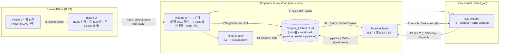
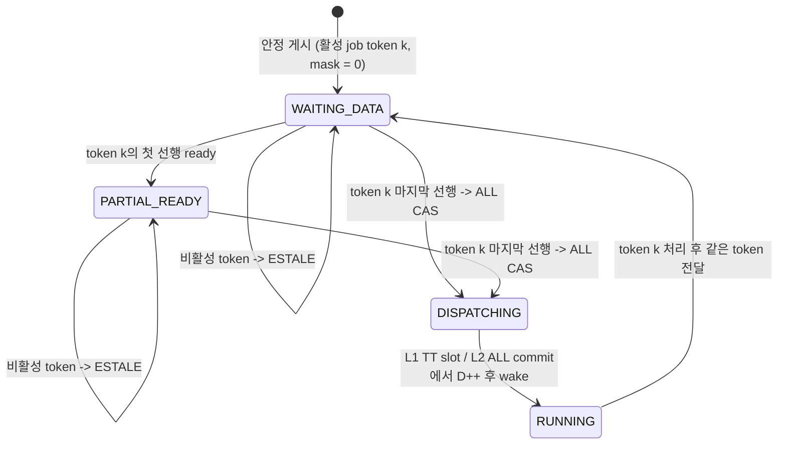
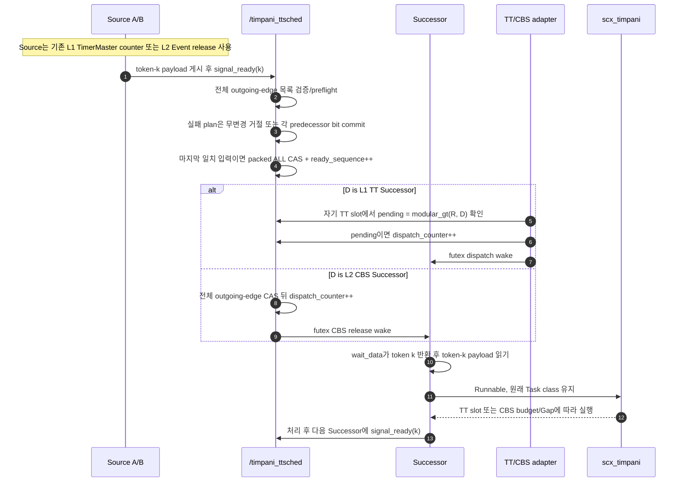
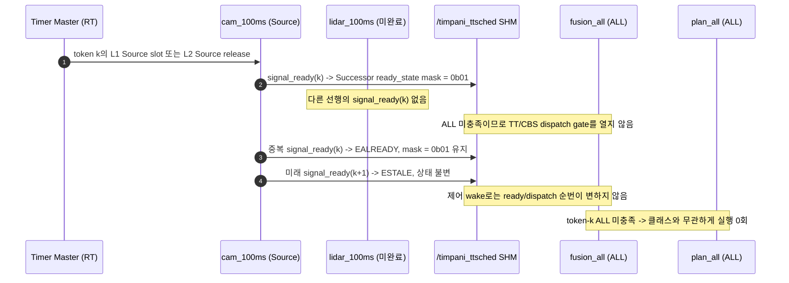

<!--
SPDX-FileCopyrightText: Copyright 2026 LG Electronics Inc.
SPDX-License-Identifier: MIT
-->

# HLD-009: Data-Driven Workload — Phase 0 상위 레벨 아키텍처 설계

**작성일:** 2026-10-27  
**최종 수정:** 2026-11-01  
**상태:** Draft — Phase 0 설계안 (현재 구현의 충족 선언 아님)  
**상위 기준:** [REQ-009](REQ-009-data-driven-workload.md) §1.5, §7.1, §8.2, [SRS-009](SRS-009-data-driven-workload.md)  
**결정/상세:** [DDR-009](DDR-009-data-driven-workload.md), [LLD-009](LLD-009-data-driven-workload.md), [DDR-011](DDR-011-runtime-table-update.md)

---

## 1. 범위와 아키텍처 구조

본 문서는 단일 노드·고정 `Epoch`/`Hyperperiod`·기본 체인 조건에서 **Task의 기존 L1 TT/L2 CBS 계층과 독립적인 Data-Driven DAG** 흐름을 정의한다. Source/Successor 역할은 실행 계층을 결정하지 않는다. 계층별 정밀 Window/Gap, 다중 주기, 갱신, `SKIP`은 후속 단계로 이관한다.

---

## 2. 컴포넌트 책임 분리 (RT / 비RT 및 O / N 경계)

| 구성 요소 | Phase 0 책임 | 하지 않는 일 |
|:---|:---|:---|
| **입력 / 시험기** | `Timpani-O` 입력 경로로 동일 주기(`100ms`) DAG 제출, 타임스탬프·오버헤드 증거 수집, 전제 이탈 시 시험 중단 | `Timpani-N`이나 SHM에 직접 테이블/그래프를 주입해 End-to-End 성공으로 판정, 제품 Fail-Safe를 대신 보장 |
| **`Timpani-O`** | DAG와 Task의 기존 `TemporalClass`를 독립 검증하고 TT/CBS 표현 및 공통 DAG 메타 생성 | DAG 역할로 계층 강제, N에 배치 판단 위임 |
| **`Timpani-N` 비RT** | 계층별 entry와 공통 `pipeline[]` 로컬 확인·게시 | DAG/TT/CBS 가능성 재계산 |
| **`Timer Master`** | L1 Task의 허용 slot에서 Data-Driven ready가 있으면 dispatch 어댑터를 연다 | L2 release 담당, L1 ready가 없을 때 실행 |
| **`libttsched` / 앱** | 클래스와 무관한 `ALL` CAS/ready 순번 갱신·신원 확인 | payload 전달, 제어 wake 실행, 실행 계층 변경 |
| **`scx_timpani`** | wake로 Runnable이 된 L1은 TT slot에서, L2는 기존 CBS 예산/Gap 경로로 dispatch | 별도 Data-Driven 스케줄링 계층 신설 |
| **`Fault Monitor`** | 기존 시스템 감시 안전장치 유지 | Phase 0 신규 `DATA_TIMEOUT` 수집·보고 (Phase 2 이관) |

공통 DAG 메타 전달, SHM 후방 `pipeline[]`, 신규 API는 사전 승인 후 반영한다. Task의 기존 TT/CBS entry와 timing 정책은 보존한다.

---

## 3. 상위 설계 영역 (H-DD-P0-01 ~ H-DD-P0-04)

### 3.1 H-DD-P0-01 — 오프라인 후보 검증과 결정적 위상 배치 (`Timpani-O`)

O는 `TaskInfo.temporal_class` 명시값을 우선하고, 미지정이면 `SchedInfo.temporal_class`를 상속해 각 Task의 실행 계층을 결정한다. `TaskReference(workload_id, task_id)` 선행 목록을 같은 workload의 정규화 Task 식별자로 변환하고 DAG를 검증한 뒤, `(workload_id_hash, task_id_hash)` key별 공통 의존성 메타를 만든다. 각 Task는 resolved class에 따라 기존 `TtSlot` 또는 `CbsConfig` 표현을 유지하며 `predecessors` 유무로 실행 계층을 추론하지 않는다.

Phase 0는 같은 workload 참조와 `ALL`만 허용하고 기존 TT slot/CBS admission 정책을 사용한다. Phase 1에는 cross-workload 참조, 혼합 DAG의 계층별 응답시간 합산, `E2E`, Window/Gap 조건을 확장한다. 실패 시 확정 모델은 유지한다.

### 3.2 H-DD-P0-02 — 노드 로컬 적합성 확인과 안정 SHM 게시 (`Timpani-N`)

N은 Task의 TT/CBS 표현과 공통 DAG 메타를 각각 확인한다. 이름·해시·CPU/slot/budget 참조가 유효하지 않으면 거절한다.

통과한 테이블은 011 규약으로 공통 `pipeline[]`를 채운다. L1 Task는 TT gate, L2 Task는 CBS gate를 사용하도록 어댑터 메타를 등록한다. 게시 자체는 ready/dispatch 순번을 증가시키지 않는다.

client는 초기화와 각 Pipeline API transaction 전에 보유 mapping 범위, mapped fd의 현재 `fstat()` 크기, SHM name이 같은 file identity로 resolve되는지를 확인하고 그 뒤에만 `pipeline_header.magic/version/abi_size`를 읽는다. 축소 또는 교체는 extension dereference 전에 `ESTALE`이다. `Timpani-N`은 live object를 전체 ABI 크기로 유지하고 교체는 무효화 + active commit drain + `unlink`로 수행하며 inplace shrink하지 않는다.

게시자는 header 안 `publication_guard`의 writer-pending을 잡아 새 Pipeline commit 진입을 막고 기존 활성 commit이 `0`이 된 뒤 SHM 세대를 홀수/내용 갱신/짝수·`magic` 유효로 전환한다. `signal_ready`와 L1 Timer Master는 packed `ready_state` CAS 또는 `dispatch_counter` 갱신 중 이 guard를 잡아 게시자와 직렬화한다. Phase 0은 최초 게시·종료/무효화, 축소/교체 거절, 고정 체인의 guard를 확인하고, Phase 1은 Pipeline 정상 갱신과 ABI 전환에, Phase 2는 실패·재시작 후 미회수 상태 정리에 이 규약을 확장한다.

### 3.3 H-DD-P0-03 — 공통 ready/dispatch 상태 전이와 제어 wake 분리

- packed `ready_state`의 `ALL` CAS부터 계층별 `dispatch_counter` 갱신과 futex wake까지는 게시 commit guard 안에서 수행한다. 게시 시 각 Successor의 직속 incoming edge가 `required_mask`와 일대일임을 먼저 증명한다. 두 edge의 bit alias, 대응 edge 없는 required bit, mask 밖 edge bit를 거절한다. 상태 변경 전에 `signal_ready(k)`는 Source의 전체 outgoing-edge 목록을 검증·preflight하므로 잘못된 metadata 또는 중복/낡은 destination 하나가 있으면 전체 fan-out이 불변이다. 같은 `(predecessor, k)`가 preflight 시 이미 설정됐으면 `EALREADY`, 다른 token이면 `ESTALE`이다. CAS 중 동시 동일 commit이 bit/sequence를 앞서면 수렴으로 처리한다. 하나의 64비트 CAS가 destination mask reset과 ready sequence/job token 증가를 원자적으로 수행한다.
- `ALL`은 ready sequence만 만든다. L1 Successor는 Timer Master가 자신의 TT slot에서 `pending`을 확인한 경우에만 `dispatch_counter`를 1 증가시키고, L2 Successor는 모든 outgoing-edge CAS가 완료된 `ALL` commit에서 1 증가시킨다. `dispatch_counter`만 futex word다.
- L1 slot 시 ready가 없으면 wake `0`이다. slot을 지난 ready는 다음 TT slot까지 pending으로 유지하며, Phase 0 정상 시험은 pending 1개까지만 포함한다.
- futex wake 후 Task가 Runnable이 되어야 기존 BPF 경로가 실행한다. L1은 TT slot에서, L2는 CBS budget/Gap에서 실제 CPU dispatch를 받는다.
- dispatch 증가가 없는 제어 wake, 축소·교체된 mapping, writer-pending/ABI 불일치, 또는 pending ready가 없는 gate는 실행으로 이어지지 않는다.

### 3.4 H-DD-P0-04 — 종단 간(E2E) 실행 시퀀스

#### (a) 정상 체인 시퀀스 (Task 클래스는 입력에 따라 TT/CBS로 독립 선택)

그래프가 같다 해도 Task 클래스는 다를 수 있다. Phase 0 시험은 TT→TT, TT→CBS, CBS→TT, CBS→CBS 연결을 포함한다.

#### (b) 부분 입력 및 제어 wake 시 대기 유지 시나리오 (`UC-DD-02`)

---

## 4. 현재 코드와 Phase 0 설계의 차이

| 확인 대상 소스 | 현재 코드 관찰 및 Phase 0 설계에서 필요한 차이 |
|:---|:---|
| `timpani-o/src/global_scheduler.{h,cpp}` | DAG와 Task의 기존 TT/CBS 분류를 별도로 생성하는 공통 후보 검증/배치 경로 필요 |
| `timpani-n/src/main.cpp` | TT/CBS entry별 등록과 공통 Pipeline DAG 메타 연결 필요 |
| `timpani-n/src/timer_master.{h,cpp}` | L1 Task ready를 허용 TT slot에서 dispatch 순번에 연결 |
| `sample-apps/src/libttsched.{h,c}` | 공통 ready/dispatch 순번과 `wait_data`/`signal_ready` 추가 *(승인 대상)* |
| `timpani-n/src/bpf/timpani.bpf.c` | 기존 TT/CBS dispatch 규칙을 사용하며 L1/L2 어댑터가 만든 dispatch만 허용 |

위 표는 설계의 출발점이며 실제 코드 변경이나 승인 완료를 뜻하지 않는다.

---

## 5. SRS 추적 매트릭스

| HLD 영역 | 활성 SRS 요구사항 | 검증 시나리오 |
|:---|:---|:---|
| **H-DD-P0-01** | `REQ-DD-P0-F-001`, `REQ-DD-P0-F-002`, `REQ-DD-P0-N-003` | `TC-DD-P0-001`, `TC-DD-P0-003`, `TC-DD-P0-005`, `TC-DD-P0-006` |
| **H-DD-P0-02** | `REQ-DD-P0-F-003`, `REQ-DD-P0-F-004`, `REQ-DD-P0-F-006`, `REQ-DD-P0-N-004` | `TC-DD-P0-003`, `TC-DD-P0-004`, `TC-DD-P0-005` |
| **H-DD-P0-03** | `REQ-DD-P0-F-005`, `REQ-DD-P0-F-006`, `REQ-DD-P0-N-001`, `REQ-DD-P0-N-002` | `TC-DD-P0-001`, `TC-DD-P0-002`, `TC-DD-P0-004`, `TC-DD-P0-006` |
| **H-DD-P0-04** | `REQ-DD-P0-F-004`..`F-008`, `REQ-DD-P0-N-002` | `TC-DD-P0-001`, `TC-DD-P0-002`, `TC-DD-P0-004` |
