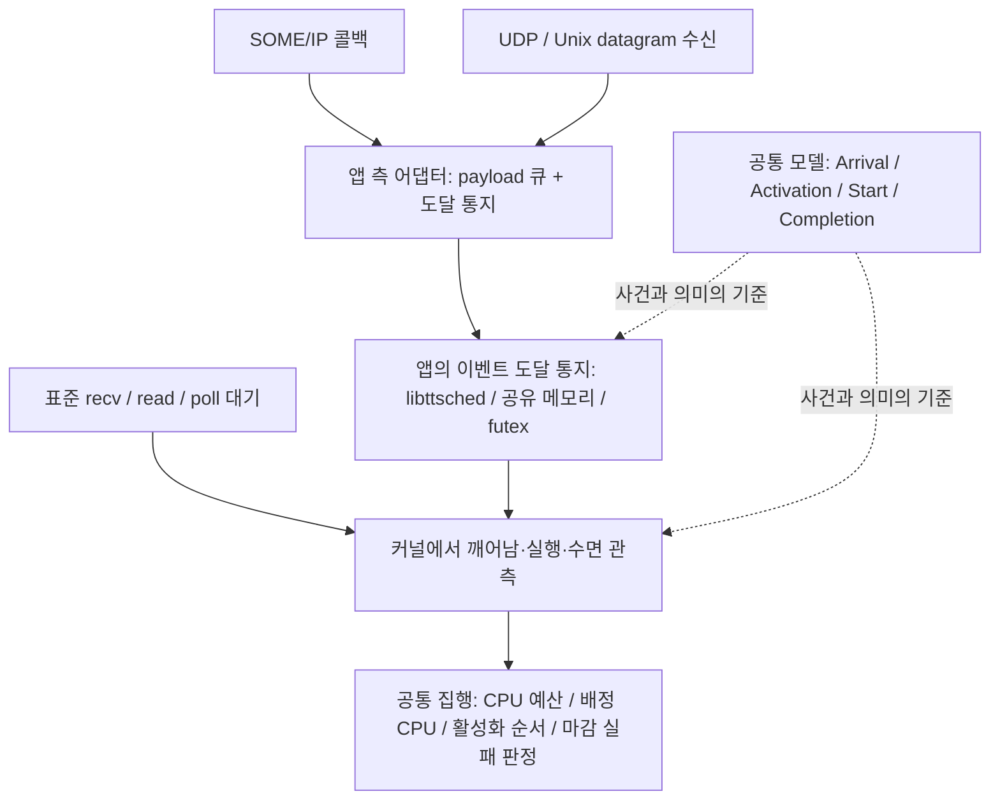
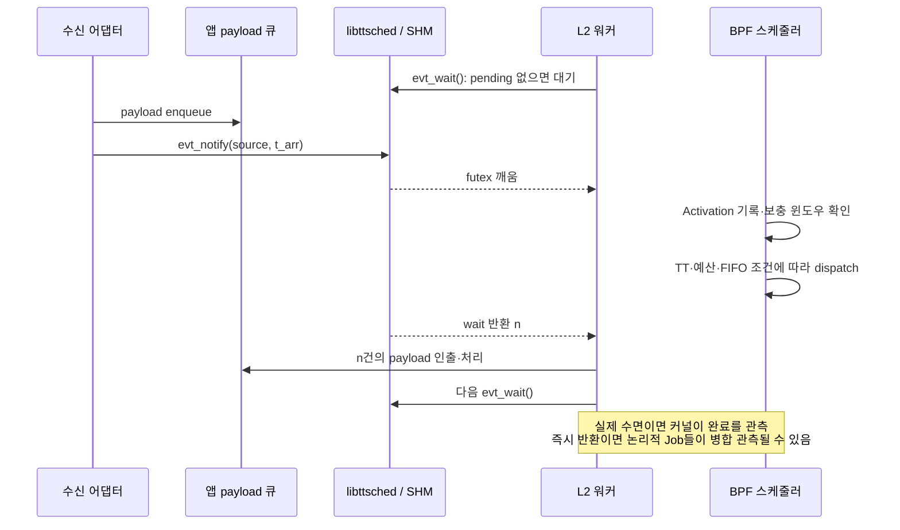

<!--
SPDX-FileCopyrightText: Copyright 2026 LG Electronics Inc.
SPDX-License-Identifier: MIT
-->

# Event-Driven Workload Support — 설계 설명 및 리뷰 가이드

| 항목 | 내용 |
|:--|:--|
| 목적 | 상세 설계 문서를 읽기 전에 핵심 개념·동작·범위·리뷰 쟁점을 공유한다 |
| 독자 | 아키텍처·스케줄러·애플리케이션·검증 담당자 |
| 기준 | 2026-11-11, 설계 브랜치의 `9209bc5` 기준 REQ/SRS/DDR/HLD/LLD-008 |
| 상태 | **Proposal / P1 구현 전**. 이 문서는 실행 결과나 구현 완료를 의미하지 않는다 |
| 문서 성격 | 설명용 요약이다. 기존 요구사항·설계 결정을 대체하거나 새로운 결정을 확정하지 않는다 |

> **한 문장 요약:** 이벤트의 전달 방식은 앱에 맡기고, TIMPANI는 공통 Event/Job 계약을 통해 사용자 공간 L2 워커의 CPU 배치·예산·실행 순서·마감 관측을 관리한다.

> **2026-11-11 P1 수정 방향 합의:** 한 Event–한 Job, 도달 기준 마감 경과 시 감지, 큐·통지·복구의 일관성 확보를 P1 목표로 한다. [P1 계약 보강 합의](P1-008-event-job-contract-amendment.md)를 먼저 참고한다. 아래 본문과 기존 008 정본·HTML 그림에는 여전히 기준 커밋의 배치 소비·활성화 기준 근사·완료 시 감지 설명이 남아 있으며, 해당 설명은 수정 대상이지 새 합의의 최종 동작이 아니다. 상세 방식과 정본 전체 갱신은 아직 완료되지 않았다.

**리뷰 시작점:** [기능 지원 Issue #53](https://github.com/eclipse-timpani/timpani26/issues/53) → [P1 계약 보강 합의](P1-008-event-job-contract-amendment.md) → [새 계약 기준 FCW 그림](../../../Radar-FCW-P1-event-job-contract.html). 새 그림은 수정 방향을 설명하며 아래 기존 기준의 설명과 구분한다.

---

## 읽기 전에: 약자와 용어

이 문서는 다음 약자를 사용한다. **R·C·D는 시간량을 나타내는 수학 기호이며, API의 `runtime`과 응답시간 R은 서로 다르다.** 시간 기호의 정의와 예시는 §2에서 설명한다.

### 실행·스케줄링

| 표기 | Full name / 원어 | 이 문서에서의 뜻 |
|:--|:--|:--|
| P1 / P2 | Phase 1 / Phase 2 | 1차 구현 범위 / 후속 확장 범위 |
| L1 / L2 | Level 1 / Level 2 | TIMPANI 계층형 스케줄링의 1계층(TT) / 2계층(이벤트 기반 CBS) |
| TT | Time-Triggered | 미리 정한 시간표에 따라 실행하는 방식 |
| CBS | Constant Bandwidth Server | 태스크의 CPU 사용량을 예산과 보충 규칙으로 제한하는 서버. 구체적인 P1 정책은 §6 참고 |
| MIT | Minimum Inter-arrival Time | 같은 발생원에서 연속한 이벤트 사이에 요구되는 최소 도달 간격 |
| CPU | Central Processing Unit | 중앙 처리 장치. 이 문서의 CPU 배치는 논리 CPU 단위 |
| FIFO | First In, First Out | 먼저 들어온 항목 우선. 본 설계에서는 활성화 순서를 기준으로 하며 승격 시 예외 규칙 적용 |
| EDF | Earliest Deadline First | 절대 마감이 가장 이른 작업부터 실행하는 방식. P2 검토 대상 |
| DSQ | Dispatch Queue | sched_ext가 실행할 태스크를 보관·선택하는 디스패치 큐 |
| DMISS | Deadline Miss | 마감 실패를 나타내는 프로젝트 표기. C/C++의 폴트 식별자로도 사용 |
| RT | Real-Time | 실시간. 처리 결과뿐 아니라 완료 시점도 중요하다는 의미 |
| E2E | End-to-End | 전체 처리 경로의 시작부터 끝까지. P1 워커 구간의 마감과 구분 |

### 구현·통신

| 표기 | Full name / 원어 | 이 문서에서의 뜻 |
|:--|:--|:--|
| FCW | Forward Collision Warning | 전방 충돌 경고 애플리케이션 예제 |
| SOME/IP | Scalable service-Oriented MiddlewarE over IP | 차량 서비스 간 통신에 사용하는 미들웨어 프로토콜 |
| IP | Internet Protocol | 인터넷 프로토콜 |
| UDP | User Datagram Protocol | 데이터그램 단위 통신을 제공하는 전송 프로토콜 |
| CAN | Controller Area Network | 차량 제어기 간 통신에 사용하는 네트워크 |
| BPF / eBPF | Berkeley Packet Filter / extended Berkeley Packet Filter | Linux 커널에서 검증된 프로그램을 실행하는 기술. 여기서는 스케줄러 구현에 사용 |
| SHM | Shared Memory | 프로세스·스레드가 함께 접근하는 공유 메모리 |
| futex | Fast Userspace Mutex | 사용자 공간의 메모리 값을 기반으로 커널 대기·깨움을 수행하는 Linux 기능 |
| IRQ / ISR | Interrupt Request / Interrupt Service Routine | 인터럽트 요청 / 인터럽트 처리 루틴. 사용자 공간 L2 워커와 구분 |
| API / ABI | Application Programming Interface / Application Binary Interface | 소스 수준 호출 계약 / 바이너리 수준 호환 계약 |
| I/O | Input/Output | 입출력 |
| ID | Identifier | 식별자 |
| PoC | Proof of Concept | 기술적으로 가능한지 확인하는 사전 실험. 구현 완료나 성능 보장과는 다름 |
| Hz | Hertz | 초당 횟수의 단위. Linux `HZ`는 스케줄러 틱 빈도를 나타내는 설정 |

다음 표기는 일반 약자를 임의로 풀어 쓰지 않고 프로젝트·제품 이름으로 읽는다.

- **TIMPANI-O / TIMPANI-N:** 스케줄링·오케스트레이션 구성요소 / 노드 실행 구성요소. 이후 O / N으로 줄여 쓴다.
- **관측 방식 표기:** 상세 설계의 K는 커널 관측, M은 애플리케이션의 명시적 이벤트 도달 통지다. 이 설명 문서의 본문·그림에서는 한 글자 표기 대신 의미를 풀어 쓴다.
- **sched_ext:** Linux의 확장형 스케줄링 기능. BPF로 스케줄링 정책을 구현한다.
- **PREEMPT_RT:** Linux의 실시간 선점 지원 구성 이름이다.
- **gRPC:** 원격 프로시저 호출(Remote Procedure Call, RPC) 프레임워크 이름이다.
- **vsomeip:** SOME/IP 구현 라이브러리 이름이다.

본문의 영문 동작 용어도 다음 의미로 사용한다: **payload**는 실제 처리 데이터, **pending**은 미소비 상태, **Runnable**은 실행 가능 상태, **dispatch**는 CPU에 실행할 태스크를 넘기는 동작, **throttling(스로틀)**은 예산 소진에 따른 실행 보류다. **Mid-job blocking**은 작업 처리 도중 잠드는 것이며, **back-to-back**은 대기 수면 없이 작업이 연속되는 것이다.

## 1. 무엇을 해결하려는가

차량 서비스는 정해진 주기에만 실행되지 않는다. SOME/IP 통지, CAN 프레임, 소켓 메시지, 하드웨어 입력, 다른 태스크의 출력처럼 **외부 도달을 계기로 실행되는 작업**도 있다.

기존 CBS 경로에 예산 차감 기능이 있다는 것만으로는 다음 질문에 일관되게 답할 수 없다.

- 이벤트가 도착한 것과 워커가 깨어난 것은 같은가?
- 처리 중 다른 이벤트가 도착하면 유실되는가, 다음 작업으로 남는가?
- 작업 한 건은 어디서 시작하고 끝나는가?
- 이벤트가 폭주하거나 처리가 길어져도 다른 L2와 L1 TT를 보호할 수 있는가?
- FCW 외 다른 전송 방식을 추가할 때 스케줄러를 다시 수정해야 하는가?

이번 설계의 목표는 **FCW 전용 기능이 아니라 여러 이벤트 기반 앱이 재사용하는 공통 실행 프레임워크**다. FCW는 이 프레임워크를 검증하는 첫 적용 사례다.

### 관리 대상의 경계

- **대상:** 등록된 사용자 공간 L2 처리 스레드의 실행.
- **앱의 책임:** 메시지 해석, payload 큐, 큐 용량·넘침 정책, 입력 어댑터.
- **자동으로 포함되지 않는 것:** IRQ/ISR, 커널 worker, vsomeip 내부 스레드, 네트워크 전달 경로 전체의 실행 예산.
- **의미:** 워커의 CBS 예산을 선언했다고 수신 경로 전체가 실시간으로 보장되는 것은 아니다.

## 2. 핵심 개념: Event와 Job은 다르다

| 개념 | 의미 | FCW 예 |
|:--|:--|:--|
| Event source | 이벤트의 선언된 발생원 | 레이더 경보를 받는 입력 흐름 |
| Event | 발생원에서 도달한 한 건 | 경보 메시지 한 건 |
| L2 태스크 | 이벤트를 소비하는 실행 주체 | FCW 처리 워커 |
| Job | wait point를 떠나 다음 wait point에 도달할 때까지의 처리 단위 | 한 번의 활성화에서 수행하는 경보 처리 |
| Wait point | 다음 이벤트를 기다리는 지점 | `ttsched_evt_wait()` 또는 표준 블로킹 대기 |

P1은 **L2 태스크 하나에 source 하나, 소비 워커 하나**를 전제로 한다. Source는 `(workload_id, task_id)`로 식별하고, `task_id`는 노드 안에서 유일한 15바이트 이하 이름이다.

### 네 가지 사건

| 사건 | 의미 | 시각 |
|:--|:--|:--|
| Arrival | Event가 source에 도달 | $t_{arr}$ |
| Activation | Job이 실행 가능해짐 | $t_{act}$ |
| Start | Job이 처음 CPU를 받음 | $t_{start}$ |
| Completion | 처리를 끝내고 wait point에 도달 | $t_{done}$ |

**이벤트를 깨우는 것과 CPU를 주는 것은 다르다.** 통지로 워커가 Runnable이 되어도, 실제 실행 시점은 TT 상태·CBS 예산·동일 CPU의 대기 순서에 따라 정해진다.

### 처리 규칙 R1~R4

1. **대기 중 도달:** 새 Job을 활성화한다.
2. **처리 중 도달:** 현재 Job에 임의로 끼워 넣지 않고 pending Event로 남긴다.
3. **완료 시 pending 존재:** 다음 Job이 대기 없이 이어질 수 있다.
4. **소비 경계:** wait가 반환할 때 읽은 스냅샷까지의 미소비 Event를 이번 Job이 모두 소비한다. 이후 도달은 다음 Job의 몫이다.

### 시간 기호: R·C·D·MIT는 무엇인가

| 기호 | Full name / 의미 | 측정·선언 기준 |
|:--|:--|:--|
| $R$ | Response time — 응답시간 | Job이 소비하는 **첫 Event의 도달부터 Job 완료까지**의 경과시간. CPU 대기·선점 시간도 포함 |
| $C$ | CPU execution-time budget — 예약 CPU 실행시간 예산 | Job에 예약하는 CPU 사용시간. 워크로드의 `runtime`에 대응하며 실제 차감 최대 실행시간보다 여유 있게 선언 |
| $D$ | Relative deadline — 상대 마감시간 | 첫 Event 도달 후 완료까지 허용되는 경과시간 |
| $MIT$ | Minimum Inter-arrival Time — 최소 도달 간격 | 같은 source의 연속 Event 사이에 요구되는 최소 간격 |
| $C_s$ / $T_s$ | Server budget / Server period — 서버 예산 / 서버 주기 | CBS 집행용 값. P1에서는 $C_s=C$, $T_s=MIT$ |
| $t_{rel}$ | Release time — 해제 기준 시각 | Job이 소비하는 첫 Event의 도달 시각. 단일 Event Job이면 해당 $t_{arr}$와 같음 |
| $R_{act}$ | Activation-based response time — 활성화 기준 응답시간 | P1이 실제 판정하는 $t_{done}-t_{act}$. 도달→활성화 지연은 빠짐 |

**R은 runtime이 아니다.** 예를 들어 C=2ms, D=5ms, MIT=18ms로 선언하고, 도달부터 완료까지 실제 CPU 사용이 1.5ms, 나머지 대기·선점이 1ms라면 R=2.5ms다. CPU 예산 2ms와 응답시간 2.5ms는 서로 다른 값이다.

정상 조건(MIT 준수, 도달 기준 응답시간 $R \le D \le MIT$, mid-job blocking 없음)에서는 **Event 한 건과 Job 한 건이 1:1**이다. 즉 “현재 이벤트 처리가 마감 안에 끝나고, 그 마감이 다음 이벤트의 가장 이른 도달 시점보다 늦지 않다”는 조건이다. 지연·폭주가 있으면 하나의 Job이 여러 Event를 소비할 수 있다. MIT는 Event 도달에, C와 D는 Job에 적용된다.

## 3. 왜 공통 프레임워크인가: 모델 / 관측 / 집행 분리

| 층 | 책임 | 전송 방식 변경 시 |
|:--|:--|:--|
| ① 모델 | Event/Job 및 생명주기·소비 규칙 정의 | 유지 |
| ② 관측 어댑터 | 실제 앱·커널 동작을 모델의 사건에 연결 | 앱 측 연결 지점이 달라짐 |
| ③ 집행 | CPU·예산·순서·마감 판정 | 기존 커널 관측·앱 도달 통지 계약을 사용하는 범위에서는 유지 |

P1 관측 경로는 두 가지다.

- **커널 관측만 사용:** 워커가 직접 `recv()`·`read()` 등으로 기다린다. 앱의 명시적 도달 통지 없이 지원하지만 Event별 계수와 정확한 도달 시각은 알 수 없다.
- **커널 관측 + 앱의 이벤트 도달 통지:** 수신 측이 큐에 넣고 `ttsched_evt_notify()`를 호출한다. 워커는 `ttsched_evt_wait()`가 반환한 n건을 처리한다. 도달 계수·도달 기준 최소 간격 검사가 추가된다.

**앱의 도달 통지가 커널 관측을 대체하는 것은 아니다.** 현재 1차 구현 설계의 CPU 예산 집행과 마감 실패 판정은 두 방식 모두 커널 관측을 사용한다. 앱의 명시적 통지가 추가하는 것은 도달 정보와 미소비 이벤트의 배치 전달이다. SOME/IP의 서비스·이벤트 식별자나 실제 처리 데이터의 타입은 코어 호출 인터페이스에 넣지 않는다.

## 4. 누가 무엇을 하는가

| 구성요소 | 역할 | 하지 않는 일 |
|:--|:--|:--|
| Pullpiri / 앱 선언 | MIT·C·D·보고 임계 등 워크로드 요구 전달 | 이벤트마다 CPU 실행을 지시하지 않음 |
| TIMPANI-O | 입력 검증, 승인 검사, CPU 배치, 정적 CBS 설정·테이블 생성 | 런타임 예산 차감·보충을 하지 않음 |
| TIMPANI-N | 실제 워커 식별·바인딩, BPF 초기 설정, 백업 보충 유발, 폴트·통계 수집 | payload 의미를 해석하지 않음 |
| BPF 스케줄러 | 실행시간 차감, 스로틀·승격, CPU별 큐, TT 우선 집행, Job 관측 | 메시지를 전달하거나 앱 큐를 관리하지 않음 |
| `libttsched` | source 핸들, 도달 통지, 대기·배치 수 반환, 도달 기준 MIT 계수 | payload 전달이나 별도 CBS 정책을 구현하지 않음 |
| 앱 측 어댑터·워커 | 입력 해석 → 큐 → notify, wait → n건 처리 | 앱이 스케줄링 클래스·우선순위를 직접 제어하지 않음 |

제어 경로는 **Pullpiri → O → N → BPF 설정**이다. 이벤트별 실행 경로는 **입력 → 앱 어댑터 → 워커 깨움 → BPF dispatch**이며, gRPC를 통과하지 않는다.

## 5. 이벤트 한 건은 어떻게 실행되는가

SHM에는 payload가 아니라 **도달 수·소비 수·최근 도달 시각·MIT 위반 수·깨움 워드**를 둔다. 앱 큐에 먼저 넣는 이유는 워커가 깨어났을 때 처리할 데이터가 있어야 하기 때문이다.

통지가 거절되면 해당 항목을 처리하지 않도록 해야 한다. 큐가 가득 차면 앱 정책으로 버리고 통지하지 않으며, 드롭 수를 따로 기록한다. **유실 없는 계수 전달은 무한 큐나 무조건적인 메시지 보존을 뜻하지 않는다.**

## 6. 실행을 제한하는 방법: CBS·TT·승인

### 6.1 선언 파라미터

| 값 | 의미 | 주의 |
|:--|:--|:--|
| MIT, $T_s$ | 연속 Event 도달의 최소 간격, CBS 주기 기준 | 송신 주기와 같다고 가정하지 않는다. 전달·수신 스케줄링 지터를 반영한다 |
| C, $C_s$ | Job당 예약 CPU 예산 | 처리 본문뿐 아니라 큐 인출·대기 진입까지 포함한 실제 차감 최대값보다 여유 있게 선언 |
| D | Job의 상대 마감 | 모델은 최초 소비 Event의 도달 기준, P1 런타임 판정은 활성화 기준 |

기본 관계는 $0 < C \le D \le MIT$이고, 서버 이용률은 $C_s/T_s$다. C는 CPU 사용시간이며 D는 대기·선점까지 포함한 경과시간이다.

### 6.2 예산·보충·순서

1. 활성화 시 이전 보충 윈도우가 끝났으면 새 예산을 준다. P1은 활성화 지터용 50µs 허용 오차를 제안한다.
2. 윈도우가 아직 끝나지 않았으면 남은 예산만 쓴다. 이 상태를 `CARRYOVER`로 표시한다.
3. 실제 on-CPU 실행시간을 차감하고, 예산을 다 쓰면 스로틀한다.
4. 스로틀된 서버는 윈도우 종료 후 dispatch에서 보충하고 **큐 뒤로** 보낸다.
5. ACTIVE이고 스로틀되지 않은 서버를 윈도우 종료만으로 자동 보충하지 않는다.

동일 CPU에서는 활성화 순서 FIFO를 사용한다. 선점 후에는 기존 순위를 유지하되, 스로틀 후 승격 시에는 새 순위를 받는다. 위반·초과 이후에는 윈도우가 밀려 이후 정상 간격의 Job도 지연될 수 있으므로 실행시간 여유가 중요하다.

**Replenisher는 예산을 쓰는 주체가 아니다.** CPU가 유휴여도 보충이 진행되도록 재스케줄을 유발하고, 실제 런타임 예산 갱신은 BPF가 담당한다. syscall BPF kick 경로의 커널 지원 여부는 PoC 확인 대상이다.

### 6.3 TT와의 공존 및 승인

- L2는 배정 CPU의 전용 DSQ에서만 실행하도록 설계한다.
- runnable TT가 있으면 L2를 dispatch하지 않고, 실행 slice도 다음 TT 시작을 고려해 제한한다.
- O는 CPU 이용률뿐 아니라 TT 블로킹과 다른 L2의 간섭을 검사한다.
- 새 앱을 추가할 때 기존 앱도 포함해 **해당 CPU의 모든 L2**를 재검사한다.

현재 P1 문서가 제안한 마감 승인식은 다음과 같다.

$$
C_i + B_{tt}(k,D_i) + L_{wake}^{max} + \sum_{j\ne i}C_j \le D_i
$$

$B_{tt}(k,D_i)$는 길이 $D_i$인 임의 구간 내 최대 TT 점유 합이다. 이용률 조건은 $U_{tt}+\sum_j C_j/T_j+U_{overhead}\le U_{bound}$이며, 제안값은 각각 overhead 0.02, bound 0.80이다.

수식의 아래첨자와 나머지 기호는 다음 뜻이다.

| 기호 | 의미 |
|:--|:--|
| $i$ / $j$ / $k$ | 검사 대상 L2 태스크 / 다른 L2 태스크 / 배정 CPU의 인덱스 |
| $B_{tt}(k,D_i)$ | TT blocking — CPU k에서 길이 $D_i$인 구간에 들어갈 수 있는 TT 점유의 최댓값 |
| $L_{wake}^{max}$ | Maximum wake-up latency — 승인 계산에 사용하는 깨움 지연 상한 파라미터 |
| $T_j$ | 태스크 j의 CBS 서버 주기. P1에서는 해당 source의 MIT |
| $U_{tt}$ | TT utilization — TT CPU 이용률 |
| $U_{overhead}$ | Overhead utilization reserve — 관리 비용으로 남겨 두는 이용률 |
| $U_{bound}$ | Utilization bound — 승인을 허용하는 이용률 상한 |
| $\sum_{j\ne i}C_j$ | 같은 CPU의 다른 L2 서버들의 예산 합 |

> **리뷰 주의:** 현재 식은 틱 기반 예산 초과 실행을 간섭 항에 포함하지 않는다. P1이 최대 1틱(HZ=1000이면 1ms) overrun을 허용하므로, 이 식을 그대로 “위반 앱이 있어도 마감을 보장하는 최종 충분조건”으로 승인하면 안 된다. 보완 쟁점은 §10을 참고한다. 50µs 등의 백분위 목표 역시 검증된 최악시간 상한과 구분해야 한다.

## 7. P1에서 보장하려는 범위와 의도적 한계

| 항목 | P1 범위·주의사항 |
|:--|:--|
| 구현 경로 | C++ O/N + BPF + `libttsched` 확장. Rust 런타임 포트는 후속 |
| Job 경계 | 모든 자발적 수면을 완료로 관측. **마커 사용 여부와 관계없이 Job 도중 블로킹 금지** |
| back-to-back | 논리적으로 다음 Job이지만 수면이 없으면 커널 레코드는 하나의 구간으로 병합될 수 있음 |
| 마감 | 런타임은 $t_{done}-t_{act}$로 판정. 모델의 $t_{done}-t_{rel}$보다 도달→활성화 지연만큼 낙관적 |
| 도달 계수 | 앱의 명시적 도달 통지를 사용하면 가능. 커널 관측만 사용하면 활성화 기준 근사이며 Event별 정확한 계수를 제공하지 않음 |
| 동적 변경 | 지연 바인딩·제거·재등록 지원. 동일 엔트리의 예산·Job 상태는 보존. 갱신 중 TT 무교란은 P2 |
| 재시작 | 현 설계는 새 SHM에서 reset을 알리고 앱 큐를 비우도록 제안. 정확한 복구 동기화는 추가 리뷰 필요 |
| ABI | SHM v2 도입으로 기존 TT 앱도 라이브러리 재빌드 필요 |
| 권한 | P1 SHM 쓰기 권한은 넓게 열려 있어 앱 제공 관측값을 신뢰하는 한계가 있음 |
| P2 이후 | 정밀 wait point 식별, EDF·정밀 승인, 다중 source, watchdog, 노드 간 E2E, pool 기반 예산 회수·재분배 |

**P1을 정확한 논리적 Job 경계까지 통일한 런타임으로 설명하지 않는다.** 공통 모델·입력 계약은 제공하지만, 런타임 집행·관측 정밀도에는 위 제한이 있다.

앱 워커는 경합 뮤텍스, 블로킹 I/O, sleep, 동기 응답 대기를 Job 내부에서 피해야 한다. 로그는 별도 스레드로 넘긴다. 이 조건을 지킬 수 없는 앱은 처리 단계를 나누거나 P2 정밀화를 검토한다.

## 8. FCW와 비-SOME/IP 앱으로 무엇을 보여줄 것인가

### 8.1 두 앱 동시 구동 제안

FCW 적용은 기존 HLD의 대상이다. 아래 **별도 datagram 앱과 동시 데모 구성은 공유·검증을 위한 제안**이며, 아직 구현·승인된 추가 요구사항은 아니다.

| 구분 | 앱 A: FCW | 앱 B: 센서 임계치 판단 예제 |
|:--|:--|:--|
| 입력 | SOME/IP 레이더 경보 | Unix datagram, 후속으로 UDP 선택 가능 |
| 도달 지점 | vsomeip 콜백 | 소켓 리더 스레드 |
| 앱 측 연결 | 큐 → notify | 큐 → notify |
| 워커 | FCW 판단 | 센서값 상태·임계치 판단 |
| 공통 대기 | `ttsched_evt_wait()` | `ttsched_evt_wait()` |
| 집행 | 독립 CBS 서버 | 독립 CBS 서버 |
| 코어 변경 | 전송별 분기 없음 | 전송별 분기 없음 |

두 앱은 별도 프로세스·고유 `task_id`·독립 C/MIT/D를 사용한다. 먼저 각각 구동한 뒤 **같은 L2 CPU**에 배치하여 서버 간 격리를 검증하고, TT와도 공존시킨다. CPU 번호와 승인 가능한 파라미터는 타깃의 TT 테이블·측정 결과로 정한다.

FCW에서는 기존 전용 이벤트 라이브러리·별도 SHM·앱의 bind/unbind를 공통 경로로 바꾸고, 워커 큐와 로그 경로를 정리한다. 기존 MIT 18ms, C 2ms, D 5ms는 출발점이지 검증 완료 값이 아니다. MIT 변경 시에는 이용률도 변하므로 승인을 다시 확인한다.

추가로 datagram 워커가 직접 `recv()`로 기다리는 **커널 관측만 사용하는 방식**을 비교하면 앱의 명시적 도달 통지가 선택 사항이라는 점도 보여줄 수 있다. 단, Event 계수 정확성 검증은 **커널 관측과 앱 도달 통지를 함께 사용하는 방식**과 구분한다.

### 8.2 데모의 합격 기준

| 시나리오 | 확인할 것 |
|:--|:--|
| 각 앱 정상 실행 | 도달 계약 준수, 실제 차감 실행시간 < C, 마감 충족, 정상 구간의 Event:Job 1:1 |
| 두 앱 동시 실행 | 같은 코어·API·테이블 형식으로 독립된 서버가 동작하고 배정 CPU 밖 실행이 없음 |
| 앱 A 입력 버스트 | MIT 위반 계수, pending 증가·해소, 앱 드롭 별도 기록, 앱 B의 응답시간 |
| 앱 A 과실행 | 스로틀 에피소드별 `BUDGET_EXCEED`, 보충·큐 순서, 앱 B 보호 |
| TT 공존 | L2 없음/정상/폭주를 비교해 TT 지터·마감 영향 측정 |
| 제거·재등록·재시작 | 기존 상태 보존 범위, stale 종료 레코드, reset 경계의 큐·계수 정렬 |

“영향 없음”은 실행시간이 완전히 같다는 뜻이 아니라 **확정된 간섭·집행 오차·타이밍 기준 안에 있음**으로 판정한다. 과부하 구간에는 Event마다 별도 Job 레코드를 요구하지 않는다.

## 9. 관측과 구현 진행 순서

### 관측해야 할 것

- **Event source:** 도달 수·소비 수·pending·MIT 위반 수. `consumed_seq`는 앱에 처리할 몫을 넘긴 수이며 실제 처리 완료 수와는 다르다.
- **Job:** 활성화·시작·완료·CPU·예산 사용량·DMISS·스로틀/이월 표식.
- **시스템:** 보충 지연, 다른 앱 응답시간, TT 지터, 앱 큐 넘침·통지 거절·트레이스 드롭.
- 폴트는 **N → O → Pullpiri**에서 `DMISS`·`BUDGET_EXCEED`·`MIT_VIOLATION` 의미를 유지한다.
- 도달 기준 응답시간은 생성기 로그와 관측 레코드를 같은 단조 시계로 대조한다. 정상 조건 밖에서는 현재 출력만으로 Event별 대응을 일반적으로 복원할 수 없다.

### 권장 구현 순서 — 제안

1. §10의 승인·동시성·복구 계약을 보완하고, 백업 kick 경로를 Linux 타깃에서 PoC한다.
2. 공통 경로를 구현한다: O 승인·테이블 → N 바인딩 → BPF 집행 → 마커 API·관측.
3. 단순 datagram/범용 이벤트 예제로 정상·버스트·과실행을 검증한다.
4. FCW를 같은 API에 연결하고 SOME/IP 고유 문제와 공통 런타임 문제를 분리한다.
5. 두 L2 앱의 동일 CPU 실행, TT 공존, 수명주기·복구 시험을 수행한다.

실제 BPF·실시간 검증에는 Linux와 적합한 sched_ext/PREEMPT_RT·커널 설정·권한이 필요하다. 후보 타이밍 수치를 구현 전 성능으로 제시하지 않는다.

## 10. 리뷰에서 합의해야 할 사항

아래는 기준 설계에 대해 제기된 **미해결 검토 사항**이다. 이 문서에서 수정안을 확정하지 않으며, 합의 후 정본 문서와 테스트 기준에 반영해야 한다.

| 우선 검토 | 질문 / 필요한 합의 |
|:--|:--|
| 승인과 실제 집행의 정합 | 다른 서버의 C에 틱 overrun·스케줄링 비용을 어떻게 반영할 것인가? 백분위 목표와 최악시간 보장의 경계를 어디에 둘 것인가? |
| reset의 원자적 경계 | 소비 계수 스냅샷과 앱 큐 clear 사이에 notify가 들어와도 이후 payload와 계수가 계속 어긋나지 않게 할 방법은 무엇인가? |
| 바인딩 세대 식별 | 지연된 이전 태스크의 종료 레코드나 콜백이 새 바인딩을 정리하지 않도록 어떤 식별·검증을 둘 것인가? |
| 필수 통계와 선택 트레이스 | trace OFF에서도 필수 카운터·히스토그램을 유지할 것인가? 보충·배정 외 CPU 실행을 어디서 계수할 것인가? |
| RT fast path 범위 | 초기 SHM 매핑·재매핑·잠금 경로를 정상 notify 비용 보장에서 어떻게 분리할 것인가? RT 호출의 준비·실패 계약은 무엇인가? |
| 커널 PoC | syscall 프로그램에서 kick 가능한가? 유휴 CPU 보충 지연·TT 경계 영향·런큐 직렬화 전제가 실제 타깃에서 성립하는가? |
| P1 적용성 | no mid-job blocking, back-to-back 병합, 활성화 기준 DMISS를 첫 적용 앱과 검증 담당자가 수용할 수 있는가? |
| 데모 범위 | FCW + 비-SOME/IP 앱을 P1 검증 목표로 채택할 것인가? 파라미터·부하·성공 기준은 무엇인가? |

### 회의 종료 시 남겨야 할 결론

- [ ] 공통 Event/Job 모델 및 전송 계층 중립 원칙에 합의했다.
- [ ] P1에서 제공하는 것과 제공하지 않는 것을 합의했다.
- [ ] 승인·복구·수명주기 쟁점의 결정 담당자와 검증 방법을 정했다.
- [ ] Linux 타깃·커널 PoC 및 두 앱 동시 구동의 범위를 정했다.
- [ ] 정본 수정과 구현 착수에 필요한 후속 작업을 구분했다.

## 11. 상세 문서 안내

| 문서 | 찾아볼 내용 |
|:--|:--|
| [REQ-008 — Requirements](REQ-008-event-driven-workload-support.md) | 요구사항: 문제·목표, 공통 모델, 상위 요구사항, 수용 기준 |
| [SRS-008 — Software Requirements Specification](SRS-008-event-driven-workload-support.md) | 소프트웨어 요구사항 명세: 컴포넌트별 기능·인터페이스·정량 타이밍 요구사항 |
| [DDR-008 — Design Decision Record](DDR-008-event-driven-workload-support.md) | 설계 결정 기록: 결정, 대안, P1/P2 경계와 오픈 이슈 |
| [HLD-008 — High-Level Design](HLD-008-event-driven-workload-support.md) | 상위 설계: 컴포넌트 구조·흐름, §8 적용 방법론과 FCW 수정 가이드 |
| [LLD-008 — Low-Level Design](LLD-008-event-driven-workload-support.md) | 상세 설계: 자료구조·콜백·API·동시성·테스트 설계 |

**추천 설명 순서:** 문제와 경계(§1) → Event/Job과 3층 구조(§2~3) → 역할·실행 흐름(§4~5) → 예산·P1 제한(§6~7) → 두 앱 검증(§8~9) → 합의할 쟁점(§10).