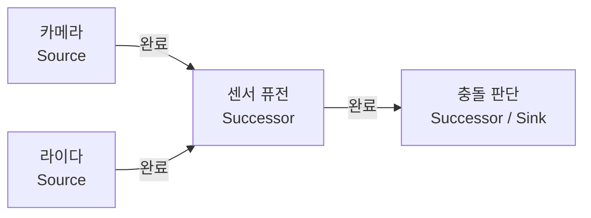
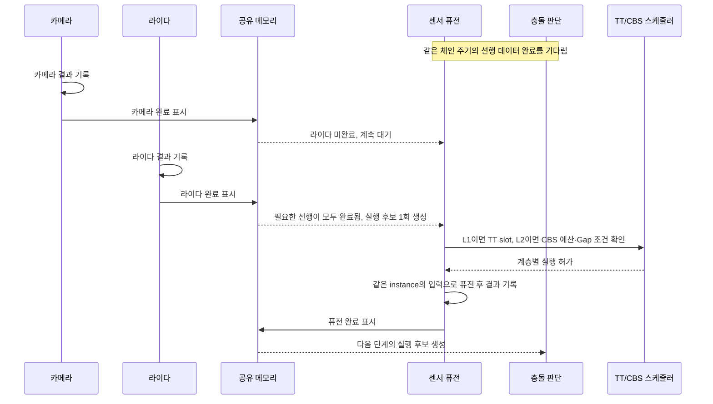

<!--
SPDX-FileCopyrightText: Copyright 2026 LG Electronics Inc.
SPDX-License-Identifier: MIT
-->

# Data-Driven Workload Support: Overview

| 항목 | 내용 |
|:--|:--|
| 목적 | Data-Driven Workload를 무엇에 쓰고, 어떻게 실행하며, 현재 어디까지 지원하는지 빠르게 설명한다 |
| 독자 | 아키텍처, 스케줄러, 애플리케이션, 검증 담당자 |
| 기준 | REQ/SRS/DDR/HLD/LLD-009 Phase 0 설계안과 연계 문서 008·011 |
| 상태 | **Draft / 구현 및 승인 전**. 실행 결과나 인터페이스 승인 완료를 뜻하지 않는다 |

> **한 문장 요약:** 필요한 선행 작업이 모두 끝나면 후행 Task가 실행 후보가 된다. 실제 실행 시점은 Task가 원래 가진 TT 또는 CBS 규칙이 결정한다.

| 살펴볼 질문 | 답 |
|:--|:--|
| **왜 필요한가?** | 고정 시각만으로는 앞 Task가 빨리 끝났을 때 생기는 빈 대기와, 아직 데이터가 없는데 뒤 Task가 깬 문제를 함께 피하기 어렵다 |
| **무엇이 달라지는가?** | `Data-Ready`가 선후 관계를 알리고, TT/CBS가 최종 실행 권한을 결정한다 |
| **지금 어디까지인가?** | Phase 0은 L1/L2 혼합 환경의 기본 `ALL` 체인을 확인한다. 시간 창, timeout, 복구는 후속 단계다 |

상세 요구사항과 결정은 [REQ-009](REQ-009-data-driven-workload.md), [DDR-009](DDR-009-data-driven-workload.md)를 본다. 이 문서는 그 내용을 짧게 잇는 설명서다.

---

## 읽기 전에: 핵심 용어

이 문서를 읽을 때 아래 뜻만 먼저 알면 충분하다. 그 외 구현 약어와 프로토콜 용어는 상세 문서에서 설명한다.

| 용어 | 이 문서에서의 뜻 |
|:--|:--|
| **DAG** | Task 사이의 앞뒤 관계를 나타내는, 순환이 없는 데이터 흐름 그래프 |
| **Source / Successor / Sink** | 시작 Task / 앞 Task를 기다리는 후행 Task / 체인의 마지막 Task |
| **`Data-Ready` / `ALL`** | 직속 선행 Task의 현재 실행 결과가 필요한 만큼 모두 준비된 상태 |
| **실행 후보 / 실행 허가** | 데이터 의존성을 충족한 상태 / CPU에서 실제로 실행해도 된다고 스케줄러가 허용한 상태 |
| **L1 TT / L2 CBS** | 미리 정한 시간에 실행하는 방식 / CPU 예산과 보충 규칙으로 실행을 제한하는 방식 |
| **O / N / 앱** | 그래프와 배치를 만드는 TIMPANI-O / 계획을 적용하는 TIMPANI-N / 실제 데이터를 만들고 완료를 알리는 애플리케이션 |
| **Phase 0 / 1 / 2** | 기본 체인 / 시간·주기 확장 / timeout과 복구 확장 |

가장 중요한 구분은 **`Data-Ready`는 실행 허가가 아니라 실행 후보 조건**이라는 점이다. 시간표와 예산 규칙은 Task의 원래 TT/CBS 계층이 그대로 유지한다.

---

## 1. 무엇을 해결하려는가

`센서 수집 → 센서 퓨전 → 충돌 판단 → 제어`처럼 앞 단계 결과가 준비되어야 다음 단계가 실행되는 작업은 데이터 파이프라인으로 묶여 있다.

고정 시각만으로 이 파이프라인을 깨우면 다음 문제가 생긴다.

- 앞 단계가 일찍 끝나도 예약 시각까지 기다리면 반응이 늦어진다.
- 앞 단계가 늦게 끝났는데 후행 Task가 먼저 깨어나면 준비되지 않은 데이터를 읽을 수 있다.

Data-Driven Workload는 **필요한 선행 데이터가 모두 준비된 직후에만 후행 Task를 실행 후보로 만든다.** 실행할 수 있는지와 언제 실행할지는 Task의 원래 L1 TT 또는 L2 CBS 규칙이 최종 결정한다.

| 핵심 목표 | 의미 |
|:--|:--|
| **정확한 순서** | 모든 직속 선행이 완료되기 전에는 후행 Task가 실행되지 않는다 |
| **빈 대기 축소** | 선행 데이터가 준비되면 다음 검증 없이 불필요한 대기 시간을 만들지 않는다 |
| **기존 스케줄러 유지** | DAG 역할은 Task를 L1/L2로 바꾸지 않으며, TT/CBS가 자체 규칙을 계속 적용한다 |

앱은 실제 데이터(`payload`)를 관리하고 완료 신호만 전달한다. TIMPANI는 데이터 자체를 전송하지 않고, **어떤 Task가 어느 선행 데이터를 기다리는지**와 **실행 후보가 되었는지**만 관리한다.

---

## 2. 무엇이 “ready”인지, 무엇이 “실행”인지

| 활성화 방식 | 실행 후보가 되는 때 | 실행을 결정하는 것 |
|:--|:--|:--|
| **Time-Triggered** | 예약된 주기 시각 | L1 TT slot |
| **Event-Triggered (008)** | 외부 이벤트 도착 | L2 CBS 예산·CPU·Gap |
| **Data-Triggered (009)** | 모든 직속 선행이 완료 | Task의 원래 TT/CBS 규칙 |

009에서 중요한 구분은 다음 두 가지다.

- **`Data-Ready`**: 데이터를 읽어도 되는 상태
- **Dispatch**: 실제로 CPU에서 실행하도록 허용하는 결정

`Data-Ready`만으로 L1 Task가 예약 시각 밖에서 실행되거나, L2 Task가 예산 규칙을 우회해서는 안 된다. `Source`와 `Successor`는 그래프에서의 역할이고 L1/L2는 Task의 실행 계층이다.

### 대표 예시: 카메라 + 라이다

- 카메라만 끝나면 퓨전은 기다린다.
- 라이다까지 끝나면 퓨전이 실행 후보가 된다.
- 퓨전이 L1이면 TT slot에서, L2이면 CBS 예산·Gap 안에서 실행된다.
- 퓨전 완료가 다음 Task의 선행 완료로 전달된다.

`ALL`은 Phase 0의 기본 조건이다. `ANY`는 확장 가능성만 남기고 현재 범위로 사용하지 않는다.

### 시간을 혼동하지 않는 법

| 용어 | 뜻 |
|:--|:--|
| **Hyperperiod** | TT/L1 슬롯 패턴이 반복되는 주기 |
| **Activation Window** | 특정 Task의 실행을 허용하는 시간 구간, Phase 1 이후 |
| **적용 경계** | 런타임 테이블이 새 값으로 바뀌는 시점, [REQ-011](REQ-011-runtime-table-update.md) |
| **E2E deadline** | Source 완료부터 Sink 완료까지 허용되는 전체 지연 |

`Data-Ready` 시점, Task 실행 구간, 테이블 적용 경계는 서로 다른 개념이다.

---

## 3. 왜 단계와 역할을 나누는가

역할을 나누는 이유는 단순하다.

- O가 순서와 실행 가능성을 검증한다.
- N은 전달받은 계획을 실행한다.
- 앱은 데이터 준비 여부만 알린다.
- TT/CBS 스케줄러는 기존 타이밍 규칙을 유지한다.

한 번에 모든 기능을 구현하지 않고 세 단계로 나눈다.

| 단계 | 이번에 확인하는 것 |
|:--|:--|
| **Phase 0** | L1/L2 혼합 환경에서 `ALL` 완료 순서와 기본 연쇄 실행 |
| **Phase 1** | TT 시간 창, CBS 응답시간, `E2E` 보장, 런타임 갱신 |
| **Phase 2** | 미도착 `SKIP`, `DATA_TIMEOUT`, Fallback, 재시작·복구 |

현재 문서는 **Phase 0** 기준이다. 후속 단계 기능을 Phase 0의 완료 조건으로 당겨오지 않는다.

---

## 4. 누가 무엇을 하는가

| 구성요소 | 하는 일 |
|:--|:--|
| **Pullpiri / 입력** | 어떤 Task가 무엇을 기다리는지와 체인 마감 목표를 선언한다 |
| **TIMPANI-O** | 잘못된 그래프를 거절하고 Task의 기존 TT/CBS 계획과 연결한다 |
| **TIMPANI-N** | 전달받은 계획을 적용하고 선행 완료 상태를 실행에 연결한다 |
| **애플리케이션** | 결과 데이터를 기록하고 자기 완료를 알린다 |
| **TT/CBS 스케줄러** | `Data-Ready`가 충족된 Task를 기존 slot·budget 규칙에 따라 실행한다 |
| **Fault Monitor** | 기존 장애를 감시한다. `DATA_TIMEOUT`은 Phase 2 대상이다 |

역할은 명확히 나뉜다.

- O는 그래프와 실행 계획을 만든다.
- N은 그래프나 가능성을 다시 계산하지 않는다.
- 앱은 payload를 전달하고 완료를 알린다.
- `Data-Ready` 경로에는 gRPC나 데몬 IPC를 넣지 않는다.

---

## 5. 데이터가 준비되면 어떻게 이어서 실행되는가?

Data-Driven 실행은 다음 네 단계로 이어진다.

1. **데이터 기록:** 선행 Task가 후행 Task가 읽을 결과를 먼저 기록한다.
2. **완료 표시:** 결과 기록이 끝난 뒤 자신의 완료만 알린다. 여러 후행 Task에 연결되어도 잘못된 전달 계획이나 불일치가 발견되면 일부 Task에만 완료가 전달되지 않는다.
3. **한 번 후보 생성:** 후행 Task가 기대하는 각 선행의 완료가 같은 체인 주기에서 모두 확인되면 실행 후보를 정확히 한 번 만든다. 같은 완료의 반복이나 다른 주기의 늦은 완료는 이 조건을 대신하지 않는다.
4. **실행 허가 확인:** Phase 0에서 L1 Task는 자신의 TT slot에서, L2 Task는 기존 CBS 예산·Gap 조건 안에서 실행된다. `Activation Window`는 Phase 1에서 추가한다.

### 왜 선행마다 완료 표시를 따로 두는가?

카메라 신호가 라이다의 완료를 대신 채울 수는 없다. 각 직속 선행은 자신만의 독립된 완료 조건을 가지며, 선행 수와 완료 조건은 게시 전에 정확히 대응해야 한다. 따라서 한 선행의 반복 완료나 다른 실행 주기의 완료가 부족한 다른 선행을 대신 만족시키지 못한다.

### 잘못된 깨움은 어떻게 막는가?

- **같은 체인 주기의 데이터만 사용:** 결과 기록과 완료 표시가 대응하고, 이전·다음 주기의 입력은 서로 섞이지 않는다.
- **유효한 연결 계획만 적용:** 누락되거나 중복된 선행 연결이 있는 계획은 실행 전에 거절한다.
- **부분 전달을 남기지 않음:** 하나의 완료 신호가 여러 후행 Task로 전달될 때 유효하지 않은 연결이 있으면, 일부만 전달된 상태를 남기지 않는다.
- **제어 신호를 데이터 완료로 오인하지 않음:** 테이블 게시·종료 같은 제어 알림으로는 Task를 실행하지 않는다.
- **기존 실행 조건 유지:** `Data-Ready`만으로 L1의 예약 시각이나 L2의 예산 규칙을 우회하지 않는다.

동기화와 인터페이스 구현 세부는 [LLD-009](LLD-009-data-driven-workload.md)에서 다룬다.

---

## 6. DAG는 어떻게 검증하고 실행하는가?

### 6.1 잘못된 그래프를 먼저 거절한다

| 확인 대상 | 의미 |
|:--|:--|
| **연결** | 모든 선행 Task가 실제로 존재하고, 자기 자신은 선행으로 지정하지 않는다 |
| **식별자** | Task 이름이 중복되거나 이름 해시가 충돌하지 않는다 |
| **순환** | Task들이 앞에서 뒤로 일관된 실행 순서를 만들 수 있다. 모두 배치할 수 없으면 `A → B → A` 같은 순환 고리다 |
| **용량** | Task·선행·후행 연결 수가 지원 범위 안이다 |
| **준비 조건 대응** | 각 직속 선행은 하나의 독립된 완료 조건과 연결되고, 누락되거나 중복된 완료 조건이 없다 |

정확한 이름·해시·완료 조건·용량 규칙은 [LLD-009](LLD-009-data-driven-workload.md)에서 다룬다. O는 선행이 없는 Task부터 차례로 실행 순서를 만들고, 여러 후보 중에서는 항상 같은 순서를 선택한다.

검증에 실패하면 후보만 버리고 기존 확정 모델과 활성 테이블은 바꾸지 않는다. N은 그래프를 다시 만들지 않고 수신한 연결과 로컬 적용 가능성만 확인한다.

### 6.2 준비 신호와 실제 실행을 구분한다

1. 선행 Task가 결과 데이터를 기록한 뒤 `Data-Ready`를 알린다.
2. 후행 Task의 직속 선행 전원이 같은 체인 주기에서 완료된 경우에만 `ALL` ready가 된다.
3. Task는 기존 실행 방식에 따라 실행한다.
   - L1 Task: `ALL` ready가 있어도 자신의 허용 TT slot에서만 wake 및 실행
   - L2 Task: `ALL` ready 후 release되며 실제 실행은 기존 CBS budget/Gap 조건에 따름
4. 실제 payload는 앱이 관리하며, 공유 상태에는 준비 여부와 실행 허가만 둔다.

따라서 Data-Ready는 “당장 실행”이 아니라 **“데이터 의존성을 충족했다”** 는 신호다. 실제 실행은 원래 Task의 L1/L2 규칙이 최종 결정한다.

### 6.3 단계별 보장 범위

| 단계 | 보장하는 것 |
|:--|:--|
| **Phase 0** | 잘못된 DAG·준비 조건 대응 거절, 반복 또는 다른 실행 instance 완료의 `ALL` 오판 방지, 부분 알림·제어 신호 실행 방지, TT/CBS 기존 실행 규칙 준수 |
| **Phase 1** | TT Window와 CBS 응답시간을 포함한 혼합 DAG의 `E2E` 검증 |
| **Phase 2** | 입력 누락 `SKIP`, 최초 원인 `DATA_TIMEOUT`, Fallback과 복구 |
---

## 7. Phase 0에서 어디까지 확인하는가

| 구분 | Phase 0 기준 |
|:--|:--|
| **보장** | 올바른 DAG와 일관된 준비 조건 대응, 같은 체인 주기의 모든 선행 완료 뒤 실행, 부분 알림·제어 wake 실행 방지, 기존 L1/L2 Task의 기본 회귀 없음 |
| **시험 형태** | 단일 노드·고정 테이블·명확한 주기 조건에서 기본 체인 연속 구동 |
| **실행 계층** | Task는 원래 L1 TT 또는 L2 CBS 계층을 유지하며, `ALL`은 각 계층의 실행 허가만 추가한다 |
| **아직 보장하지 않음** | `Activation Window`, 정량 `E2E`, Pipeline 포함 런타임 갱신, 장애 복구·Fallback |
| **연계 기준** | [REQ-011](REQ-011-runtime-table-update.md)의 게시 안정성·제어 wake 구분을 따라 일반 TT 갱신 회귀를 막는다 |

Phase 0 완료는 기본 Data-Driven 체인이 동작함을 뜻하며, 기능안전·Fail-Safe 운용 승인이나 모든 실시간 보장을 뜻하지 않는다.

---

## 8. 무엇을 예제로 확인하는가

Phase 0은 4개 Task의 센서 퓨전 체인으로 핵심 동작을 보여준다.

| Task | 역할 | 이 예제에서 확인할 것 |
|:--|:--|:--|
| 카메라 | Source | 자신의 처리 완료만 알린다 |
| 라이다 | Source | 카메라와 별개의 완료 상태를 갖는다 |
| 센서 퓨전 | Successor | 카메라와 라이다가 모두 끝난 뒤에만 실행된다 |
| 충돌 판단 | Successor / Sink | 퓨전 완료 뒤에 연쇄 실행된다 |

예제 Task는 각각 TT 또는 CBS로 바꾸어 검증한다. 따라서 TT→TT, TT→CBS, CBS→TT, CBS→CBS 연결이 모두 같은 데이터 의존성 규칙을 사용함을 확인한다.

Phase 0 합격 여부는 다음 네 가지로 판단한다.

| 관찰 | 합격 조건 |
|:--|:--|
| **정상 체인** | 선행 완료 순서가 어긋나지 않고 각 Task가 원래 TT/CBS 규칙대로 실행된다 |
| **부분 입력** | 필수 선행 하나가 비었거나 완료가 다른 체인 주기에 속하면 후행 실행은 0회다 |
| **잘못된 입력·깨움** | 잘못된 그래프·준비 조건 대응·공유 상태는 적용 전에 거절되고, 제어 wake는 작업 실행으로 이어지지 않는다 |
| **회귀·결정성** | 기존 TT/CBS 동작에 회귀가 없고, 입력 순서를 바꿔도 같은 실행 계획이 만들어진다 |

정확한 수치와 각 시험 ID는 [SRS-009](SRS-009-data-driven-workload.md)에서 확인한다.

---

## 9. 무엇을 관측하고 어떤 순서로 진행하는가

### Phase 0 관측

- **순서:** 모든 선행 완료 뒤에만 후행이 시작했는가?
- **실행 계층:** L1 Task는 TT 규칙을, L2 Task는 CBS 규칙을 지켰는가?
- **가짜 wake:** 일부 입력, 테이블 게시, 종료 신호로 실행되지 않았는가?
- **회귀:** Data-Driven 연결을 추가한 뒤 기존 TT/CBS 동작에 변화가 없는가?

호스트 단위 시험과 실제 Linux `sched_ext` 타깃 시험은 구분한다. 타깃에서 실행하지 않은 항목은 미검증으로 남긴다.

### 권장 진행 순서

1. 공통 DAG 메타와 애플리케이션 API의 승인 범위를 확정한다.
2. O에 DAG 검증과 기존 TT/CBS 실행 계획 연결을 구현한다.
3. N과 앱에 `ALL` 준비 신호 및 계층별 실행 허가를 연결한다.
4. TT→TT, TT→CBS, CBS→TT, CBS→CBS 기본 체인과 부분 입력 사례를 검증한다.

---

## 10. 무엇을 합의해야 하는가

| 결정 | 검토 질문 |
|:--|:--|
| **Pipeline 선언 형식** | Task의 선행 관계와 L1/L2 실행 클래스를 독립적으로 어떻게 표현하는가? |
| **공유 메모리/API** | Data-Driven 상태가 008·011의 기존 SHM 계약과 어떻게 공존하는가? |
| **TT/CBS 실행 연결** | `ALL` 완료 후에도 각 계층의 slot, 예산, Gap 규칙을 어떻게 그대로 지키는가? |
| **후속 시간·복구 계약** | Phase 1의 혼합 DAG `E2E`와 Phase 2의 `SKIP`·Fallback·재시작을 어떤 기준으로 추가하는가? |

Phase 0에서는 **Task 클래스 변경 없이 L1/L2 혼합 기본 체인이 동작함**까지 확인한다. 아래 행의 프로토콜·SHM·공개 API 변경은 Project Leader 승인 후 적용한다.

---

## 11. 상세 문서는 언제 보는가

| 문서 | 볼 때 |
|:--|:--|
| [REQ-009](REQ-009-data-driven-workload.md) | 지원 범위와 요구사항을 확인할 때 |
| [SRS-009](SRS-009-data-driven-workload.md) | Phase 0의 정확한 검증 조건과 합격 기준을 확인할 때 |
| [DDR-009](DDR-009-data-driven-workload.md) | 설계 결정과 그 이유를 확인할 때 |
| [HLD-009](HLD-009-data-driven-workload.md) | O, N, 앱의 책임과 전체 흐름을 확인할 때 |
| [LLD-009](LLD-009-data-driven-workload.md) | 구조, 상태, 알고리즘과 구현 순서를 확인할 때 |
| [OVERVIEW-008](../DDR-008-event-driven-workload/OVERVIEW-008-event-driven-workload-support.md) | Event-Driven 모델과의 경계를 비교할 때 |
| [REQ-011](REQ-011-runtime-table-update.md) / [DDR-011](DDR-011-runtime-table-update.md) | runtime table update와 생명주기 제약을 비교할 때 |

**권장 읽기 순서:** Overview → REQ → DDR → HLD → SRS → LLD. 008과 011은 공통 SHM, runtime update, 종료 계약을 다룰 때 함께 확인한다.
