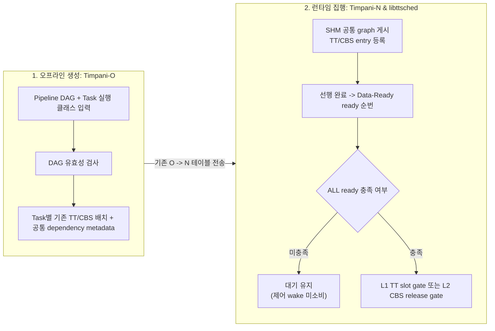
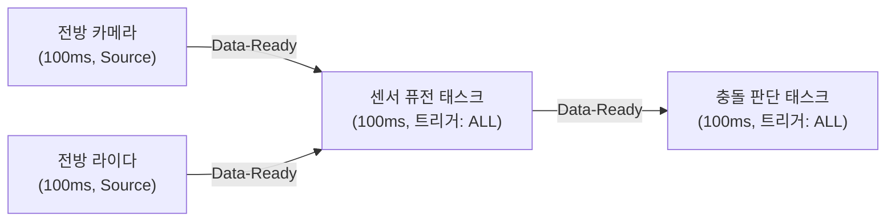

<!--
SPDX-FileCopyrightText: Copyright 2026 LG Electronics Inc.
SPDX-License-Identifier: MIT
-->

# REQ-009: Data-Driven Workload 지원 — 요구사항 정의서

**작성일:** 2026-10-27  
**최종 수정:** 2026-10-31 (Phase 0/1/2 단계 기준 분리, Phase 0 시험 경계·최소 동작·수용 기준·후속 문서 기준 명시 및 DDR-011 Phase 0 정합 반영)  
**상태:** Draft  
**현재 설계 기준:** Phase 0 — Data-Driven Workload 기본 체인 동작 확인  
**작성자:** Human + AI  
**상위 요구사항:** [SRS-000](SRS-000-timpani-system.md) §5.1 `REQ-DD-001`  
**관련 문서:** [DDR-001](DDR-001-workload-model.md)(워크로드 모델), [DDR-002](DDR-002-scheduling-architecture.md)(스케줄링 아키텍처), [DDR-003](DDR-003-interface-protocol.md)(인터페이스/프로토콜), [DDR-004](DDR-004-resource-allocation.md)(자원 할당), [DDR-005](DDR-005-sched-ext-bpf-scheduler.md)(BPF 스케줄러), [DDR-006](DDR-006-communication-architecture.md)(통신), [DDR-007](DDR-007-tt-cbs-integrated-scheduling.md)(TT/CBS), [REQ-011](REQ-011-runtime-table-update.md)·[DDR-011](DDR-011-runtime-table-update.md)(런타임 테이블 갱신), [DDR-012](DDR-012-fault-management.md)(장애 관리)  
**후속 문서:** [SRS-009](SRS-009-data-driven-workload.md), [HLD-009](HLD-009-data-driven-workload.md), [DDR-009](DDR-009-data-driven-workload.md), [LLD-009](LLD-009-data-driven-workload.md), PLAN-009. 현재 개정 대상 문서는 모두 **Phase 0 기준**으로 작성하며, 전체 단계(Phase 1/2)의 기능을 현재 구현 범위로 자동 승계하지 않는다(§8.2).

> **문서의 역할.** 본 문서는 **요구사항 정의서(What & Why)** 이다. 선행 태스크의 데이터 준비 완료(`Data-Ready`)에 의해 후행 태스크가 실행될 때 TIMPANI가 *무엇을* 보장해야 하고 *왜* 그래야 하는지를 시스템 수준에서 규정한다. 세부 프로토콜 필드, 공유 메모리(SHM) 비트 레이아웃, 위상 정렬 알고리즘은 본 문서에서 고정하지 않으며, 이는 [SRS-009](SRS-009-data-driven-workload.md)에서 명세하고 [DDR-009](DDR-009-data-driven-workload.md)·[LLD-009](LLD-009-data-driven-workload.md)에서 결정·상세화한다.
>
> **키워드 규약:** **SHALL** = 해당 단계 필수, **SHOULD** = 권고, **MAY** = 선택.

---

## 1. 목적과 범위

### 1.1 목적

TIMPANI의 기존 활성화 방식(Time-Triggered / Event-Triggered)을 확장하여, **선행 태스크의 데이터 준비 완료(`Data-Ready`)**에 의해 후행 태스크가 연쇄 실행되는 **Data-Driven Workload** 기능을 단계적으로 구현하기 위한 요구사항을 정의한다. 현재는 **Phase 0의 기본 Data-Driven 체인 동작 확인**을 설계·구현 대상으로 삼고, `Activation Window` 기반 실행 시점 통제·오프라인 E2E 검증·정상 런타임 갱신 정합성은 **Phase 1**, 입력 누락 타임아웃 `SKIP`·원인 장애 보고·비정상 상태 안전 초기화(Fail-Safe)는 **Phase 2**로 분리한다.

전체 요구사항(§5)은 최종 목표와 추적성을 보존하기 위해 유지한다. **현재 적용 범위는 §1.5, 현재 수용 기준은 §7.1**을 따른다. 후속 단계(Phase 1/2) 요구사항의 미충족은 Phase 0의 미완료 사유가 아니며, Phase 0 완료가 전체 기능 또는 기능안전(ISO 26262) 수준의 충족을 뜻하지 않는다.

### 1.2 배경 및 요구사항 정식화

#### 1.2.1 활성화 모델 비교

SDV/자율주행 환경(센서 → 인지 → 퓨전 → 판단 → 제어)에서는 개별 태스크의 주기 준수뿐 아니라 **데이터 흐름 체인 전체의 실행 순서와 종단 간(`E2E`) 반응 시간**이 중요하다. 기존 고정 오프셋(TT) 방식만으로는 선행 센서의 최악 실행 시간(`WCET`) 끝까지 대기해야 하므로 조기 완료 시 대기 시간이 낭비되고, 선행 태스크 미완료 시 준비되지 않은 데이터를 읽을 위험이 있다.

| 활성화 방식 | 활성화 조건 | 실행 계층 | 적용 대상 |
|:---|:---|:---|:---|
| **Time-Triggered** | 고정 타이머 | L1 TT | 주기 태스크 |
| **Event-Triggered** | 외부 Sporadic Event | L2 CBS | 비주기 태스크 |
| **Data-Triggered** *(본 문서)* | 직속 선행 `Data-Ready`(`ALL`) 완료 | **원래 Task의 L1 또는 L2 계층을 유지** | DAG의 Successor |

Data-Driven Workload는 **그래프 역할과 실행 계층을 분리**한다. `Source`/`Successor`는 `predecessors`가 정하는 DAG 역할이고, L1/L2는 Task의 기존 `TemporalClass`가 정한다. 따라서 L1 또는 L2 Task 모두 Source·Successor가 될 수 있으며, 선행 데이터 준비가 `ALL`을 만족한 뒤 각 계층의 기존 발화·예산·CPU 게이트를 거쳐 실행한다.

#### 1.2.2 Phase 0 기본 동작 흐름 (현재 설계 기준)

아래 다이어그램은 **현재 Phase 0 범위**에서 동작하는 기본 체인 흐름이다. (`Activation Window` 열림/닫힘 통제, `E2E deadline` `Feasibility` 검사 및 정상 런타임 갱신 경계 전환은 Phase 1, 미도착 타임아웃 `SKIP` 및 `Fault Monitor` `DATA_TIMEOUT` 보고는 Phase 2에서 확장한다.)

#### 1.2.3 정규화된 시스템 요구 진술 (전체 목표 기준)

아래 진술은 **Phase 0~2 전체 완료 시의 목표**이며 §5 요구사항의 근거가 된다. Phase 0에 모든 성질을 일괄 요구하지 않으며, 단계별 적용 범위는 §1.5와 §5의 단계 표기를 따른다.

| ID | 정규화된 요구 진술 |
|:---|:---|
| **SR-DD-01** | 시스템은 태스크 간 선행 데이터 의존성을 비순환 방향 그래프(DAG) 형태의 **Pipeline**으로 선언받으며, 유효하지 않은 그래프(순환, 자기 참조, 미존재 참조)는 스케줄 생성 단계에서 거부해야 한다. |
| **SR-DD-02** | Pipeline 스케줄 생성과 가능성(`Feasibility`) 판단은 오직 **`Timpani-O`** 만이 수행하며, **`Timpani-N`** 은 위상 정렬이나 스케줄 가능성을 재계산하지 않고 전달받은 테이블의 로컬 적용 적합성만 확인하여 집행한다. |
| **SR-DD-03** | Data-Driven DAG는 Task의 L1/L2 실행 계층을 변경하지 않는다. L1 Task는 TT 게이트, L2 Task는 CBS 게이트를 사용하며 Source/Successor 역할과 독립적으로 배치된다. |
| **SR-DD-04** | 후행 태스크는 직속 선행 `Data-Ready`(`ALL`)가 충족되기 전에 실행되지 않으며, 제어 wake를 `Data-Ready`로 소비하지 않는다. |
| **SR-DD-05** | `Data-Ready` 전달은 SHM + futex로 공통 처리하고, 실제 dispatch는 Task의 기존 실행 계층(L1 TT 또는 L2 CBS)에 위임한다. |
| **SR-DD-06** | `Timpani-O`는 Task의 원래 계층별 스케줄 가능성(TT 슬롯/Window 또는 CBS 예산/Gap)을 검증하고, DAG의 준비 조건은 별도 공통 메타데이터로 전달한다. |
| **SR-DD-07** | 전체 단계 완료 시 후행 태스크는 허용 시간 창과 `E2E deadline`을 지키고(Phase 1), 입력 누락 시 `SKIP` 및 최초 원인 `DATA_TIMEOUT` 보고로 연쇄 지연을 차단한다(Phase 2). 런타임 갱신에서는 [REQ-011](REQ-011-runtime-table-update.md)의 의존성·상태 전환 원칙을 따른다. |

### 1.3 범위에 포함되는 것

아래는 전체 단계(Phase 0~2)의 기능 범위이다. **현재 설계·구현에 포함되는 범위는 §1.5에서 한정한다.**

- 단일 노드에서 L1 TT 또는 L2 CBS로 분류된 Task를 DAG로 연결하는 Data-Driven Pipeline 선언·검증·연쇄 실행
- O는 Task의 원래 실행 계층을 유지한 채 DAG 준비 조건을 공통 메타데이터로 생성하고, N은 TT/CBS별 기존 발화·dispatch 경로에 연결
- 다중 선행 입력 `ALL` 동기화와 `libttsched` Data-Ready API
- 계층별 TT 슬롯/Window 또는 CBS 예산/Gap 검증, FFI 및 `E2E deadline` `Feasibility` 검사

`Source`/`Successor`는 DAG 역할일 뿐 L1/L2를 결정하지 않는다. Source도 L2 외부 Event로 활성화될 수 있고, Successor도 L1 TT 또는 L2 CBS로 실행될 수 있다.
- 입력 누락 타임아웃 시 `SKIP` 격리, Sink Fallback 유지 및 원인 선행 태스크 `DATA_TIMEOUT` 보고 *(Phase 2)*
- [REQ-011](REQ-011-runtime-table-update.md) 런타임 테이블 갱신과의 공유 인터페이스 호환성*(Phase 0)*, 정상 경계 전환 정합성*(Phase 1)*, 비정상/복구 상태 초기화*(Phase 2)*

### 1.4 범위에서 제외되는 것

- 일반적인 CPU 할당·슬롯 배치 정책 자체([DDR-004](DDR-004-resource-allocation.md), [DDR-007](DDR-007-tt-cbs-integrated-scheduling.md)), 런타임 테이블 갱신 트랜잭션·상태 기계 자체([REQ-011](REQ-011-runtime-table-update.md)), 장애 복구 정책 결정 로직 자체([DDR-012](DDR-012-fault-management.md))
- Schedule Table에 표현되지 않는 L3/L4(`NonSafety`) 워크로드의 내부 스케줄링 ([DDR-002](DDR-002-scheduling-architecture.md))
- **분산 파이프라인 (Multi-Node Pipeline)**: 네트워크(TSN/gPTP)를 경유하는 노드 간 DAG 스케줄링
- **이종 가속기 연계 (GPU/NPU Modeling)**: AI 추론 가속기 비동기 실행 구간 모델링 (`REQ-AI-001`)
- **Non-harmonic 다중 주기 및 LET 버퍼**: 배수 관계가 아닌 주기(예: `33ms` + `100ms`) 간 링버퍼/LET 상태 관리
- **동적 조기 실행 (Early Release)**: `Activation Window` 시작 시각 이전 CPU 유휴 구간에서의 동적 슬롯 조정
- **`ANY` 시퀀스 고도화**: 다중 시퀀스 중 하나 이상의 입력으로 실행하는 구조
- **실행 중 CPU 런타임 마이그레이션**: Partitioned Scheduling 원칙상 금지하며, CPU 변경은 O가 생성한 새 테이블 적용 시에만 수행
- **Pipeline 파라미터 제자리 변경(`UPD-MODIFY`) 및 `Hyperperiod` 변경 갱신**: [REQ-011](REQ-011-runtime-table-update.md) Phase 1 이후의 후속 확장 과제

### 1.5 단계별 구현 범위와 현재 기준

#### 1.5.1 단계 정의

Data-Driven Workload는 [REQ-011](REQ-011-runtime-table-update.md)과 동일한 **Phase 0 / Phase 1 / Phase 2** 3단계 체계로 구현한다.

| 단계 | 목적 | 구현 범위 | 완료 판단 |
|:---|:---|:---|:---|
| **Phase 0 — 기본 동작** | Data-Driven 체인이 실행 계층과 독립적으로 동작함을 확인 | 고정 테이블에서 DAG 검증·`ALL`·공통 SHM 상태를 확인하고, L1 Task는 TT 게이트, L2 Task는 CBS 게이트를 거쳐 실행한다. L1/L2 혼합 연결을 최소 조합으로 검증 | §7.1의 수용 기준 충족 |
| **Phase 1 — 정밀 시간·배치·갱신** | 계층별 마감 및 `E2E` 보장 | TT `Activation Window`, CBS TT Gap/예산 검증, Harmonic 주기, `E2E Feasibility`, 정상 런타임 갱신 | Phase 1 SRS |
| **Phase 2 — Fail-Safe** | 입력·갱신 이상 시 장애 격리 | Window 종료 `SKIP`, 최초 원인 `DATA_TIMEOUT`, Sink Fallback, 갱신·재시작 상태 초기화. 실행 계층은 갱신 중 임의 변경하지 않음 | Phase 2 SRS |

단계는 누적된다. 후속 단계는 앞 단계의 정상 동작을 유지하면서 기능을 보강한다. **이관은 신규 구현·검증의 유예이지, 기존 동작이나 안전장치를 제거할 허용이 아니다.** Phase 0에서도 `Timpani-O`/`Timpani-N` 역할 분리, RT critical path 규율, 기존 L1/L2 하위 호환성, [DDR-011](DDR-011-runtime-table-update.md) Phase 0의 SHM 유효 게시 확인 및 인터페이스 변경 사전 승인 제약은 유지한다.

#### 1.5.2 Phase 0의 시험 경계

- **대상 워크로드:** 고정 `E/H`와 동일 주기의 기본 체인에서 L1/L2 Task가 Source 또는 Successor 역할을 맡는 조합을 검증한다. 역할은 실행 계층을 결정하지 않으며, 실제 계층은 입력 Task의 `TemporalClass`를 따른다.
- **실행·상태 경계:** `ALL`은 공통 ready 조건이다. L2 Task는 CBS 예산/Gap dispatch에 즉시 release하고, L1 Task는 `ALL`이 충족된 경우에만 다음 허용 TT 슬롯에서 dispatch한다. Phase 0 시험은 L1 Successor의 `ALL`이 해당 슬롯 전에 충족되는 정상 조건만 사용한다.
- **런타임 테이블 갱신([DDR-011](DDR-011-runtime-table-update.md))과의 경계:**
  - Phase 0 시험 중에는 **Pipeline이 포함된 테이블에 대한 런타임 갱신(`UPD-REPLACE / ADD / REMOVE / CLEAR`)을 수행하지 않는다**. Pipeline 포함 테이블의 정상 경계 전환 정합성(`REQ-DD-016`)은 Phase 1, 갱신 실패·롤백·복구 `STOP`·재시작 시 상태 초기화(`REQ-DD-014`)는 Phase 2로 이관한다.
  - 단, **[DDR-011](DDR-011-runtime-table-update.md) Phase 0 기준선과의 공유 인터페이스 정합**은 Phase 0 필수 범위이다:
    1. `/timpani_ttsched` 기존 784바이트 prefix는 바꾸지 않는다. Pipeline extension은 `magic`, ABI `version`, 전체 `abi_size`, 실제 `fstat()` 크기, 안정 `generation`, Task 신원을 모두 확인한 경우에만 접근한다. 구 SHM에서는 기존 TT API만 유지하고 Pipeline API는 `ENOTSUP`을 반환한다.
    2. commit guard는 packed `ready_state`의 단일 64비트 CAS(mask reset + ready-sequence 증가), L2/L1 `dispatch_counter` 갱신 및 futex wake를 게시 세대 전환과 직렬화한다. 64비트 CAS는 대상 환경에서 lock-free여야 하며, `dispatch_counter`만 futex wait/wake word로 사용한다.
    3. 테이블 게시 알림, 종료 알림, 슬롯 재사용 등 `dispatch_counter` 증가가 없는 **제어 wake**는 후행 태스크 실행으로 소비하지 않는다. Pipeline API는 publish/write-permission/ABI 실패를 `errno`로 구분해 변경 없이 실패해야 한다.
    4. Pipeline을 포함하지 않는 일반 L1 TT 테이블에 대해서는 [REQ-011](REQ-011-runtime-table-update.md) Phase 0 정상 갱신 수용 기준(`AC-P0-01` ~ `08`)에 회귀가 없어야 한다.
  - **단계 경계:** Phase 0은 최초 게시·무효화와 고정 Pipeline commit 직렬화를 요구하지만 Pipeline을 포함한 정상 런타임 갱신은 수행하지 않는다. Phase 1은 같은 guard를 Pipeline 경계 갱신에 적용하고, Phase 2는 갱신 실패·rollback·재시작에서 남은 guard/상태 회수를 추가한다.
- **입력 및 역할 분담:** O는 DAG와 Task의 기존 L1/L2 배치를 각각 검증한다. N은 공통 SHM 그래프만 게시하고, TT Task는 TimerMaster/TT gate, CBS Task는 CBS gate를 사용한다. `Data-Ready` 자체는 실행 계층을 재분류하거나 CPU를 바꾸지 않는다.
- **보장 수준:** 부분 선행·제어 wake 시 미실행과 L1/L2 계층별 dispatch 조건을 확인한다. 타임아웃 `SKIP`, `DATA_TIMEOUT`, 정량적 최악 `E2E`는 후속 단계 대상이다.

#### 1.5.3 Phase 0에서 요구하는 최소 동작

§5의 단계에 `0`이 포함된 항목은 **아래 내용만 Phase 0에 적용**한다. 다른 단계가 함께 표기된 항목(`0/1`, `0/1/2`)의 나머지 상세 의무는 후속 단계로 이관한다. 이는 동일 ID의 단계별 구체화이며 해당 요구사항 전체를 Phase 0에서 완료했다는 뜻이 아니다.

| 대상 요구사항 | Phase 0 적용 내용 | 후속 보강 |
|:---|:---|:---|
| **REQ-DD-001** | 고정 테이블 생성 시 구조화 선행 참조 `TaskReference(workload_id, task_id)`를 해석한다. 빈 `workload_id`는 현재 workload를 뜻하며 Phase 0에는 같은 workload 내 참조만 허용한다. 순환·자기 참조·미존재 참조·Task 식별자 쌍의 중복/해시 충돌·용량 초과는 사전 거절하고 확정 모델을 유지한다 | cross-workload 참조, `E2E deadline` `Feasibility`, 런타임 갱신 후보 검증: Phase 1 |
| **REQ-DD-002** | `TaskInfo.temporal_class` 명시값은 Task의 실행 계층으로 사용하고, 미지정이면 `SchedInfo.temporal_class`를 상속한다. O는 DAG 역할과 계층을 독립해 TT/CBS 표현과 공통 DAG 메타를 분리하고 O→N은 `(workload_id_hash, task_id_hash)` 쌍으로 식별한다 | 계층별 정밀 검증 및 cross-workload Pipeline: Phase 1 |
| **REQ-DD-004** | Source는 기존 TT/CBS 경로를 유지한다. L1 Successor는 `ALL` pending ready가 있을 때만 자신의 TT slot에서 `dispatch_counter`를 1회 열고, L2 Successor는 `ALL` commit 시 `dispatch_counter`를 열어 BPF CBS gate에 release한다. 제어 wake는 실행으로 소비하지 않는다 | `Activation Window`/slot miss 만료: Phase 1, `SKIP`: Phase 2 |
| **REQ-DD-005** | packed predecessor 상태에서 `ALL` 충족 시 계층별 dispatch를 주기당 1회 허용하고 완료 상태를 원자적으로 소비한다. Phase 0에서 앱은 실행 job 완료 후 `signal_ready()`를 최대 1회 호출하고 성공 반환 후 재호출하지 않는다 | job token/idempotency 및 Harmonic 다중 주기: Phase 1 |
| **REQ-DD-007** | RT critical path에서 블로킹 IPC/gRPC·동적 할당·커널 특권 없이 SHM 원자 연산 + `futex`로 `Data-Ready` 전달 | 멀티코어 동시 경합 정량 검증: Phase 1 |
| **REQ-DD-008** | L1 Successor는 ready + 자신의 TT slot gate, L2 Successor는 ready + 기존 CBS CPU/budget/Gap gate를 만족한다. Phase 0에서는 계층별 `dispatch_counter` gate만 집행한다 | `Activation Window`와 Gap 정밀화: Phase 1 |
| **REQ-DD-015** | 011 안정 게시와 extension `magic/version/abi_size`, Task 신원, commit guard를 확인한다. packed `ready_state` 단일 64비트 CAS와 `dispatch_counter` 갱신/wake를 게시자와 같은 세대 순서로 직렬화하고, 구 ABI·무효 snapshot·writer-pending 상태에서는 변경 없이 실패한다 | Pipeline 정상 갱신 경계 적용: Phase 1, 실패/재시작의 guard 회수: Phase 2 |
| **REQ-DD-013** | 고정 기본 체인에서 TT→TT, TT→CBS, CBS→TT, CBS→CBS 연결과 부분 입력/제어 wake, 무효 DAG, 기존 TT/CBS 회귀 및 세대-commit 경쟁을 검증 | 혼합 계층 `E2E`·정상 갱신: Phase 1, Fail-Safe: Phase 2 |

현재 후속 문서([SRS-009](SRS-009-data-driven-workload.md), [HLD-009](HLD-009-data-driven-workload.md), [DDR-009](DDR-009-data-driven-workload.md), [LLD-009](LLD-009-data-driven-workload.md), PLAN-009)는 이 절의 내용만 상세화한다. 후속 단계 항목은 추적용 목록으로 보존하되, 그 내부 상태 플래그·Window 종료 타이머·`SKIP`/복구 상태 기계를 Phase 0 구현 작업으로 끌어오지 않는다.

---

## 2. 용어 정의

아래 용어는 전체 목표에 공통으로 사용한다([DDR-001](DDR-001-workload-model.md) ~ [DDR-012](DDR-012-fault-management.md) 및 [REQ-011](REQ-011-runtime-table-update.md) 표준 통일). `Activation Window` 및 Pipeline 적용 경계 전환은 Phase 1, `DATA_TIMEOUT` 및 비정상 상태 초기화는 Phase 2에서 상세화하며, **용어의 존재만으로 Phase 0 구현을 요구하지 않는다.**

| 용어 | 본 문서군 표준 표기 및 정의 | 기준 문서 |
|:---|:---|:---|
| **Pipeline** | DAG 의존성으로 연결된 워크로드/태스크 실행 체인 (공통 `Hyperperiod`, `E2E deadline` 보유) | [DDR-001](DDR-001-workload-model.md) §2 |
| **Task (Source / Successor / Sink)** | 그래프 역할이다. Source는 선행 없는 시작 Task, Successor는 `predecessors`가 있는 Task, Sink는 체인 마지막 Task다. 어느 역할도 L1/L2를 강제하지 않는다 | 본 문서군 |
| **Data-Ready** | 선행 Task가 출력 데이터를 게시한 뒤 후행 Task의 논리적 ready 상태를 갱신하는 공통 신호. 실제 dispatch는 Task 실행 계층에 위임한다 | 본 문서군 |
| **실행 어댑터** | Data-Driven ready 조건을 계층별 scheduler에 연결한다. Phase 0에서 L1은 Timer Master TT slot gate, L2는 `ALL` commit release + BPF CBS budget/Gap gate를 사용한다. `Activation Window`는 Phase 1이다 | 본 문서군, DDR-007/008 |
| **트리거 조건 (`ALL` / `ANY`)** | 직속 선행 ready 조건. Phase 0은 `ALL` 필수, `ANY`는 확장만 고려한다 | 본 문서군 |
| **Activation Window** | 오프라인에서 검증된 후행 활성화·실행 허용 구간 (`[EST, window_end_us]`). *(Phase 1 적용)* | 본 문서군 |
| **Harmonic 주기** | 태스크 주기들이 배수 관계를 이루어 `Hyperperiod` 폭발이 없는 주기 구성 | [DDR-004](DDR-004-resource-allocation.md) §8.A |
| **Timer Master / Fault Monitor** | `timpani-n`(`userspace`) 내 정밀 타이머 발화 스레드 및 장애 수집·보고 컴포넌트 | [DDR-002](DDR-002-scheduling-architecture.md), [DDR-012](DDR-012-fault-management.md) |
| **Deadline miss (`DMISS`) / `DATA_TIMEOUT`** | 실행 마감 초과(`DMISS`) 및 `Activation Window` 종료 시점의 선행 데이터 미도착 Fault 유형 *(후자는 Phase 2 적용)* | [DDR-003](DDR-003-interface-protocol.md), [DDR-012](DDR-012-fault-management.md) |
| **적용 경계 (Activation instant)** | 런타임 갱신으로 준비된 후보 Schedule Table이 활성 테이블이 되는 공통 `Epoch` 격자의 `Hyperperiod` 경계(`T = E + kH`). 태스크 단위 실행 허용 구간인 **`Activation Window`와 다른 개념**이므로 본 문서군에서는 "적용 경계"로 표기한다 | [REQ-011](REQ-011-runtime-table-update.md) §2 |
| **게시 / 제어 wake** | `Timer Master`가 `/timpani_ttsched` SHM에 테이블 이미지를 기록·유효화하는 절차(게시)와, 게시·종료 등을 알리기 위한 `futex` wakeup(제어 wake). 제어 wake는 잡 실행이나 `Data-Ready`로 취급되지 않는다 | [REQ-011](REQ-011-runtime-table-update.md) F-051, [DDR-011](DDR-011-runtime-table-update.md) D-P0-05 |

---

## 3. 이해관계자 요구 및 유사 프로젝트 참조 교훈

### 3.1 이해관계자와 요구

아래는 전체 단계의 이해관계자 요구이다. Phase 0에서는 §1.5의 시험 경계와 최소 동작을 적용한다.

| 이해관계자 | 요구 |
|:---|:---|
| **Pullpiri** | DAG 의존성, Task 실행 클래스, timing, `E2E`를 공급하고 거절 사유를 받는다. |
| **Timpani-O** | DAG 검증과 Task의 기존 TT/CBS 배치를 수행하는 유일한 주체다. |
| **Timpani-N** | TT/CBS entry와 공통 DAG metadata를 로컬 확인·집행한다. |
| **Pipeline 앱** | 출력 데이터 게시 후 `Data-Ready`를 전달한다. |
| **기능안전 담당자** | 계층별 TT/CBS 격리, 실행 순서, timeout의 증거를 확보한다. |

### 3.2 유사 프로젝트 핵심 교훈

| 참조 대상 | 핵심 특징 | Timpani 설계 반영점 | 적용 단계 |
|:---|:---|:---|:---:|
| **ROS 2 (rclc Executor)** | `ALL`/`ANY` 트리거 조건, 정적 실행 순서 | 다중 센서 취합용 `ALL` 트리거 및 결정적 실행 순서 채택 | **Phase 0** |
| **NVIDIA STM (Alpamayo 배포)** | 오프라인 DAG 컴파일 + 런타임 단순 집행 | 런타임 그래프 탐색 배제, 오프라인 합성된 정적 테이블·인덱스만 집행 | **Phase 0** |
| **MotionWise (TTTech)** | Time-Triggered 기반 위 Dataflow 결합 | 오프라인에서 검증된 `Activation Window` 내에서만 데이터 트리거 허용 | Phase 1 |
| **Apex.OS (Apex.Grace)** | 태스크 체인화 및 실행 기한·누락 감시 | 체인 단위 `E2E deadline` 검증(Phase 1) 및 입력 누락 `SKIP`·장애 감시(Phase 2) | Phase 1 / 2 |

---

## 4. 운영 시나리오

각 시나리오는 단계별 목표 동작을 기술한다. **Phase 0에서는 `UC-DD-01`, `UC-DD-02`, 그리고 `E-DD-01`의 기본 무효 DAG 거절만 §1.5의 고정 테이블 조건에서 확인**한다. `UC-DD-03`(Harmonic 다중 주기 및 `Activation Window`), `UC-DD-04`(Pipeline 포함 테이블 정상 갱신)는 Phase 1, `E-DD-02`(타임아웃 `SKIP` 및 원인 보고)와 `E-DD-03`(비정상/복구 상태 초기화)은 Phase 2에 해당한다.

### UC-DD-01 — 동일 주기 다중 센서 퓨전 기본 체인 실행 *(Phase 0 현재 대상)*

- **전제조건:** 4개 Task 각각은 입력에 따라 L1 TT 또는 L2 CBS로 배치되어 있고, DAG 역할은 별도로 전달되어 있다.
- **주 흐름:** Source는 기존 TT/CBS 방식으로 시작한다 → 완료 후 `Data-Ready` 전달 → `ALL` ready 생성 → L1 Successor는 다음 허용 TT slot, L2 Successor는 CBS release에서 실행 → 완료가 다음 Task를 깨운다.
- **후행조건:** 직속 선행 완료 후에만 실행되고 각 Task의 원래 TT/CBS timing 규칙을 준수한다.

### UC-DD-02 — 부분 선행 입력 또는 제어 wake 시 대기 유지 *(Phase 0 현재 대상)*

- **전제조건:** `UC-DD-01`과 동일한 체인이 동작 중이다.
- **주 흐름:** (a) `라이다`가 신호를 보내지 않은 상태에서 `카메라`만 여러 주기에 걸쳐 반복 완료 신호를 전달하거나, (b) SHM 테이블 게시·종료 알림 등 `Data-Ready` 카운터 증가가 없는 제어 wake가 발생한다.
- **후행조건:** `ALL` 조건이 충족되지 않았거나 실제 `Data-Ready`가 아니므로 `센서 퓨전`과 `충돌 판단`은 실행되지 않고 대기 상태를 유지한다. *(타임아웃 시점의 강제 `SKIP` 및 `DATA_TIMEOUT` 보고는 Phase 2 `E-DD-02`에서 다룬다.)*

### UC-DD-03 — Harmonic 다중 주기 및 `Activation Window` 기반 AEB 체인 *(Phase 1 목표)*

- **구성:** 카메라(`50ms`) + 라이다(`100ms`) → 센서 퓨전 → 충돌 판단 → 제동 제어/Fallback. 각 Task의 TT/CBS 클래스는 선언에 따르며, 특정 클래스는 예제상 강제하지 않는다.
- **목표 동작:** `50ms` 카메라 1회차 단독 완료나 `EST` 이전 조기 입력 도착 시에는 퓨전 태스크가 실행되지 않으며, 오프라인에서 검증된 `Activation Window`(`[EST, window_end_us]`) 내에서 `ALL` 조건이 충족될 때만 실행되어 체인 전체가 `E2E deadline` 이내에 완료된다.

### UC-DD-04 — Pipeline 포함 테이블의 정상 런타임 갱신 *(Phase 1 목표, REQ-011 연계)*

- **목표 동작:** Pipeline 갱신 시 적용 경계 전에 진행 중인 chain instance를 완료 또는 안전 종료하고, 경계 `T=E+kH`에서 TT/CBS 실행 표현·공통 DAG metadata·ready state를 함께 전환한다. 무관 Pipeline은 유지한다.

### 예외 시나리오

| ID | 시나리오 | 요구되는 결과 (요약) | 적용 단계 |
|:---|:---|:---|:---:|
| **E-DD-01** | 유효하지 않거나 제약 위반인 Pipeline 제출 (순환 의존성, 자기 참조, 미존재 참조 / FFI 위반, Non-harmonic, `E2E deadline` 초과, 제거 대상을 선행으로 참조) | `Timpani-O`(또는 로컬 표현/용량 한계는 `Timpani-N`)가 활성화 전에 사유와 함께 거절, 기존 확정 모델과 활성 테이블 불변 | **기본 DAG·용량: Phase 0** FFI·E2E·갱신 참조: Phase 1 |
| **E-DD-02** | `Activation Window` 종료까지 선행 입력 미도착 | 해당 주기 후행 태스크 wakeup 생략(`SKIP`)으로 연쇄 지연 차단, 최초 미완료 선행 태스크만 `DATA_TIMEOUT` 보고, Sink 제어 태스크는 직전 유효 출력(Fallback) 유지 | Phase 2 |
| **E-DD-03** | 런타임 갱신 활성화 실패·롤백, 워크로드 복구 `STOP`/`RESTART`, `Timpani-N` 재시작 발생 | 잔여 선행 완료 비트나 이전 세대 상태로 인한 잘못된 wakeup `0`건 보장, 복구 `STOP` 대상 태스크 재발화 금지 | Phase 2 |

---

## 5. 요구사항

우선순위: **M** = 해당 단계 수용을 위한 필수(`SHALL`), **S** = 권고(`SHOULD`)

**단계 표기:** `0`, `1`, `2`는 적용 단계이며, `0/1`이나 `0/1/2`처럼 여러 단계가 있으면 해당 ID를 단계적으로 충족한다. **Phase 0은 §1.5.3의 내용만 적용**한다. `1`, `2` 항목은 현재 구현·수용의 선행 조건이 아니다. 아래 원문은 후속 단계까지의 목표를 보존한 목록이며 현재 설계의 상세 입력으로 일괄 사용하지 않는다.

> 요구사항 ID는 재번호 부여나 재사용을 하지 않으므로 절 내에서 ID가 연속하지 않을 수 있으며 이는 오류가 아니다.

### 5.1 파이프라인 모델 (Pipeline Model)

| ID | 요구사항 | 우선 | 단계 | 근거 / 출처 |
|:---|:---|:-:|:---:|:---|
| **REQ-DD-001** | **DAG 모델 선언 및 유효성 검증**: 시스템은 선행 `TaskReference(workload_id, task_id)` Edge로 구성된 DAG Pipeline을 선언할 수 있어야 한다(SHALL). Phase 0에서 빈 `workload_id`는 현재 workload로 해석하고 다른 workload 참조는 거절한다. 순환, 자기 참조, 미존재 참조, `(workload_id, task_id)` 중복, FNV-1a hash 쌍 충돌, 지원 용량 초과는 스케줄 생성 전에 거절한다. Phase 1은 cross-workload 참조와 `E2E deadline` 검사를 확장한다. | M | 0/1 | [SRS-000](SRS-000-timpani-system.md) REQ-DD-001, E-DD-01 |
| **REQ-DD-002** | **계층 독립 매핑 및 역할 분리**: `TaskInfo.temporal_class`가 명시되면 그 값을 사용하고, 없으면 `SchedInfo.temporal_class`를 상속해야 한다(SHALL). 이 resolved class는 DAG 역할과 독립이며, O는 기존 TT/CBS 실행 표현을 생성한다. 공통 DAG 메타는 `(workload_id_hash, task_id_hash)` 쌍으로 별도 전달하고 N은 스케줄 가능성을 재계산하지 않는다. workload는 기본 class와 생명주기 묶음을 제공하고 Task override는 Scheduling 계층 결정에 사용한다. | M | 0/1 | DDR-001, DDR-002, DDR-007 |
| **REQ-DD-003** | **상호 간섭 배제 (FFI)**: `NonSafety` 의존성은 거절하고, 각 Task는 원래 계층의 TT/CBS 간섭·예산 검사에 통과해야 한다(SHALL). | M | 1 | SRS-000 REQ-NFR-002 |

### 5.2 활성화 및 런타임 집행 (Activation & Execution)

| ID | 요구사항 | 우선 | 단계 | 근거 / 출처 |
|:---|:---|:-:|:---:|:---|
| **REQ-DD-004** | **선행 의존성 보장 및 계층별 gate 연결**: Source는 기존 TT/CBS 활성화를 유지한다. Successor는 `ALL` ready 전 실행되지 않아야 하며, L1 Successor는 Timer Master가 자신의 TT slot에서 pending ready를 확인해 `dispatch_counter`를 열고, L2 Successor는 `ALL` commit에서 `dispatch_counter`를 연 뒤 기존 CBS CPU/budget/Gap gate를 따라야 한다(SHALL). 게시·종료·슬롯 재사용 wake는 dispatch로 취급하지 않는다. | M | 0 | UC-DD-01, UC-DD-02 |
| **REQ-DD-005** | **트리거 조건 지원**: `ALL` 충족 시 계층별 dispatch를 주기당 정확히 1회 허용하고 반복 선행 신호가 다른 입력을 덮어쓰지 않아야 한다(SHALL). Phase 0 앱은 출력 기록 후 실행 job마다 `signal_ready()`를 최대 1회 호출하고 성공 후 재호출하지 않는다(SHALL). `ANY` 및 job token/idempotency는 확장 가능한 구조만 유지한다(SHOULD). | M | 0 | UC-DD-01, UC-DD-02 |
| **REQ-DD-006** | **Activation Window 강제**: 실행 계층과 무관하게 L1/L2 계층의 기존 시간 게이트 위에 `Activation Window`를 결합한다(SHALL). Phase 1부터 `ALL` ready 전이나 Window 밖에서는 실행되지 않는다. | M | 1 | UC-DD-03 |
| **REQ-DD-007** | **저지연 Data-Ready 동기화**: 데이터 완료 신호 전달 및 대기는 RT critical path 내 블로킹 IPC/gRPC, 동적 메모리 할당, 커널 특권(`CAP_BPF`) 없이 `/timpani_ttsched` 공유 메모리(SHM)와 `futex` 기반의 `libttsched` API로 수행되어야 한다(SHALL). | M | 0 | [SRS-000](SRS-000-timpani-system.md) REQ-NFR-003, [DDR-006](DDR-006-communication-architecture.md) |
| **REQ-DD-008** | **계층별 정적 집행**: `ALL` pending ready가 있는 L1 Successor는 허용 TT slot에서만 `dispatch_counter` gate가 열려야 하며, L2 Successor는 `ALL` commit에서 gate가 열린 뒤 원래 CBS CPU·예산·Gap 정책에서만 실행되어야 한다(SHALL). Phase 0은 `Activation Window`를 적용하지 않고, DAG metadata는 기존 scheduler timing/budget 규칙을 우회하지 않는다. | M | 0 | DDR-005, DDR-007, 008 |
| **REQ-DD-015** | **SHM 인터페이스 및 게시 유효성**: Pipeline 경로는 기존 784바이트 prefix를 보존하고 extension `magic`/ABI `version`/전체 `abi_size`/실제 SHM 크기를 확인한 뒤에만 동작해야 한다(SHALL). `ready_state`는 predecessor mask와 ready sequence를 묶은 64비트 lock-free CAS로 갱신하며, L1/L2 `dispatch_counter`만 futex wait/wake word로 사용한다. packed CAS, dispatch 갱신, wake는 commit guard로 게시 세대 전환과 직렬화하고, 실제 dispatch 증가가 없거나 ABI·generation·writer-pending 상태가 무효하면 변경 없이 `-1`과 `errno`를 반환해야 한다. | M | 0/1/2 | REQ-011 F-037/038/041 |

### 5.3 오프라인 스케줄링 (`Timpani-O`)

| ID | 요구사항 | 우선 | 단계 | 근거 / 출처 |
|:---|:---|:-:|:---:|:---|
| **REQ-DD-009** | **실행 계층별 배치 합성**: O는 각 Task에 기존 TT/CBS 배치 규칙을 적용하고 DAG 순서를 함께 검증한다(SHALL). Phase 0는 기존 TT slot/기존 CBS admission 정책을 사용한다. Phase 1은 TT Window와 CBS Gap/간섭을 `E2E` 분석에 포함한다. 런타임 마이그레이션은 허용하지 않는다. | M | 0/1 | DDR-004, DDR-007, 008 |
| **REQ-DD-010** | **E2E deadline 보장 및 측정**: O는 DAG 경로의 L1 TT 대기/슬롯 지연과 L2 CBS Gap/예산 지연을 계층에 맞게 합산하여 최악 `E2E`가 선언값을 넘으면 거절한다(SHALL). | M | 1 | SRS-000 REQ-DD-001 |

### 5.4 폴트 및 모니터링 (Fault & Monitoring)

| ID | 요구사항 | 우선 | 단계 | 근거 / 출처 |
|:---|:---|:-:|:---:|:---|
| **REQ-DD-011** | **입력 타임아웃 및 연쇄 지연 차단**: Window 종료까지 `ALL` 미충족이면 해당 체인 instance를 `SKIP`해 연쇄 지연을 막아야 한다(SHALL). Sink/Fallback Task는 자신의 TT 또는 CBS 실행 규칙에서 유효한 출력 유지 전략을 적용할 수 있어야 하며, 009가 Sink를 특정 클래스에 고정해서는 안 된다. | M | 2 | E-DD-02 |
| **REQ-DD-012** | **원인 태스크 장애 보고**: 입력 누락 타임아웃 시 하위 태스크의 연쇄 중복 보고 없이 최초 미완료 선행 태스크만 식별하여 `DATA_TIMEOUT` Fault로 보고(`FaultInfo`)해야 하며(SHALL), 보고 조건은 [DDR-012](DDR-012-fault-management.md)의 임계값(`current_limit`) 정책을 따른다. | M | 2 | [DDR-012](DDR-012-fault-management.md), E-DD-02 |
| **REQ-DD-014** | **Pipeline 상태 안전 초기화 (비정상 상황)**: 런타임 갱신의 활성화 실패·롤백, 워크로드 복구 `STOP`/`RESTART`, `Timpani-N` 재시작 시 Pipeline 런타임 상태(선행 완료 정보, Window 상태, `pipeline_header.publication_guard`의 writer-pending/활성 commit 상태)는 초기화되어야 하며(SHALL), 이전 주기나 이전 테이블의 잔여 상태로 인해 후행 태스크가 잘못 wakeup되어서는 안 된다. 복구 `STOP`으로 제거 중인 Pipeline 태스크는 이전 테이블 복원을 이유로 다시 wakeup되어서는 안 된다([REQ-011](REQ-011-runtime-table-update.md) F-030). | M | 2 | E-DD-03, [REQ-011](REQ-011-runtime-table-update.md) Phase 2 |

### 5.5 런타임 Schedule Table 갱신 연계 (Runtime Table Update)

> [REQ-011](REQ-011-runtime-table-update.md)이 정의하는 런타임 갱신(`UPD-REPLACE / ADD / REMOVE / CLEAR`)이 **Pipeline을 포함한 테이블**에 적용될 때의 후속 단계(Phase 1) 요구사항이다. Phase 0에서는 Pipeline 포함 테이블의 런타임 갱신을 수행하지 않으며(§1.5.2), 갱신 절차 자체는 [REQ-011](REQ-011-runtime-table-update.md)을 따른다.

| ID | 요구사항 | 우선 | 단계 | 근거 / 출처 |
|:---|:---|:-:|:---:|:---|
| **REQ-DD-016** | **정상 갱신 Pipeline 정합성**: ① 공통 DAG metadata와 TT/CBS 실행 표현을 같은 적용 경계에서 전환한다. ② ready/dispatch 상태를 초기화해 구 세대 신호가 새 세대를 깨우지 않게 한다. ③ chain instance는 적용 경계를 가로지지 않고 완료/안전 종료한다. ④ 제거 Task 참조 후보를 거절한다. ⑤ 무관 Pipeline의 TT slot, CBS budget, dependency state를 보존한다. | M | 1 | UC-DD-04, E-DD-01 |

### 5.6 검증 (Verification)

| ID | 요구사항 | 우선 | 단계 | 근거 / 출처 |
|:---|:---|:-:|:---:|:---|
| **REQ-DD-013** | **센서 퓨전 PoC 단계별 검증**: 각 구현 단계의 수용 기준(§7)을 실측으로 검증해야 하며(SHALL), Phase 0에서는 동일 주기(`100ms`) 기본 체인을, 전체 단계 완료 시에는 Harmonic 주기 기반 카메라(`50ms`) + 라이다(`100ms`) → 센서 퓨전(`ALL`) → 판단 → 제어 체인에서 실행 순서 보장, `E2E deadline` 만족, 입력 누락 시 `SKIP` 격리를 검증해야 한다. | M | 0/1/2 | [SRS-000](SRS-000-timpani-system.md) REQ-DD-001, §7 |

---

## 6. 제약과 가정

### 6.1 제약

| ID | 제약 | 출처 |
|:---|:---|:---|
| **CON-DD-01** | `sched_ext` (`SCX_OPS_SWITCH_PARTIAL`)를 지원하는 Linux 6.12+, `PREEMPT_RT`, cgroup v2 및 Isolated CPU 환경 | [SRS-000](SRS-000-timpani-system.md) REQ-ENV-001..003 |
| **CON-DD-02** | Partitioned Scheduling을 따른다. Task는 입력 실행 계층의 기존 TT Harmonic/slot 또는 CBS admission 규칙을 따르며 DAG 역할로 계층이나 CPU를 바꾸지 않는다. CPU 변경은 새 테이블 적용 시에만 가능하다 | DDR-004/007/008 |
| **CON-DD-03** | Pullpiri가 실행 계층·타이밍 정보를 공급하고, O만 DAG와 계층별 TT/CBS 표현을 생성·검증하며, N은 스케줄 가능성을 재계산하지 않는다 | DDR-002, REQ-011 CON-03 |
| **CON-DD-04** | RT critical path(`Timer Master` 루프, `libttsched` 신호 경로, `kernel` BPF 콜백) 내 동적 메모리 할당, 블로킹 IPC/gRPC 호출 및 비정렬 컨테이너(`std::unordered_map`) 사용을 금지한다 | 저장소 엔지니어링 제약, [DDR-005](DDR-005-sched-ext-bpf-scheduler.md) |
| **CON-DD-05** | 인터페이스(`.proto`) 스키마 변경, `/timpani_ttsched` SHM 레이아웃 변경, 외부 의존성 또는 신규 공개 API 추가는 구현 착수 전 Project Leader의 명시적 승인을 받아야 한다(§9 승인 항목 참조) | 저장소 엔지니어링 제약, [REQ-011](REQ-011-runtime-table-update.md) CON-05, CON-06 |
| **CON-DD-06** | `TimerMaster`, `BpfLoader`, `TaskRegistry`, `FaultMonitor`, `GlobalScheduler`의 기존 공개 메서드를 삭제하거나 이름을 변경하지 않는다 | 저장소 엔지니어링 제약, [REQ-011](REQ-011-runtime-table-update.md) CON-07 |

### 6.2 가정

Phase 0에서는 고정 `Epoch`/`Hyperperiod` 시험 테이블과 기존 노드 격리 CPU 설정을 사용한다. §6.1의 사전 승인·공개 메서드 보존·RT critical path 제약은 단계와 무관하게 적용한다.

| ID | 가정 |
|:---|:---|
| **ASM-DD-01** | 모든 Pipeline Task는 고유 이름과 기존 `TemporalClass`를 가지며, 커널 정책은 N만 적용한다. DAG 역할은 클래스 변경 사유가 아니다. |
| **ASM-DD-02** | 참여 Task는 출력 데이터 게시 후 `Data-Ready`를 전달하고, 실행 구간에는 mid-job blocking을 두지 않는다. |
| **ASM-DD-03** | Phase 0 연결·시계가 안정적이고 L1 TT 테스트는 `ALL`이 허용 TT slot 전에 충족되는 조건, L2 CBS 테스트는 CBS admission 조건을 만족한다. |
| **ASM-DD-04** | CPU 배치는 Task의 기존 TT/CBS 정책과 O 테이블에 의해 정적으로 결정되며 실행 중 마이그레이션하지 않는다. |

---

## 7. 수용 기준 (요구사항 수준)

### 7.1 현재 수용 기준 — Phase 0

§1.5의 시험 조건에서 아래 항목을 모두 만족하면 **Phase 0만 완료**한 것으로 판단한다. [SRS-009](SRS-009-data-driven-workload.md)는 이를 시험 입력·관측점·합격 기준으로 구체화한다. 목표 환경에서 실제 실행을 확인하되, `Activation Window` 보장이나 Fail-Safe 격리를 입증한 것으로 해석하지 않는다.

| ID | Phase 0 수용 기준 | 검증 대상 |
|:---|:---|:---|
| **AC-DD-P0-01** | 동일 그래프에서 각 Task가 L1 또는 L2로 선언된 경우, Successor는 `ALL` ready 후에만 실행되고 L1은 TT gate, L2는 CBS gate를 준수한다. L1/L2 혼합 연결의 순서 위반은 `0`건이다. | REQ-DD-001, 002, 004, 005, 007, 008, 013 |
| **AC-DD-P0-02** | 일부 선행만 완료하면 Task의 클래스와 무관하게 Successor 실행이 `0`회이다. | REQ-DD-004, 005, 013 |
| **AC-DD-P0-03** | 불안정 SHM/제어 wake로 어떤 L1/L2 Successor도 실행되지 않는다. | REQ-DD-004, 015, 013 |
| **AC-DD-P0-04** | 무효 DAG 또는 TT/CBS 표현·CPU·용량 한계 초과를 사전 거절하고 기존 상태를 유지한다. | REQ-DD-001, 002 |
| **AC-DD-P0-05** | 동일 Pipeline에서 L1/L2 Task를 섞어도 각각 기존 TT/CBS 회귀가 없고, 011 일반 TT 갱신 회귀도 없다. | REQ-DD-002, 008, 009, 015, 013 |
| **AC-DD-P0-06** | 동일 입력은 DAG와 계층별 배치가 입력 순서와 무관하게 같고, RT 경로의 금지 연산이 없다. | REQ-DD-007, 008, 009, CON-DD-04 |

### 7.2 전체 목표 수용 기준 — 후속 단계 추적용

아래 `AC-DD-01` ~ `AC-DD-07`은 Phase 1/2를 포함한 전체 기능의 목표이며 **Phase 0 완료 게이트가 아니다.** 각 단계 착수 시 해당 항목을 활성화하여 검증한다.

| ID | 수용 기준 | 단계 | 검증 대상 |
|:---|:---|:---:|:---|
| **AC-DD-01** | Harmonic 다중 주기 혼합 L1/L2 체인에서 `ALL` 1회 실행, TT Window/slot, CBS 예산/Gap을 모두 보장한다. | Phase 1 | REQ-DD-005, 006, 009, 013 |
| **AC-DD-02** | 혼합 DAG의 Source~Sink `E2E`가 TT slot/Window 지연과 CBS Gap/예산 지연을 합산한 선언값 이내다. | Phase 1 | REQ-DD-010, 013 |
| **AC-DD-03** | Non-harmonic 주기(`33ms` + `100ms`), `E2E deadline` 초과, `SafetyCritical` → `NonSafety` FFI 위반, 제거 대상을 선행으로 참조하는 갱신 후보가 모두 활성화 전에 사유와 함께 거절된다. | Phase 1 | REQ-DD-003, 009, 010, 016 |
| **AC-DD-04** | Pipeline을 포함한 테이블의 정상 런타임 갱신(`UPD-REPLACE / ADD / REMOVE / CLEAR`)에서 적용 경계를 가로지르는 체인 실행 및 구/신 테이블 혼합 트리거가 `0`건이고 무관 Pipeline이 교란 없이 유지된다. | Phase 1 | REQ-DD-016 |
| **AC-DD-05** | Window 종료 시 체인 instance가 `SKIP`되어 다른 TT/CBS Task에 간섭하지 않고, Sink/Fallback은 자신의 실행 계층 규칙으로 유효 출력을 유지한다. | Phase 2 | REQ-DD-011, 013 |
| **AC-DD-06** | 입력 누락 시 하위 태스크의 연쇄 중복 보고 없이 최초 미완료 선행 태스크만 `DATA_TIMEOUT`으로 식별·보고된다. | Phase 2 | REQ-DD-012, 013 |
| **AC-DD-07** | 런타임 갱신 활성화 실패·롤백, 복구 `STOP`/`RESTART`, `Timpani-N` 재시작 직후 잔여 상태에 의한 잘못된 wakeup이 `0`건이며 복구 `STOP` 대상 태스크는 재발화되지 않는다. | Phase 2 | REQ-DD-014 |

---

## 8. 추적성

### 8.1 상위 추적

| REQ-009 그룹 | SRS-000 | 관련 DDR / REQ |
|:---|:---|:---|
| §5.1 파이프라인 모델 | `REQ-DD-001`, `REQ-NFR-002` | [DDR-001](DDR-001-workload-model.md), [DDR-002](DDR-002-scheduling-architecture.md), [REQ-011](REQ-011-runtime-table-update.md) |
| §5.2 활성화·런타임 집행 | `REQ-DD-001`, `REQ-FUN-007`, `REQ-NFR-001`, `REQ-NFR-003` | [DDR-002](DDR-002-scheduling-architecture.md), [DDR-005](DDR-005-sched-ext-bpf-scheduler.md), [DDR-006](DDR-006-communication-architecture.md), [DDR-011](DDR-011-runtime-table-update.md) |
| §5.3 오프라인 스케줄링 | `REQ-DD-001`, `REQ-FUN-013` | [DDR-004](DDR-004-resource-allocation.md), [DDR-007](DDR-007-tt-cbs-integrated-scheduling.md) |
| §5.4 폴트·모니터링 | `REQ-FUN-014`, `REQ-FUN-015` | [DDR-003](DDR-003-interface-protocol.md), [DDR-012](DDR-012-fault-management.md), [REQ-011](REQ-011-runtime-table-update.md) |
| §5.5 런타임 테이블 갱신 연계 | `REQ-FUN-012`, `REQ-DD-001` | [REQ-011](REQ-011-runtime-table-update.md), [DDR-011](DDR-011-runtime-table-update.md) |

### 8.2 하위 추적 — 후속 문서 Phase 0 작성 기준

현재 개정의 추적 대상은 **§1.5.3의 Phase 0 적용 내용과 §7.1의 `AC-DD-P0-01` ~ `06`** 이다. §5의 전체 요구사항 ID(`REQ-DD-001` ~ `016`)는 최종 목표 목록으로 보존하되, Phase 1/2 전용 항목(`003`, `006`, `009`, `010`, `011`, `012`, `014`, `016`)과 복합 단계 항목의 후속 부분은 이관 목록에만 남기고 현재 활성 설계·구현 작업으로 전개하지 않는다.

| 문서 | Phase 0 작성 기준 |
|:---|:---|
| **[SRS-009](SRS-009-data-driven-workload.md)** | §1.5.3의 Phase 0 적용 요구사항과 `AC-DD-P0-01` ~ `06`만 활성화하여 기능·비기능·인수 기준을 구체화한다. Phase 1/2 항목의 동시 명세를 요구하지 않는다. |
| **[HLD-009](HLD-009-data-driven-workload.md)** | 실행 계층에 독립인 SHM `ALL` 준비 조건과 L1 TT/L2 CBS 어댑터 경계, RT/비RT 책임을 정의한다. |
| **[DDR-009](DDR-009-data-driven-workload.md)** | 공통 SHM/futex, 단일 `CAS`, 실행 클래스 독립성, 계층별 dispatch 결정을 기록한다. |
| **[LLD-009](LLD-009-data-driven-workload.md)** | 공통 DAG 메타, TT/CBS 실행 어댑터, 계층 혼합 시험을 상세화한다. |
| **PLAN-009** | Phase 0 구현·단위/통합 검증 작업(`WP-0` ~ `WP-5`)만 실행 계획으로 분해하고 활성 요구사항 및 테스트 케이스에 연결한다. Phase 1/2 작업은 선행 완료 조건으로 연결하지 않는다. |

추적 방향은 **REQ-009(Phase 0 적용 부분) → SRS-009 → HLD-009 / DDR-009 / LLD-009 → PLAN-009 및 시험**이다. 각 후속 문서는 적용 단계(`Phase 0`)를 명시해야 한다(SHALL). Phase 1/2 착수 시 해당 이관 항목을 활성화하고 추적 매트릭스를 확장한다.

---

## 9. 사전 승인 및 후속 단계 결정 항목

아래는 전체 단계에서 해소·승인할 결정 항목이다. **Phase 0 후속 문서는 표의 `Phase 0` 부분만 해소**하며, Phase 1/2 항목을 미리 확정하는 것을 Phase 0 착수 조건으로 삼지 않는다. **(승인)** 표시는 코드·스키마 반영 전 Project Leader의 명시적 승인이 필요함을 뜻한다(CON-DD-05).

| 해소 단계 | 항목 | 현재 처리 기준 |
|:---|:---|:---|
| **Phase 0** | OI-DD-01, OI-DD-02, OI-DD-03 | Task class explicit-over-inherit, 같은 workload의 `TaskReference`, hash-pair 공통 DAG 메타, SHM/API, L1/L2 adapter 및 혼합 조합 시험 |
| **Phase 1** | OI-DD-04, OI-DD-05, OI-DD-06 | 계층별 Window/예산과 혼합 DAG `E2E`, Pipeline 갱신 |
| **Phase 2** | OI-DD-07, OI-DD-08 | `DATA_TIMEOUT` 및 계층 공통 복구 상태 초기화 |

| ID | 미결 / 승인 항목 | 관련 요구사항 |
|:---|:---|:---|
| **OI-DD-01** | Phase 0 Task 인터페이스를 다음과 같이 정의한다: `TaskInfo.temporal_class`는 `optional`이며 명시값이 우선이고 미지정 시 `SchedInfo.temporal_class`를 상속한다. `predecessors`는 `TaskReference(workload_id, task_id)`로 표현하되 Phase 0에는 현재 workload 내부 참조만 허용한다. O는 DAG 역할로 클래스를 추론하지 않고 실행 표현과 공통 DAG 메타를 분리하며, O→N의 Task 식별자는 `(workload_id_hash, task_id_hash)` 쌍으로 전달한다. 트리거는 `ALL`만 지원하고, `E2E`는 Phase 1 OI-DD-05로 이관한다 **(인터페이스 승인)** | REQ-DD-001, 002, CON-DD-05 |
| **OI-DD-02** | Phase 0 SHM extension ABI는 기존 784바이트 prefix 뒤에 `magic/version/abi_size/publication_guard` header와 `pipeline[]`를 추가한다. `ready_state`는 mask+ready sequence의 64비트 lock-free CAS, `dispatch_counter`는 유일한 futex word로 고정한다. ABI/permission/error 계약, O_RDWR/O_RDONLY fallback, 구 ABI 호환, 제어 wake, lock-free/호환성·경쟁 시험을 모두 명세하면 설계를 조건부 승인한다. 시험 미충족 시 구현 병합 승인은 보류한다 **(조건부 SHM/API 승인)** | REQ-DD-005, 007, 015, CON-DD-05 |
| **OI-DD-03** | Phase 0 실행 연결은 다음을 조건으로 승인한다. L1/L2 Source는 기존 TT/CBS 활성화 경로를 유지한다. L1 Successor는 Timer Master가 자신의 TT slot에서 pending ready를 확인한 경우에만 `dispatch_counter`를 1 증가시키고 wake하며, L2 Successor는 `ALL` commit에서 1 증가시키고 wake한 뒤 BPF가 기존 CBS budget/Gap을 집행한다. slot에 ready가 없으면 wake `0`, 늦은 ready는 다음 slot까지 pending이며 정상 Phase 0 조건은 pending 최대 1개다. `Activation Window`/timeout/`SKIP`는 Phase 1/2로 이관한다. gate·mixed-class·no-ready 시험이 모두 통과하면 설계를 확정하고, 미통과 시 구현 병합을 보류한다 **(조건부 Phase 0 실행 연결 승인)** | REQ-DD-004, 008, 009, 013 |
| **OI-DD-04** | 공통 `Activation Window`와 계층별 slot/budget gate 동기화 **(인터페이스 승인)** | REQ-DD-006, 009, CON-DD-05 |
| **OI-DD-05** | 혼합 L1/L2 DAG에서 TT/ CBS 지연을 합산하는 `E2E Feasibility` 식과 복수 경로 선택 | REQ-DD-009, 010 |
| **OI-DD-06** | Pipeline 포함 테이블 갱신에서 L1/L2 chain instance 완료·안전 종료와 공통 metadata 전환 조건, SHM 버전 관리 | REQ-DD-015, 016 |
| **OI-DD-07** | `FaultType.DATA_TIMEOUT` 프로토콜 확장, 최초 원인 선행 태스크 식별·연쇄 보고 억제 및 `current_limit` 연계 방식 **(인터페이스 변경 시 승인)** | REQ-DD-011, 012, CON-DD-05 |
| **OI-DD-08** | 런타임 갱신 활성화 실패·롤백, 복구 `STOP`/`RESTART`, 데몬 재시작 시 Pipeline 상태 안전 초기화 경계([REQ-011](REQ-011-runtime-table-update.md) Phase 2 연계) | REQ-DD-014 |

---

## 10. 참고 문서

- [SRS-000-timpani-system.md](SRS-000-timpani-system.md) — 시스템 요구사항 기준선 (`REQ-DD-001`, `REQ-FUN-012`)
- [DDR-001-workload-model.md](DDR-001-workload-model.md) — 워크로드 분류(L1~L4) 및 Pipeline 개념
- [DDR-002-scheduling-architecture.md](DDR-002-scheduling-architecture.md) — 계층형 스케줄링 아키텍처 및 `Timer Master`
- [DDR-003-interface-protocol.md](DDR-003-interface-protocol.md) — `Timpani-O` ↔ `Timpani-N` 및 장애 보고 인터페이스
- [DDR-004-resource-allocation.md](DDR-004-resource-allocation.md) — Partitioned CPU 할당 및 Harmonic 주기 제약
- [DDR-005-sched-ext-bpf-scheduler.md](DDR-005-sched-ext-bpf-scheduler.md) — `scx_timpani` BPF 스케줄러 및 `/timpani_ttsched` 연동
- [DDR-006-communication-architecture.md](DDR-006-communication-architecture.md) — 통신 아키텍처 및 RT critical path 제약
- [DDR-007-tt-cbs-integrated-scheduling.md](DDR-007-tt-cbs-integrated-scheduling.md) — TT/CBS 통합 스케줄링 및 `Hyperperiod`
- [REQ-011-runtime-table-update.md](REQ-011-runtime-table-update.md) — 런타임 Schedule Table 갱신 요구사항 정의서 (Phase 0 기준)
- [DDR-011-runtime-table-update.md](DDR-011-runtime-table-update.md) — 런타임 Schedule Table 갱신 Phase 0 설계 결정 (`D-P0-01` ~ `D-P0-08`)
- [DDR-012-fault-management.md](DDR-012-fault-management.md) — 장애 관리 및 `FaultAction` 복구 정책
