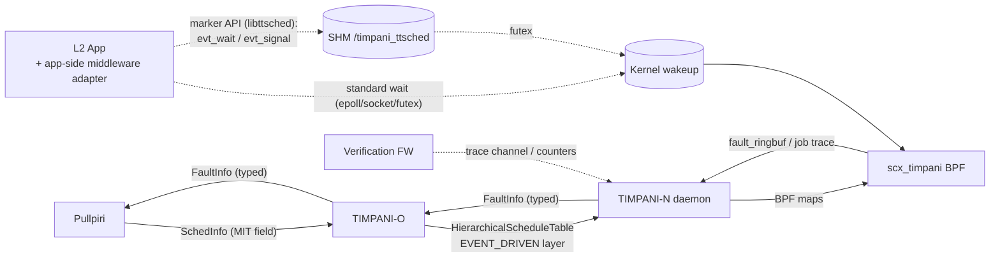

<!--
SPDX-FileCopyrightText: Copyright 2026 LG Electronics Inc.
SPDX-License-Identifier: MIT
-->

# SRS-008: Event-Driven Workload Support 소프트웨어 요구사항 명세 (SRS)

**날짜:** 2026-11-09 (Last Updated: 2026-11-10)
**상태:** Draft (v1)
**작성:** Human + AI
**상위 문서:** [REQ-008](REQ-008-event-driven-workload-support.md), [SRS-000](SRS-000-timpani-system.md)
**관련 문서:** [DDR-001](DDR-001-workload-model.md), [DDR-003](DDR-003-interface-protocol.md), [DDR-004](DDR-004-resource-allocation.md), [DDR-005](DDR-005-sched-ext-bpf-scheduler.md), [DDR-006](DDR-006-communication-architecture.md), [DDR-007](DDR-007-tt-cbs-integrated-scheduling.md), [DDR-011](DDR-011-runtime-table-update.md), [DDR-012](DDR-012-fault-management.md)
**하위 문서:** DDR-008 (설계 결정), HLD-008, LLD-008

> 본 문서는 [REQ-008](REQ-008-event-driven-workload-support.md)의 상위 요구사항을 **소프트웨어 컴포넌트에 할당 가능하고 검증 가능한 수준**으로 구체화한다. SRS-000 §1의 규약대로 기능별 SRS(`SRS-008`)는 특정 결정 기록(`DDR-008`)의 요구사항을 구체화한다.
> 설계 선택(알고리즘, 자료구조, 스레드 모델)은 본 문서에서 **결정하지 않으며** DDR-008이 결정한다. 다만 검증 가능성을 위해 "관측 가능한 동작"은 구체적으로 기술한다.
> REQ-008의 두 원칙(**전송 계층 중립**, **Phase 1/2 분할**)을 계승한다. 각 요구사항에 Phase를 표시하며, `P1*`는 Phase 1에서 단순화된 형태로 충족하고 Phase 2에서 강화됨을 뜻한다.
>
> **키워드 규약**: **SHALL** = 필수, **SHOULD** = 권장, **MAY** = 선택.
> **검증 방법 약어**: A = 분석(Analysis), T = 테스트(Test, 단위/통합), M = 측정(Measurement, 타이밍 벤치), D = 시연(Demonstration, PoC).

---

## 요약 (Korean Summary)

- 목적: L2(Sporadic + SafetyCritical) Event-Driven 워크로드를 TIMPANI가 **도달 감지 → CBS 격리 실행 → 완료 판정 → 폴트 보고**의 종단간 흐름으로 결정론적으로 지원하기 위한 소프트웨어 요구사항을 컴포넌트(proto, TIMPANI-O, TIMPANI-N 사용자 공간, BPF 스케줄러, 애플리케이션 라이브러리, 검증 프레임워크)별로 정의한다.
- 핵심(P1): (1) job 경계(활성화/완료)의 결정적 규칙과 전송 계층 중립 마커 인터페이스, (2) 이용률 + 단순 블로킹 합 기반 승인, (3) 배정 CPU 고정·FIFO 서버 순서·바운드된 백업 보충, (4) 유형 손실 없는 폴트 분류(DMISS/BUDGET_EXCEED/MIT_VIOLATION)와 속도 제한, (5) 정량 타이밍 요구사항(측정 방법 포함), (6) 와이어 호환 proto 확장(MIT 필드, EVENT_DRIVEN 레이어, 폴트 유형).
- P2로 미룬 것: 마커 없는 태스크의 정밀 job 경계 분류, EDF 순서·윈도우 수요 승인, 태스크 단위 시간 클래스, 거부 사유 코드, TT 무교란 증분 갱신, NodeStatus 통계, watchdog/깨움 지연 폴트, HRTICK.
- 상태: Draft v1. 목표 수치는 REQ-008 §4.6의 후보값을 계승하며 측정으로 확정한다.

---

## 1. 서론 (Introduction)

### 1.1 목적
REQ-008의 각 요구사항을 구현·테스트 담당자가 직접 사용할 수 있는 소프트웨어 요구사항으로 분해하고, 각 요구사항에 **담당 컴포넌트, 검증 방법, 상위 추적성, Phase**를 부여한다.

### 1.2 범위
- 포함: TIMPANI-O(승인·테이블 생성·발행), TIMPANI-N 사용자 공간 데몬, `scx_timpani` BPF 스케줄러, 애플리케이션 라이브러리(`libttsched` 확장), Pullpiri↔O / O↔N 프로토콜, 검증 프레임워크가 요구하는 관측점.
- 제외: REQ-008 §7의 범위 외 항목(Aperiodic, D > MIT, 노드 간 체인, 미들웨어 고유 의미론, watchdog, QNX 포팅, Pullpiri YAML).

### 1.3 용어 정의 (본 문서에서의 정확한 의미)

| 용어 | 정의 |
|:--|:--|
| **L2 태스크** | `Sporadic + SafetyCritical` 워크로드에 속한 커널 스케줄링 단위(스레드). CBS 서버 1개에 1:1 대응 |
| **CBS 서버** | 예산 $C_s$, 보충 주기 $T_s$, 잔여 예산, 보충 시각, 상대 마감 $D$를 갖는 대역폭 서버 |
| **Job** | 하나의 Event 도달에 대응하는 1회 처리 단위. 활성화 시각 $t_{act}$에서 시작하여 완료 시각 $t_{done}$에 끝남 |
| **Wait point** | 태스크가 "다음 Event를 기다리는" 블로킹 지점. 마커 API 또는 커널 관측 규칙으로 식별됨 |
| **Mid-job blocking** | job 처리 도중의 블로킹(뮤텍스, I/O, 선점). 완료가 아님 |
| **활성화(Activation)** | WAITING 상태의 태스크가 wakeup되는 사건. $t_{act}$ 기록 |
| **완료(Completion)** | ACTIVE 상태의 태스크가 wait point에 진입하는 사건. $t_{done}$ 기록 |
| **응답 시간** | $R = t_{done} − t_{act}$ |
| **깨움 지연** | $L_{wake} = t_{start} − t_{act}$ ($t_{start}$ = job 최초 실행 개시) |
| **Gap** | 배정 CPU에서 L1 TT 슬롯이 활성이 아닌 시간 구간 |
| **$B_{tt}(k)$** | CPU $k$에서 길이 $L$인 임의 윈도우 내 TT 점유 시간의 최댓값 $B_{tt}(k, L)$(병합 슬롯 기준, hyperperiod 경계 wrap 포함). P1 승인식은 $L = D_i$를 사용한다. $L$이 최장 연속 TT 블록 이상이면 최대 연속 TT 점유 길이와 같다 |
| **MIT 위반** | 동일 태스크의 연속 활성화 간격이 `min_inter_arrival_us` 미만인 사건 |
| **Throttle 에피소드** | 잔여 예산이 0이 된 시점부터 보충으로 양수가 될 때까지의 구간 |
| **정격 부하** | 승인된 모든 L1/L2 워크로드가 활성이고 L2 이벤트가 MIT 간격으로 도달하는 조건 |
| **마커 API** | 앱이 wait point 진입과 L2 태스크 깨움을 TIMPANI 라이브러리에 명시하는 전송 계층 중립 C API |

### 1.4 참조
REQ-008, SRS-000, DDR-001~007/011/012, `timpani26` 소스(HEAD `4201573`), Linux sched_ext 문서(`Documentation/scheduler/sched-ext.rst`).

### 1.5 Phase 매핑 요약

| Phase | 포함 SRS-008 ID |
|:--|:--|
| **P1** | FR-G-001; FR-O-001, 003, 004(P1: 사유 로그), 005, 010, 011, 012(P1 범위), 013(P1식), 014, 015, 016, 020; FR-N-002, 003, 004, 005, 006, 007, 010, 011, 012, 013, 014, 015, 020, 021, 022, 024; FR-B-001~003, 004(P1 규칙), 005, 006, 010~013, 014, 015, 016(FIFO), 017, 020~023; FR-L-001~006; TMG-001~013(측정 시작); IF-PO-001, 004, 005, 006; IF-ON-001~004, 006; IF-L-001~003; IF-V-001~003; NFR-001, 002, 003, 005, 006, 007 |
| **P2** | FR-O-002, 004(응답 사유 필드), 017, 018, 021; FR-N-001, 023, 025; FR-B-004(P2 규칙), 016(EDF), 022(예약 유형 활성화); IF-PO-002, 003; IF-ON-005; NFR-004 |

---

## 2. 시스템 컨텍스트 및 컴포넌트 할당

### 2.1 컨텍스트

### 2.2 할당 매트릭스

| 컴포넌트 | 약어 | 책임 (본 기능 관점) |
|:--|:--|:--|
| 공통 | **G** | 전송 계층 중립 원칙 |
| Pullpiri↔O 프로토콜 (`schedinfo.proto`) | **IF-PO** | MIT 전용 필드, 폴트 유형 확장 (P2: 태스크 단위 시간 클래스, 거부 사유 코드) |
| O↔N 프로토콜 (`node_control.proto`) | **IF-ON** | EVENT_DRIVEN 레이어, CBS 엔트리 확장(MIT, CPU), 폴트 유형 확장 (P2: 통계 보고) |
| TIMPANI-O | **O** | 파라미터 검증, 배치, 승인(이용률 + 블로킹 합), 테이블 생성·발행, 폴트 전달 |
| TIMPANI-N 사용자 공간 | **N** | 테이블 적용, 태스크 식별·지연 바인딩, 백업 보충, 폴트 집계·보고, 통계·트레이스 노출 |
| BPF 스케줄러 (`scx_timpani`) | **BPF** | job 상태 머신, 활성화/완료 감지, CBS 예산 집행, CPU 고정, 서버 순서, 폴트 이벤트 발생 |
| 애플리케이션 라이브러리 (`libttsched`) | **LIB** | 마커 API(wait point, signal + $t_{arr}$) |
| 검증 프레임워크 | **VF** | 트레이스 수집, 히스토그램, 합부 판정(본 문서는 요구 관측점만 정의) |

---

## 3. 기능 요구사항 (Functional Requirements)

> ID 형식: `SRS-008-FR-<컴포넌트>-NNN`. 각 항목: 명세 / 상위 REQ / 검증 / Phase.

### 3.0 공통 (G)

| ID | 요구사항 | 상위 | 검증 | Phase |
|:--|:--|:--|:-:|:-:|
| **SRS-008-FR-G-001** | TIMPANI-O, TIMPANI-N, BPF, `libttsched`의 소스·proto·공개 헤더는 특정 미들웨어/전송 계층의 식별자·타입·헤더(예: SOME/IP service/instance/event ID, vsomeip, DDS 토픽)를 참조하지 않아야 한다(SHALL). Event의 식별 단위는 `(workload_id, task_id)`로 식별되는 L2 태스크이다. | MOD-006 | A(코드 리뷰, grep) | P1 |

### 3.1 워크로드 모델 및 검증 (O)

| ID | 요구사항 | 상위 | 검증 | Phase |
|:--|:--|:--|:-:|:-:|
| **SRS-008-FR-O-001** | TIMPANI-O는 L2 태스크 명세에서 `min_inter_arrival_us`(MIT), `wcet_us`, `deadline_us`, `max_dmiss`를 읽어야 하며(SHALL), MIT 전용 필드가 0이고 `period`가 설정된 Sporadic 입력은 **전환 기간 동안** `period`를 MIT로 해석하되 경고를 기록해야 한다(SHOULD). | MOD-001, IF-001 | T | P1 |
| **SRS-008-FR-O-002** | TIMPANI-O는 태스크 단위 시간 클래스를 지원해야 한다(SHALL). 태스크 클래스가 미지정(0)이면 워크로드 클래스를 상속한다. 한 워크로드 내에 Periodic(TT)과 Sporadic(CBS) 태스크가 공존할 수 있어야 한다. | IF-002 | T | P2 |
| **SRS-008-FR-O-003** | TIMPANI-O는 L2 태스크에 대해 `0 < wcet_us ≤ deadline_us ≤ min_inter_arrival_us`, `min_inter_arrival_us > 0`, `max_dmiss ≥ 0`을 검증하고 위반 시 워크로드 전체를 거부해야 한다(SHALL). `deadline_us = 0`은 `min_inter_arrival_us`로 기본 설정한다. | MOD-004/005 | T | P1 |
| **SRS-008-FR-O-004** | TIMPANI-O는 승인 거부 시 구조화된 사유 코드(최소: `PARAM_INVALID`, `UTIL_EXCEEDED`, `DEADLINE_INFEASIBLE`, `NO_CPU`, `NODE_UNKNOWN`, `NON_HARMONIC`)와 메시지를 응답에 포함해야 한다(SHALL). P1에서는 동일 사유를 로그에 기록한다(SHALL). | IF-006 | T | P2 (로그는 P1) |
| **SRS-008-FR-O-005** | 승인 거부 시 TIMPANI-O는 **거부 이전의 유효한 워크로드 집합과 테이블을 보존**해야 하며(SHALL), 동일 `workload_id`의 갱신이 거부되면 이전 버전을 복원해야 한다. | RTU-001, AC-08 | T | P1 |

### 3.2 배치 및 승인 (O)

| ID | 요구사항 | 상위 | 검증 | Phase |
|:--|:--|:--|:-:|:-:|
| **SRS-008-FR-O-010** | TIMPANI-O는 L2 태스크별 CBS 파라미터를 $C_s = \text{wcet\_us}$, $T_s = \text{min\_inter\_arrival\_us}$, $D = \text{deadline\_us}$로 산출해야 한다(SHALL). | CBS-001 | T | P1 |
| **SRS-008-FR-O-011** | TIMPANI-O는 CPU $k$별로 $U_{tt}(k) + \sum_j C_{s,j}/T_{s,j} + U_{overhead} \le U_{bound}$ 를 검증해야 한다(SHALL). $U_{bound}$, $U_{overhead}$는 DDR-004/007 값(0.80, 0.02)을 설정 가능 상수로 사용한다. TT 이용률 $U_{tt}(k) \le U_{bound}$ 도 함께 검증해야 한다(SHALL, 현행 미검사 보완). | CBS-001 | T | P1 |
| **SRS-008-FR-O-012** | TIMPANI-O는 CPU $k$의 TT 테이블로부터 길이 $L$ 윈도우 내 최대 TT 점유 $B_{tt}(k, L)$(병합 슬롯 기준, hyperperiod 경계 wrap 포함)를 계산할 수 있어야 한다(SHALL, P1; $L$ = 각 L2 태스크의 $D_i$). P2에서는 Gap 공급 함수 $sbf_k(L)$ 기반 정밀식으로 확장한다(SHALL). | CBS-004, ORD-001 | T | P1* |
| **SRS-008-FR-O-013** | TIMPANI-O는 CPU $k$의 모든 L2 태스크 $i$에 대해 마감 충족 충분 조건을 검증하고 불충족 시 `DEADLINE_INFEASIBLE`로 거부해야 한다(SHALL). **P1 조건(FIFO 순서 전제, 보수적)**: $C_{s,i} + B_{tt}(k, D_i) + L_{wake}^{max} + \sum_{j \ne i} C_{s,j} \le D_i$, 여기서 $L_{wake}^{max}$는 REQ-008 TIM-001 목표값(설정 상수). **P2 조건**: EDF 순서 전제의 윈도우 수요·공급 함수식(DDR-008 후속). | CBS-004 | T, A | P1* |
| **SRS-008-FR-O-014** | TIMPANI-O의 L2 CPU 배치는 FR-O-011과 FR-O-013을 모두 만족하는 CPU만 후보로 삼아야 하며(SHALL), 최소 Gap 길이가 `CBS_MIN_EXEC_US` 미만인 CPU는 후보에서 제외해야 한다(SHALL, 현행 경고→거부). 후보 중 선택 규칙(worst-fit 등)은 DDR-008에서 결정한다. | ORD-001 | T | P1 |
| **SRS-008-FR-O-015** | TIMPANI-O는 TT 슬롯 반복 주기와 테이블 `hyperperiod_us`의 불일치(CPU별 LCM vs 전역 LCM)를 제거해야 하며(SHALL), L2 전용 노드의 `hyperperiod_us`는 0이 아닌 정의된 값이어야 한다(SHALL). | §10-16 (선행 버그) | T | P1 |
| **SRS-008-FR-O-016** | TIMPANI-O는 L2 엔트리를 `LayerConfig.model = EVENT_DRIVEN`인 별도 레이어로 발행해야 하며(SHALL), 각 엔트리에 $C_s$, $T_s$, MIT, $D$, `current_limit`, 배정 CPU를 포함해야 한다. | IF-003 | T | P1 |
| **SRS-008-FR-O-017** | L2 워크로드만 변경된 테이블 발행에서 TIMPANI-O는 `epoch_ns`를 갱신하지 않아야 한다(SHALL). TT 슬롯 집합이 변경된 경우에만 epoch 갱신이 허용된다. | RTU-002/003 | T | P2 |
| **SRS-008-FR-O-018** | TIMPANI-O는 L2 워크로드 추가·제거 시 영향을 받는 노드에만 테이블을 발행해야 한다(SHOULD). | RTU-002 | T | P2 |

### 3.3 폴트 전달 (O)

| ID | 요구사항 | 상위 | 검증 | Phase |
|:--|:--|:--|:-:|:-:|
| **SRS-008-FR-O-020** | TIMPANI-O는 TIMPANI-N으로부터 수신한 폴트 유형(`DMISS`, `BUDGET_EXCEED`, `WATCHDOG`, `MIT_VIOLATION`)을 **동일 의미의 유형**으로 Pullpiri에 전달해야 하며(SHALL), `UNKNOWN`으로 축약하지 않아야 한다. | PRT-005, IF-004 | T | P1 |
| **SRS-008-FR-O-021** | TIMPANI-O는 폴트 전달 실패 시 재시도 큐에 적재하되, 폴트 전달이 노드 스트림 수신 처리를 블로킹하지 않도록 해야 한다(SHOULD). | TIM-005, OI-7 | T | P2 |

### 3.4 테이블 적용 및 태스크 식별 (N)

| ID | 요구사항 | 상위 | 검증 | Phase |
|:--|:--|:--|:-:|:-:|
| **SRS-008-FR-N-001** | TIMPANI-N은 수신 테이블을 현재 적용 테이블과 비교하여 **변경된 엔트리만** 적용해야 한다(SHALL). (TT 테이블이 동일할 때 Timer Master 재시작을 생략하는 P1* SHOULD는 FR-N-006.) | RTU-002 | T, M | P2 |
| **SRS-008-FR-N-002** | TIMPANI-N은 EVENT_DRIVEN 레이어의 각 엔트리에 대해 CBS 상태(예산 $C_s$, 주기 $T_s$, MIT, $D$, 잔여 = $C_s$, 보충 시각)를 BPF에 등록하고, 해당 태스크를 `SCHED_EXT`로 전환하며, 엔트리에 명시된 배정 CPU를 기록해야 한다(SHALL). | CBS-001/005 | T | P1 |
| **SRS-008-FR-N-003** | TIMPANI-N은 테이블 적용 시 식별되지 않은 L2 태스크 이름을 **미해결 목록**에 보관하고, `T_bind`(REQ-008 TIM-006) 이내 주기로 재식별을 시도하여 발견 즉시 FR-N-002를 수행해야 한다(SHALL). 재식별은 프로세스 및 스레드(`/proc/<pid>/task/<tid>/comm`) 모두를 대상으로 한다. | DET-006 | T, M | P1 |
| **SRS-008-FR-N-004** | TIMPANI-N은 식별된 L2 태스크의 종료(TID 소멸)를 감지하여 BPF 상태를 정리하고 해당 이름을 미해결 목록으로 되돌려야 한다(SHALL). | DET-006, RTU-004 | T | P1 |
| **SRS-008-FR-N-005** | 워크로드 제거(STOP 또는 테이블에서 소멸) 시 TIMPANI-N은 해당 L2 태스크의 CBS 상태·태스크 메타·통계·미해결 항목을 모두 제거하고 스케줄링 클래스를 `SCHED_OTHER`로 원복해야 한다(SHALL). | RTU-004 | T | P1 |
| **SRS-008-FR-N-006** | 테이블 적용 과정은 gRPC 수신 스레드를 1 hyperperiod 이상 블로킹하지 않아야 하며(SHOULD), TT 슬롯 집합·오프셋·hyperperiod·epoch가 동일한 테이블(L2 엔트리만 변경)에서는 Timer Master 스레드를 재시작하지 않아야 한다(SHOULD, DDR-008 D-17(b)). | RTU-002, TIM-007 | M | P1* |
| **SRS-008-FR-N-025** | 테이블 적용 과정은 실행 중인 L1 TT 활성화를 누락시키지 않아야 한다(SHALL). FR-N-001의 증분 적용과 함께 구현한다. | RTU-002, TIM-007 | M | P2 |
| **SRS-008-FR-N-007** | TIMPANI-N은 L2 태스크의 식별 수단으로 P1에서는 comm 이름을 사용하되, 식별 로직을 교체 가능한 단일 모듈(TaskRegistry)에 격리해야 한다(SHALL). | A-03, NFR-004 | A | P1 |

### 3.5 보충 및 폴트 집계 (N)

| ID | 요구사항 | 상위 | 검증 | Phase |
|:--|:--|:--|:-:|:-:|
| **SRS-008-FR-N-010** | TIMPANI-N은 모든 L2 서버의 보충 시각을 추적하여, 보충 시각 도래 시 BPF 경로 활동과 무관하게 예산 보충과 배정 CPU의 재스케줄 유발을 수행하는 **백업 보충 경로**를 제공해야 한다(SHALL). 보충은 BPF의 지연 보충과 멱등(idempotent)이어야 한다. | PRT-003 | T, M | P1 |
| **SRS-008-FR-N-011** | 백업 보충 경로는 RT 임계 경로 규칙(gRPC·힙 할당·블로킹 I/O 금지)을 준수해야 하며(SHALL), 실행 우선순위는 Timer Master보다 낮아야 한다(SHALL). | NFR-002 | A | P1 |
| **SRS-008-FR-N-012** | TIMPANI-N은 BPF로부터 수신한 `DMISS` 이벤트를 `(workload, task)`별로 계수하고, 누적 횟수가 `current_limit`을 초과할 때 보고해야 한다(SHALL, DDR-012 규칙 유지). MIT 위반 연관 표식이 있는 `DMISS`는 보고에 표식을 포함해야 한다(SHOULD). | PRT-002/007 | T | P1 |
| **SRS-008-FR-N-013** | TIMPANI-N은 `BUDGET_EXCEED`를 서버당 Throttle 에피소드별 최대 1건으로 집계하여 보고해야 한다(SHALL). 동일 에피소드 내 중복 이벤트는 카운터만 증가시킨다. | PRT-006 | T | P1 |
| **SRS-008-FR-N-014** | TIMPANI-N은 `MIT_VIOLATION` 이벤트를 계수하고, 서버당 $T_s$ 윈도우마다 최대 1건의 집계 보고(위반 횟수 포함)를 TIMPANI-O로 전송해야 한다(SHALL). | PRT-004/005 | T | P1 |
| **SRS-008-FR-N-015** | TIMPANI-N은 폴트 보고 시 `task_id`, `node_id`, `timestamp_ns`를 채워야 한다(SHALL, 현행 미설정 보완). | IF-004 | T | P1 |

### 3.6 관측성 (N)

| ID | 요구사항 | 상위 | 검증 | Phase |
|:--|:--|:--|:-:|:-:|
| **SRS-008-FR-N-020** | TIMPANI-N은 L2 태스크별로 다음 카운터를 유지해야 한다(SHALL): 활성화 수, 완료 수, DMISS 수, BUDGET_EXCEED 에피소드 수, MIT 위반 수, 보충 수, 배정 외 CPU 실행 수(0이어야 함). | OBS-001, CBS-005 | T | P1 |
| **SRS-008-FR-N-021** | TIMPANI-N은 L2 태스크별 응답 시간 $R$과 깨움 지연 $L_{wake}$의 히스토그램(최소 10 µs 해상도, p50/p99/p99.9/p99.99 산출 가능)을 유지해야 한다(SHALL). | OBS-001 | T | P1 |
| **SRS-008-FR-N-022** | TIMPANI-N은 job 단위 $(t_{act}, t_{start}, t_{done}, \text{cpu}, \text{budget\_used})$ 레코드를 검증 프레임워크가 구독할 수 있는 트레이스 채널로 노출해야 한다(SHALL). 트레이스 비활성 시 추가 비용은 0에 가까워야 하며, 활성 시에도 REQ-008 TIM-008 내여야 한다. | OBS-002, TIM-008 | T, M | P1 |
| **SRS-008-FR-N-023** | TIMPANI-N은 FR-N-020/021의 요약을 `NodeStatus`로 주기 보고해야 한다(SHOULD). 보고 주기는 설정 가능하며 기본 1 s이다. | OBS-003 | T | P2 |
| **SRS-008-FR-N-024** | Timer Master 지터 통계는 stdout 외에 FR-N-022 트레이스 채널로도 노출되어야 한다(SHOULD, TIM-007 A/B 비교용). | TIM-007 | T | P1 |

### 3.7 Job 상태 및 활성화/완료 감지 (BPF)

| ID | 요구사항 | 상위 | 검증 | Phase |
|:--|:--|:--|:-:|:-:|
| **SRS-008-FR-B-001** | BPF는 L2 태스크별 job 상태 `{WAITING, ACTIVE}`를 유지해야 한다(SHALL). 초기 상태는 `WAITING`이다. | MOD-002/003 | T | P1 |
| **SRS-008-FR-B-002** | BPF는 `WAITING` 상태 태스크의 wakeup에서만 `activation_ns`를 기록하고 상태를 `ACTIVE`로 전이해야 한다(SHALL). `ACTIVE` 상태에서의 wakeup(mid-job 재깨움, 선점 후 재개)은 `activation_ns`를 변경하지 않아야 한다(SHALL). | DET-001, MOD-003 | T | P1 |
| **SRS-008-FR-B-003** | BPF는 `ACTIVE` 태스크가 **wait point로 분류되는 블로킹**으로 수면에 들어갈 때(`ops.quiescent`, `SCX_DEQ_SLEEP`) 완료로 판정하여 $t_{done}$을 기록하고 상태를 `WAITING`으로 전이해야 한다(SHALL). 선점·슬라이스 만료(`ops.stopping(runnable=true)`)는 완료가 아니며, `ops.stopping(runnable=false)`는 예산 차감만 수행한다(SHALL). | DET-002 | T | P1 |
| **SRS-008-FR-B-004** | wait point 분류 규칙은 결정적이어야 하며 휴리스틱 난수를 포함하지 않아야 한다(SHALL). **P1 규칙**: (a) 마커 API로 표시된 wait point(FR-L-001)는 항상 wait point; (b) 마커 없는 태스크의 **모든** 자발적 블로킹은 wait point(알려진 한계: mid-job blocking이 job을 분할함 — REQ-008 A-06). **P2 규칙**: (b)를 블로킹 시스템 콜 분류(이벤트 대기 계열 = wait point)와 블로킹 지속 시간 임계(`midjob_block_max_us`, 기본 $D$) 기반 사후 재분류로 정밀화(DDR-008 후속). | DET-005 | T, A | P1* |
| **SRS-008-FR-B-005** | BPF는 job의 최초 실행 개시 시각 $t_{start}$를 `ACTIVE` 전이 후 첫 `running` 콜백에서 기록해야 한다(SHALL). | TIM-001 | T | P1 |
| **SRS-008-FR-B-006** | BPF는 활성화 시 직전 활성화와의 간격을 MIT와 비교하여 위반 시 `MIT_VIOLATION` 이벤트를 발생시키고 태스크별 위반 카운터를 증가시켜야 한다(SHALL). | PRT-004 | T | P1 |

### 3.8 CBS 집행 (BPF)

| ID | 요구사항 | 상위 | 검증 | Phase |
|:--|:--|:--|:-:|:-:|
| **SRS-008-FR-B-010** | BPF는 L2 태스크를 배정 CPU의 L2 큐에만 삽입하고, CPU $k$의 dispatch는 CPU $k$의 L2 큐만 소비해야 한다(SHALL). L2 태스크가 비배정 CPU에서 실행되면 안 된다(SHALL). | CBS-005 | T, M | P1 |
| **SRS-008-FR-B-011** | BPF는 배정 CPU에서 TT가 활성(runnable TT 태스크 존재 또는 TT 슬롯 진행 중)인 동안 L2를 디스패치하지 않아야 하며(SHALL), L2 실행 중 슬라이스를 `min(잔여 예산, 다음 TT 시작까지 남은 시간)`으로 제한해야 한다(SHALL). | CBS-002 | T, M | P1 |
| **SRS-008-FR-B-012** | BPF는 L2 태스크의 매 실행 구간(`running`→`stopping`)의 실제 실행 시간을 1 µs 해상도로 잔여 예산에서 차감해야 한다(SHALL). 절사 오차의 누적을 방지하기 위해 ns 단위 누산 후 µs 변환해야 한다(SHOULD). | CBS-003/006 | T | P1 |
| **SRS-008-FR-B-013** | 잔여 예산이 0이 되면 BPF는 태스크를 Throttled 큐로 이동시키고 보충 시각을 기록해야 하며(SHALL), 이 전이 시점에 `BUDGET_EXCEED` 이벤트를 **에피소드당 1회** 발생시켜야 한다(SHALL). 보충 전까지 Throttled 큐의 태스크는 디스패치되지 않아야 한다(SHALL). | PRT-001, PRT-006 | T | P1 |
| **SRS-008-FR-B-014** | 보충 규칙(주기 격자 정렬 vs 활성화 기준)은 DDR-008이 결정하되, 임의의 길이 $T_s$ 윈도우에서 서버가 소비하는 CPU 시간이 승인 검사(FR-O-013)가 가정한 간섭 상한을 초과하지 않아야 한다(SHALL). | ORD-003, CBS-006 | A, M | P1 |
| **SRS-008-FR-B-015** | BPF는 보충 시각이 지난 Throttled 태스크를 L2 큐로 승격하는 경로를 enqueue·dispatch·running 진입점에 가져야 하며(SHALL), 사용자 공간 백업 보충(FR-N-010)과 동일한 멱등 규칙을 사용해야 한다(SHALL). | PRT-001/003 | T | P1 |
| **SRS-008-FR-B-016** | 동일 CPU에 둘 이상의 L2 태스크가 실행 가능할 때 BPF는 결정적으로 선택해야 한다(SHALL). **P1**: 활성화 순서(FIFO). **P2**: 절대 마감 오름차순(EDF, DDR-008 후속). | ORD-002 | T | P1* |
| **SRS-008-FR-B-017** | BPF는 MIT 위반 활성화에 대해 **P1 정책 "잔여 예산 내 흡수"**(위반 도달은 새 예산을 받지 않음)를 적용해야 하며(SHALL), 어떤 정책에서도 해당 서버의 $T_s$ 윈도우당 CPU 소비가 $C_s$를 초과하지 않아야 한다(SHALL). | PRT-004, ORD-003 | T, M | P1 |

### 3.9 폴트 감지 (BPF)

| ID | 요구사항 | 상위 | 검증 | Phase |
|:--|:--|:--|:-:|:-:|
| **SRS-008-FR-B-020** | BPF는 완료 시 $R = t_{done} − t_{act} > D$ 이면 `DMISS` 이벤트를 1회 발생시켜야 한다(SHALL). 이벤트에는 $t_{act}$, 절대 마감, $t_{done}$, CPU, 그리고 해당 job의 MIT 위반 여부 또는 Throttle 경유 여부 표식을 포함해야 한다(SHALL). | PRT-002/007 | T | P1 |
| **SRS-008-FR-B-021** | BPF는 `ACTIVE` 상태에서 절대 마감이 경과한 것을 `stopping`에서 관측하면 **조기 `DMISS`**를 1회 발생시킬 수 있다(MAY). 조기 발생한 job에 대해서는 완료 시 중복 발생시키지 않아야 한다(SHALL). | PRT-002 | T | P1 |
| **SRS-008-FR-B-022** | BPF 폴트 이벤트 구조는 유형 필드에 `DMISS`, `BUDGET_EXCEED`, `MIT_VIOLATION`을 구분 표현해야 하며(SHALL), `WAKEUP_LATENCY_EXCEED`, `WATCHDOG` 값을 예약해야 한다(SHOULD). | PRT-005 | T | P1 (예약 활성화는 P2) |
| **SRS-008-FR-B-023** | BPF 폴트 이벤트는 ringbuf 공간 부족 시 드롭 카운터를 증가시켜야 하며(SHALL), 드롭이 발생해도 스케줄링 동작에 영향을 주지 않아야 한다(SHALL). | NFR-002 | T | P1 |

### 3.10 애플리케이션 마커 인터페이스 (LIB)

| ID | 요구사항 | 상위 | 검증 | Phase |
|:--|:--|:--|:-:|:-:|
| **SRS-008-FR-L-001** | `libttsched`는 L2 태스크용 **명시적 wait point API**를 제공해야 한다(SHALL). 호출 시 태스크는 다음 활성화까지 블로킹되며, 이 블로킹은 BPF에 의해 항상 wait point로 분류되어야 한다(FR-B-004(a)). | DET-004(a) | T | P1 |
| **SRS-008-FR-L-002** | `libttsched`는 지정 L2 태스크를 **깨우는(signal) API**를 제공해야 한다(SHALL). 동일 호스트의 임의 스레드(예: 앱 측 미들웨어 어댑터)가 호출하며, 도달 시각 $t_{arr}$를 함께 기록할 수 있어야 한다(SHOULD). API는 미들웨어 식별자를 인자로 받지 않는다(SHALL). | DET-004(b), MOD-006 | T | P1 |
| **SRS-008-FR-L-003** | 마커 API 없이 표준 블로킹 호출만 사용하는 L2 태스크도 FR-B-004(b)에 의해 지원되어야 하며, 마커 API 사용은 선택이어야 한다(SHALL). | DET-003 | T, D | P1 |
| **SRS-008-FR-L-004** | 마커 API는 C ABI, 스레드 안전, 힙 할당 없음, 호출당 비용 ≤ REQ-008 TIM-008을 만족해야 한다(SHALL). 블로킹 API를 제외한 모든 호출은 단일 atomic 연산 + 최대 1회 futex 시스템 콜 이내여야 한다(SHOULD). | IF-005 | M | P1 |
| **SRS-008-FR-L-005** | 마커 API는 기존 TT API(`ttsched_init`, `ttsched_wait_next_period`)와 동일 SHM 생명주기(magic/generation 핸드셰이크)를 공유하고, 테이블 갱신·데몬 종료 시 동일한 오류 코드 규약으로 복귀해야 한다(SHALL). | NFR-003 | T | P1 |
| **SRS-008-FR-L-006** | `examples/someip/libtimpani_rt`의 L2 관련 기능(`timpani_evt_*`, `timpani_cbs_*`)은 FR-L-001/002의 **앱 측 어댑터**로 축소되거나 제거되어야 하며(SHALL), TIMPANI 코어와 별도의 SHM·폴트 판정·서버 키 해시를 갖지 않아야 한다(SHALL). | §10-15, §12 | T | P1 |

---

## 4. 타이밍 및 결정론 요구사항 (Timing & Determinism)

> REQ-008 §4.6의 후보값을 계승한다. 모든 항목은 **Isolated CPU, PREEMPT_RT, 정격 부하, 1시간 연속 관측**을 기본 조건으로 하며, 측정은 FR-N-022 트레이스 채널을 통해 검증 프레임워크가 수행한다. 목표값 확정 전까지 "(후보)"로 표기한다. 모든 항목은 P1에서 측정을 시작한다.

| ID | 요구사항 | 목표 | 조건 | 측정 |
|:--|:--|:--|:--|:--|
| **SRS-008-TMG-001** | Gap·유휴 상태 깨움 지연 $L_{wake} = t_{start} − t_{act}$ | ≤ 50 µs @ p99.99 (후보) | 배정 CPU에 runnable TT 없음, 타 L2 없음 | job 레코드 히스토그램 |
| **SRS-008-TMG-002** | TT 점유 중 도달 시 깨움 지연 | ≤ $B_{tt}(k) + 50$ µs @ p99.99 (후보) | 도달 시 TT 활성 | job 레코드 + 테이블의 $B_{tt}$ |
| **SRS-008-TMG-003** | 백업 보충 지연: `replenish_at_ns` → 태스크 실행 가능(L2 큐 + CPU 재스케줄) | ≤ 100 µs @ p99.99 (후보) | 보충 시각 이후 어떠한 enqueue/dispatch도 발생하지 않는 조건 포함 | 보충 발화 시각 vs BPF 잔여 예산 복원 시각 |
| **SRS-008-TMG-004** | 서버당 $T_s$ 윈도우 내 예산 초과(overrun) | P1: ≤ 1 scheduler tick (HZ=1000 기준 1 ms); P2: ≤ 50 µs (HRTICK 채택 시, 후보) | 연속 CPU 소모 job | BPF exec 누산 vs $C_s$ |
| **SRS-008-TMG-005** | DMISS 커널 감지 지연 | ≤ 마감 + $C_s$ | FR-B-020/021 | ringbuf 타임스탬프 − 절대 마감 |
| **SRS-008-TMG-006** | DMISS TIMPANI-O 도달 지연 | ≤ 커널 감지 + 200 ms (후보) | FaultMonitor 폴링 100 ms 포함 | O 수신 로그 시각 |
| **SRS-008-TMG-007** | 지연 식별 `T_bind` | ≤ 1 s (후보) | 테이블 적용 후 스레드 생성 | 스레드 생성 시각 vs BPF 등록 시각 |
| **SRS-008-TMG-008** | L1 무간섭: L2 유/무 A/B에서 TT 활성화 지터 p99.99 차이 | ≤ 10 µs (후보) | 동일 TT 테이블, L2 정격·폭주(MIT/3) 양 조건 | Timer Master 지터 트레이스 |
| **SRS-008-TMG-009** | 활성화 누락·중복: 100,000 이벤트 중 활성화 기록 누락 또는 중복 | 0건 | 마커 사용 조건(P1); 마커 미사용은 A-06 준수 앱 | job 레코드 vs 생성기 로그 대조 |
| **SRS-008-TMG-010** | 배정 외 CPU 실행 | 0회 / 1시간 | 정격 + 폭주 | `sched_switch` 트레이스 |
| **SRS-008-TMG-011** | Event 감지 오버헤드(이벤트당 추가 CPU 시간, BPF + 마커) | ≤ 2 µs (후보) | 정격 | `bpf_prog` run_time_ns / run_cnt, 마커 마이크로벤치 |
| **SRS-008-TMG-012** | 폴트 보고 속도: `BUDGET_EXCEED` 보고 건수 | ≤ 1건 / 서버 / Throttle 에피소드 | 지속 폭주 | O 수신 카운트 |
| **SRS-008-TMG-013** | 런타임 L2 추가·제거 중 기존 L1/L2 활성화 누락 | 0건 / 10회 반복 (P2) ; P1: 데몬 재시작 0, 잔존 상태 0 | UC-04 | job·TT 레코드 연속성 |

---

## 5. 인터페이스 요구사항 (Interface Requirements)

> 필드 번호·타입의 최종 확정은 DDR-008/LLD-008에서 하며, 본 절은 **필수 정보 요소**와 호환 규칙을 정의한다.

### 5.1 Pullpiri → TIMPANI-O (`schedinfo.proto`) — IF-PO

| ID | 요구사항 | 상위 | 검증 | Phase |
|:--|:--|:--|:-:|:-:|
| **SRS-008-IF-PO-001** | `TaskInfo`에 MIT 전용 정보 요소(`min_inter_arrival_us`, µs, 32비트 이상)를 **신규 필드 번호**로 추가해야 한다(SHALL). 기존 필드 1~10의 번호·타입은 변경하지 않는다(SHALL). | IF-001, NFR-005 | T | P1 |
| **SRS-008-IF-PO-002** | `TaskInfo`에 태스크 단위 시간 클래스 정보 요소를 추가해야 하며(SHALL), 값 0은 "워크로드 클래스 상속"이어야 한다(SHALL, proto3 기본값 호환). | IF-002 | T | P2 |
| **SRS-008-IF-PO-003** | `Response`에 거부 사유 코드(enum) 및 메시지 정보 요소를 추가해야 한다(SHALL). `status` 필드 의미(0 성공 / 비0 실패)는 유지한다. | IF-006 | T | P2 |
| **SRS-008-IF-PO-004** | `schedinfo.FaultType`에 `BUDGET_EXCEED`, `WATCHDOG`, `MIT_VIOLATION`을 추가해야 하며(SHALL), 값은 `node_control.FaultType`과 동일 번호를 사용해야 한다(SHOULD). | IF-004 | T | P1 |
| **SRS-008-IF-PO-005** | `FaultInfo`에 `timestamp_ns`, 집계 카운트(위반 횟수), MIT 위반 연관 표식 정보 요소를 추가해야 한다(SHOULD). | PRT-007 | T | P1 |
| **SRS-008-IF-PO-006** | 기존 클라이언트(필드 1~10만 사용, `temporal_class` 워크로드 단위)의 요청은 변경 없이 수용되어야 한다(SHALL). | NFR-005 | T | P1 |

### 5.2 TIMPANI-O → TIMPANI-N (`node_control.proto`) — IF-ON

| ID | 요구사항 | 상위 | 검증 | Phase |
|:--|:--|:--|:-:|:-:|
| **SRS-008-IF-ON-001** | L2 엔트리는 `LayerConfig.model = EVENT_DRIVEN`인 레이어에 실려야 하며(SHALL), TT 레이어(`TIME_TRIGGERED`)에는 `cbs_entries`가 비어 있어야 한다(SHALL). TIMPANI-N은 레이어 모델 값을 읽어 처리 경로를 분기해야 한다(SHALL). | IF-003 | T | P1 |
| **SRS-008-IF-ON-002** | `CbsConfig`(또는 후속 명칭)에 MIT 정보 요소를 $T_s$(`period_us`)와 **별도 필드**로 추가해야 한다(SHALL). 전환 기간 동안 MIT 필드가 0이면 $T_s$를 MIT로 해석한다(SHOULD). | IF-003 | T | P1 |
| **SRS-008-IF-ON-003** | `CbsConfig`에 배정 CPU 정보 요소를 명시해야 한다(SHALL, 현행 파티션 cpuset 첫 원소 암묵 사용 제거). | CBS-005 | T | P1 |
| **SRS-008-IF-ON-004** | `node_control.FaultType`에 `MIT_VIOLATION`을 추가해야 하며(SHALL), `WAKEUP_LATENCY_EXCEED`를 예약해야 한다(SHOULD). `FaultInfo`에 집계 카운트와 MIT 연관 표식 정보 요소를 추가해야 한다(SHOULD). | PRT-005/007 | T | P1 |
| **SRS-008-IF-ON-005** | `NodeStatus`에 L2 태스크별 통계 요약(FR-N-020/021) 정보 요소를 추가해야 한다(SHOULD). | OBS-003 | T | P2 |
| **SRS-008-IF-ON-006** | `HierarchicalScheduleTable.table_id`는 발행마다 단조 증가하는 식별자여야 한다(SHOULD, 현행 고정 `"table_v1"` 개선; `TableApplied` 상관을 위함). | RTU-002 | T | P1 |

### 5.3 TIMPANI-N ↔ 애플리케이션 (SHM / `libttsched`) — LIB

| ID | 요구사항 | 상위 | 검증 | Phase |
|:--|:--|:--|:-:|:-:|
| **SRS-008-IF-L-001** | L2 태스크도 SHM 태스크 슬롯을 할당받아야 하며(SHALL, 현행 TT 전용 해제), 슬롯은 TT와 동일한 안정성 규칙(기존 태스크 인덱스 유지, generation 핸드셰이크)을 따른다(SHALL). 최대 태스크 수는 REQ-008 NFR-001(노드당 ≥ 32 L2 + 기존 TT)을 수용해야 한다(SHALL). | DET-004, NFR-001 | T | P1 |
| **SRS-008-IF-L-002** | SHM 슬롯은 L2용으로 최소 다음 정보 요소를 가져야 한다(SHALL): wait/wake 카운터, 도달 시각 $t_{arr}$(ns), job 시퀀스. 레이아웃 변경은 `magic`/버전 필드로 식별 가능해야 한다(SHALL). | DET-004 | T | P1 |
| **SRS-008-IF-L-003** | 마커 API 시그니처(명칭은 LLD-008 확정): `int ttsched_evt_wait(void)` — wait point에서 블로킹; `int ttsched_evt_signal(const char *task_name, uint64_t t_arr_ns)` — 지정 태스크 깨움 + $t_{arr}$ 기록(0이면 호출 시각). 반환 규약은 `ttsched_wait_next_period`와 동일(0 정상, −1 재초기화 필요). | FR-L-001/002 | T | P1 |

### 5.4 TIMPANI-N ↔ 검증 프레임워크 — VF

| ID | 요구사항 | 상위 | 검증 | Phase |
|:--|:--|:--|:-:|:-:|
| **SRS-008-IF-V-001** | job 레코드 트레이스 채널은 레코드당 최소 `{workload_id_hash, task_id_hash, job_seq, t_act, t_start, t_done, cpu, budget_used_us, flags(mit_violation, throttled, dmiss, marker_used)}`를 제공해야 한다(SHALL). | OBS-002 | T | P1 |
| **SRS-008-IF-V-002** | 트레이스 채널은 런타임에 활성/비활성 전환이 가능해야 하며(SHALL), 비활성 시 BPF 경로의 추가 분기 1회 이하여야 한다(SHOULD). | TIM-008 | M | P1 |
| **SRS-008-IF-V-003** | 검증 프레임워크가 이벤트 생성 시각(생성기 측 $t_{arr}$)과 TIMPANI 측 $t_{act}$를 대조할 수 있도록 공통 단조 시계(`CLOCK_MONOTONIC`) 기준을 사용해야 한다(SHALL). | DET-009 | A | P1 |

---

## 6. 비기능 요구사항 (Non-Functional Requirements)

| ID | 요구사항 | 상위 | 검증 | Phase |
|:--|:--|:--|:-:|:-:|
| **SRS-008-NFR-001** | 노드당 L2 태스크 ≥ 32, CPU당 ≥ 8. BPF 맵 용량·SHM 슬롯·N 자료구조가 이를 수용해야 한다(SHALL). | NFR-001 | T | P1 |
| **SRS-008-NFR-002** | BPF 경로에 추가되는 명령은 검증기(verifier) 한계 내여야 하며, 반복문은 상한이 명시되어야 한다(SHALL). | NFR-002 | T | P1 |
| **SRS-008-NFR-003** | L2 엔트리가 없는 테이블에서 TIMPANI-N/BPF의 동작·타이밍은 변경 전과 동일해야 한다(SHALL). 회귀 측정: TT 지터 p99.99 차 ≤ 5 µs. | NFR-003 | M | P1 |
| **SRS-008-NFR-004** | Event 감지·분류 로직(FR-B-001~006)은 OS 의존 부분(시스템 콜 번호, 커널 콜백)과 정책 부분(상태 머신)을 분리하여 구현해야 한다(SHOULD). | NFR-004 | A | P2 |
| **SRS-008-NFR-005** | 모든 proto 변경은 필드 추가만 허용하고, 생성 코드가 기존 메시지를 역직렬화할 수 있어야 한다(SHALL). | NFR-005 | T | P1 |
| **SRS-008-NFR-006** | 신규 코드(timpani-o, timpani-n C++)는 GTest 단위 테스트를 동반해야 하며, 승인 로직(FR-O-010~014)과 job 상태 머신(FR-B-001~006)은 결정적 입력에 대한 표 기반(table-driven) 테스트를 가져야 한다(SHALL). | 개발 규칙 | T | P1 |
| **SRS-008-NFR-007** | C++ 경로의 테스트가 CI에서 실행되지 않는 현행 제약을 고려하여, 로컬 실행 스크립트와 결과 보고 형식을 테스트 전략에 정의해야 한다(SHOULD). | C-04 | A | P1 |

---

## 7. 제약 및 가정 (Constraints & Assumptions)

REQ-008 §8의 A-01~06, C-01~04를 계승하며 다음을 추가한다.

| ID | 내용 |
|:--|:--|
| **A-07** | sched_ext 콜백(`enqueue/running/stopping`)과 보조 BPF 프로그램(P2: `sys_enter`류 트레이스포인트)이 동일 BPF 객체에 공존할 수 있다(Linux 6.12+). |
| **C-05** | BPF에서 futex 깨움·CPU 재스케줄을 사용자 공간 요청으로 직접 수행할 수 없으므로, 백업 보충은 사용자 공간 스레드가 BPF 프로그램 실행(syscall 타입) 또는 보조 스레드 깨움으로 재스케줄을 유발해야 한다. 가용성은 DDR-008 PoC로 확인한다(REQ-008 OI-9). |
| **C-06** | 슬라이스 만료 해상도는 커널 틱(HZ)에 의존한다. TMG-004 P1 값은 HZ=1000을 가정한다. |
| **C-07** | P1 샘플 앱(FCW)은 TT 생산자와 L2 소비자를 **별도 워크로드**로 등록한다(IF-002는 P2). |

---

## 8. 추적성 매트릭스 (Traceability)

### 8.1 REQ-008 → SRS-008

| REQ-008 | SRS-008 |
|:--|:--|
| MOD-001 | FR-O-001 |
| MOD-002 | FR-B-001 |
| MOD-003 | FR-B-001, FR-B-002, TMG-009 |
| MOD-004 | FR-O-003 |
| MOD-005 | FR-O-003 (MIT > 0) |
| MOD-006 | FR-G-001, FR-L-002, FR-L-006 |
| DET-001 | FR-B-002, FR-B-005 |
| DET-002 | FR-B-003 |
| DET-003 | FR-L-003, FR-B-004(b) |
| DET-004 | FR-L-001, FR-L-002, IF-L-001~003 |
| DET-005 | FR-B-004 |
| DET-006 | FR-N-003, FR-N-004, TMG-007 |
| CBS-001 | FR-O-010, FR-O-011, FR-N-002 |
| CBS-002 | FR-B-011 |
| CBS-003 | FR-B-012 |
| CBS-004 | FR-O-012, FR-O-013 |
| CBS-005 | FR-B-010, FR-N-002, IF-ON-003, TMG-010 |
| CBS-006 | FR-B-012, FR-B-014, TMG-004 |
| PRT-001 | FR-B-013, FR-B-015 |
| PRT-002 | FR-B-020, FR-B-021, FR-N-012, TMG-005/006 |
| PRT-003 | FR-N-010, FR-N-011, FR-B-015, TMG-003 |
| PRT-004 | FR-B-006, FR-B-017, FR-N-014 |
| PRT-005 | FR-B-022, FR-O-020, IF-PO-004, IF-ON-004 |
| PRT-006 | FR-B-013, FR-N-013, TMG-012 |
| PRT-007 | FR-B-020, FR-N-012, IF-PO-005 |
| ORD-001 | FR-O-012, FR-O-014 |
| ORD-002 | FR-B-016, FR-O-013 |
| ORD-003 | FR-B-014, FR-B-017 |
| TIM-001~008 | TMG-001~004, 005/006, 007, 008, 011 |
| IF-001~006 | IF-PO-001~006, IF-ON-001~006, FR-O-004, FR-L-004 |
| RTU-001~004 | FR-O-005, FR-O-017, FR-O-018, FR-N-001, FR-N-005, FR-N-006, FR-N-025, TMG-013 |
| OBS-001~003 | FR-N-020~024, IF-V-001~003, IF-ON-005 |
| NFR-001~005 | NFR-001~005, FR-N-011 |
| AC-008-01~12 | 각 요구사항 행의 "상위" 열에 `AC-nn`으로 표기(예: FR-O-005 ← AC-08); 정량 합격 기준은 TMG-001~013이 구체화(AC-01↔TMG-009, AC-02↔TMG-008, AC-03↔TMG-003/004, AC-04↔TMG-005/006, AC-05↔TMG-001/002, AC-06↔TMG-010, AC-10↔TMG-007, AC-11↔TMG-012) |

### 8.2 SRS-000 연계 (요약)
REQ-008 §6을 그대로 계승한다. 특히 `REQ-FUN-004`(L2 CBS 실행) ↔ FR-B-010~017, `REQ-FUN-013`(feasibility) ↔ FR-O-010~014, `REQ-FUN-014`(이상 징후 분류) ↔ FR-B-020~022/FR-N-012~014/FR-O-020, `REQ-NFR-003`(투명성) ↔ FR-L-003, `REQ-NFR-004`(재시작 복원력) ↔ FR-N-003/004/007.

---

## 9. 오픈 이슈 (Open Issues)

REQ-008 §11의 OI-1~9를 계승한다. 본 문서에서 추가된 항목:

| # | 이슈 | 영향 | 결정 문서 | Phase |
|:--|:--|:--|:--|:-:|
| OI-10 | FR-B-004 P2 규칙의 구현 지점(sched_ext 콜백 내 레지스터 판독 vs `sys_enter` 트레이스포인트 병행) 및 시스템 콜 집합 | 커널 호환성, 오버헤드 | DDR-008 후속 | P2 |
| OI-11 | FR-O-013 P1식의 보수성이 FCW 구성(C 2 ms, $B_{tt}$ 2 ms, D 5 ms, 타 L2 없음 → 4 ms + $L_{wake}$ ≤ 5 ms)에서 수용 가능함을 확인; 다중 L2 시 과도한 거부 가능성 | 승인 수용률 | DDR-008 D-09 (FCW 구성 확인, LLD-008 GTest `FifoAdmission_FcwConfigPasses` → 종결; 다중 L2 거부율은 F-3, P2) | P1 |
| OI-12 | FR-B-013 "에피소드당 1회" 보장을 BPF에서 할지 N 집계에서 할지(양쪽 모두 권장) | ringbuf 대역폭 | DDR-008 D-10 (BPF 전이 시 1회 발행 + N 에피소드 키 집계, 이중 방어 → 종결) | P1 |
| OI-13 | `CbsConfig` 명칭 유지 vs `EventEntry` 신설(IF-ON-002/003) | proto 승인 범위 | DDR-008 D-11 (`CbsConfig` 유지, 필드 추가 → 종결) | P1 |
| OI-14 | 마커 API 명칭·헤더 배치(`libttsched` 확장 vs 별도 `libttevent`) | 앱 마이그레이션 | DDR-008 D-03 (`libttsched` 확장, `ttsched_evt_wait/signal` → 종결) | P1 |
| OI-15 | `ttsched_evt_signal`이 다른 프로세스의 L2 태스크를 깨울 수 있어야 하는가(SHM 공유 범위·권한) | 어댑터 배치 자유도 | DDR-008 D-03 (P1: 동일 프로세스 또는 SHM 쓰기 권한을 가진 동일 호스트 프로세스 → 종결; 권한 축소 정책은 P2) | P1 |
